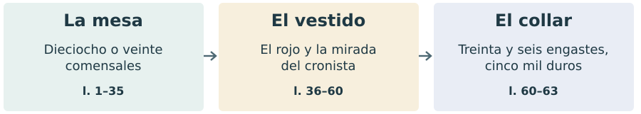

# BEL A/L — Espagnol, commentaire et traduction 2018 · Corrigé guidé

*Corrigé rédigé par IA, non officiel. Signalez toute erreur.*

**Rédaction** · GPT-6.2 Astra Ultra · vitesse non renseignée

**Révision** · GPT-6.2 Astra Ultra · vitesse non renseignée

Benito Pérez Galdós, *Lo prohibido* (1884). Écrit commun de l’ENS de Lyon et de l’ENS (Paris), six heures avec dictionnaire unilingue autorisé.

Le commentaire couvre les lignes 1 à 63. La version va de « Una vez por semana… » à « …qué felices anuncios traen de la sesión gastronómica! » (lignes 1 à 20).

[Sujet officiel, p. 10–11](https://www.ens-lyon.fr/sites/default/files/2018-10/2018%20commentaire%20et%20traduction%20en%20LVE.pdf#page=10) · [Rapport du jury, rubrique commune, p. 1–10](https://www.ens-lyon.fr/sites/default/files/2018-11/Fascicule%20ESPAGNOL_2018.pdf#page=1)

## Préparer la lecture

**Suivre celui qui compte.** Les nombres changent de fonction. Au début, le nombre de femmes renseigne sur le pouvoir de l’hôtesse. Les quatre-vingts pieds de chaise font ensuite entendre ensemble vingt convives. À la fin, les trente-six chatons et les cinq mille duros rendent visible l’implication du narrateur. Le montant indiqué est celui du bijou.

**Attribuer les images.** La correction du lieu, aux lignes 40 à 42, est un test de lecture. Le vêtement rouge a été porté au palais de Gravelinas. Le narrateur compare le regard d’Eloísa à un alcool. Les paradoxes sur le démon et l’ange appartiennent au chroniqueur dont il rapporte les paroles. On peut alors expliquer la jalousie du premier sans confondre sa voix avec celle de l’auteur.

**Traduire le retour du souvenir.** Au premier mouvement, *daba* marque une habitude et *No gustaba mi prima* a pour sujet la cousine. Dans le deuxième, *Paréceme* ramène deux fois la scène au présent. *Hasta el otro día* désigne ici la persistance des impressions du dîner jusqu’au lendemain, lecture que le jury privilégie. La dernière phrase associe deux sujets, l’assaut du repas et la vapeur de la bisque, à la même exclamation. Maintenir les deux coupes déjà imprimées et finir avant le récit de la conversation.

## Commentaire en espagnol

Quien cuenta los jueves de Eloísa en *Lo prohibido* (1884) promete al lector que va a ser breve. Sin embargo, aún no se ha servido la comida cuando ya hemos oído arrastrar ochenta patas de silla. Benito Pérez Galdós confía el relato a un comensal que ama a la anfitriona y que corre con parte de los gastos de su esplendor. ¿Qué revela ese exceso de detalles acerca de quien se proclama dueño de sus recuerdos? A medida que pasa de la mesa al vestido y del vestido al collar, el narrador deja asomar, en la misma descripción que glorifica a Eloísa, su malestar ante el precio y la publicidad de su pasión.

La regularidad de la cita se expresa al principio mediante el imperfecto y cifras que admiten cierta oscilación. En cambio, el pequeño cómputo de las mujeres desciende hasta cero. Esa distribución protege el brillo exclusivo de la anfitriona. El primo atribuye los celos a una aprensión inocente de la propia hermosura, como si una cualidad física pudiera dispensar a su poseedora de responder por sus decisiones. También la etiqueta admite arreglos. La convivencia entre maneras importadas y franqueza nacional se llama «transacción». El narrador se incluye en el orgullo colectivo al tiempo que duda de su fundamento. Bajo la cortesía de sus explicaciones se oye ya una segunda voz, más escéptica.

Cuando se dirige a sus lectores, el narrador reivindica el derecho de escoger los detalles pertinentes. Pero la selección que sigue obedece al deseo. Los ojos, los movimientos y la voz de Eloísa todavía flotan en la misma atmósfera tibia. El presente reiterado de «Paréceme» acerca el salón a quien escribe sin borrar la distancia del recuerdo. Las conjunciones suman personas y cosas como si, al separar un elemento de otro, se perdiera el instante que los reúne. En cuanto los convidados se sientan, los objetos adquieren iniciativa. El primer plato amenaza con apoderarse del organismo de quien iba a consumirlo. La promesa de placer y la imagen del monstruo caben en una sola exclamación. La memoria registra además cuán pronto se marchitan las flores y cómo las sonrisas encubren la gula. Los ojos enlazan a los invitados, las réplicas fragmentan la conversación y las bromas de Raimundo salvan las formas mientras comunican lo indecoroso. La aparente espontaneidad nacional tiene también sus reglas.

El escote devuelve la mirada a Eloísa. El narrador retuerce el sentido de «sencillez» hasta hacer de la escasez de tela una virtud. Al evocar un vestido excepcional corrige el lugar de la escena: ya no estamos en la casa de su prima, sino en el palacio de Gravelinas. La rectificación muestra a la vez la voluntad de exactitud y la fuerza de una imagen que se impone a la sucesión de los jueves. El rojo se extiende desde el terciopelo hasta los zapatos. Del color de la sangre se pasa al fuego de un crisol. Eloísa sale purificada de lo que habría consumido a otra mujer. Que su mirada se vuelva licor capaz de subirse a la cabeza revela de quién es esa visión. También se comprende por qué el enamorado prefiere dejar de lado la promesa, hecha aquella misma mañana, de no estrenar más vestidos.

El cronista de sociedad se apropia a continuación del espectáculo. Sus ocurrencias pasan de la conversación al periódico y de ahí, entre comillas, al relato. Las parejas imposibles de ángel y asesinato, cielo e infierno, venden la originalidad del atuendo. El amante se burla de semejante entusiasmo, aunque él mismo acaba de competir con el fuego mediante metáforas. Su incomodidad estalla en la extraña «carnicería marmórea»: lo que para el periodista es una obra maestra expuesta a todos, para él es carne de la que se pretende dueño. Cuando decide dar su nombre verdadero a la «constelación», sustituye las estrellas por treinta y seis engastes y, finalmente, por cinco mil duros menos en su cuenta. El paréntesis que le obliga a decirlo todo responde a la promesa inicial de escoger. Se había presentado como observador de unos usos sociales. Al cerrar las cuentas se descubre partícipe interesado de los mismos.

## Version française

Une fois par semaine, Eloísa donnait un grand dîner auquel assistaient dix-huit ou vingt personnes. Les dames étaient peu nombreuses, deux ou trois en général, parfois aucune. Ma cousine n’aimait pas que les charmes d’une autre femme fissent de l’ombre aux siens. Crainte bien innocente chez une si belle personne, car il eût été bien difficile de rivaliser avec elle. L’étiquette qui régnait à ce qu’on appelait les jeudis d’Eloísa tenait de l’éclectisme, d’un compromis entre des façons cérémonieuses venues de l’étranger et cette franchise nationale dont nous tirons tant de vanité, à juste titre ou non, je l’ignore. […]

J’ai si bien en tête tous les détails de ces réunions que, si je le voulais, je pourrais les décrire par le menu. Mais pour ne pas ennuyer mes lecteurs avec ce qui ne les intéresse pas, je serai bref. Parmi tout ce qui me revient à l’esprit, je choisirai ce qui fera le mieux comprendre les événements que je raconte. De ces dîners, j’ai gardé un souvenir d’une étonnante fraîcheur. Il me semble respirer cet air tiède où flottaient les regards de la femme aimée, ses mouvements et le timbre de sa voix séduisante. Ces impressions se prolongeaient en moi jusqu’au lendemain comme la douce sensation d’un songe heureux. Je crois revoir les murs et les gens et le tapis et les lumières dans ce moment d’impatience et d’attente où l’heure est venue et où il manque encore quatre ou cinq convives. […]

Je crois entendre le remue-ménage des quatre-vingts pieds de chaise qui raclent légèrement le tapis gris perle et voir les domestiques enfiler leurs gants à la hâte tandis que nous défilons et prenons place. Cette première charge du repas, qui s’approche comme un monstre venu prendre possession de notre organisme, cette vapeur qui monte de la bisque, relevée comme tous les diables, quel heureux prélude aux plaisirs de la table !
