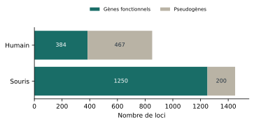
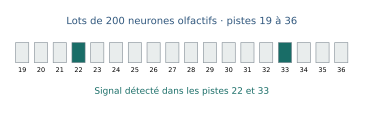
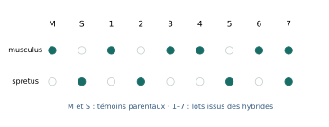
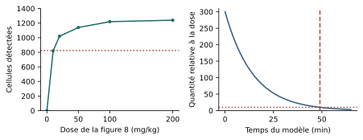
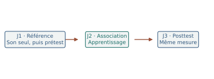
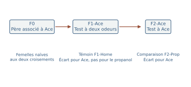
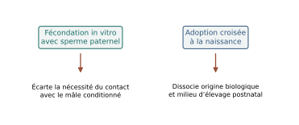

# ENS de Lyon — Second concours, Biologie-biochimie 2018 · Corrigé brut

*Corrigé rédigé par IA, non officiel.*

**Rédaction** · GPT-6.2 Astra Ultra · vitesse non renseignée

**Couverture.** Les 35 questions sont traitées à partir des treize figures du sujet. Les fréquences, seuils et amplitudes lus sur les graphiques sont donnés avec leur précision graphique. Les hypothèses sur les descendants sont distinguées des mesures effectuées.

## I. Répertoire des récepteurs olfactifs

### Question 1 — Distribution sur les chromosomes

Les gènes de récepteurs olfactifs (RO) sont répartis sur de nombreux chromosomes, avec une densité très inégale. Ils se trouvent souvent en groupes, par exemple sur le chromosome 11, et d’autres régions en portent très peu. Dans plusieurs zones, les pics de gènes fonctionnels coïncident avec des pics de pseudogènes. Ce regroupement local, associé à la dispersion des groupes dans le génome, est compatible avec une histoire de duplications.

### Question 2 — Origine des pseudogènes

Un gène de récepteur peut être dupliqué, puis une des copies accumuler des mutations rendant le produit non fonctionnel, par exemple un codon stop prématuré ou un décalage du cadre. La copie conserve une séquence ressemblant à celle des récepteurs actifs. Une perte de fonction d’un gène ancestral est aussi possible. La carte suggère cette histoire sans dater ni attribuer individuellement chaque pseudogène.

### Question 3 — Comparaison entre espèces

Avec les effectifs du sujet, les pseudogènes représentent $467/(384+467)\simeq55\,\%$ du répertoire humain et $200/(1250+200)\simeq14\,\%$ du répertoire murin. Duplications, pertes de gènes et pseudogénisations ont pu se produire à des rythmes différents après la séparation des lignées. Un récepteur utile dans une niche peut demeurer sous sélection purificatrice, tandis qu’une contrainte relâchée permet l’accumulation de mutations. Les effectifs ne suffisent pas à désigner un événement ancestral, à prouver que chaque différence est adaptative ou à classer globalement les capacités olfactives des deux espèces.

## Expression tissulaire et unicellulaire

### Question 4 — Détection par une sonde

Deux brins nucléiques complémentaires s’apparient de façon antiparallèle par des liaisons hydrogène entre bases compatibles. Une sonde marquée, complémentaire d’une portion du transcrit, peut donc s’hybrider au tissu là où cet ARN est présent. La spécificité dépend aussi de la séquence choisie et des conditions d’hybridation, point important dans une famille de gènes proches.

### Question 5 — Intérêt du relief des cornets

Les replis augmentent la surface d’épithélium exposée à l’air pour un encombrement donné. Ils peuvent aussi orienter les courants d’air et multiplier les contacts entre molécules odorantes et mucus à proximité des cils récepteurs. Cela favorise la capture d’odorants sans exiger un renouvellement identique de l’air dans toutes les régions.

### Question 6 — Localisation du signal I7

À faible grossissement, les points sombres sont disséminés dans une région de la surface du cornet. En coupe, le bleu foncé marque quelques cellules individuelles dans l’épithélium, compatibles par leur position avec les corps cellulaires de neurones récepteurs olfactifs. La flèche noire de la légende indique la lame basale, qui sert de repère. La sonde situe l’ARNm, et non la distribution de la protéine à la surface des cils.

### Question 7 — Hétérogénéité entre cellules

L’ARNm de I7 est présent dans une petite sous-population de neurones disséminés parmi de nombreuses cellules sans signal détectable. Le tissu présente donc une expression sélective et discontinue de ce gène. Une seule sonde ne permet pas encore d’établir combien de récepteurs différents produit chacune de ces cellules.

### Question 8 — Témoins négatifs

On peut utiliser un témoin de PCR sans matrice, un témoin d’extraction sans cellules et un contrôle où la transcriptase inverse a été omise. Une bande dans le premier suggérerait une contamination des réactifs, et une bande sans transcription inverse ferait suspecter un ADN résiduel. Les pistes négatives 1, 17 et 18 sont effectivement sans bande I7. La légende ne dit pas lequel de ces témoins correspond à chacune des trois pistes. Les pistes M étalonnent la taille des fragments.

### Question 9 — Estimer la rareté des neurones I7

Dans les grands lots le signal est fréquent. Parmi les 18 lots de 200 neurones, seules les pistes 22 et 33 ont une bande nette. En première approximation, si chacune provient d’une cellule positive, on compte $2/(18\times200)\simeq5{,}6\times10^{-4}$ des neurones, environ un sur 1800. Plus précisément, avec prélèvement aléatoire indépendant et détection fiable, la fraction négative estime $(1-p)^{200}=16/18$, d’où $p\simeq5{,}9\times10^{-4}$, soit un sur 1700. Avec deux lots positifs seulement, il s’agit d’un ordre de grandeur. L’approche complète l’observation histologique en quantifiant approximativement la rareté du transcrit.

### Question 10 — Répertoire d’un neurone unique

Les 18 cellules présentent chacune un signal très majoritaire pour un gène de RO parmi les quelque 1250 analysés. Le gène dominant varie d’une cellule à l’autre. L’échelle logarithmique distingue ces pics des faibles signaux de fond. Ces observations appuient un modèle de **choix d’un récepteur dominant par neurone mature**. Elles n’établissent pas une absence absolue de tout transcrit minoritaire, ni l’origine allélique du signal, étudiée ensuite.

## Choix de l’allèle exprimé

### Question 11 — Nature des sondes alléliques

Ce sont des acides nucléiques marqués, typiquement des oligonucléotides d’ADN simple brin complémentaires d’un segment de I7 présentant une différence entre espèces. Un ARN complémentaire pourrait aussi servir. Les témoins parentaux établissent que chaque sonde discrimine les deux produits dans les conditions de la figure.

### Question 12 — Rôle de l’hybride

Chaque cellule somatique de l’hybride possède une copie de I7 provenant de chaque espèce parentale. Les différences de séquence permettent de distinguer les deux ARNm alors que les allèles se trouvent dans le même contexte cellulaire. Les parents purs contrôlent la spécificité des sondes et indiquent dans quel sens attribuer leurs signaux.

### Question 13 — Attribution des dépôts

Les lots 1, 3, 4 et 6 sont reconnus par la sonde *musculus*. Les lots 2 et 5 le sont par la sonde *spretus*. Le lot 7 répond aux deux. Un dépôt réunit les produits d’un **lot de 200 neurones**. Il peut donc contenir un neurone I7 exprimant l’allèle *musculus* et un autre exprimant l’allèle *spretus*. Ce double signal ne démontre pas qu’une même cellule exprime les deux allèles. Les témoins M et S présentent le signal attendu sur une seule ligne.

### Question 14 — Exclusion allélique

En tenant compte de la rareté des neurones I7, les lots positifs contiennent souvent une seule cellule exprimant ce gène. Le signal se rattache alors généralement à un seul allèle, avec possibilité des deux origines dans des lots distincts. Cela soutient une **expression monoallélique**, ou exclusion allélique, dans les cellules considérées, en plus du choix d’un gène de RO parmi la famille. Une analyse allélique directement unicellulaire renforcerait la conclusion.

## Marquage des cellules en prolifération

### Question 15 — Marquage de l’ADN en synthèse

L’EdU est un analogue de la thymidine, le groupe éthynyle remplaçant le méthyle en position 5 de la base. Son sucre est un désoxyribose. Après phosphorylation cellulaire, l’analogue peut être incorporé par une ADN polymérase dans l’ADN néosynthétisé à une position normalement occupée par la thymidine. La fonction éthynyle permet de révéler les cellules qui synthétisaient de l’ADN pendant la fenêtre de présence du marqueur.

### Question 16 — Dilution du signal

En l’absence de nouvel EdU, aucune nouvelle marque n’est ajoutée mais les brins anciens subsistent. En moyenne sur les descendantes, la quantité marquée par cellule est divisée approximativement par deux à chaque division, puis par quatre après deux divisions. La distribution peut être hétérogène entre cellules et entre chromatides. Le signal total de toute la descendance se conserve idéalement en l’absence de pertes.

### Question 17 — Saturation du dénombrement

Les premières doses augmentent fortement le nombre de cellules détectées, puis la courbe tend vers un plateau de l’ordre de 1200 à 1250. Dans les conditions de l’observation, presque toutes les cellules accessibles qui synthétisent de l’ADN pendant la fenêtre étudiée sont alors détectées. Une dose plus importante peut accroître le marquage d’une cellule déjà comptée sans changer l’effectif. Le plateau ne signifie pas que toutes les cellules du tissu sont en division.

### Question 18 — Durée de la fenêtre de marquage

Les deux tiers du plateau correspondent à environ 800–830 cellules positives. La figure situe le seuil près de 10 mg/kg en équivalent de dose. Si la quantité disponible décroît comme $D(t)=300\,2^{-t/10}$ pour $t$ en minutes et que le seuil graphique est applicable à cette quantité, $t=10\log_2(300/10)\simeq49$ minutes. Après cinq demi-vies il reste $300/32\simeq9{,}4$, juste sous le seuil. L’estimation est donc **environ cinquante minutes**, une valeur de modèle avec une lecture graphique approximative.

## Renouvellement de l’épithélium

### Question 19 — Prolifération selon l’âge

À deux jours, le panneau A montre de nombreuses cellules EdU positives et une couche basale riche en cellules Lgr5 positives. Certaines sont doublement positives. À trois mois, le panneau B montre beaucoup moins de cellules marquées en rouge ou en vert, et quelques cellules basales en division persistent. La prolifération et la proportion apparente des cellules basales Lgr5 positives sont plus importantes dans l’épithélium en croissance. Un champ représentatif ne donne pas une mesure statistique de toute la muqueuse.

### Question 20 — Suivi différé du marquage

Dans C, les cellules Lgr5 positives restent essentiellement près de la base. Dans C′ et C″, on observe des cellules EdU positives plus haut dans l’épithélium, souvent sans Lgr5 détectable. Le marquage ancien a donc été conservé par des cellules qui ont quitté la zone basale, compatible avec la progression et la différenciation de descendantes de précurseurs. Quelques signaux persistent près de la base. Une image à un instant fixe ne filme pas directement la migration d’une cellule individuelle.

### Question 21 — Identité des cellules basales

Les cellules basales Lgr5 positives constituent des candidates au rôle de progénitrices de l’épithélium olfactif. Certaines incorporent l’EdU et donc prolifèrent. Le suivi est compatible avec la production de cellules différenciées tandis qu’une population reste à la base. Pour démontrer sans ambiguïté le statut de cellule souche, il faudrait établir sur la durée l’auto-renouvellement et la production de descendantes différenciées, par exemple au moyen d’un suivi de lignées.

### Question 22 — Durée de vie des neurones

Un signal stable dans les NRO suivis suggère qu’après leur différenciation ils se divisent peu ou pas, car des divisions successives dilueraient le traceur. La disparition après plusieurs mois indique une durée de vie limitée du contingent marqué et un renouvellement à partir de précurseurs. Cela ne fixe pas la même durée de vie pour chaque neurone.

## II. Réponse acquise à un odorant

### Question 23 — Chronologie des comparaisons

**Jour 1.** Mesure du sursaut au son seul, servant de référence. Un prétest mesure ensuite le sursaut au même son en présence de l’odeur, avant apprentissage. **Jour 2.** Association de l’odeur à l’événement aversif dans le groupe étudié. **Jour 3.** Le posttest reprend la comparaison odeur–son du prétest sans renouveler l’association. On exprime la variation de la réponse par rapport à la référence. La frise situe ainsi la seule phase d’apprentissage entre deux mesures comparables.

### Question 24 — Apprentissage associatif

Le score moyen passe d’environ 10–15 % au prétest à environ 75 % au posttest, et l’astérisque indique une différence significative. L’odeur, devenue signal prédictif d’un événement aversif, augmente la réponse de sursaut au bruit. Il s’agit d’un conditionnement associatif de type pavlovien. Le pourcentage porte sur l’amplitude de la réponse du groupe, et non sur la proportion d’animaux qui auraient appris.

## Comparaisons des descendants

### Question 25 — Effet observé en F1

Dans la figure 11a le score vis-à-vis de l’acétophénone est en moyenne supérieur chez les descendants F1-Ace, avec une dispersion et un chevauchement entre groupes. La différence indiquée est significative. Les descendants n’ont pas vécu l’association de la génération parentale. Le résultat suggère une transmission intergénérationnelle d’une sensibilité ou d’une modulation de réponse liée à l’odeur. Une modification de l’état des gamètes, un effet parental ou une différence dans l’environnement des jeunes sont des hypothèses à départager. L’acquisition par le descendant d’un souvenir détaillé de l’expérience parentale ne découle pas du graphique. Les comparaisons suivent le signe représenté sur la figure, la phrase du sujet décrivant la soustraction dans l’autre sens.

### Question 26 — Contrôle avec un autre odorant

Avec le propanol, les groupes F1-Home et F1-Ace présentent des scores proches et aucune différence significative n’est signalée. Ce contrôle rend moins probable une augmentation générale du sursaut de tous les descendants F1-Ace quel que soit l’odorant. Il soutient une composante spécifique de l’odeur parentale. Il ne démontre pas une identité absolue des réponses au propanol.

### Question 27 — Persistance en F2

Au test à l’acétophénone, les F2-Ace présentent un score moyen supérieur aux F2-Prop. La différence significative existe donc encore en deuxième génération, avec comme comparateur une lignée dont les grands-pères ont été associés à un autre odorant. Dans la lignée paternelle étudiée, cette persistance après deux croisements avec des femelles naïves appuie un effet transgénérationnel. Le résultat ne précise ni le support moléculaire ni la durée au-delà de F2.

## Contrôles de transmission

### Question 28 — Ce que distingue la fécondation in vitro

Quand la descendance issue du sperme F0-Ace et d’ovocytes de femelles naïves présente le même décalage, une information associée au gamète paternel devient une explication plausible. L’accouplement direct et le comportement paternel envers la mère ou les jeunes ne sont pas nécessaires pour obtenir le résultat. Cette expérience ne suffit pas à identifier une marque de méthylation, un ARN ou une modification précise de séquence.

### Question 29 — Hypothèse testable sur le gamète

Je demanderais si une différence reproductible de marquage épigénétique près du gène du récepteur est associée à la lignée. On pourrait comparer à l’aveugle des échantillons de spermatozoïdes déjà disponibles de pères Ace et témoins, en contrôlant la séquence, l’âge et le lot, puis comparer le signal à des régions témoins et au phénotype moyen des portées. Une association propre à la région et reproductible entre pères renforcerait l’hypothèse. Des résultats négatifs orienteraient notamment vers d’autres marques ou d’autres régions. Une corrélation seule ne démontrerait pas que la marque cause la réponse.

### Question 30 — Lignée maternelle

L’effet se retrouve lorsque la mère a connu l’association et que le père est naïf. Le phénomène observé en F1 ne se limite donc pas à la transmission par le père. Dans ce croisement, ovocyte, environnement de gestation et soins maternels varient potentiellement ensemble. On ne peut en déduire d’emblée que les voies paternelle et maternelle partagent un support moléculaire identique.

### Question 31 — Adoption croisée

Lorsque les petits sont adoptés à la naissance par une mère de l’autre condition, l’écart suit encore l’origine biologique. Les soins et apprentissages transmis après la naissance par la mère d’élevage ne suffisent donc pas à expliquer la différence. L’adoption est un contrôle distinct de la fécondation in vitro paternelle. Elle agit sur le milieu postnatal, tout en laissant associés l’ovocyte et la gestation de la mère biologique.

## Organisation de la voie sensorielle

### Question 32 — Rapporteur des neurones exprimant le récepteur

Le rapporteur offre un produit coloré détectable dans le corps cellulaire et les prolongements des neurones concernés. Pour rendre sa production spécifique, on peut placer le gène de la β-galactosidase sous le contrôle des mêmes éléments régulateurs que le récepteur, idéalement au sein d’une unité de transcription assurant leur coexpression tout en préservant le récepteur. On contrôlerait sur des coupes que le signal du rapporteur coïncide avec celui du transcrit du récepteur et que les tissus témoins sont négatifs. Un promoteur neuronal général marquerait beaucoup plus de cellules.

### Question 33 — Organisation des projections

Les corps cellulaires sont répartis dans l’épithélium. Leurs prolongements marqués s’assemblent en faisceaux orientés vers une région commune. Cette organisation suggère une convergence des axones des neurones qui expriment un même récepteur vers une cible glomérulaire du bulbe olfactif. La vue en transparence suggère le trajet collectif, sans identifier à elle seule toutes les connexions synaptiques.

### Question 34 — Différence entre descendant témoin et descendant Ace

Le panneau F1-Ace, en bas, présente un marquage plus dense et plus étendu que le panneau F1-Home, au niveau des corps cellulaires et de leurs prolongements. Cela suggère une représentation accrue de ce récepteur dans la voie olfactive et constitue un corrélat anatomique du résultat de comportement. Davantage de neurones, des projections différentes ou une expression plus forte du rapporteur peuvent contribuer à l’image. Il faudrait un comptage normalisé et des mesures par cellule pour les séparer.

### Question 35 — Distinguer sensibilité et anticipation

Je chercherais à savoir si les descendants détectent de plus faibles concentrations d’acétophénone, indépendamment du sursaut. Un test comportemental neutre de discrimination odeur contre air, coté en aveugle pour plusieurs concentrations et un odorant témoin, fournirait courbes de détection et seuils pour plusieurs portées des deux lignées. Un seuil spécifiquement abaissé pour l’acétophénone appuierait une différence sensorielle. Des seuils comparables malgré la différence de sursaut orienteraient vers une modulation de l’attention ou de l’anticipation. Les portées doivent être distinguées des individus dans l’analyse pour éviter de compter des apparentés comme des répétitions indépendantes.
