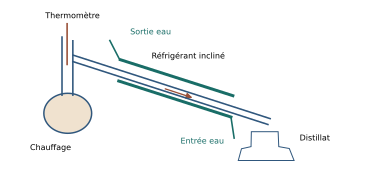
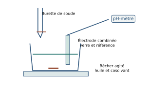
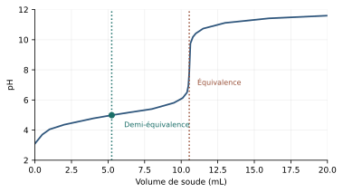
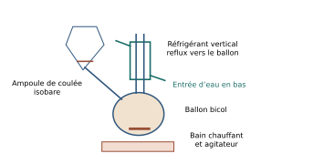
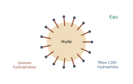
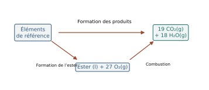
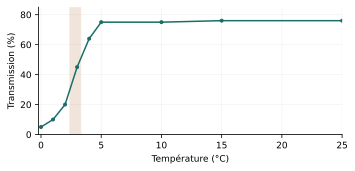
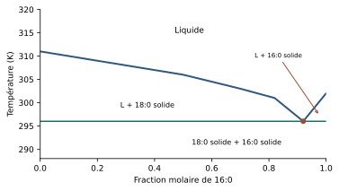
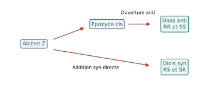

# ENS de Lyon — Second concours, Chimie 2018 · Corrigé guidé

*Corrigé rédigé par IA, non officiel.*

**Rédaction** · GPT-6.2 Astra Ultra · vitesse non renseignée

**Couverture.** Les 66 questions sont traitées. Les valeurs de titrage et de points de trouble sont lues sur les figures originales. La différence de pH initial selon le volume retenu et les conventions des corrections calorimétriques sont explicitées.

## A.I. Préparation de l’huile

### Question 1 — Hydrolyse des triglycérides

> [!INDICATION]
> Suivre les trois liaisons ester jusqu’à la limite d’une hydrolyse complète.

#### Solution

Un triacylglycérol et trois molécules d’eau peuvent donner une molécule de glycérol et trois acides gras $\mathrm{R_iCOOH}$. Ce bilan correspond à la rupture des trois esters. Une hydrolyse partielle donne également des mono- et diacylglycérols. Chaque rupture libère une fonction acide carboxylique et reforme une fonction alcool sur le squelette glycérol.

### Question 2 — Estérification des acides libres

> [!INDICATION]
> Distinguer l’accélération de la réaction de l’augmentation de sa conversion à l’équilibre.

#### Solution

On fait réagir les acides gras avec du méthanol en excès en présence d’un catalyseur acide tel que l’acide para-toluènesulfonique. Le chauffage à reflux permet de travailler près de la température d’ébullition du mélange en limitant les pertes de méthanol. Température et catalyse accélèrent la réaction. L’excès d’alcool et, si elle est réalisable, l’élimination de l’eau produite déplacent l’équilibre vers l’ester.

### Question 3 — Mécanisme de Fischer

> [!INDICATION]
> Conserver la liaison entre la chaîne grasse R et le carbone carbonylé.

#### Solution

Le carbonyle de $\mathrm{RCOOH}$ est protoné sur l’oxygène. Le méthanol attaque le carbone électrophile et donne un intermédiaire tétraédrique. Les transferts de protons rendent l’un des hydroxyles partant sous forme d’eau. La reformation du carbonyle expulse cette eau, puis la déprotonation donne $\mathrm{RCOOCH_3}$ et régénère la catalyse acide. Le bilan est $\mathrm{RCOOH+CH_3OH\rightleftharpoons RCOOCH_3+H_2O}$.

### Question 4 — Rôle de l’excès d’alcool

> [!INDICATION]
> Écrire le quotient de l’équilibre de la question 3.

#### Solution

Le méthanol figure au dénominateur du quotient de réaction. En accroissant son activité on diminue le quotient, ce qui favorise le sens de formation de l’ester jusqu’au rétablissement de l’équilibre. La constante à température donnée reste inchangée.

### Question 5 — Lavage au glycérol

> [!INDICATION]
> Comparer le nombre d’hydroxyles et les miscibilités de l’annexe.

#### Solution

Le glycérol possède trois OH. Il se mélange à l’eau, au méthanol et aux espèces polaires ou au catalyseur acide indiqués dans l’annexe. Il forme une autre phase que l’huile et le biodiésel. Un lavage récupère donc dans la phase polaire de l’eau, du catalyseur et une partie de l’alcool résiduel, tandis que les composés gras restent majoritairement dans la phase organique.

### Question 6 — Élimination du méthanol

> [!INDICATION]
> Comparer les températures d’ébullition à pression voisine.

#### Solution

On peut éliminer le méthanol par distillation. Il bout vers 64,7 °C à pression atmosphérique alors que les constituants de l’huile et le biodiésel sont bien moins volatils, avec des températures d’ébullition indiquées supérieures à 200 °C. Les vapeurs enrichies en méthanol sont condensées et recueillies à part. À petite échelle, une évaporation sous pression réduite est également envisageable.

### Question 7 — Montage de distillation

> [!INDICATION]
> Distinguer trajet du distillat et trajet de l’eau de refroidissement.

#### Solution

Le ballon contenant le mélange est chauffé sous agitation. La tête de distillation porte un thermomètre dont le réservoir est à hauteur du départ latéral. Les vapeurs gagnent le réfrigérant descendant et le condensat tombe dans le récipient collecteur. L’eau de refroidissement entre par la tubulure la plus basse du réfrigérant et sort par la plus haute. Le montage communiqué à l’atmosphère maintient la pression de travail prévue. Le dessin identifie les deux circuits.

## Transestérification

### Question 8 — Transestérification

> [!INDICATION]
> Compter trois fonctions ester dans chaque triglycéride.

#### Solution

Un triacylglycérol réagit avec trois méthanols pour donner du glycérol et trois esters méthyliques $\mathrm{R_iCOOCH_3}$. Il s’agit d’une transestérification, plus précisément d’une méthanolyse. Les trois chaînes acyles se retrouvent chacune dans une molécule d’ester méthylique.

### Question 9 — Catalyse basique de la méthanolyse

> [!INDICATION]
> Tracer l’attaque au carbone du carbonyle et non sur la chaîne aliphatique.

#### Solution

La base établit une concentration de méthanolate dans le méthanol. $\mathrm{CH_3O^-}$ attaque le carbonyle d’un ester du triglycéride. L’intermédiaire tétraédrique se referme en expulsant un alcoolate du squelette glycérol. Sa protonation par le méthanol régénère du méthanolate. Les deux autres fonctions ester réagissent de même en passant par des di- puis monoacylglycérols. La soude sert de précurseur de la catalyse basique et peut être consommée par des acides gras libres.

### Question 10 — Équivalents par ester

> [!INDICATION]
> Ramener les quantités ajoutées à trois fois le nombre de moles de triglycéride.

#### Solution

Un litre d’huile pèse environ 920 g, soit $920/884=1{,}04$ mol de triglycéride et 3,12 mol de fonctions ester. Les 3,5 g de soude correspondent à $3{,}5/40=0{,}0875$ mol, soit $0{,}028$ équivalent par ester. Les six équivalents de méthanol par triglycéride donnent **deux équivalents de méthanol par ester**. Le méthanol est en excès, la base en quantité catalytique.

### Question 11 — Acides libres et savons

> [!INDICATION]
> Comparer une neutralisation acido-basique et une transestérification.

#### Solution

Un acide gras libre consomme un équivalent de base, $\mathrm{RCOOH+OH^-\rightarrow RCOO^-+H_2O}$. Le carboxylate de sodium est un savon. La quantité de catalyseur disponible diminue et la présence de savon favorise des émulsions qui compliquent la séparation des produits.

## A.II. Titrage des fonctions acides

### Question 12 — Titrage pH-métrique

> [!INDICATION]
> Identifier l’élément sensible au pH et celui dont le potentiel reste stable.

#### Solution

La burette graduée contient la solution de soude étalonnée et verse dans le bécher d’huile diluée, agité au barreau magnétique. Une électrode de verre sensible à l’activité des protons est associée à une électrode de référence, par exemple Ag/AgCl à électrolyte interne. Une électrode combinée réunit les deux. Le pH-mètre étalonné mesure la différence de potentiel. Le schéma distingue électrode, burette et agitation.

### Question 13 — Cosolvant du titrage

> [!INDICATION]
> Une réaction de dosage doit atteindre les acides contenus dans l’huile.

#### Solution

L’isopropanol est miscible à l’eau et solubilise mieux les composés organiques à longue chaîne. Il rend le prélèvement et le titrant suffisamment homogènes pour que l’acide gras réagisse avec les ions hydroxyde. Le sujet autorise ensuite l’approximation numérique d’une phase aqueuse idéale.

### Question 14 — Trois courbes pour deux axes

> [!INDICATION]
> Repérer le départ de chaque courbe et l’ordonnée qu’il faut lire.

#### Solution

La courbe 1 décroissante représente le pourcentage d’acide oléique $\mathrm{HA}$, la courbe 2 croissante vers 100 % représente le pourcentage d’oléate $\mathrm{A^-}$, tous deux à lire sur l’échelle de droite. La courbe 3 avec saut près de l’équivalence est le pH lu sur l’échelle de gauche.

### Question 15 — Lecture du pKa

> [!INDICATION]
> Au croisement des pourcentages, lire le pH sur la troisième courbe au même volume.

#### Solution

Quand $[\mathrm{A^-}]=[\mathrm{HA}]$, la relation de Henderson–Hasselbalch donne $\mathrm{pH}=pK_a$. Le croisement se trouve vers 5,2–5,3 mL. En reportant ce volume sur la courbe 3, on lit un pH voisin de 5,0, cohérent avec un acide carboxylique faible. La même estimation s’obtient vers la demi-équivalence. La valeur verticale du croisement des deux pourcentages est 50 % et ne constitue pas elle-même le pKa.

### Question 16 — Équation de dosage

> [!INDICATION]
> Combiner dissociation de l’acide et neutralisation de l’oxonium.

#### Solution

$\mathrm{HA+OH^-\rightarrow A^-+H_2O}$. La constante vaut $K^\circ=K_a/K_e=10^{14-pK_a}\simeq10^9$ pour $pK_a\simeq5$. La réaction est donc largement déplacée vers les produits, de stœchiométrie 1:1 et adaptée au titrage.

### Question 17 — Volume équivalent

> [!INDICATION]
> Chercher le milieu du saut de pH ou le maximum de sa dérivée.

#### Solution

Le plus fort changement de pente se situe vers $V_E=10{,}5$ à $10{,}6$ mL. On peut tracer deux tangentes parallèles de part et d’autre du saut, tracer la droite parallèle équidistante, puis projeter sur l’axe des volumes son intersection avec la courbe. L’incertitude de lecture justifie d’utiliser 10,5 mL pour la suite.

### Question 18 — Acidité de l’huile avant dilution

> [!INDICATION]
> La quantité d’acide titrée est celle de l’aliquote de 2,0 mL.

#### Solution

À l’équivalence $n(\mathrm{HA})=c_bV_E\simeq0{,}010\times0{,}0105=1{,}05\times10^{-4}\ \mathrm{mol}$. Avant dilution, $c_{\rm huile}=n/0{,}0020\simeq5{,}25\times10^{-2}\ \mathrm{mol\,L^{-1}}$. Les 30 mL de cosolvant n’ont pas changé le nombre de fonctions acides.

### Question 19 — Dissociation initiale

> [!INDICATION]
> Considérer l’équilibre avant l’ajout de base forte.

#### Solution

Même sans soude, une fraction de $\mathrm{HA}$ cède un proton à l’eau, $\mathrm{HA+H_2O\rightleftharpoons A^-+H_3O^+}$. Une partie de la matière est déjà sous forme d’oléate, d’où un pourcentage initial de HA inférieur à 100 %.

### Question 20 — pH initial et volume de dilution

> [!INDICATION]
> Préciser quelle concentration entre dans l’équation de dissociation.

#### Solution

Dans le bécher décrit, $C=1{,}05\times10^{-4}/0{,}0320=3{,}28\times10^{-3}\ \mathrm{mol\,L^{-1}}$. Avec $pK_a\simeq5$ et l’approximation aqueuse du sujet, on pose $h=[\mathrm{H_3O^+}]\simeq[\mathrm{A^-}]$, puis $K_a\simeq h^2/(C-h)$ avec les concentrations numériques en mol/L. La racine positive donne $h\simeq1{,}76\times10^{-4}$, soit **pH ≈ 3,75 et 95 % d’acide HA**. Sur le tracé initial, le pH est plus proche de 3,1 et la fraction acide avoisine 98–99 %. Ces dernières valeurs s’obtiennent si l’on prend $C\simeq0{,}0525$ mol/L, concentration dans l’huile avant l’ajout des 30 mL, ce qui donne $\mathrm{pH}\simeq3{,}14$ et 98,6 % de HA. La différence ne se résout pas par la seule précision de lecture. Le volume retenu doit donc accompagner le résultat.

### Question 21 — Soude ajoutée pour l’huile non prétraitée

> [!INDICATION]
> Additionner consommation par les acides et charge catalytique prévue.

#### Solution

Un litre d’huile contient environ 0,0525 mol de fonctions acides, qui consomment $0{,}0525\times40\simeq2{,}1$ g de NaOH. Pour conserver les 3,5 g de soude prévus pour la transestérification, la quantité totale est environ **5,6 g par litre**. Cette correction compense la neutralisation des acides libres et crée parallèlement des savons.

## Obtention du biocarburant

### Question 22 — Montage de réaction

> [!INDICATION]
> Distinguer le réfrigérant vertical, qui renvoie les condensats, du réfrigérant de distillation.

#### Solution

Le ballon bicol est maintenu dans un bain chauffant sous agitation magnétique. Sur le premier col, l’ampoule de coulée munie d’une voie d’égalisation de pression ajoute la solution. Le second col porte le réfrigérant vertical. Les vapeurs y condensent et retournent dans le ballon, l’eau de refroidissement entrant en bas de la jaquette. Le haut du réfrigérant communique avec l’atmosphère. Le dessin montre le trajet de la matière et l’agitation.

### Question 23 — Deux phases en fin de synthèse

> [!INDICATION]
> Répartir les espèces par polarité puis contrôler avec les masses volumiques.

#### Solution

La phase supérieure organique contient surtout les esters méthyliques, avec éventuellement de l’huile résiduelle et un peu de méthanol. La phase inférieure, plus dense et polaire, est riche en glycérol et contient notamment du méthanol, de l’eau, de la base et des sels. Les savons se trouvent en partie à l’interface. La répartition du méthanol entre les deux phases dépend de leur composition.

### Question 24 — Émulsions et application

> [!INDICATION]
> Orienter les deux parties d’une molécule amphiphile à une interface.

#### Solution

Les carboxylates formés présentent une longue queue hydrophobe et une tête carboxylate hydrophile. Placés à l’interface huile–eau, ils réduisent l’énergie interfaciale et stabilisent de petites gouttelettes, ralentissant la décantation. C’est aussi le principe du lavage d’une tache grasse au savon. Les queues se placent du côté de la graisse et les têtes vers l’eau, permettant d’emporter la graisse dispersée au rinçage.

### Question 25 — Rendement isolé

> [!INDICATION]
> Calculer la masse théorique de trois esters par molécule de trioléine.

#### Solution

Les 60 mL d’huile pèsent $60\times0{,}92=55{,}2$ g. Avec l’hypothèse de trioléine pure, cela représente $55{,}2/884=0{,}0624$ mol, pouvant fournir $3\times0{,}0624\times296=55{,}4$ g d’oléate de méthyle. Le rendement isolé est $45{,}2/55{,}4\simeq81{,}5\,\%$. Les pertes de conversion, de séparation et de purification ne sont pas distinguées par cette seule mesure.

## B.I. Thermochimie de combustion

### Question 26 — Combustion complète

> [!INDICATION]
> Compter les carbones et les hydrogènes avant de fixer le coefficient du dioxygène.

#### Solution

L’oléate de méthyle a pour formule $\mathrm{C_{19}H_{36}O_2}$. Pour une mole, la combustion complète avec eau vapeur est $\mathrm{C_{19}H_{36}O_2(l)+27\,O_2(g)\rightarrow19\,CO_2(g)+18\,H_2O(g)}$. On retrouve 56 atomes d’oxygène de chaque côté.

### Question 27 — États standards de référence

> [!INDICATION]
> Prendre les corps simples de référence à 298 K et à la pression standard.

#### Solution

Le carbone est le graphite solide. L’oxygène est $\mathrm{O_2(g)}$, l’azote $\mathrm{N_2(g)}$ et l’hydrogène $\mathrm{H_2(g)}$. Les corps simples de référence ont par convention une enthalpie standard de formation nulle dans ces conditions.

### Question 28 — Formation standard

> [!INDICATION]
> Former exactement une mole de composé à partir des éléments de référence.

#### Solution

$\mathrm{H_2(g)+\tfrac12 O_2(g)\rightarrow H_2O(l)}$ est associée à $\Delta_fH^\circ(\mathrm{H_2O(l)})$. L’équation $\mathrm{C(graphite)+O_2(g)\rightarrow CO_2(g)}$ donne $\Delta_fH^\circ(\mathrm{CO_2(g)})$.

### Question 29 — Former l’ester liquide par un chemin atomique

> [!INDICATION]
> Le groupe méthoxy est rattaché par O, et la double C=O ne compte pas parmi les C=C.

#### Solution

Le passage des éléments à des atomes gazeux coûte $19L_{\rm sub,C}+18D_{\rm H-H}+D_{\rm O=O}$. L’ester gazeux de formule $\mathrm{C_{19}H_{36}O_2}$ possède 36 liaisons C–H, 16 C–C simples, une C=C, une C=O et deux C–O simples. Les former libère la somme $S=36D_{\rm C-H}+16D_{\rm C-C}+D_{\rm C=C}+D_{\rm C=O}+2D_{\rm C-O}$. La condensation libère ensuite $L_{\rm vap,18:1}$. Ainsi $\Delta_fH^\circ_{18:1,l}=19L_{\rm sub,C}+18D_{\rm H-H}+D_{\rm O=O}-S-L_{\rm vap,18:1}$.

### Question 30 — Cycle de Hess

> [!INDICATION]
> Rejoindre les mêmes produits à partir des mêmes éléments par deux chemins.

#### Solution

Le premier chemin forme l’oléate de méthyle liquide à partir des éléments, puis le brûle en présence de 27 dioxygènes. Le second forme directement 19 dioxyde de carbone et 18 eaux gazeuses à partir des éléments. Par indépendance du chemin, $\Delta_cH^\circ_{18:1,l}=19\Delta_fH^\circ_{\rm CO_2,g}+18\Delta_fH^\circ_{\rm H_2O,g}-\Delta_fH^\circ_{18:1,l}$. Utiliser la valeur de l’eau gazeuse ou $\Delta_fH^\circ_{\rm H_2O,l}+L_{\rm vap,H_2O}$ assure le même choix de phase.

### Question 31 — Expression développée de la combustion

> [!INDICATION]
> Introduire le résultat de la question 29 avec le signe moins.

#### Solution

En notant $S$ la somme des énergies de liaison définie en Q29, $\Delta_cH^\circ=19\Delta_fH^\circ_{\rm CO_2,g}+18\Delta_fH^\circ_{\rm H_2O,g}-19L_{\rm sub,C}-18D_{\rm H-H}-D_{\rm O=O}+S+L_{\rm vap,18:1}$. Le terme de vaporisation apparaît avec un signe positif parce que l’ester initial est liquide dans la combustion considérée.

### Question 32 — Application à l’oléate de méthyle

> [!INDICATION]
> Commencer par vérifier l’enthalpie de formation de l’ester.

#### Solution

Avec les énergies moyennes du tableau, la Q29 donne $\Delta_fH^\circ\simeq-593{,}2\ \mathrm{kJ\,mol^{-1}}$. La combustion vaut $19(-393{,}5)+18(-241{,}8)-(-593{,}2)=-11235{,}7\ \mathrm{kJ\,mol^{-1}}$. Elle est fortement exothermique, environ 38 MJ/kg. La précision physique est plus faible que celle des décimales calculées puisque les énergies de liaison sont des moyennes.

### Question 33 — Autres esters

> [!INDICATION]
> Raisonner sur N carbones dans la molécule entière et u doubles liaisons de la chaîne.

#### Solution

Pour un composé $\mathrm{C_NH_hO_2}$, $h=2N-2u$. Il y a $h$ liaisons C–H, $N-2-u$ liaisons C–C simples, $u$ liaisons C=C, une C=O et deux C–O. Notons $S_{Nu}=hD_{\rm C-H}+(N-2-u)D_{\rm C-C}+uD_{\rm C=C}+D_{\rm C=O}+2D_{\rm C-O}$. Alors $\Delta_cH^\circ=N\Delta_fH^\circ_{\rm CO_2,g}+(h/2)\Delta_fH^\circ_{\rm H_2O,g}-NL_{\rm sub,C}-(h/2)D_{\rm H-H}-D_{\rm O=O}+S_{Nu}+L_{\rm vap}$. Les couples $(N,u)$ et résultats en kJ/mol sont **16:0** $(17,0)$, −10 119 ; **18:0** $(19,0)$, −11 350 ; **18:2** $(19,2)$, −11 120 ; **18:3** $(19,3)$, −11 004. Le carbone supplémentaire par rapport à la notation de l’acide gras vient du méthanol.

### Question 34 — Enthalpie du mélange de colza

> [!INDICATION]
> Employer les pourcentages du colza, pas ceux du tournesol ni du soja.

#### Solution

En prenant la composition simplifiée comme molaire et les enthalpies additives, $\Delta_cH^\circ_{\rm mélange}=0{,}03\Delta_cH^\circ_{16:0}+0{,}01\Delta_cH^\circ_{18:0}+0{,}66\Delta_cH^\circ_{18:1}+0{,}22\Delta_cH^\circ_{18:2}+0{,}08\Delta_cH^\circ_{18:3}\simeq-11\,159\ \mathrm{kJ\,mol^{-1}}$. La masse molaire moyenne calculée avec ces mêmes fractions est 294,48 g/mol, proche des 296 g/mol arrondis du tableau.

## Calorimétrie et titrage en retour

### Question 35 — Demi-équations du bilan parasite

> [!INDICATION]
> Équilibrer en milieu acide les éléments, puis la charge.

#### Solution

L’azote passe de 0 dans $\mathrm{N_2}$ à +V dans le nitrate. La demi-équation d’oxydation est $\mathrm{N_2+6H_2O\rightarrow2NO_3^-+12H^++10e^-}$. Le dioxygène est réduit suivant $\mathrm{O_2+4H^++4e^-\rightarrow2H_2O}$. Les protons et les électrons servent à établir le bilan dans la convention acide.

### Question 36 — Bilan d’oxydoréduction

> [!INDICATION]
> Éliminer dix électrons par mole de diazote.

#### Solution

En multipliant la deuxième demi-équation par $5/2$ et en additionnant, on obtient $\mathrm{N_2+\tfrac52 O_2+H_2O\rightarrow2NO_3^-+2H^+}$. Avec les états du modèle calorimétrique fourni, on l’écrit $\mathrm{N_2(g)+\tfrac52O_2(g)+H_2O(g)\rightarrow2HNO_3(l)}$. Une mole de diazote correspond à deux moles d’acide dans cette correction.

### Question 37 — Pollution azotée

> [!INDICATION]
> Distinguer le bilan simplifié du calorimètre de la chimie atmosphérique.

#### Solution

À haute température, l’azote de l’air peut contribuer aux émissions d’oxydes d’azote. Les NOx affectent la qualité de l’air et leurs transformations atmosphériques conduisent entre autres à de l’acide nitrique et à des nitrates, qui participent aux dépôts acides et aux particules. Dans le calorimètre, le bilan global est représenté par la petite quantité d’acide mesurée après l’essai.

### Question 38 — Correction énergétique azotée

> [!INDICATION]
> Définir dès le départ si Q désigne l’énergie libérée ou l’enthalpie signée.

#### Solution

La réaction secondaire a pour enthalpie molaire $\Delta_rH_N^\circ=2\Delta_fH^\circ(\mathrm{HNO_3,l})-\Delta_fH^\circ(\mathrm{H_2O,g})=2(-173{,}2)-(-241{,}8)=-104{,}6\ \mathrm{kJ\,mol^{-1}}$. Dans la suite, on compte $Q_N$ comme chaleur **libérée positive**, donc $Q_N=-n_{\rm N_2}\Delta_rH_N^\circ$. Avec une convention d’enthalpie signée la contribution chimique est $n_{\rm N_2}\Delta_rH_N^\circ$.

### Question 39 — Titrage en retour de l’acide formé

> [!INDICATION]
> La soude ajoutée en quantité connue est en excès.

#### Solution

La quantité de base initiale est $C_bV_0$. L’acide chlorhydrique du second dosage neutralise le restant, soit $C_aV_E$. La différence $C_bV_0-C_aV_E$ est la quantité d’acide nitrique présente au départ du dosage en retour. Il vient $n_{\rm N_2}=(C_bV_0-C_aV_E)/2=(0{,}1000\times0{,}01000-0{,}1000\times0{,}00510)/2=2{,}45\times10^{-4}\ \mathrm{mol}$, soit $Q_N\simeq25{,}6\ \mathrm J$.

### Question 40 — Gaz dissous et dosage

> [!INDICATION]
> Chercher une autre espèce du milieu qui consommerait la soude.

#### Solution

Un chauffage modéré facilite le dégazage, notamment parce que la solubilité de nombreux gaz décroît quand la température augmente. Le dioxyde de carbone dissous est gênant, car les formes carboniques neutralisent une partie de la soude et fausseraient l’acidité attribuée au seul acide nitrique. La valeur voisine de 10,3 imprimée pour le premier couple carbonique correspond usuellement à la seconde acidité du système carbonate. La conclusion sur l’interférence du dioxyde de carbone n’en dépend pas.

### Question 41 — Énergie attribuable à l’échantillon

> [!INDICATION]
> Établir le bilan du système chaud avec une seule convention de signe.

#### Solution

Le calorimètre absorbe $C_{\rm cal}\Delta T$. Cette énergie provient de la combustion du biodiésel, de la mèche et de la réaction azotée secondaire. Avec $Q_m$ et $Q_N$ positifs comme chaleurs libérées, l’enthalpie signée attribuée à l’échantillon dans la convention de la notice est $\Delta H_e=-C_{\rm cal}\Delta T+Q_m+Q_N$. Une bombe travaillant à volume constant mesure rigoureusement une variation d’énergie interne. L’équivalence avec l’enthalpie utilisée ici suppose la convention de l’exercice ou une correction de gaz et d’état appropriée.

### Question 42 — Énergie massique expérimentale

> [!INDICATION]
> Exprimer chaque correction en joules et conserver la masse en grammes ou en kilogrammes de façon cohérente.

#### Solution

En unités cohérentes, $\Delta_ch_{\rm mass}=\big[-C_{\rm cal}\Delta T+Q_m-\tfrac12(C_bV_0-C_aV_E)(2\Delta_fH^\circ_{\rm HNO_3,l}-\Delta_fH^\circ_{\rm H_2O,g})\big]/m$. La chaleur absorbée est $10845\times3{,}4804=37745\ \mathrm J$. Après retrait des 60 J de la mèche et des 25,6 J attribués à l’azote, l’échantillon libère environ 37 659 J. Pour 0,955 g cela donne $\Delta_ch_{\rm mass}\simeq-39{,}4\ \mathrm{kJ\,g^{-1}}=-39{,}4\ \mathrm{MJ\,kg^{-1}}$.

### Question 43 — Énergie molaire comparée

> [!INDICATION]
> Utiliser la même convention de masse molaire pour effectuer la comparaison.

#### Solution

En utilisant $M\simeq296\ \mathrm{g\,mol^{-1}}$ du tableau, $\Delta_cH^\circ_{\rm exp}\simeq-39{,}43\times296=-11\,670\ \mathrm{kJ\,mol^{-1}}$. Avec la moyenne détaillée de Q34, on trouve environ −11 610 kJ/mol. Les valeurs sont de l’ordre de 4 à 5 % plus exothermiques que la valeur théorique −11 159 kJ/mol. Les énergies de liaison moyennes, les approximations sur la composition et la différence d’état final de l’eau dans une bombe refroidie peuvent contribuer à cet écart.

## Utilisation du carburant

### Question 44 — Énergie d’un litre

> [!INDICATION]
> Associer une énergie massique à la masse volumique du carburant.

#### Solution

Un litre pèse environ 0,88 kg. Avec l’énergie massique mesurée, la chaleur libérée est $0{,}88\times39{,}43\simeq34{,}7\ \mathrm{MJ\,L^{-1}}$. L’énergie fournie est comptée positivement ici.

### Question 45 — Consommation pour cent kilomètres

> [!INDICATION]
> Diviser l’énergie utile par le rendement avant de convertir en litres.

#### Solution

Il faut $80\ \mathrm{MJ}$ aux roues, donc $80/0{,}40=200\ \mathrm{MJ}$ fournis par le carburant. Avec la valeur de Q44, le volume requis est $200/34{,}7\simeq5{,}8\ \mathrm L$ pour 100 km.

### Question 46 — Émission de dioxyde de carbone

> [!INDICATION]
> Chaque carbone de l’ester donne un dioxyde de carbone à combustion complète.

#### Solution

Le modèle oléate donne $19\times44=836$ g de $\mathrm{CO_2}$ par 296 g de carburant. Pour environ $5{,}76\times0{,}88=5{,}07$ kg de carburant par 100 km, on obtient $5{,}07\times836/296\simeq14{,}3$ kg de $\mathrm{CO_2}$, soit **environ 143 g/km à l’échappement**. Le calcul par la composition molaire moyenne donne pratiquement la même valeur. Elle dépasse le repère de 95 g/km cité par le sujet. Un bilan de cycle de vie qui comptabilise la croissance des végétaux et leur transformation constitue une autre mesure.

## B.II. Point de trouble

### Question 47 — Principe du spectrophotomètre

> [!INDICATION]
> Suivre le trajet optique depuis la source jusqu’à l’affichage.

#### Solution

Une source UV-visible fournit la lumière. Un monochromateur sélectionne la longueur d’onde et une cuve de quartz contient l’échantillon sur un trajet connu. Un détecteur mesure l’intensité transmise, comparée au blanc pour déterminer l’intensité de référence $I_0$. Le balayage en longueur d’onde fournit le spectre. Dans un échantillon trouble, le détecteur en transmission directe reçoit également moins de lumière parce qu’elle est diffusée hors de l’axe.

### Question 48 — Deux échelles optiques

> [!INDICATION]
> Vérifier qu’un milieu transparent donne T proche de un et A proche de zéro.

#### Solution

La transmittance est $T=I/I_0$ ou $T_\%=100I/I_0$ si elle est exprimée en pour cent. L’absorbance vaut $A=-\log_{10}(I/I_0)=-\log_{10}T$. On emploie la fraction $T$, et non le pourcentage directement, dans le logarithme.

### Question 49 — Effet de la température sur les spectres

> [!INDICATION]
> Séparer les zones du spectre et comparer les trois courbes basses aux tracés superposés.

#### Solution

Entre environ 3 et 25 °C, les courbes de la figure 5 sont proches et atteignent un plateau autour de 65–70 % sur la partie rouge du visible. À 2, 1 puis 0 °C, la transmission diminue successivement sur une large plage, avec une baisse particulièrement nette aux courtes longueurs d’onde. Vers et en dessous de 400 nm, les transmissions sont déjà très faibles pour toutes les températures. La chute dans le visible accompagne l’apparition du trouble.

### Question 50 — Lumière diffusée par des cristaux

> [!INDICATION]
> Distinguer extinction du faisceau direct et absorption moléculaire.

#### Solution

Les premiers cristaux créent des variations d’indice de réfraction qui diffusent la lumière. Le détecteur perd une fraction de la lumière du faisceau direct, davantage aux courtes longueurs d’onde dans les données. La dépendance peut évoquer la diffusion de Rayleigh pour de très petites particules. Sans connaître les tailles, l’énoncé ne justifie pas d’imposer une loi exacte en $\lambda^{-4}$.

### Question 51 — Choix de 540 nm

> [!INDICATION]
> Chercher une fenêtre où les courbes restent bien séparées et le signal témoin reste mesurable.

#### Solution

À 540 nm, le liquide clair transmet une proportion appréciable du faisceau, alors que la formation de particules réduit nettement cette transmission. À proximité de la coupure UV les valeurs seraient toutes trop proches de zéro. La fenêtre choisie donne donc une variation exploitable à travers la transition, loin d’accidents étroits du spectre.

### Question 52 — Point de trouble de l’arachide

> [!INDICATION]
> Lire l’abscisse du plus fort changement de pente sur la figure 6.

#### Solution

La partie la plus raide de la courbe vers 20–60 % de transmission se situe autour de **3 °C**, avec une incertitude de l’ordre du pas de mesure d’un degré. Le point de trouble est ici défini par l’inflexion. Il se trouve au-dessus de 0 °C et explique qu’un échantillon puisse déjà paraître trouble à 1,7 °C sans être entièrement solidifié. Les lectures de la figure 5 et de la figure 6 n’ont pas exactement le même plateau de transmission.

## Équilibre binaire

### Question 53 — Diagramme des deux esters saturés

> [!INDICATION]
> Repérer les températures des corps purs et le point commun aux deux branches.

#### Solution

Le diagramme est compatible avec un eutectique simple à liquide miscible et solides essentiellement séparés. Le liquidus descend depuis la température de fusion du 18:0 pur à gauche, environ 311 K, jusqu’à un minimum vers $x_{16:0}=0{,}92$ et $T_E\simeq296\ \mathrm K$, puis remonte vers environ 302 K pour le 16:0 pur. Au point eutectique, liquide de composition eutectique et deux solides peuvent coexister à pression fixée.

### Question 54 — Nature de la courbe

> [!INDICATION]
> Le protocole repère les premiers cristaux lors d’un refroidissement.

#### Solution

La courbe tracée est le **liquidus**, frontière du domaine entièrement liquide. À composition initiale fixée, le premier solide apparaît en la franchissant à la baisse. Le solidus complète le diagramme à plus basse température et ne correspond pas au point de trouble mesuré.

### Question 55 — Domaines de phases

> [!INDICATION]
> Suivre un point en refroidissement à gauche puis à droite de l’eutectique.

#### Solution

Au-dessus du liquidus, le mélange est liquide. Entre le liquidus et l’horizontale eutectique se trouvent liquide + solide 18:0 à gauche du minimum, et liquide + solide 16:0 à droite. En dessous de l’isotherme eutectique coexistent les deux solides pour les mélanges de composition intérieure. Sur cette isotherme, le liquide de composition eutectique se transforme en deux solides. Aux deux extrémités, le comportement est celui d’un corps pur.

### Question 56 — Refroidissement à 20 % de 16:0

> [!INDICATION]
> À gauche de l’eutectique, quel solide apparaît en premier ?

#### Solution

De 320 K jusqu’au liquidus, le liquide refroidit seul. Vers 308–309 K pour $x_{16:0}=0{,}20$, le 18:0 solide apparaît. La courbe présente un changement de pente, puis la température continue de descendre pendant que le liquide résiduel s’enrichit en 16:0. À environ 296 K, le liquide restant se solidifie à température constante en mélange eutectique. Après ce palier, les deux solides refroidissent ensemble.

### Question 57 — Refroidissement à 92 % de 16:0

> [!INDICATION]
> Situer cette composition par rapport au minimum et tenir compte de l’incertitude graphique.

#### Solution

À $x_{16:0}=0{,}92$, on se trouve pratiquement à la composition eutectique. Le liquide descend de 320 K à près de 296 K. On attend ensuite un palier de solidification de tout le liquide en deux solides, puis la reprise de la baisse de température. Si la composition est légèrement décalée du minimum réel, un très court domaine de cristallisation primaire précède le palier, difficile à distinguer sur la figure.

### Question 58 — Minimum du point de trouble

> [!INDICATION]
> Comparer le minimum à la température de service souhaitée.

#### Solution

Le minimum correspond à environ 92 % molaire d’ester 16:0 et 8 % d’ester 18:0, vers 295–296 K, soit environ 22–23 °C. Ce minimum est plus bas que les températures de fusion des deux esters purs. Il reste cependant trop élevé pour assurer à lui seul la fluidité d’un carburant en hiver. Les biodiésels réels contiennent aussi de nombreux esters insaturés.

## Chimie de l’adjuvant

### Question 59 — Géométrie de l’oléate

> [!INDICATION]
> Sur chaque carbone vinylique, comparer H et le groupe carboné.

#### Solution

Les deux groupes carbonés, de priorité supérieure à H, se trouvent du même côté de la double liaison. Il s’agit donc du **(9Z)-octadéc-9-énoate de méthyle**, couramment appelé oléate de méthyle.

### Question 60 — Groupes du m-CPBA

> [!INDICATION]
> La fonction oxydante comporte une liaison O–O.

#### Solution

L’acide méta-chloroperbenzoïque contient une fonction peroxyacide $\mathrm{{-}C(=O){-}O{-}OH}$, un noyau aromatique benzénique et un substituant chlore en position méta du groupe peroxycarboxylique. La liaison C–Cl est celle d’un chlorure d’aryle. Le groupe OH terminal appartient au peracide.

### Question 61 — Structure et formation de A

> [!INDICATION]
> Placer le nouvel atome d’oxygène sur les deux carbones de l’ancienne double liaison.

#### Solution

A est le méthyl-9,10-époxyoctadécanoate, dont l’oxygène forme avec C9 et C10 un cycle à trois. La réaction est une époxydation concertée. Les électrons $\pi$ de l’alcène se dirigent vers l’oxygène terminal du peracide. La formation de la seconde liaison C–O, le transfert du proton et la rupture de la liaison O–O se font au cours du même événement cyclique, avec réorganisation des liaisons du carboxyle. Les produits sont l’époxyde et l’acide méta-chlorobenzoïque. L’ester méthylique terminal est conservé.

### Question 62 — Stéréoisomères de A

> [!INDICATION]
> L’addition se fait sur une seule face mais les deux faces sont accessibles.

#### Solution

L’époxydation est stéréospécifique et conserve la relation cis des deux chaînes organiques du substrat Z. Le peracide peut approcher par l’une ou l’autre face dans un milieu achiral. Les extrémités de la molécule diffèrent, l’une conduisant à un ester et l’autre à un méthyle. Les deux formes cis $(9R,10S)$ et $(9S,10R)$ sont donc des énantiomères, attendus en mélange racémique. Aucune symétrie interne ne les confond.

### Question 63 — Ouverture en diol B

> [!INDICATION]
> Suivre l’attaque d’eau à l’opposé de la liaison C–O rompue.

#### Solution

La protonation de l’oxygène de l’époxyde active le cycle. Une molécule d’eau attaque par l’arrière l’un des carbones époxydiques pendant que la liaison à l’oxygène du cycle se rompt. La déprotonation donne le méthyl-9,10-dihydroxyoctadécanoate $\mathrm{MeO_2C(CH_2)_7CH(OH)CH(OH)(CH_2)_7CH_3}$. Les deux OH sont introduits globalement **anti** par rapport à la double liaison initiale. Les deux carbones étant secondaires, aucune préférence absolue de site n’est nécessaire pour donner cette constitution.

### Question 64 — Stéréochimie du diol anti

> [!INDICATION]
> Raisonner par inversion du seul centre attaqué, sans changer le second.

#### Solution

L’ouverture anti de l’époxyde cis inverse la configuration du carbone attaqué et conserve l’autre centre. Le diol issu du substrat Z appartient donc au couple $(9R,10R)$ et $(9S,10S)$. Les deux formes sont énantiomères et, sans source chirale, le mélange est racémique. Il n’existe pas de forme méso, les extrémités des deux chaînes étant différentes.

### Question 65 — Accès aux deux autres diols

> [!INDICATION]
> Modifier la relation d’addition des deux OH à partir du même alcène Z.

#### Solution

Une dihydroxylation **syn** de l’oléate de méthyle permet d’obtenir l’autre couple, $(9R,10S)$ et $(9S,10R)$. Une oxydation douce de l’alcène par du permanganate dilué en milieu alcalin à froid illustre ce type de transformation, avec hydrolyse de l’intermédiaire manganate cyclique. Le choix de conditions douces vise à s’arrêter au diol et à éviter une coupure oxydante.

### Question 66 — Diacétate C

> [!INDICATION]
> Retrouver dans le bilan deux substitutions nucléophiles d’acyle.

#### Solution

Chaque OH secondaire de B est transformé en groupe $\mathrm{OCOCH_3}$. C est $\mathrm{MeO_2C(CH_2)_7CH(OCOCH_3)CH(OCOCH_3)(CH_2)_7CH_3}$. Le doublet O de l’alcool attaque un carbonyle de l’anhydride éthanoïque. L’intermédiaire tétraédrique se referme en expulsant l’acétate. Un transfert de proton fournit l’ester et de l’acide éthanoïque. La répétition sur le deuxième alcool consomme le deuxième équivalent d’anhydride. Les liaisons C9–O et C10–O sont conservées, donc la disposition spatiale à ces carbones est conservée.
