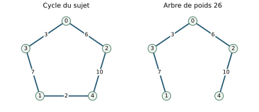
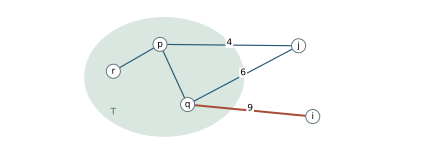

# ENS de Lyon · Second concours · Informatique 2018 · Corrigé brut

*Corrigé rédigé par IA, non officiel. Signalez toute erreur.*

**Rédaction** · GPT-6.2 Astra Ultra · vitesse non renseignée · 24 novembre 2026

## 1 · Arbres couvrants de poids maximal

### Question 1.1 · L’arbre de la figure 2

Le graphe de la figure est le cycle $0,2,4,1,3,0$, de poids successifs $6,10,2,7,3$. Un arbre couvrant conserve quatre des cinq arêtes : supprimer celle de poids 2 entre 1 et 4 donne $\{\{0,2\},\{2,4\},\{1,3\},\{0,3\}\}$. Son poids est $6+10+7+3=26$. Tout autre choix retranche davantage au poids total 28.



### Question 1.2 · Décider l’existence d’un chemin

Depuis $i$, empiler les sommets à explorer et marquer chaque voisin lors de sa première insertion. Un sommet marqué est accessible, par induction le long des découvertes. Si un sommet accessible n’était pas visité à la fin, le premier sommet non visité d’un chemin depuis $i$ aurait un prédécesseur exploré, qui l’aurait découvert. La présence de $j$ parmi les sommets atteints donne donc exactement la réponse attendue. Pour une matrice de taille $n$, temps $O(n^2)$ et espace auxiliaire $O(n)$.

```python
def chemin(G, i, j):
    vu = [False] * len(G)
    vu[i] = True
    pile = [i]
    while pile:
        u = pile.pop()
        if u == j:
            return True
        for v, poids in enumerate(G[u]):
            if poids > 0 and not vu[v]:
                vu[v] = True
                pile.append(v)
    return False
```

### Question 1.3 · Propriété de la coupe

Soit $F$ un arbre couvrant maximal contenant $B$, qui est ici un ensemble d’arêtes. Notons $e=\{s,t\}$ l’arête lourde. Si elle est dans $F$, celui-ci convient. Sinon l’unique chemin de $s$ à $t$ dans $F$ traverse la coupe : choisir sur ce chemin une arête $f$ qui la traverse. La coupe respectant $B$, on a $f\notin B$. Le lemme d’échange donné dans le sujet garantit que $F'=F-f+e$ est un arbre couvrant. Comme $p(e)\ge p(f)$, son poids est au moins celui de $F$, donc maximal. Il contient $B\cup\{e\}$. La preuve autorise l’égalité des poids.

## 2 · Algorithme de Prim

### Question 2.1 · Construire la matrice des parents

Créer $n$ lignes distinctes, toutes nulles. Pour chaque parent défini, écrire 1 dans les deux cases symétriques qui représentent l’arête non orientée. Les doubles écritures éventuelles sur une même arête ne changent rien. L’initialisation prend $\Theta(n^2)$, les ajouts $O(n)$ ; le résultat occupe $\Theta(n^2)$.

```python
def graphe_de_parent(parent):
    n = len(parent)
    H = [[0] * n for _ in range(n)]
    for i, père in enumerate(parent):
        if père != -1:
            H[i][père] = 1
            H[père][i] = 1
    return H
```

### Question 2.2 · Invariants de Prim

Au début de l’itération, $T$ contient les sommets déjà extraits et $B$ seulement leurs arêtes parentales. Renforçons (c) : pour tout sommet extérieur de clé positive, le parent est dans $T$ et **l’arête vers ce parent** réalise la valeur de la clé. Au départ $T=B=\varnothing$, toute clé est nulle et tout parent vaut $-1$. (a), (b) et (c) sont vérifiés, car un graphe fini connexe possède au moins un arbre couvrant maximal.

Supposons l’invariant vrai avant l’extraction de $i$. **(a)** Si le parent de $i$ est défini, il appartient à l’ancien $T$ et les deux extrémités de l’arête désormais fixée sont dans $T\cup\{i\}$. Les anciennes arêtes de $B$ restent internes.

**(b)** Si la clé de $i$ est nulle, son parent est indéfini et $B$ ne change pas. Sinon $e=\{i,\mathrm{parent}[i]\}$ est lourde pour la coupe de l’ancien $T$ : chaque arête sortante a un sommet extérieur $j$, son poids est au plus la clé de $j$, elle-même au plus celle de $i$. Cette coupe respecte $B$ d’après (a). Par 1.3, $B\cup\{e\}$ est inclus dans un arbre couvrant maximal.

**(c)** Pour un sommet restant $j$, les voisins dans le nouvel ensemble sont ses anciens voisins de $T$ et éventuellement $i$. Si $p(i,j)$ améliore sa clé, on pose la clé à ce poids et le parent à $i$. Sinon clé et parent restent valables, y compris en cas d’égalité. La clé est donc positive exactement lorsqu’il existe un voisin déjà extrait, et dans ce cas le parent en est un qui réalise le maximum. En l’absence de voisin, la clé reste 0 et le parent reste $-1$. Cela établit les trois équivalences, la position du parent et la formule du maximum.



### Question 2.3 · Pourquoi le résultat de Prim est couvrant et maximal

Au premier tour le sommet $i_0$ n’a pas de parent. Une fois $T$ non vide, tant que $T\ne S$, la connexité de $G$ donne une arête entre $T$ et son complément. Les poids étant strictement positifs, son extrémité extérieure a une clé positive par 2.2(c). La clé maximale extraite est donc positive. Ce sommet neuf est rattaché à un unique sommet ancien : la connexité de $(T,B)$ est préservée et aucune boucle de chemin n’apparaît. Les clés des sommets déjà extraits ne sont plus modifiées.

Chaque itération retire un sommet de l’ensemble à visiter. Après $n$ extractions, on a un arbre couvrant avec $n-1$ arêtes et, par 2.2(b), ses arêtes sont contenues dans celles d’un arbre couvrant maximal. Les deux arbres ont $n-1$ arêtes, donc coïncident. Pour un singleton, l’arbre rendu a poids zéro.

### Question 2.4 · Extraire le meilleur sommet restant

Un balayage mémorise l’indice de la plus grande clé déjà vue parmi les sommets encore disponibles. Le test strict conserve le premier indice en cas d’égalité, choix autorisé. Si aucun sommet ne convient, retourner le marqueur Python None. Sinon, modifier uniquement sa case dans la liste à visiter. Temps $O(n)$ et espace $O(1)$.

```python
def extrait(avisiter, clef):
    meilleur = None
    for i in range(len(clef)):
        if avisiter[i] and (meilleur is None or clef[i] > clef[meilleur]):
            meilleur = i
    if meilleur is not None:
        avisiter[meilleur] = False
    return meilleur
```

### Question 2.5 · Programmer Prim

Initialiser les trois tableaux comme dans le sujet, répéter l’extraction puis mettre à jour les voisins extérieurs si le poids est strictement supérieur à la clé. Les poids absents valant zéro, la comparaison stricte élimine automatiquement les cases sans arête. Les opérations correspondent exactement aux étapes 1 à 3 de l’algorithme dont 2.2–2.3 prouvent la correction. Le résultat est une matrice symétrique de 0 et de 1. L’algorithme fait $O(n^2)$ opérations et utilise $O(n)$ d’espace auxiliaire en plus de la matrice rendue.

```python
def prim(G):
    n = len(G)
    parent = [-1] * n
    avisiter = [True] * n
    clef = [0] * n
    while True:
        i = extrait(avisiter, clef)
        if i is None:
            return graphe_de_parent(parent)
        for j, poids in enumerate(G[i]):
            if avisiter[j] and poids > clef[j]:
                clef[j] = poids
                parent[j] = i
```

## 3 · Algorithme de Borůvka

### Question 3.1 · Compatibilité des arêtes choisies au même tour

Fixons une composante $C$ de la forêt courante. Sa coupe est $(C,S\setminus C)$. L’arête $e$ qu’elle sélectionne est la **seule** arête de poids maximal traversant cette coupe puisque tous les poids sont distincts. Si un arbre couvrant maximal $F$ l’omettait, le chemin de $F$ entre ses extrémités traverserait la coupe par une arête $f$ de poids strictement inférieur. L’échange de 1.3 augmenterait alors strictement le poids de $F$, contradiction. Toute arête choisie par une composante appartient donc à **tout** arbre couvrant maximal.

Au départ $B$ est vide. Si $B$ est contenu dans un arbre maximal donné, cet arbre contient aussi toutes les arêtes du tour, même si deux composantes ont choisi la même. Leur ajout simultané préserve l’invariant et l’acyclicité. L’argument explique pourquoi montrer que chaque arête est séparément sûre, avec des arbres témoins éventuellement différents, serait insuffisant sans le caractère forcé.

### Question 3.2 · Terminaison de Borůvka

Avec $k>1$ composantes, la connexité de $G$ donne à chacune une arête sortante. Le graphe sur les anciennes composantes dont les arêtes sont les choix de ce tour n’a pas de sommet isolé. Chaque nouvelle composante regroupe donc au moins deux anciennes : leur nombre devient au plus $\lfloor k/2\rfloor$. Après au plus $\lceil\log_2 n\rceil$ tours pour $n\ge1$, il ne reste qu’une composante. Par 3.1, $B$ est acyclique et inclus dans un arbre maximal. Puisqu’il relie maintenant tous les sommets, il constitue un arbre couvrant ; l’inclusion entre deux arbres couvrants entraîne leur égalité.

### Question 3.3 · Numéroter les composantes

Une exploration depuis un sommet sans étiquette marque exactement tous les sommets de sa composante, par le raisonnement de 1.2. Lui réserver le numéro suivant puis recommencer sur un sommet encore sans numéro. Les identifiants sont consécutifs de 0 à $k-1$, ce qui permet de les utiliser comme indices en 3.4. La fonction traite aussi les graphes non connexes, nécessaires à Borůvka. Temps $O(n^2)$ et espace auxiliaire $O(n)$.

```python
def cc(H):
    n = len(H)
    idcc = [-1] * n
    k = 0
    for s in range(n):
        if idcc[s] != -1:
            continue
        idcc[s] = k
        pile = [s]
        while pile:
            u = pile.pop()
            for v, a in enumerate(H[u]):
                if a != 0 and idcc[v] == -1:
                    idcc[v] = k
                    pile.append(v)
        k += 1
    return k, idcc
```

### Question 3.4 · Programmer un tour complet de Borůvka

Calculer les identifiants sur la matrice courante $H$. Parcourir les arêtes du graphe initial une seule fois dans le triangle supérieur. Pour une arête entre deux composantes différentes, proposer ce candidat comme maximum aux deux composantes. Ajouter les candidats à $H$ **après** le balayage. Les doubles choix écrivent simplement les mêmes cases à 1. La connexité assure qu’aucun maximum ne manque pendant un tour non terminal. On reproduit ainsi les étapes de 3.1–3.2 et l’algorithme rend un arbre de poids maximal. Le coût est $O(n^2\log(n+1))$ en temps et $O(n^2)$ pour la matrice $H$, plus $O(n)$ pour les listes.

```python
def boruvka(G):
    n = len(G)
    H = [[0] * n for _ in range(n)]
    while True:
        k, idcc = cc(H)
        if k <= 1:
            return H
        choix = [None] * k
        for u in range(n):
            for v in range(u + 1, n):
                w = G[u][v]
                a, b = idcc[u], idcc[v]
                if w > 0 and a != b:
                    for c in (a, b):
                        if choix[c] is None or w > choix[c][0]:
                            choix[c] = (w, u, v)
        for w, u, v in choix:
            H[u][v] = 1
            H[v][u] = 1
```
