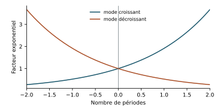

# ENS de Lyon · Second concours · Mathématiques 2018 · Corrigé brut

*Corrigé rédigé par IA, non officiel. Signalez toute erreur.*

**Rédaction** · GPT-6.2 Astra Ultra · vitesse non renseignée

**Révision** · GPT-6.2 Astra Ultra · vitesse non renseignée · 26 novembre 2026

Le premier problème détermine la parité des parties entières de deux suites de puissances. Le second construit une solution de carré intégrable pour une équation différentielle à coefficient périodique. [Sujet officiel](https://banques-ecoles.fr/cms/wp-content/uploads/2018/10/2018_2CC_sujet_Math.pdf) · [Rapport du jury](https://banques-ecoles.fr/cms/wp-content/uploads/2018/10/18_2CC_rap_eMath.pdf)

## 1. Algèbre. Parties entières de puissances algébriques

### Question 1.1

Pour $P=X^3-3X^2-X+1$, les valeurs $P(-1)=-2$, $P(0)=1$, $P(1)=-2$, $P(3)=-2$ et $P(4)=13$ donnent par continuité des racines $c\in(-1,0)$, $b\in(0,1)$, $a\in(3,4)$. Ces trois racines distinctes épuisent le degré. Plus finement $P(16/5)=-19/125<0$ et $P(4)>0$, donc $a>3{,}2$.

### Question 1.2

Viète donne $A_1=a+b+c=3$ et $ab+bc+ca=-1$. Par conséquent $A_2=A_1^2-2(ab+bc+ca)=11$. Comme $a>3{,}2$, on obtient $b^2+c^2=11-a^2<11-(16/5)^2=19/25<1$.

### Question 1.3

La division euclidienne de $X^n$ par le polynôme unitaire $P\in\mathbb Z[X]$ fournit un reste $u_nX^2+v_nX+w_n$ à coefficients entiers, en complétant par des coefficients nuls si nécessaire. Évaluer aux trois racines donne les équations demandées. Un tel reste est unique, car un polynôme de degré au plus deux qui s’annule en $a,b,c$ est nul.

### Question 1.4

Modulo $P$, $X^3=3X^2+X-1$. Le nouveau reste a donc pour coefficients $3u_n+v_n$, $u_n+w_n$, $-u_n$. Ainsi
$$M=\begin{pmatrix}3&1&0\\1&0&1\\-1&0&0\end{pmatrix},\qquad
\det(XI-M)=(X-3)X^2-X+1=P(X).$$
Le vecteur initial est $(u_0,v_0,w_0)^t=(0,0,1)^t$.

### Question 1.5

En additionnant les trois identités, $A_n=11u_n+3v_n+3w_n\in\mathbb Z$. Chaque racine vérifie $x^{n+3}=3x^{n+2}+x^{n+1}-x^n$. La même récurrence vaut pour $A_n$. Comme $A_0=3$, $A_1=3$ et $A_2=11$ sont impairs, la récurrence conserve cette parité pour tous les rangs.

### Question 1.6

Puisque $|b|,|c|<1$, pour $n\ge2$ on a $|b^n+c^n|\le |b|^n+|c|^n\le b^2+c^2<1$ d’après 1.2.

### Question 1.7

On a $P(1/2)=-1/8<0$ et $P(0)>0$, donc $0<b<1/2$. De même $P(-1/2)=5/8>0$ et $P(-1)<0$, donc $c<-1/2$. Ainsi $|c|>b$. Pour $n$ pair, $b^n+c^n>0$, y compris $n=0$. Pour $n$ impair, $b^n+c^n=b^n-|c|^n<0$.

### Question 1.8

Pour $n\ge2$ pair, $0<A_n-a^n<1$, donc $\lfloor a^n\rfloor=A_n-1$ est pair. Pour $n\ge3$ impair, $-1<A_n-a^n<0$, donc $\lfloor a^n\rfloor=A_n$ est impair. Enfin $\lfloor a\rfloor=3$ traite $n=1$.

### Question 1.9

De $(d-1)^2=2$ suit $d^2-2d-1=0$. Le nombre $d=1+\sqrt2$ est irrationnel, donc aucun polynôme rationnel non nul de degré inférieur à deux ne l’annule. Le polynôme minimal unitaire est $X^2-2X-1$. Sans normalisation, tous ses multiples par un entier non nul sont aussi de degré minimal.

### Question 1.10

Notons $d'=1-\sqrt2\in(-1,0)$ et $B_n=d^n+(d')^n$. Les deux racines satisfont $r^2=2r+1$, donc $B_{n+2}=2B_{n+1}+B_n$. Les valeurs initiales $B_0=B_1=2$ montrent que tous les $B_n$ sont pairs. Pour $n>0$ pair, $0<(d')^n<1$ implique $\lfloor d^n\rfloor=B_n-1$, impair. Pour $n$ impair, $-1<(d')^n<0$ implique $\lfloor d^n\rfloor=B_n$, pair. Au rang zéro, $\lfloor d^0\rfloor=1$ est impair.

## 2. Analyse. Équation de Hill et solutions de carré intégrable

### Question 2.1a

Par Cauchy–Schwarz sur $[x,\infty)$,
$$\int_x^\infty e^{\alpha(x-t)}|g(t)|\,dt\le(2\alpha)^{-1/2}\left(\int_x^\infty g(t)^2dt\right)^{1/2}<\infty.$$
La première norme vient de $\int_0^\infty e^{-2\alpha s}ds=1/(2\alpha)$.

### Question 2.1b

Par 2.1a, $|\psi(x)|\le(2\alpha)^{-1/2}\|g\|_{L^2(x,\infty)}$. Le reste d’une intégrale convergente positive tend vers zéro lorsque $x\to+\infty$, donc $\psi(x)\to0$.

### Question 2.1c

Écrivons $\psi(x)=e^{\alpha x}F(x)$, $F(x)=\int_x^\infty e^{-\alpha t}g(t)dt$. Cette intégrale converge pour chaque $x$ par 2.1a. La continuité de l’intégrande donne $F'(x)=-e^{-\alpha x}g(x)$ en prenant la différence de deux intégrales. Le produit dérivé donne $\psi'=\alpha\psi-g$.

### Question 2.1d

Sur $[A,B]$, $\alpha\psi^2=\psi\psi'+\psi g$, d’où
$$\alpha\int_A^B\psi^2=\tfrac12(\psi(B)^2-\psi(A)^2)+\int_A^B\psi g
\le \tfrac12\psi(B)^2+\left(\int_A^B\psi^2\right)^{1/2}\left(\int_A^B g^2\right)^{1/2}.$$
La dernière étape est Cauchy–Schwarz.

### Question 2.1e

Pour $U=\|\psi\|_{L^2(A,B)}$ et $V=\|g\|_{L^2(A,B)}$, on a $UV\le(\alpha U^2+V^2/\alpha)/2$. En reportant dans 2.1d puis en multipliant par deux, il vient $\alpha U^2\le V^2/\alpha+\psi(B)^2$.

### Question 2.1f

Prenons $A=-R$, $B=R$. Le membre droit de 2.1e tend vers $\|g\|_2^2/\alpha$ par intégrabilité et 2.1b. Les intégrales de $\psi^2$ sur $[-R,R]$ croissent. Elles ont une limite finie et $\int_{\mathbb R}\psi^2\le\alpha^{-2}\int_{\mathbb R}g^2$.

### Question 2.2

Le wronskien $W=u_0u_1'-u_0'u_1$ vérifie $W'=u_0u_1''-u_0''u_1=-qu_0u_1+qu_0u_1=0$. Avec les deux couples de données initiales, $W(0)=1$, donc $W\equiv1$.

### Question 2.3

Par linéarité et unicité du problème de Cauchy pour $q$ continue, $u(t)=u(0)u_0(t)+u'(0)u_1(t)$. La même relation dérivée puis l’évaluation en $1$ donnent $(u(1),u'(1))^t=M(u(0),u'(0))^t$.

### Question 2.4

On a $\det M=W(1)=1$, donc $\chi_M(X)=X^2-EX+1$. Pour $|E|<2$, les valeurs propres sont conjuguées non réelles de module un. Pour $E=\pm2$, il y a une valeur double $\pm1$, sans conclusion automatique de diagonalisabilité. Pour $|E|>2$, les deux racines sont réelles distinctes, réciproques et du signe de $E$, l’une de module inférieur à un et l’autre supérieur à un.

### Question 2.5

Prenons comme données initiales un vecteur propre complexe non nul de $M$ pour $\lambda$. La solution $u$ est non nulle. Les fonctions $x\mapsto u(x+1)$ et $x\mapsto\lambda u(x)$ vérifient la même équation par périodicité de $q$ et ont les mêmes données initiales d’après 2.3. Par unicité elles coïncident. Comme $\lambda\ne0$, choisissons $\alpha$ tel que $e^\alpha=\lambda$. Alors $e^{-\alpha(x+1)}u(x+1)=e^{-\alpha x}u(x)$, ce qui donne une fonction de période un.

### Question 2.6

Si $\lambda\ne\pm1$, les valeurs propres $\lambda$ et $1/\lambda$ sont distinctes. Prenons $\alpha$ tel que $e^\alpha=\lambda$ et employons $-\alpha$ pour l’autre. La question 2.5 fournit les solutions $e^{\alpha x}v_+(x)$ et $e^{-\alpha x}v_-(x)$, avec $v_\pm$ continues et $1$-périodiques. Leurs données propres sont indépendantes, donc elles engendrent l’espace complexe de dimension deux des solutions.

### Question 2.7a

Pour $E>2$, écrivons $\lambda_+>1$, $\lambda_-=\lambda_+^{-1}<1$ et $\alpha=\log\lambda_+>0$. Les deux vecteurs propres peuvent être pris réels. Les solutions correspondantes sont $u_\pm=e^{\pm\alpha x}v_\pm(x)$, linéairement indépendantes, avec $v_\pm$ périodiques donc bornées. Ainsi $u_-(x)\to0$ à droite et $u_+(x)\to0$ à gauche.

### Question 2.7b

Comme en 2.2, $u_+u_-'-u_+'u_-$ est constant. Sa valeur en zéro est le déterminant des deux données propres indépendantes, donc elle n’est pas nulle. Diviser $u_-$ par cette constante conserve toutes ses propriétés et normalise le wronskien à un.

### Question 2.7c

Écrivons $u=c_+u_++c_-u_-$, et $a_\pm=\|u_\pm\|_{L^2(0,1)}>0$. Par 2.5, les normes des deux modes sur $[n,n+1]$ valent $e^{\pm\alpha n}a_\pm$. Si $c_+\ne0$, la norme de $u$ sur cet intervalle est au moins $|c_+|e^{\alpha n}a_+-|c_-|e^{-\alpha n}a_-$ et diverge lorsque $n\to+\infty$. Si $c_+=0$ mais $c_-\ne0$, la norme diverge vers $n\to-\infty$. La seule solution de carré intégrable est donc nulle.

### Question 2.7d

Écrivons $w=\phi_+u_++\phi_-u_-$ avec la condition $\phi_+'u_++\phi_-'u_-=0$. L’équation devient $\phi_+'u_+'+\phi_-'u_-'=f$. Le déterminant du système est le wronskien normalisé à un, donc $\phi_+'=-u_-f$, $\phi_-'=u_+f$. Réciproquement, des primitives de ces deux fonctions vérifient la condition et produisent des solutions. Les deux constantes d’intégration engendrent toutes les solutions homogènes, ce qui assure l’exhaustivité.

### Question 2.7e

Prenons
$$w(x)=u_+(x)\int_x^\infty u_-(t)f(t)\,dt+u_-(x)\int_{-\infty}^x u_+(t)f(t)\,dt.$$
Les intégrales convergent absolument par Cauchy–Schwarz sur les demi-droites, car le mode présent sous chaque intégrale y décroît exponentiellement. Leurs dérivées ont les signes de 2.7d, donc $w''+qw=f$. Posons $C=\|v_+\|_\infty\|v_-\|_\infty$. On a
$$|w(x)|\le C\!\left(\int_x^\infty e^{-\alpha(t-x)}|f(t)|dt+\int_{-\infty}^x e^{-\alpha(x-t)}|f(t)|dt\right).$$
Par 2.1f, le premier terme entre parenthèses a norme $L^2$ au plus $\|f\|_2/\alpha$. Le second a la même borne par réflexion $x\mapsto-x$. Ainsi $\|w\|_2\le2C\|f\|_2/\alpha$. La différence de deux solutions de carré intégrable serait homogène et de carré intégrable, donc nulle par 2.7c.

Le cas $q=-\alpha^2$ contrôle le signe. Les choix $u_+(x)=e^{\alpha x}$ et $u_-(x)=-e^{-\alpha x}/(2\alpha)$ donnent un wronskien égal à 1. La formule précédente a alors pour noyau $G(x,t)=-e^{-\alpha|x-t|}/(2\alpha)$. Sa dérivée en $x$ saute de $-1/2$ à $1/2$ en $x=t$, ce qui produit bien le terme source avec le signe demandé.
