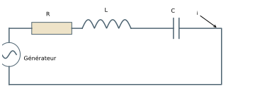
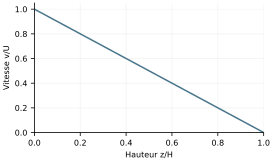
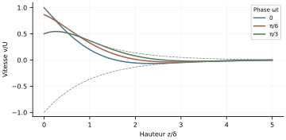
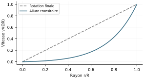
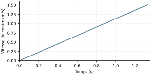

# ENS de Lyon, second concours 2018 — Physique · Corrigé guidé

*Corrigé rédigé par IA, non officiel. Signalez toute erreur.*

**Rédaction** · GPT-6.2 Astra Ultra · vitesse non renseignée

Le jury recommande de contrôler la cohérence physique et les unités des applications numériques.

## A — Questionnaire de physique

### Question A1 — Stigmatisme

> [!INDICATION]
> Préciser le rôle des prolongements des rayons pour une image virtuelle.

#### Solution

Un système optique est rigoureusement stigmatique pour un couple de points $A,A'$ si les rayons issus de $A$, après traversée du système, passent par $A'$ ou semblent provenir de $A'$. Un point objet a ainsi un point image.

### Question A2 — Circuit résonant

> [!INDICATION]
> Préciser quelle grandeur manifeste la résonance.

#### Solution

Un générateur sinusoïdal alimente un circuit série comportant résistance $R$, inductance $L$ et capacité $C$. L’intensité est maximale lorsque les réactances se compensent, à $\omega_0=1/\sqrt{LC}$. La tension aux bornes de $R$ est alors aussi maximale à tension génératrice fixée.

### Question A3 — Unité de conductivité thermique

> [!INDICATION]
> Dans la loi de Fourier, diviser un flux thermique surfacique par un gradient de température.

#### Solution

L’unité SI est le $\mathrm{W\,m^{-1}\,K^{-1}}$.

### Question A4 — Maxwell-Ampère

> [!INDICATION]
> Ajouter le courant de déplacement au courant de conduction.

#### Solution

Sous la forme microscopique en unités SI, $\nabla\times\mathbf B=\mu_0\mathbf j+\mu_0\varepsilon_0\,\partial_t\mathbf E$.

### Question A5 — Distribution de Boltzmann

> [!INDICATION]
> Normaliser les poids statistiques sur l’ensemble des microétats.

#### Solution

À l’équilibre thermique à température $T$, la probabilité du microétat $i$ d’énergie $E_i$ est $p_i=e^{-E_i/(k_BT)}/Z$, où $Z=\sum_j e^{-E_j/(k_BT)}$. Pour un niveau d’énergie dégénéré, multiplier le poids par le nombre de microétats de ce niveau.

### Question A6 — Application du Michelson

> [!INDICATION]
> La lumière parcourt deux fois chaque bras.

#### Solution

On peut mesurer un déplacement de miroir en comptant les franges qui défilent. En incidence normale, un déplacement $\Delta x$ change la différence de marche de $2\Delta x$. Le défilement de $N$ franges correspond à $\Delta x=N\lambda/2$.

### Question A7 — Lois de Kepler

> [!INDICATION]
> Distinguer géométrie de l’orbite, loi des aires et relation période–taille.

#### Solution

L’orbite d’une planète du problème à deux corps lié est une ellipse dont le Soleil occupe un foyer. Le rayon Soleil–planète balaie des aires égales pendant des temps égaux. Pour des planètes de masse négligeable devant celle du Soleil, $T^2/a^3=4\pi^2/(GM_\odot)$ est commun, $a$ étant le demi-grand axe.

### Question A8 — Relation de Bernoulli

> [!INDICATION]
> Les trois termes doivent être de même dimension.

#### Solution

Pour un fluide parfait incompressible en régime stationnaire soumis à la pesanteur uniforme, $p+\rho v^2/2+\rho gz$ est constant le long d’une ligne de courant, hors machine et dissipation.

### Question A9 — Distance Terre–Soleil

> [!INDICATION]
> La distance varie légèrement au cours de l’année.

#### Solution

Le demi-grand axe de l’orbite terrestre est voisin d’une unité astronomique, $1{,}50\times10^{11}\ \mathrm m$.

### Question A10 — Masse terrestre

> [!INDICATION]
> On peut retrouver cet ordre de grandeur avec $gR_\oplus^2/G$.

#### Solution

La masse de la Terre est proche de $5{,}97\times10^{24}$ kg, soit environ $6\times10^{24}$ kg.

## B — Cisaillement en géométrie plane

### Question B1 — Viscosité cinématique de l’eau

> [!INDICATION]
> Le pascal seconde vaut un kilogramme par mètre et par seconde.

#### Solution

$\nu=\eta/\rho=10^{-3}/10^3=1{,}0\times10^{-6}\ \mathrm{m^2\,s^{-1}}$. C’est le coefficient de diffusion de quantité de mouvement.

### Question B2 — Champ unidirectionnel

> [!INDICATION]
> Distinguer les symétries géométriques et l’hypothèse de stabilité de la solution laminaire.

#### Solution

L’homogénéité du forçage et les plaques infinies rendent le problème invariant par translation selon $x$ et $y$. L’imperméabilité exclut un flux normal aux plaques, et la vitesse imposée ne sélectionne que la direction $x$. On adopte un écoulement laminaire parallèle, sans effet de bord ni instabilité qui briserait ces symétries. Ainsi $\mathbf v=v(z,t)\mathbf e_x$.

### Question B3 — Signe du gradient

> [!INDICATION]
> Repérer quelle paroi entraîne la couche et le sens de l’axe vertical.

#### Solution

Pour l’échelon positif, l’adhérence donne $v(0,t)=U$ et $v(H,t)=0$. La diffusion propage la mise en mouvement depuis le bas. À partir du repos le profil décroît avec $z$, donc $\partial_zv\le0$ (nul initialement dans l’intérieur encore immobile, strictement négatif dans le profil établi). Ce raisonnement porte sur l’échelon, avant le forçage oscillant.

### Question B4 — Contraintes sur une tranche

> [!INDICATION]
> Pour une même contrainte, changer l’orientation de la normale change le signe de la traction.

#### Solution

La contrainte newtonienne vaut $\sigma_{xz}=\eta\partial_zv$. La face supérieure de la tranche, de normale $+\mathbf e_z$, reçoit $\mathbf F_{\rm sup}=\eta S\,\partial_zv(z+\mathrm dz,t)\mathbf e_x$. La face inférieure, de normale opposée, reçoit $\mathbf F_{\rm inf}=-\eta S\,\partial_zv(z,t)\mathbf e_x$. Avec le gradient négatif de B3, la couche du dessous entraîne la tranche vers $+x$ et celle du dessus la freine. Les faces latérales opposées n’apportent pas de résultante visqueuse horizontale.

### Question B5 — Équation d’évolution

> [!INDICATION]
> Appliquer le bilan de quantité de mouvement à la tranche entière.

#### Solution

La différence des deux contraintes vaut $\eta S\,\mathrm dz\,\partial_z^2v$ au premier ordre. Aucun gradient horizontal de pression n’intervient et la dérivée convective $v\partial_xv$ s’annule. Newton donne $\rho S\,\mathrm dz\,\partial_t v=\eta S\,\mathrm dz\,\partial_z^2v$, soit $\partial_t v=\nu\partial_z^2v$.

### Question B6 — Nature de l’équation

> [!INDICATION]
> Identifier le coefficient de dimension longueur au carré divisée par un temps.

#### Solution

C’est une équation de diffusion, parabolique. La température d’un solide homogène vérifie la même forme avec la diffusivité thermique, et la concentration d’un soluté avec le coefficient de diffusion moléculaire.

### Question B7 — Couette permanent

> [!INDICATION]
> Imposer deux valeurs aux extrémités d’une fonction affine.

#### Solution

À l’état stationnaire, $v_\infty''=0$. L’adhérence en $z=0,H$ impose $v_\infty(z)=U(1-z/H)$. Le profil est un segment de $U$ sur la plaque mobile à zéro sur la plaque fixe. La contrainte est uniforme, $\eta v_\infty'=-\eta U/H$.

### Question B8 — Temps de mise en mouvement

> [!INDICATION]
> Annoncer la convention employée pour le temps caractéristique.

#### Solution

Une perturbation diffuse sur une distance d’ordre $\sqrt{\nu t}$. Pour atteindre l’autre plaque, il faut $t_\infty\sim H^2/\nu=(0{,}10)^2/10^{-6}=10^4$ s, environ 2,8 h. C’est une échelle, car le régime permanent est atteint asymptotiquement. Si l’on définit le temps comme celui de décroissance du mode $\sin(\pi z/H)$, on obtient $H^2/(\pi^2\nu)$, environ 17 min. Le temps pour un seuil précis dépend encore du nombre de temps de relaxation retenu.

## Plaque oscillante

### Question B9 — Dispersion du cisaillement oscillant

> [!INDICATION]
> Une dérivée temporelle donne $i\omega$, deux dérivées spatiales donnent $-k^2$.

#### Solution

La substitution $v=Ae^{i(\omega t-kz)}$ dans l’équation de diffusion fournit $i\omega=-\nu k^2$, donc $k^2=-i\omega/\nu$. Le nombre d’onde est complexe dès que $\omega\ne0$.

### Question B10 — Racines complexes

> [!INDICATION]
> Vérifier le signe de l’exponentielle réelle et non celui d’un nombre d’onde isolé.

#### Solution

Pour $\omega>0$, $\delta=\sqrt{2\nu/\omega}$ et $k=\pm(1-i)/\delta$. Dans la convention $e^{-ikz}$, la racine de partie imaginaire négative donne une décroissance vers $z>0$. Si l’on conserve les fréquences négatives, écrire $k=\pm(\operatorname{sgn}\omega-i)/\delta$ avec $\delta=\sqrt{2\nu/|\omega|}$, puis sélectionner la racine décroissante. La solution réelle peut être obtenue à partir de la fréquence positive seule.

### Question B11 — Champ réel

> [!INDICATION]
> Écrire séparément l’enveloppe et la phase.

#### Solution

Le milieu semi-infini élimine la racine croissante. L’adhérence à $z=0$ donne $A=U$. À fréquence positive, la représentation complexe est $v=Ue^{-z/\delta}e^{i(\omega t-z/\delta)}$, donc la vitesse réelle vaut $Ue^{-z/\delta}\cos(\omega t-z/\delta)$. L’amplitude décroît et le mouvement est retardé en profondeur.

### Question B12 — Trois profils instantanés

> [!INDICATION]
> Utiliser les mêmes axes pour les trois phases et représenter leur enveloppe commune.

#### Solution

À chaque instant, porter $v/U=e^{-z/\delta}\cos(\omega t-z/\delta)$ en fonction de $z/\delta$. La figure donne par exemple les phases $0,\pi/6,\pi/3$, séparées par $T/12$. Les intersections avec $z=0$ suivent le mouvement imposé et les oscillations spatiales restent dans l’enveloppe $\pm e^{-z/\delta}$.

### Question B13 — Profondeur de pénétration

> [!INDICATION]
> Distinguer l’épaisseur d’amortissement de la distance d’un tour de phase.

#### Solution

Sur une épaisseur $\delta$, l’amplitude est divisée par $e$ et la phase accumule un retard de 1 radian. La longueur d’onde de phase est $2\pi\delta$, sur laquelle l’amplitude est divisée par $e^{2\pi}$. Quand la fréquence augmente, la couche oscillante s’amincit. Il s’agit de diffusion de vorticité.

### Question B14 — Condition de milieu semi-infini

> [!INDICATION]
> Évaluer directement l’enveloppe exponentielle à $z=H$.

#### Solution

Le modèle est valable si l’amplitude à l’autre plaque est négligeable, soit $H/\delta\gg1$ ou $\omega\gg2\nu/H^2$ en ordre de grandeur. Pour un seuil d’amplitude résiduelle $\varepsilon$, on pourrait exiger $H>\delta\ln(1/\varepsilon)$.

### Question B15 — Puissance mécanique à la paroi

> [!INDICATION]
> Pour calculer une puissance complexe moyenne, conjuguer l’un des deux facteurs.

#### Solution

La contrainte motrice exercée sur le fluide au bas de la couche a pour amplitude complexe $-\eta\partial_z v|_0=\eta(1+i)U/\delta$. Sa multiplication par la vitesse de paroi, puis la moyenne temporelle, donnent
$$\langle p_{\rm op}\rangle=\frac12\operatorname{Re}\!\left[\frac{\eta(1+i)}{\delta}U U^*\right]
=\frac{\eta U^2}{2\delta}=U^2\sqrt{\frac{\rho\eta\omega}{8}}.$$
Cette puissance par unité de surface est positive. À amplitude de vitesse imposée, elle croît en $\sqrt\omega$ car le gradient augmente dans la couche plus mince.

### Question B16 — Dissipation visqueuse

> [!INDICATION]
> Moyenner un carré réel avant d’intégrer l’exponentielle sur la profondeur.

#### Solution

La puissance volumique irréversiblement dissipée est $\eta(\partial_zv_{\rm réel})^2$. Comme $|\partial_z v|^2=2U^2e^{-2z/\delta}/\delta^2$ en amplitudes complexes, sa moyenne intégrée vaut
$$\langle p_\eta\rangle=\frac{\eta U^2}{\delta^2}\int_0^\infty e^{-2z/\delta}\,\mathrm dz=\frac{\eta U^2}{2\delta}=\langle p_{\rm op}\rangle.$$
Sur une période l’énergie cinétique revient à sa valeur initiale. Tout le travail net devient chaleur dans le fluide et tend à l’échauffer en l’absence d’évacuation thermique.

## Bouteille en rotation

### Question B17 — Rotation finale

> [!INDICATION]
> Un gradient radial de vitesse ne signifie pas à lui seul que le taux de cisaillement cylindrique est non nul.

#### Solution

Quand l’eau est entraînée sans cisaillement, elle effectue une rotation en bloc, $v_\infty(r)=\Omega r$. Ce champ est régulier sur l’axe et satisfait l’adhérence en $r=R$. La contrainte cylindrique $\eta(\partial_rv-v/r)$ est nulle.

### Question B18 — Diffusion jusqu’à l’axe

> [!INDICATION]
> Remplacer l’écartement des plaques par la distance entre la paroi et l’axe.

#### Solution

Dans le modèle radial sans effet des fonds, l’ordre de grandeur de la durée de mise en rotation est $\tau=R^2/\nu$. Pour $R=0{,}05$ m, $\tau\simeq2{,}5\times10^3$ s, soit environ 42 min. Une définition par un taux d’erreur ou par le mode de relaxation le plus lent introduirait un facteur numérique.

### Question B19 — Profil radial transitoire

> [!INDICATION]
> Placer le maximum à la paroi qui vient d’être mise en rotation.

#### Solution

La condition de symétrie impose $v(0)=0$ et l’adhérence $v(R)=\Omega R$. Vers $t=\tau/10$ le fluide extérieur tourne déjà, alors que le cœur est encore beaucoup moins entraîné. Le rayon sur lequel l’effet pariétal est important est de l’ordre de $\sqrt{\nu t}=0{,}32R$ depuis le bord. La courbe se situe sous la droite finale $\Omega r$. Le dessin donne une allure compatible avec ces propriétés.

### Question B20 — Épaisseur entraînée à dix secondes

> [!INDICATION]
> Cette épaisseur croît avec la racine carrée du temps, contrairement à la profondeur oscillante de B10.

#### Solution

Pour $t<\tau$, $\delta(t)\sim\sqrt{\nu t}$ en partant de la paroi. À $t=10$ s, $\delta\simeq\sqrt{10^{-5}}=3{,}16\times10^{-3}$ m, soit environ 3,2 mm, bien inférieur à $R=50$ mm.

## Roulement sur un plan incliné

### Question B21 — Énergie du cylindre roulant

> [!INDICATION]
> Ajouter la rotation autour du centre à la translation du centre.

#### Solution

L’énergie cinétique est la somme $\tfrac12 Mv^2+\tfrac12 I\Omega^2$. Le roulement sans glissement donne $\Omega=v/R$ en module. Avec $I=MR^2/2$, $W_c=3Mv^2/4$. Plus généralement, $W_c=\tfrac12 M(1+k)v^2$ pour $k=I/(MR^2)$.

### Question B22 — Conservation de l’énergie mécanique

> [!INDICATION]
> Calculer la puissance au point de contact, pas seulement avec la vitesse du centre.

#### Solution

La force de frottement statique peut être non nulle et fournit le couple de rotation. Son point d’application sur le solide a une vitesse instantanée nulle, car le contact roule sans glisser sur un plan fixe. Sa puissance totale est donc nulle, de même que celle de la normale. Le poids dérive d’une énergie potentielle et les résistances dissipatives sont négligées.

### Question B23 — Accélération sur le plan

> [!INDICATION]
> Remplacer $\dot x$ par $v$ et utiliser le moment d’inertie autour du centre.

#### Solution

Avec $x$ vers le bas du plan, l’énergie conservée donne $\tfrac12 M(1+k)v^2=Mgx\sin\alpha$. Par dérivation pour $t>0$ puis continuité à l’origine, $\dot v=g\sin\alpha/(1+k)$. Pour le cylindre homogène, $\dot v=(2/3)g\sin\alpha$.

### Question B24 — Évolution de la vitesse

> [!INDICATION]
> La pente de $v(t)$ est l’accélération.

#### Solution

Le cylindre est lâché sans vitesse. On obtient $v(t)=(2/3)g\sin\alpha\,t$, une droite passant par l’origine. Pour $\alpha=10^\circ$, sa pente vaut environ $1{,}14\ \mathrm{m\,s^{-2}}$ tant que le cylindre reste sur le plan et que les hypothèses du modèle tiennent.

### Question B25 — Adhérence nécessaire

> [!INDICATION]
> Le frottement réel est déterminé par les équations de mouvement et doit rester sous sa valeur limite.

#### Solution

Notons $F$ le module du frottement statique dirigé vers le haut du plan. La translation donne $M\dot v=Mg\sin\alpha-F$, la rotation $FR=I\dot v/R$. Donc $F=kM\dot v=[k/(1+k)]Mg\sin\alpha$. Comme $N=Mg\cos\alpha$, l’adhérence exige $f\ge[k/(1+k)]\tan\alpha$. Pour $k=1/2$ et 10°, $f_{\min}\simeq0{,}059$.

### Question B26 — Limite du modèle de longue durée

> [!INDICATION]
> Identifier l’hypothèse qui devient de moins en moins bonne lorsque la vitesse augmente.

#### Solution

Sur un plan supposé indéfiniment long, la droite de B24 prédit une vitesse indéfiniment croissante. Négliger les forces dissipatives, notamment la traînée de l’air qui augmente avec la vitesse, finirait par devenir irréaliste. Sur le plan fini l’évolution cesse d’être décrite par cette équation dès la sortie. Le critère de frottement statique de B25 est indépendant du temps dans le modèle.

### Question B27 — Durée sur un mètre

> [!INDICATION]
> Intégrer la vitesse depuis l’instant de lâcher.

#### Solution

L’accélération est constante et la distance $a=\tfrac12[g\sin\alpha/(1+k)](\Delta t)^2$. Donc $\Delta t=\sqrt{2a(1+k)/(g\sin\alpha)}=\sqrt{3a/(g\sin\alpha)}$ pour le bloc plein. Avec $a=1$ m, $g=9{,}81\ \mathrm{m\,s^{-2}}$ et $\alpha=10^\circ$, $\Delta t\simeq1{,}33$ s.

### Question B28 — Disparition de la masse

> [!INDICATION]
> La conclusion compare des cylindres de même répartition relative de masse.

#### Solution

La force de pesanteur est proportionnelle à la masse gravitationnelle. Les inerties de translation et de rotation sont proportionnelles à la masse inertielle pour une même répartition géométrique. Leur proportionnalité universelle fait disparaître la masse du bilan. Un changement de répartition peut cependant modifier le rapport $k$.

### Question B29 — Cylindre plein et cylindre creux

> [!INDICATION]
> Comparer les moments d’inertie réduits plutôt que les masses totales.

#### Solution

Pour un cylindre plein homogène, $k=1/2$. Pour une couronne homogène avec rayon intérieur $r_i$ et rayon extérieur $R$, $k=[1+(r_i/R)^2]/2>1/2$ et tend vers 1 pour une paroi mince. À même rayon extérieur, la masse distante de l’axe exige davantage d’énergie de rotation pour une même vitesse du centre. Le cylindre plein a donc la plus forte accélération et arrive le premier.

### Question B30 — Mouvement de l’eau pendant la descente

> [!INDICATION]
> Distinguer l’accélération du centre de masse et la diffusion visqueuse de la rotation.

#### Solution

Le parcours dure de l’ordre d’une seconde, très peu devant $\tau\simeq2500$ s. En translation, les forces de pression de la paroi accélèrent la masse d’eau avec la bouteille pleine. En rotation, seule une mince couche au contact de la paroi est nettement entraînée pendant ce temps, d’épaisseur de l’ordre du millimètre. Le cœur garde une faible vitesse angulaire dans le référentiel en translation avec le centre. On ne peut donc pas lui attribuer la rotation rigide de toute l’enveloppe pendant cette descente.

### Question B31 — Bouteille pleine et bouteille vide

> [!INDICATION]
> Écrire quelles masses participent à chaque terme d’énergie. Le poids et l’inertie de translation augmentent ensemble.

#### Solution

Soient $M_b,I_b$ la masse et le moment d’inertie de la bouteille vide et $M_e$ la masse d’eau. Dans la limite courte de B30, l’eau contribue presque entièrement à la translation mais peu à l’inertie de rotation. Le rapport effectif est voisin de $I_b/[(M_b+M_e)R^2]$, inférieur à $I_b/(M_bR^2)$ pour la bouteille vide. Sous la même hypothèse de roulement, l’accélération $g\sin\alpha/(1+k_{\rm eff})$ est donc plus grande pour la bouteille pleine. Elle arrive en premier. La faible couche entraînée et sa dissipation visqueuse corrigent ce résultat dans le modèle réel. Pour une descente courte leurs effets sont limités par $\sqrt{\nu\Delta t}/R\ll1$.

[Sujet officiel](https://banques-ecoles.fr/cms/wp-content/uploads/2018/07/18_2c_sujet_phy_lyon.pdf) · [Rapport du jury](https://banques-ecoles.fr/cms/wp-content/uploads/2018/10/18_2CC_rap_ePhy.pdf)
