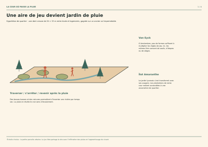
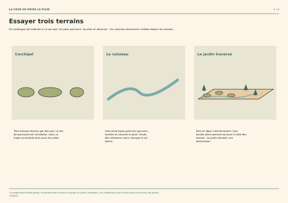
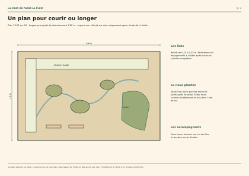
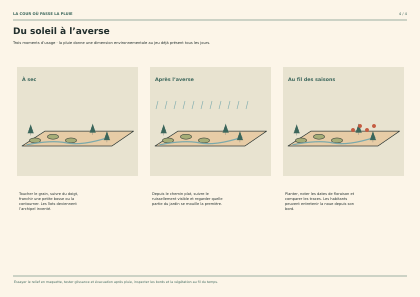

# ENS Paris-Saclay — Design d'espace 2018 · Corrigé brut

*Corrigé rédigé par IA, non officiel.*

**Rédaction** · GPT-6.2 Astra Ultra · vitesse non renseignée

La cour où passe la pluie transforme une dent creuse de quartier en terrain de jeu libre et en jardin de pluie. Les enfants peuvent suivre une ligne d’eau, contourner les reliefs ou jardiner avec leurs voisins. Les 4 planches numérotées et anonymes sont au format 420 × 297 mm. Les échelles indiquées valent pour une planche seule imprimée sur A3 à 100 %.

## Planche 1 — Une aire de jeu devient jardin de pluie

Une aire de jeux est ici un lieu où un enfant peut inventer une règle, la modifier et inviter un autre enfant. La friche hypothétique de 24 × 15 m relie école, logements et parcours de voisinage. La chronologie du sujet part du jardin de sable et du Giant Stride pour montrer différents modes de jeu et de standardisation. Les dispositifs peu figuratifs d’Aldo van Eyck donnent l’idée de trois îlots sans fonction imposée. L’expérience de Copenhague de Carl Theodor Sørensen invite à faire avec les enfants ; l’îlot Amaranthe à Lyon fait du jardinage une activité de quartier sur la durée. À Belleville, l’agence BASE éprouve les gestes et la pente par des maquettes successives. La cour proposée reprend cette méthode, dans une parcelle plus petite et avec des reliefs très bas.

## Planche 2 — Essayer trois terrains

Le premier jour, les îlots sont des maisons. Le second, ils deviennent des rives entre lesquelles on passe en observant une trace. La bande plane permet à un enfant en fauteuil et à un petit qui apprend à marcher de participer au même jeu. Une rainure ne suffit pas à assurer du jeu libre. Une aire de modules isolés ne suffit pas à rendre la pluie compréhensible. Les deux se croisent donc dans un sol continu jusqu’à une zone plantée entretenue avec les riverains. Aux points de contact, choisir du bois poncé à bouts arrondis, du béton finement strié et une bande souple dont la couleur indique le changement de niveau. Distinguer les zones de réception de celles où l’eau circule.

## Planche 3 — Un plan pour courir ou longer

Les 360 m² de la parcelle comprennent les passages, trois reliefs, le jardin et les assises. Un chemin stable de 1,80 m longe le site et rencontre le terrain de jeu. Le sol de jeu descend progressivement vers la noue. Pour une pluie hypothétique de 10 mm sur 100 m² effectivement collectés, 1 m³ d’eau est apporté avant pertes. Cela impose de vérifier infiltration, surverse, nature du sol et absence d’alimentation par des eaux de chaussée. On garde le jeu à sec possible et l’on plante la zone d’infiltration distincte. Aux limites, réserver la fermeture ou un sas si une circulation motorisée se trouve à proximité. Les dégagements, l’accessibilité et la sécurité des jeux seront validés avant installation.

## Planche 4 — Du soleil à l’averse

Un modèle de terrain permet de corriger les hauteurs de chute et les angles morts avant étude par un spécialiste des aires de jeux. Sur un tronçon d’essai, mesurer la pente, observer si les roues roulent sur une surface durablement stable et comparer la glissance sèche et mouillée. Choisir des plantes adaptées au lieu et compatibles avec la présence de jeunes enfants. Prévoir inspection des fixations, nettoyage de la rainure et jardinage. Observer ensuite les jeux sans imposer une règle. La réussite se juge aussi au retour des enfants lorsque le terrain est sec et à la continuité du jardinage lorsque l’aire est calme.

[Énoncé et annexes du concours](https://ens-paris-saclay.fr/sites/default/files/CONCOURS/ANNALES_1C/1C_Design/2018_Sujet_1A_Design_Espace.pdf)
