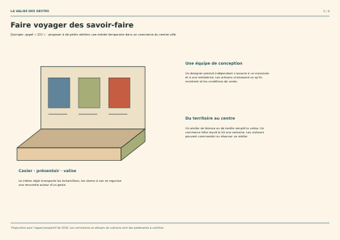
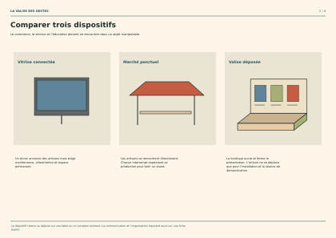
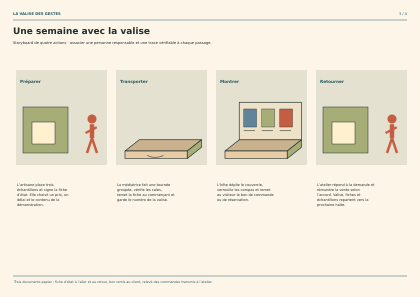
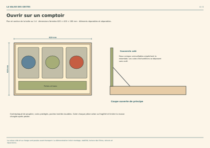

# ENS Paris-Saclay — Design de produit 2018 · Corrigé brut

*Corrigé rédigé par IA, non officiel.*

**Rédaction** · GPT-6.2 Astra Ultra · vitesse non renseignée

La valise des gestes relie des artisans des communes de Quimper à un réseau de commerces et de lieux d’apprentissage du centre-ville. Elle se ferme pour transporter les pièces et s’ouvre pour les faire manipuler. Les 4 planches numérotées et anonymes sont au format 420 × 297 mm. Les échelles indiquées valent pour une planche seule imprimée sur A3 à 100 %.

## Planche 1 — Faire voyager des savoir-faire

Le programme « Action cœur de ville » cité par le sujet concerne 222 villes. À Quimper, la faïence, le textile, la musique et le rapport aux communes voisines donnent des points de départ concrets. Je me place en designer produit associé à un menuisier et à une médiatrice. Un commerce hôte accueille temporairement une valise préparée par un petit atelier. Elle présente des échantillons que le visiteur peut toucher, le travail correspondant et le moyen de prendre rendez-vous ou de commander. La rétribution de l’artisan et le temps de la médiatrice font partie du coût du service. Les données de population et de trafic du dossier sont celles de 2018.

## Planche 2 — Comparer trois dispositifs

Une vitrine-écran énumère vite de nombreuses offres mais écarte l’essentiel, la rencontre avec une matière. Le marché apporte cette rencontre en obligeant les petites structures à libérer une journée entière. Le module déposé peut circuler à coût contenu entre boutique, médiathèque et commune associée. Une rotation hebdomadaire est une hypothèse de test, à régler sur la fréquentation et les capacités de transport. La valise comprend trois échantillons robustes, une fiche de manipulation, une grille de prix ou de réservation et des bons détachables. L’outil numérique reste facultatif. Un commerçant peut transmettre les commandes par téléphone à la fin de la journée.

## Planche 3 — Une semaine avec la valise

Le premier partenaire choisit les pièces qu’il peut réellement fabriquer, renseigne les matières et distingue commande et simple contact. La médiatrice regroupe les livraisons plutôt que de multiplier les voyages. Le commerce hôte installe le dispositif dans un espace accessible, se rend disponible pour des questions simples et indique l’heure d’un atelier découverte. Le visiteur garde un exemplaire de son bon et l’artisan confirme directement les délais. Les conditions de commission, de responsabilité et d’assurance se règlent avant le dépôt. Dans une commune associée, une bibliothèque peut héberger la valise avec une activité d’éducation à la matière, sans fonction de caisse.

## Planche 4 — Ouvrir sur un comptoir

La valise fermée mesure 620 × 420 × 180 mm. La base et le couvercle répartissent les volumes. Un fond rigide et des alvéoles textiles remplaçables reçoivent séparément les échantillons. Les coins renforcés et deux compas vissés avec pièces remplaçables protègent les manipulations répétées. Viser une masse chargée de moins de 8 kg, puis vérifier par pesée avec les pièces choisies. Aucun échantillon ne déborde du gabarit fermé. Sur une première tournée de trois lieux volontaires, relever temps de montage, manipulations, casse, contacts qualifiés et commandes abouties. Comparer ces résultats au temps effectivement rémunéré des hôtes et des artisans avant de fabriquer d’autres valises.

[Énoncé et annexes du concours](https://ens-paris-saclay.fr/sites/default/files/CONCOURS/ANNALES_1C/1C_Design/2018_Sujet_1A_Design_Produit.pdf)
