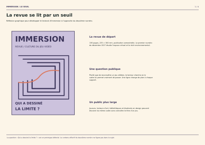
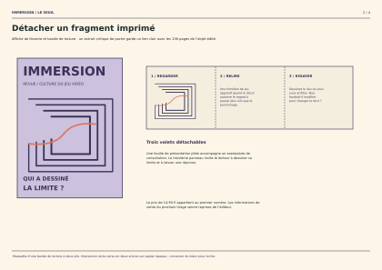
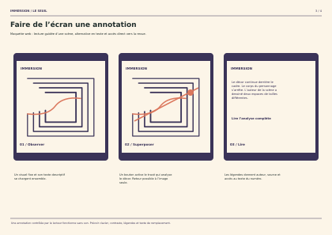
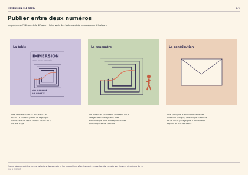

# ENS Paris-Saclay — Design graphique 2018 · Corrigé brut

*Corrigé rédigé par IA, non officiel.*

**Rédaction** · GPT-6.2 Astra Ultra · vitesse non renseignée

Immersion / le seuil propose de faire lire un jeu vidéo comme un espace construit. L’affiche, la bande imprimée et le parcours d’annotation conduisent à la revue semestrielle et à une communauté de lecteurs et d’auteurs. Les 4 planches numérotées et anonymes sont au format 420 × 297 mm. Les échelles indiquées valent pour une planche seule imprimée sur A3 à 100 %.

## Planche 1 — La revue se lit par un seuil

Le premier numéro est un mook semestriel sans publicité de 136 pages, au format 225 × 300 mm. La couverture de Trevor et les captures animées de la page d’accueil fournies en annexe jouent sur la familiarité des jeux. Or les articles analysent notamment l’espace virtuel, sa mise en données et la narration environnementale. La campagne rend cette méthode visible à un public de librairie ou de musée. Un cadre d’abord fermé s’ouvre quand le regard suit une ligne. « Qui a dessiné la limite ? » est une proposition de contenu pour illustrer cette démarche ; elle ne prétend pas annoncer le véritable sommaire du numéro 2.

## Planche 2 — Détacher un fragment imprimé

Trois pistes sont passées au format affiche. Accumuler des couvertures renseignait les connaisseurs. Une capture en pleine page promettait surtout un spectacle. Le cadre ouvert permet d’interroger l’image elle-même. L’affiche se place à proximité d’un exemplaire ouvert en librairie ou en bibliothèque. Une bande imprimée de trois volets accueille un schéma, un court paragraphe original et une consigne de dessin. Le verso porte adresse éditoriale, référence de l’extrait, crédits et modalités de commande confirmées par la revue. On peut emporter le fragment en laissant l’exemplaire de consultation aux autres lecteurs. Les deux encres et la même trame simplifient le retirage dans plusieurs lieux.

## Planche 3 — Faire de l’écran une annotation

La page d’accueil photographiée dans l’annexe fait défiler des captures de jeux. La proposition enrichit cette entrée par une micro-lecture choisie par l’utilisateur. Le lecteur regarde d’abord la scène fixe, active un tracé analytique, lit une interprétation courte et peut ouvrir un extrait long ou la fiche de la revue. Une version textuelle précise la disposition et raconte le mouvement. Un même dessin abstrait produit ici les trois maquettes. Pour des images de jeu réellement publiées, documenter capture, auteur, titre, support et accord nécessaire. La lettre d’information partage un nouvel exemple entre deux numéros, avec une fréquence à tester et un désabonnement simple.

## Planche 4 — Publier entre deux numéros

À l’approche de la sortie, les libraires volontaires reçoivent une affiche et des triptyques. Aux semaines suivantes, la revue propose une rencontre d’analyse croisée en bibliothèque ou en école d’art, dont un fragment rejoint le site avec les crédits convenus. Entre les parutions semestrielles, un appel à propositions sollicite une question critique et un exemple argumenté, avec contact éditorial et réponse annoncée. Mesurer les consultations longues des extraits, les ventes par lieu, les réabonnements volontaires et les propositions éditoriales pertinentes. Un compteur de vues ne suffit pas à dire qu’un lecteur s’est installé. Le programme préserve ainsi le temps de l’enquête et la singularité du grand format imprimé.

[Énoncé et annexes du concours](https://ens-paris-saclay.fr/sites/default/files/CONCOURS/ANNALES_1C/1C_Design/2018_Sujet_1A_Design_Graphique.pdf)
