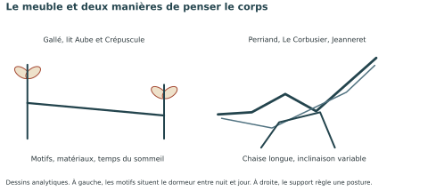

# Émile Gallé, le meuble « inventé par la génération vivante » · Paris-Saclay 2018 · Corrigé brut

*Corrigé rédigé par IA, non officiel. Signalez toute erreur.*

**Rédaction** · GPT-6.2 Astra Ultra · vitesse non renseignée · 25 novembre 2026

**Révision** · GPT-6.2 Astra Ultra · vitesse non renseignée · 25 novembre 2026

**Révision (tour 2)** · GPT-6.2 Astra Ultra · vitesse non renseignée · 26 novembre 2026

Le sujet propose un extrait de l’article « Le mobilier contemporain orné d’après la nature », publié par Gallé en 1900. Il invite à interroger les relations entre invention, service et plaisir dans le cadre du programme 1890–1939.

## Introduction

À la question « Que doit donc être le Meuble moderne ? », Gallé répond par trois opérations. Une génération invente, des métiers exécutent, une ornementation plaît. L’objet doit encore convenir « à notre taille ». L’auteur associe ainsi l’appartenance historique, l’adaptation corporelle et une expérience sensible dont il fait un besoin. Il parle depuis un milieu où la concurrence du pastiche et de la fabrication en série appelle une recherche de formes contemporaines. Il parle aussi au pluriel. Qui ce « nous » inclut-il lorsqu’une partie de la production la plus inventive reste destinée à des commanditaires fortunés ?

La modernité d’un meuble se mesure-t-elle à la nouveauté de son ornement, à l’ajustement à un usage, ou à la possibilité de concilier ces ambitions dans la vie collective ? L’objet conçu par Gallé, le meuble qui prend en charge les gestes du corps, puis l’équipement d’un logement reproductible font apparaître trois réponses qui se recoupent sans s’identifier.

## I. L’ornement peut faire comprendre la fonction intime du meuble

Le lit Aube et Crépuscule est commandé à Gallé par Henry Hirsch à l’occasion de son mariage en 1903 et présenté à Nancy en 1904. Le meuble de chambre est un lieu où s’éprouvent le coucher, le retour du jour et les rythmes d’une vie. Il met ces expériences en relation avec les métamorphoses des papillons. Au pied du lit, deux papillons de jour aux ailes diaprées se font face au-dessus d’un œuf en cristal. Au chevet de tête, le papillon de nuit est un sphinx aux ailes déployées, la tête tournée vers le bas. L’aube et le crépuscule deviennent ainsi reconnaissables aux deux extrémités du meuble. La marqueterie d’ébène et de palissandre, les contrastes de couleur et les incrustations changent avec la lumière. Le motif naturel ne se borne pas à copier un insecte sur une surface. Il fait du meuble une interprétation de l’activité pour laquelle il est conçu.

L’expression « orné pour plaire » dépasse donc ici l’ajout d’un motif séduisant à une structure déjà achevée. L’ornement participe de la signification du lit et de sa relation à la vie du commanditaire. Mais la commande est singulière, les matériaux précieux et la technique complexe. Une génération peut reconnaître dans cet objet un langage contemporain sans que la majorité de ses membres puisse l’acheter. Le passage des goûts de « notre génération » à l’expérience concrète d’un public déterminé est un point à discuter.

L’enjeu de la « joie » apparaît si l’on parcourt le lit du pied à la tête comme y invite le dessin. La différence entre les deux extrémités donne un sens au trajet et à la durée. Le fabricant peut y inscrire une émotion que l’acheteur n’a pas commandée dans ses détails. Chez Gallé, convenir à une existence présente comporte donc une part d’invention. Cette marge devient un pouvoir de prescription quand un programme de logement définit à l’avance jusqu’à l’ordre des gestes de l’habitant.

Le vase *Hommes noirs*, réalisé en 1900 par Gallé avec Victor Prouvé, qui en dessine le décor, déplace la question du plaisir. Au lys doré répond la ciguë noire. Dans le contexte de l’affaire Dreyfus, l’une des plantes évoque l’innocence, l’autre la calomnie. Une personne peut apprécier le contraste des matières avant de comprendre que leur éclat et leur obscurité portent un jugement public. Le vase appartient à la verrerie. Le rapprochement avec le lit se justifie par la même opération, charger un motif naturel d’un sens qui déborde son apparence. Dans la chambre, c’est le temps vécu qui se donne à sentir. Ici, l’ornement engage le spectateur jusque dans un désaccord politique. La « joie » d’inventer peut ainsi se communiquer sous la forme d’une inquiétude. Qui se trouve alors inclus dans le « notre » de Gallé ? [Vase Hommes noirs, musée de l’École de Nancy](https://www.nancy.fr/fileadmin/NAN/culture/scolaires/2019/MEN_-_Exposition_Politique.pdf)

## II. « À notre taille » peut commander le mécanisme et la structure

En 1928, Charlotte Perriand, Le Corbusier et Pierre Jeanneret conçoivent une chaise longue présentée au Salon d’automne en 1929. Une armature courbe portant la surface de repos s’appuie sur un piétement distinct. Son inclinaison peut varier avec la position recherchée. Le meuble rend donc possible un geste de réglage. Le profil de l’assise et la distribution des appuis dessinent le corps au repos sans reproduire une silhouette végétale ou animale. Le contraste des matériaux et la variation du dossier donnent eux aussi un plaisir visuel. Le plaisir se déplace vers la lisibilité de la construction et la liberté laissée à une posture.

Cette chaise longue confirme que servir et plaire peuvent être pensés ensemble. Elle conteste toutefois l’idée que l’ornement ajouté soit indispensable à leur accord. La préférence moderne pour une structure visible devient elle-même un choix esthétique. L’usage d’un matériau associé à l’industrie ne garantit d’ailleurs pas une diffusion immédiate dans tous les milieux. Il faut distinguer l’ambition de série, les conditions commerciales de mise en production et la reconnaissance ultérieure de l’objet comme pièce de collection.

## III. Le meuble contemporain dépend aussi de la manière dont on habite ensemble

La cuisine de Francfort, conçue par Margarete Schütte-Lihotzky en 1926 pour des logements municipaux, étend la question de la « taille » à la pièce entière. Des contenants réservés aux ingrédients, un plan de travail, des rangements accessibles et la proximité des postes organisent les mouvements quotidiens. La répétition de l’équipement offre une autre réponse à l’existence contemporaine que la commande individuelle d’un lit d’apparat. Les conditions financières d’un programme public, la surface du logement et les normes sanitaires entrent dans la forme du mobilier. La génération vivante n’est donc pas seulement celle des créateurs. Elle comprend des institutions, des fabricants et des habitants dont les attentes peuvent diverger.

Cette rationalisation a ses limites. Le parcours de travail efficace d’une personne seule dans une étroite cuisine n’est pas forcément adapté à une cuisine partagée ou à un autre corps. Inversement, dans l’œuvre de Gallé, le plaisir d’une marqueterie singulière ne s’évalue pas par le seul nombre de gestes économisés. La question décisive n’oppose pas le beau meuble au meuble utile. Elle porte sur ceux qui ont la possibilité de définir leur usage et leur plaisir.

Gallé propose finalement une définition ouverte de la modernité, produite dans le présent et adressée à des manières de vivre. Son œuvre montre ce que l’ornement peut apporter au sens d’un objet intime. Les recherches de l’entre-deux-guerres élargissent sa formule en concevant autrement la relation au corps et au logement, tout en laissant ouverte la question sociale contenue dans le mot « notre ».

[Sujet officiel, p. 1](https://ens-paris-saclay.fr/sites/default/files/CONCOURS/ANNALES_1C/1C_Design/2018_Sujet_1A_Design_Histoire_art.pdf#page=1) · [Rapport du jury, p. 3–7](https://ens-paris-saclay.fr/sites/default/files/CONCOURS/ANNALES_1C/1C_Design/2018_RE_1A_Design.pdf#page=3)
