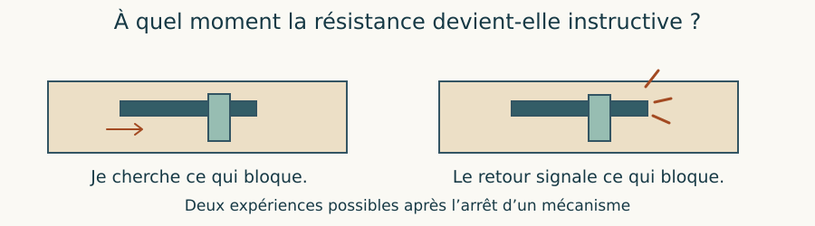

# Devrions-nous ainsi décrire la tâche du designer ? · 2018 · Corrigé guidé

*Corrigé rédigé par IA, non officiel. Signalez toute erreur.*

**Rédaction** · GPT-6.2 Astra Ultra · vitesse non renseignée · 25 novembre 2026

**Révision** · GPT-6.2 Astra Ultra · vitesse non renseignée · 26 novembre 2026

ENS Paris-Saclay · concours Design de première année · écrit de quatre heures · C18102. Francis Ponge oppose « arranger les choses » à l’exigence de se laisser déranger par elles (*Méthodes*, 1961, p. 263).

[Sujet officiel, p. 1](https://ens-paris-saclay.fr/sites/default/files/CONCOURS/ANNALES_1C/1C_Design/2018_Sujet_1A_Design_Philo_art.pdf) · [Rapport du jury, p. 11–13](https://ens-paris-saclay.fr/sites/default/files/CONCOURS/ANNALES_1C/1C_Design/2018_RE_1A_Design.pdf#page=11)

## Entrer dans le sujet

Dans la question, « ainsi » renvoie à la manière dont Ponge conçoit la tâche en amont. Le rapport distingue l’action d’améliorer une situation et celle de lui donner extérieurement bel aspect (p. 12). Faites varier le point de vue devant la commode de Remy. Qu’est-ce que l’arrangement fait remarquer ? Qu’est-ce qui risquerait de gêner la personne qui ouvre le tiroir ?

## Introduction

> [!INDICATION]
> Essayer trois sujets grammaticaux différents avec le verbe « déranger ».

Une porte qui coince fait remarquer son poids et sa charnière à celui qui les avait oubliés. Le visiteur chargé d’un sac subit l’obstacle. Le menuisier peut y lire une indication sur l’affaissement du battant. Francis Ponge demande que les choses nous dérangent. L’énoncé ne donne pas au poète pour mission de fabriquer des objets importuns. Il confie à ce qui lui résiste le pouvoir de le déplacer. Devrions-nous décrire ainsi la tâche du designer ? Son travail consiste souvent à arranger, c’est-à-dire à ordonner des éléments ou à remédier à une difficulté réelle. Comment l’attention à ce qui dérange pourrait-elle améliorer ce travail sans faire porter à l’usager le prix de notre curiosité ?

## I. L’arrangement est une promesse que la résistance des choses met à l’épreuve

> [!INDICATION]
> Distinguer la gêne éprouvée au moment de l’usage et le renseignement qu’en tire celui qui dessine.

L’expression « arranger les choses » prend une couleur différente selon la personne qui la prononce. Pour celui qui ferme la porte, l’arranger peut vouloir dire en réparer la charnière. Pour celui qui présente une photographie de la pièce, ce peut être masquer la porte défectueuse derrière un rideau. Le même résultat visible peut signaler la solution d’une difficulté ou sa dissimulation. Chez Ponge, les choses deviennent sujets du verbe qui dit le dérangement. Accepter ce renversement engage le designer à laisser une difficulté réelle défaire le bel ordre de son projet.

Celui qui conçoit un tiroir veut qu’on puisse l’ouvrir d’une main tout en soutenant une casserole de l’autre. Une façade parfaitement alignée peut dissimuler une prise trop mince. La composition paraît achevée sur le dessin tandis qu’un geste ordinaire la dément. Écouter la résistance, c’est reprendre le profil, le poids et les conditions d’approche de la main. Un tiroir plus facile à ouvrir peut être le résultat d’une conception qui a accepté d’être dérangée. Si le dessinateur exigeait en revanche de chaque cuisinier le même effort pénible au nom d’une expérience plus riche, il confondrait deux moments et deux destinataires de son projet.

Ponge, dans « Le Cageot » du *Parti pris des choses*, s’attarde sur une petite caisse promise à un usage bref. Sa fragilité, son matériau et jusqu’aux sonorités de son nom font dévier l’idée toute faite de l’emballage. Un designer peut lui emprunter cette discipline de l’attention. La manipulation d’une caisse vide révèle par exemple des lèvres coupantes que l’œil avait jugées minces et élégantes. Cependant le poète dispose du mot, le fabricant livre aussi des arêtes à des mains. Transposer l’exigence de Ponge, c’est la soumettre à cette différence d’effets.

## II. Certains arrangements soustraient à l’attention ce qui devrait faire question

> [!INDICATION]
> Chercher un cas dans lequel la facilité immédiate contribue à maintenir le problème.

Une interface propose d’acheter en un geste et exige plusieurs écrans pour retirer une option ajoutée. Tout semble « arrangé » tant que l’on suit le chemin le plus court. Cette facilité distribue de manière inégale les chances de consentir ou de refuser. Il serait possible de ralentir le paiement pour demander de confirmer précisément l’option. Le dérangement aurait ici un contenu. Il rendrait saillant un choix que le premier parcours faisait presque disparaître. La qualité d’une interface dépend donc aussi de ce qu’elle autorise l’usager à interrompre.

Dans la commode de Tejo Remy *You Can’t Lay Down Your Memory* (1991), des tiroirs de récupération, chacun entouré d’un caisson, sont réunis par une sangle. L’ensemble déroute l’attente d’une façade régulière et laisse visibles les différences que le meuble industriel ordinaire tend à effacer. C’est aussi un arrangement au sens matériel le plus strict. Sans les caissons et la sangle, les tiroirs ne formeraient aucun meuble. Le cas oblige à nuancer l’alternative de départ. Ce que l’ordre produit peut être précisément l’occasion de remarquer les choses auxquelles on ne prêtait plus attention. Son intérêt ne dispense cependant pas de demander ce que vaut la commode pour qui veut atteindre un tiroir.

Le schéma montre deux réactions à un arrêt identique. Si aucune raison n’apparaît, l’obstacle mange du temps et l’on recommence à l’aveugle. Si le retour désigne le point sur lequel on peut agir, l’interruption se transforme en enquête. Il existe pourtant une limite. Amasser des demandes de confirmation pour chaque geste conduit à cliquer sans lire. La nouveauté formelle et l’effet de choc se consument de la même manière lorsqu’ils deviennent systématiques. Ce qui dérange mérite d’être conservé lorsqu’il rend perceptible un enjeu sur lequel le destinataire peut encore intervenir.

## III. La tâche tient à la distribution de l’attention et des moyens de reprise

> [!INDICATION]
> Décrire à qui profite une difficulté et qui doit la surmonter.

Prenons une bouilloire devenue irréparable parce que son couvercle est scellé. L’achat de la suivante se fait aisément. Pourtant l’objet usagé, encombrant, dérange la fiction d’une consommation sans reste. En lui consacrant du temps, le designer peut découvrir que le joint défectueux pourrait être accessible derrière un couvercle démontable. La remise en service exige alors un geste supplémentaire. Elle rend à l’utilisateur ou au réparateur la possibilité d’une décision qui appartenait jusque-là au seul fabricant. Il faudra encore préserver la sécurité de l’appareil et indiquer les parties qui peuvent être manipulées. Une invitation à bricoler ne suffit pas à faire un objet réparable.

Deux usages du dérangement se distinguent finalement. Dans un cas, la difficulté est imposée à des personnes qui n’ont aucune prise sur elle. Dans l’autre, elle oblige d’abord le concepteur à défaire l’évidence de sa solution et donne ensuite au destinataire un moyen d’examiner la situation. Un objet très discret peut répondre admirablement à cette seconde exigence. Que le joint soit visible au moment où l’on cherche à le remplacer est plus décisif que de l’exhiber à chaque tasse. L’attention juste a un moment, une adresse et un coût.

## Conclusion

La formule de Ponge décrit une disponibilité indispensable au designer. La chose doit pouvoir démentir l’idée commode qu’il s’en était faite. Elle ne lui prescrit pas d’incommoder les usagers. Sa tâche consiste à remédier aux gênes évitables et à ménager des interruptions intelligibles là où la commodité ferait disparaître une décision ou ses conséquences.

## Reprendre le raisonnement

Reprendre l’exemple du tiroir en se plaçant tour à tour devant le prototype, chez une personne qui cuisine et dans un atelier de réparation. À chaque fois, nommer la résistance, son destinataire et ce qu’il peut en apprendre. Une seule réponse pour les trois situations ramènerait le sujet à un éloge général des difficultés.
