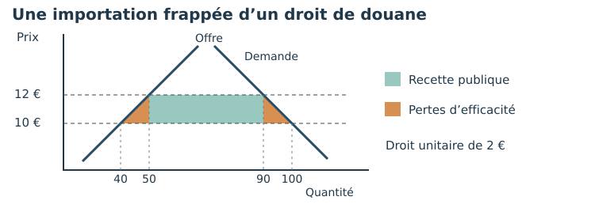

# ENS Paris-Saclay · Analyse économique (oral) 2018 — Corrigé guidé

*Corrigé rédigé par IA, non officiel. Signalez toute erreur.*

**Rédaction** · GPT-6.2 Astra Ultra · vitesse non renseignée

Chaque candidat tirait un seul sujet. Le jury publie quatre exemples, tous traités ici. La liste complète et les questions d’entretien effectivement posées restent inconnues. Préparation de trente minutes, puis trente minutes devant le jury, dont quinze à vingt d’exposé. La notice attribue le coefficient 2 à cette interrogation.

Chaque dossier contient une réponse que l’on peut développer à l’oral en expliquant le mécanisme ou le calcul, puis une relance d’entraînement avec sa réponse. Pour une préparation de trente minutes, consacrer les premières minutes aux définitions et à la thèse, la moitié du temps aux mécanismes et aux exemples, puis répéter l’ouverture et la conclusion. Les relances proposées sont originales.

## 1. Comment atteindre le plein emploi en France ?

**Préparer l’exposé.** Dessiner sur une feuille deux bassins d’emploi. Dans le premier, les postes vacants et l’emploi diminuent après une chute des ventes. Dans le second, des offres persistent dans une branche alors que les chômeurs disponibles ont travaillé dans une autre. Passer d’une situation à l’autre marque la transition du diagnostic aux instruments. Pour le calcul oral, énoncer le numérateur et le dénominateur avant de donner le taux. Une dernière minute peut être consacrée à l’évaluation, en confrontant les embauches aidées au nombre d’embauches supplémentaires.

**Introduction.** Une usine peut annoncer des postes vacants au moment où des demandeurs d’emploi attendent depuis des mois un entretien. Le plein emploi désigne une situation dans laquelle chacun peut normalement trouver un travail approprié après une période de recherche. Une économie en plein emploi connaîtra encore des transitions, des licenciements et des recherches de premier poste. En France, chercher un chiffre unique et constant risque de masquer la diversité des bassins d'emploi. Je défendrais une politique à deux horizons. Il faut soutenir les embauches lorsque les débouchés manquent, puis réduire les obstacles durables d’accès à des emplois productifs.

**I. Identifier la cause du défaut d’embauche.** Pour mesurer le chômage au sens du Bureau international du travail, on rapporte les personnes sans emploi, disponibles et en recherche active à la population active. Imaginons cent actifs dont dix chômeurs. Si deux chômeurs découragés cessent de chercher, l’emploi reste à 90 alors que le taux de chômage passe de 10 % à $8/98$, soit environ 8,2 %. Il faut donc suivre l’emploi en proportion de la population en âge de travailler, les heures souhaitées, les vacances de postes et les flux de retour durable à l’emploi. Le taux agrégé ne dit pas si le chômage touche surtout les entrants, les seniors ou certaines zones.

Une baisse des commandes conduit d’abord les employeurs à réduire les heures et les embauches. Le chômage augmente alors que les offres d’emploi diminuent. Une baisse d’activité prolongée peut aussi dégrader les qualifications et détourner les employeurs des candidats restés longtemps inactifs. Cette hystérèse transforme une insuffisance initiale de la demande en obstacle plus durable. Si, à chômage donné, de nombreuses offres restent vacantes, examiner les salaires offerts, les compétences, les horaires, les transports et le coût du logement. Le couple chômage-vacances, représenté par la courbe de Beveridge, suggère un diagnostic à vérifier à l’échelle des secteurs.

**II. Agir à l’échelle où se trouve le frein.** En récession, les stabilisateurs automatiques maintiennent une partie des revenus et de la consommation. Des investissements publics prêts à démarrer soutiennent la commande et peuvent améliorer le transport qui relie ensuite salariés et employeurs. En zone euro, la politique monétaire est commune. Le gouvernement français agit sur la composition du budget, tandis que la BCE règle les conditions monétaires pour l’ensemble de la zone. Le soutien national perd de sa force si la demande se porte principalement sur des importations. Une coordination européenne peut amplifier les effets dans les pays où les capacités sont disponibles. Lorsque les entreprises sont saturées, une relance additionnelle agit davantage sur les prix et les importations.

Face aux obstacles d’appariement, un accompagnement de proximité peut révéler que trois mois de formation à une machine précise ouvrent réellement un recrutement. Le financement doit alors être lié à une compétence transférable et suivi d’une observation du maintien dans l’emploi. À l’autre extrême, envoyer les demandeurs d’emploi suivre une formation générale pendant que toutes les commandes s’effondrent peut seulement différer leur retour dans les statistiques. Pour un débutant dont la productivité initiale est faible, un allègement ciblé du coût du travail peut rendre l’embauche rentable. Son efficacité dépend de la sensibilité des employeurs au coût et de l’ampleur des embauches qui auraient eu lieu de toute façon. Une aide à la garde d’enfants ou à la mobilité répond mieux à certains obstacles de participation.

**Conclusion.** Atteindre le plein emploi demande de préserver l’activité quand les débouchés se contractent et de rapprocher durablement travailleurs et emplois. J’évaluerais un dispositif par les recrutements supplémentaires qui tiennent dans le temps, la progression des heures et du revenu ainsi que l’amélioration du retour à l’emploi des personnes durablement exclues.

**Relance d’entraînement. Une hausse du taux d’activité peut-elle faire monter le chômage ?** Oui. À emploi inchangé, si des personnes jusque-là inactives entrent sur le marché et commencent à chercher, elles rejoignent les chômeurs et les actifs simultanément. Cette hausse de court terme est compatible avec une amélioration de leurs perspectives d’embauche.

## 2. Libre-échange ou protectionnisme ?

**Présenter le schéma.** Commencer au prix mondial et lire les deux quantités. Déplacer le doigt vers la ligne supérieure, puis soustraire offre et demande pour trouver les nouvelles importations. Les deux triangles de perte d’efficacité ont chacun une base de dix unités et une hauteur de deux euros. L’argument du grand pays vient seulement après cette démonstration. Il modifie l’hypothèse de prix mondial exogène. Pour comparer deux interventions, nommer la défaillance corrigée et les agents qui supportent la dépense.

**Introduction.** Une entreprise qui vend du matériel à l’étranger peut acheter son acier à l’étranger. Un tarif protégeant les sidérurgistes augmente alors les coûts de cet exportateur. L’unité de raisonnement doit inclure producteurs, utilisateurs et consommateurs. Le libre-échange réduit les obstacles aux échanges. La protection prélève un droit, limite une quantité ou restreint l’accès au marché. Dans un petit pays qui prend les prix mondiaux comme donnés, je privilégierais l’ouverture, accompagnée d’instruments d’ajustement et de corrections ciblées lorsque le marché ne mesure pas tous les coûts.

**I. Un gain agrégé peut coexister avec des pertes individuelles durables.** Chez Ricardo, la spécialisation suit les coûts d’opportunité. Imaginons qu’une unité supplémentaire de vin exige de renoncer à deux unités de drap dans le pays A et à quatre dans le pays B. À un prix international de trois unités de drap, A gagne à vendre du vin et B à en acheter, y compris si l’un des deux pays est techniquement plus productif dans les deux activités. La variété des biens, l’accès à des intrants moins chers et les économies d’échelle peuvent ajouter aux gains. Ces avantages n’assurent pas une transition indolore. Un salarié spécialisé dans une activité importatrice peut perdre son revenu pendant la reconversion. Son logement et les emplois de ses proches limitent sa mobilité. Une hausse du revenu national n’indemnise personne par elle-même.

Le schéma permet de chiffrer le coût d’une protection. Au prix mondial de 10 euros, la demande intérieure est de 100 unités et l’offre de 40. Avec un droit de 2 euros, le prix monte à 12, la demande tombe à 90 et l’offre augmente à 50. Les importations passent de 60 à 40. Avec les segments linéaires du dessin, les consommateurs perdent $(100+90)\times2/2=190$ euros. Les producteurs gagnent $(40+50)\times2/2=90$ euros. Le Trésor reçoit $2\times40=80$ euros. Il reste une perte collective de 20 euros, moitié parce qu’une production intérieure plus chère remplace des importations, moitié parce que des achats qui valaient leur coût mondial disparaissent.

**II. Choisir une intervention en fonction de la défaillance et de ceux qui paient.** L’argument de l’industrie naissante prend de la force lorsque l’apprentissage profite à d’autres entreprises qui ne contribuent pas à son financement. Une aide temporaire peut permettre le décollage d’une branche. Il faut alors documenter ces retombées, annoncer la durée et identifier un critère d’arrêt. Une aide à la formation ou à la recherche cible plus directement l’externalité. Le tarif, lui, fait aussi payer les acheteurs du produit. Un enjeu de sécurité d’approvisionnement peut justifier une diversification des fournisseurs, un stockage ou une capacité domestique minimale. Les comparer au tarif permet de choisir l’assurance la moins coûteuse pour une résilience donnée.

Un grand pays peut espérer que son droit de douane fasse baisser le prix demandé par les fournisseurs étrangers et améliore ses termes de l’échange. La condition est un pouvoir de marché effectif et la possibilité que les partenaires s’abstiennent de réagir. Une riposte ajoute un coût pour les exportateurs et peut annuler le gain. L’Union européenne conduit la politique commerciale commune. Pour la France, la négociation des règles d’accès aux marchés et la mise en œuvre de l’ajustement intérieur relèvent ainsi d’échelons différents. Un soutien aux revenus de transition, la formation et l’investissement dans les territoires spécialisés peuvent donner aux gains diffus de l’ouverture une traduction locale.

**Conclusion.** L’ouverture est défendable si l’on reconnaît les coûts de mobilité et si les institutions aident les personnes qui les supportent. J’accepterais une protection ciblée lorsque son objectif est mesurable, son financement identifiable, sa durée révisable et les instruments plus directs insuffisants.

**Relance d’entraînement. Un quota produit-il la même recette ?** Un quota qui ramène les importations à 40 peut produire ici le même prix. La différence de 2 euros par unité devient une rente. Des licences vendues aux enchères peuvent la faire revenir au Trésor. Une distribution gratuite peut en faire bénéficier les importateurs, voire les fournisseurs étrangers selon l’organisation du marché.

## 3. Faut-il se résigner aux taux d’intérêt négatifs ?

**Commencer par trois distinctions.** Tracer trois colonnes intitulées « nominal/réel », « court/long » et « banque centrale/marché ». Placer le taux de dépôt de la BCE dans la troisième colonne puis choisir l’exemple numérique approprié pour la première. Pendant l’exposé, expliquer l’hypothèse sur l’inflation avant de conclure sur le coût réel d’emprunt. Une objection bien menée consiste à demander ce qu’il advient d’une baisse de taux si personne ne souhaite investir, puis à expliquer quel autre instrument pourrait lever cet obstacle.

**Introduction.** Un épargnant qui prête 100 euros et en reçoit 99 un an plus tard a accepté un rendement nominal de −1 %. Il peut néanmoins préférer ce placement à des espèces coûteuses à conserver ou rechercher un actif immédiatement disponible et jugé sûr. En avril 2018, le taux de la facilité de dépôt de la BCE était de −0,40 %. Ce taux s’appliquait à un placement des banques auprès de l’Eurosystème. La question ouvre donc deux débats. Pourquoi des taux négatifs peuvent-ils apparaître et quelles politiques rendraient leur maintien moins nécessaire ? Je défendrais leur usage temporaire lorsque la demande et l’inflation sont faibles, en surveillant leur transmission et en préparant les conditions de la reprise.

**I. Identifier le prix qui est devenu négatif.** Un taux nominal négatif fait perdre des euros au prêteur sur la période si le titre est conservé jusqu’à son échéance. Un rendement réel négatif est possible même lorsque le taux nominal est positif. Le rendement réel anticipé vaut $(1+i)/(1+\pi^e)-1$, avec $\pi^e$ l’inflation anticipée. Un placement à 1 % quand les prix devraient croître de 2 % donne environ −0,98 % en pouvoir d’achat. À l’inverse, un titre à −0,5 % dans une économie où les prix devraient baisser de 2 % donne près de +1,53 % en termes réels. Ces deux cas ont des effets différents sur la propension à investir.

La préférence pour des titres publics sûrs et liquides peut en faire monter le prix jusqu’à rendre leur rendement négatif. Un fonds doit parfois détenir ces actifs pour couvrir un engagement ou constituer une garantie. Les billets offrent une possibilité de substitution, mais le stockage, le transport et la sécurité ont un coût. La borne effective en dessous de laquelle un passage massif aux espèces devient intéressant peut donc être inférieure à zéro. Une banque centrale qui juge la demande trop faible peut pousser ses taux vers cette borne. Aux maturités plus longues, les anticipations de taux et d’inflation, les risques et les primes de terme interviennent aussi. Les ménages n’obtiennent pas automatiquement un prêt immobilier aux mêmes conditions qu’une banque plaçant ses réserves.

**II. Évaluer les bénéfices, les limites et les moyens de sortie.** Une baisse du taux de dépôt peut inciter les banques à rechercher des prêts ou des titres plus rémunérateurs. Le refinancement devient plus favorable pour certaines entreprises. Un investissement dont le rendement prévu est modeste peut alors devenir rentable. Ce mécanisme suppose qu’il existe des emprunteurs solvables et des projets présentant des débouchés. La répartition des réserves peut changer entre banques sans que l’ensemble du système puisse, par une simple décision de prêt, faire disparaître les réserves que la banque centrale a créées.

Une partie des déposants de détail peut se tourner vers les billets si les banques répercutent la baisse. Si les taux de crédit diminuent et que les taux des dépôts de détail restent proches de zéro, les marges peuvent se contracter. L’amélioration de la solvabilité des débiteurs et l’augmentation éventuelle du volume de prêts vont dans l’autre sens. L’effet net sur le crédit dépend du bilan des établissements. Une recherche excessive de rendement peut aussi pousser à sous-estimer les risques financiers. La surveillance prudentielle peut viser les prêts les plus fragiles, tandis que la banque centrale maintient des conditions compatibles avec son objectif de prix.

**Conclusion.** Relever les taux simplement parce que leur signe surprend risquerait de contracter l’activité et de faire reculer encore les prix. Je privilégierais une normalisation conditionnée au rétablissement de la demande et des perspectives d’inflation. Des investissements publics productifs dans les pays disposant de marge budgétaire peuvent soutenir les projets privés et réduire le besoin de solliciter indéfiniment la politique monétaire.

**Relance d’entraînement. Pourquoi un acheteur accepte-t-il un rendement négatif sur une obligation ?** Le rendement se calcule à partir du prix et des flux promis. Un zéro-coupon acheté 101 et remboursé 100 dans un an rapporte environ −0,99 %. Sa sécurité, sa liquidité ou sa valeur comme garantie peuvent justifier ce coût. L’acheteur peut aussi espérer le revendre avant terme à un prix plus élevé, au risque d’une perte si les conditions changent.

## 4. La France doit-elle privilégier une politique de l’offre ou de la demande ?

**Faire entendre un choix.** Le mot « privilégier » demande un critère qui puisse changer la décision. Introduire deux observations opposées, des machines inutilisées et des commandes refusées. À chaque instrument proposé, répondre à trois questions. Quelle dépense ou quelle capacité change d’abord ? Quel agent adapte ensuite sa décision ? Quel indice ferait douter que le mécanisme a joué ? Pour présenter le multiplicateur, expliquer à voix haute que la fuite par les importations réduit chaque transmission successive. On peut garder la formule et commenter seulement les deux premiers tours devant le jury.

**Introduction.** Une usine qui tourne à mi-capacité et une usine qui refuse des commandes faute de main-d’œuvre font face à deux problèmes différents. Une politique de demande agit sur les dépenses des ménages, des entreprises, des administrations et de l’étranger adressées aux producteurs. Une politique d’offre agit sur les coûts, les capacités et la productivité. Le choix français dépend de l’état du cycle, des secteurs et du partage des compétences en zone euro. Je donnerais la priorité à la demande lorsque des ressources restent durablement inutilisées, en protégeant les dépenses qui accroissent les capacités futures. Je privilégierais l’offre lorsque le frein effectivement observé se trouve du côté des capacités.

**I. Une mesure efficace dans un état de l’économie peut perdre son effet dans un autre.** Quand les commandes manquent, une entreprise hésite à acheter une nouvelle machine même si le crédit est bon marché. Le soutien du revenu des ménages soumis à une contrainte de liquidité a alors de bonnes chances d’alimenter la consommation. Une commande publique peut accroître directement la production. Le revenu supplémentaire devient en partie la dépense de quelqu’un d’autre. Dans un modèle à prix fixes, sans impôts induits, avec une propension marginale à consommer de 0,8 et une propension marginale à importer de 0,2, un euro de revenu supplémentaire engendre 0,6 euro de demande intérieure supplémentaire. Pour un euro initial de commande domestique, les tours successifs donnent $1+0{,}6+0{,}6^2+\cdots=2{,}5$ euros de revenu. Le résultat illustre un canal. Il surestimerait l’effet si des hausses de prix, des impôts induits ou une réponse des taux absorbaient une partie de l’impulsion.

Le raisonnement change lorsque les équipements sont déjà utilisés au maximum et les recrutements difficiles. Une commande additionnelle peut allonger les délais, renchérir les intrants et accroître les importations. L’effort public doit alors examiner les compétences recherchées, l’accès au capital productif, la concurrence et la diffusion des innovations. Des baisses ciblées du coût du travail peuvent soutenir l’emploi si les entreprises les transforment en embauches ou en prix plus compétitifs. Le crédit d’impôt pour la compétitivité et l’emploi, en vigueur en France à la date du concours, illustre l’instrument. Une marge supplémentaire peut aussi servir à se désendetter. Le financement public de la mesure peut peser sur la demande. Il serait donc imprudent d’identifier automatiquement un allègement de coût à une création nette d’emplois.

**II. Composer les instruments et les évaluer dans une économie ouverte.** La formation, la rénovation de logements ou des investissements de transport mobilisent immédiatement des fournisseurs et peuvent ensuite améliorer le capital humain, réduire les consommations d’énergie ou faciliter les déplacements domicile-travail. Encore faut-il que les chantiers soient prêts, que les entreprises puissent y répondre et que le rendement collectif justifie le coût. En période de tension dans le bâtiment, programmer plusieurs chantiers successifs peut être plus efficace que les ouvrir tous à la fois. L’ordre des dépenses devient ainsi un instrument de politique économique.

L’échelle européenne compte également. Si plusieurs pays consolident en même temps leurs finances publiques au creux du cycle, chacun perd une partie de la demande de ses partenaires. Une relance coordonnée là où existent des marges peut réduire cette fuite extérieure pour la zone. À l’inverse, une stratégie de compétitivité par baisse relative des coûts réussit plus difficilement si tous les partenaires la poursuivent simultanément. La France ne fixe pas seule le taux directeur ni le taux de change de l’euro. Elle peut agir sur les compétences et l’environnement des entreprises, et défendre une orientation commune adaptée aux écarts de conjoncture.

**Conclusion.** Je commencerais par un diagnostic croisant enquêtes de commandes, capacités utilisées, postes vacants, évolution des prix et des salaires. Une insuffisance de débouchés et des pénuries localisées peuvent coexister. Le budget peut soutenir les catégories qui dépensent effectivement le revenu supplémentaire et concentrer l’effort structurel sur les goulets d’étranglement identifiés. L’évaluation doit suivre les emplois créés, les volumes produits et le coût pour les finances publiques dans les deux horizons.

**Relance d’entraînement. Pourquoi la même dépense apparaît-elle dans les deux politiques ?** La construction d’une ligne de transport commande aujourd’hui du travail et du matériel. Une fois en service, elle élargit le bassin d’emploi accessible et peut réduire les coûts de déplacement. Le premier effet dépend du cycle et de la part importée du chantier. Le second dépend de l’usage réel du réseau sur plusieurs années.

[Quatre exemples publiés](https://ens-paris-saclay.fr/sites/default/files/CONCOURS/ANNALES_1C/1C_D2_1/2018_Rapports_Oraux_D2_AEG.pdf#page=1) · [Rapport du jury](https://ens-paris-saclay.fr/sites/default/files/CONCOURS/ANNALES_1C/1C_D2_1/2018_Rapports_Oraux_D2_AEG.pdf) · [Notice, p. 34](https://ens-paris-saclay.fr/sites/default/files/2017-11/Notice_2018_Concours-entree.pdf#page=34)
