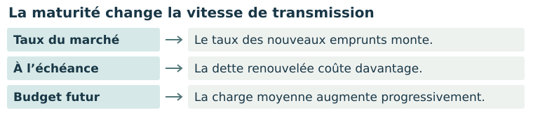

# ENS Paris-Saclay · Analyse monétaire et politique économique 2018 — Corrigé guidé

*Corrigé rédigé par IA, non officiel. Signalez toute erreur.*

**Rédaction** · GPT-6.2 Astra Ultra · vitesse non renseignée

Écrit d’admission de l’option économique et de gestion, jeudi 26 avril 2018, quatre heures, coefficient 2. Le jury reproduit l’intitulé de la dissertation à la première page de son rapport. Le feuillet distribué en salle reste à retrouver.

Sur le brouillon, écrire deux phrases avec des flèches de sens opposés. Le coût de la dette modifie les décisions publiques. Les décisions publiques modifient le solde primaire, le coût et la croissance. Garder ces deux phrases sous les yeux permet de traiter toutes les dimensions de « face à ». Les exemples institutionnels ci-dessous se placent à la date de l’épreuve.

## Les politiques économiques face à la soutenabilité de la dette

**Délimiter.** « Politiques économiques » appelle le budget, la monnaie et les politiques structurelles. La zone euro partage la politique monétaire, tandis que les dépenses et la plupart des prélèvements restent nationaux. Ce partage donne un contenu précis à la question de savoir qui peut agir. Le rapport souligne que de nombreux candidats ont réduit le sujet à la baisse du stock de dette et omis les politiques de long terme. Une phrase distinguant état de la dette et choix de politique évite ce rétrécissement dès l’introduction.

Un État peut emprunter aujourd’hui pour maintenir les revenus pendant une récession. Si cette intervention abrège la crise, sa dette augmente dans l’immédiat, mais la base sur laquelle il lèvera l’impôt demain est mieux préservée. Le même emprunt, consenti à un taux élevé pour reconduire une dépense sans financement durable, risque de réduire sa capacité d’intervention lors de la crise suivante. Le montant emprunté suffit donc rarement à juger de la décision.

La dette publique est le stock d’engagements financiers des administrations publiques dans le périmètre retenu. Les déficits successifs y contribuent, de même que certaines opérations financières et variations de valorisation. La liquidité désigne la capacité à régler les échéances proches. La solvabilité renvoie, sous des hypothèses de taux et de croissance, aux ressources que le débiteur peut mobiliser pour honorer ses engagements dans la durée. Une trajectoire est soutenable si les politiques budgétaires qui permettent de servir ou de refinancer la dette restent économiquement et politiquement réalisables, y compris face à des chocs plausibles. L’horizon des paiements et la capacité à maintenir l’effort fiscal comptent autant que l’identité comptable.

Les pouvoirs publics poursuivent des objectifs d’emploi, de stabilité des prix, de répartition et de croissance. Comment la charge de la dette change-t-elle leurs arbitrages et comment ces arbitrages transforment-ils en retour la trajectoire de l’endettement ? Il faut caractériser la contrainte, étudier ses effets sur les politiques de stabilisation, puis examiner comment prolonger la capacité collective d’agir.

## I. Une même dette brute peut imposer des efforts très différents

**Reproduire le calcul.** Un solde primaire excédentaire porte un signe positif dans la définition de $s_t$ et un signe négatif dans la variation de $b_t$. Pour vérifier le premier résultat, imaginer au départ un PIB de 100 et une dette de 90. Le PIB atteint 102 et la dette avant solde primaire 93,6. Pour garder un ratio de 90 %, la dette doit valoir 91,8. L’écart de 1,8 vaut environ 1,76 % du PIB courant. Faire cette vérification en niveaux évite de confondre taux de variation et points de PIB.

Soit $B_t$ la dette à la fin de l’année, $i_t$ le taux nominal moyen effectivement payé sur le stock de début d’année et $S_t$ le solde primaire, les recettes moins les dépenses hors intérêts. En l’absence d’ajustements entre stock et flux, $B_t=(1+i_t)B_{t-1}-S_t$. Si le PIB nominal augmente au taux $g_t$, diviser cette égalité par le PIB courant donne, avec $b_t=B_t/Y_t$ et $s_t=S_t/Y_t$,

$$
b_t-b_{t-1}=\frac{i_t-g_t}{1+g_t}b_{t-1}-s_t.
$$

Le premier terme est l’effet dit « boule de neige ». Si le taux moyen excède la croissance nominale, le maintien du ratio exige un excédent primaire. Pour une dette initiale égale à 90 % du PIB, avec un taux moyen de 4 % et une croissance nominale de 2 %, cet excédent est de $0{,}9\times 0{,}02/1{,}02$, soit environ 1,76 % du PIB. Si le taux moyen passe à 2 % et la croissance à 3 %, le solde stabilisant devient un déficit primaire d’environ 0,87 % du PIB. Il s’agit de scénarios hypothétiques. Le calcul fixe l’effort nécessaire pendant une année et laisse entière la question de la durée et de la faisabilité de cet effort.

Une dette libellée en monnaie domestique à taux fixe et de maturité longue transmet plus lentement une hausse de taux qu’une dette à renouveler dans l’année. Une dette en devise expose en outre les ressources fiscales nationales à une dépréciation du change. Les créanciers peuvent craindre de ne pouvoir revendre leur titre et demander une prime. Cette hausse du taux aggrave la trajectoire qu’ils redoutent. Un État dont les recettes futures permettraient d’honorer la dette peut alors manquer de liquidité. À l’inverse, reporter les maturités peut donner du temps à un État dont l’assiette fiscale s’est durablement contractée, sans restaurer à lui seul sa capacité de paiement.

Les ressources mobilisables ont enfin des limites. Une hausse répétée des prélèvements peut peser sur l’activité, encourager l’évasion ou rencontrer un refus politique. Une baisse des dépenses peut affaiblir des services nécessaires à la croissance et au consentement à l’impôt. La qualité des institutions fiscales, les actifs financés en contrepartie de l’emprunt et les engagements futurs liés au vieillissement éclairent le diagnostic. Deux pays de même ratio initial peuvent disposer de marges de stabilisation très différentes.

## II. La contrainte de financement modifie les politiques conjoncturelles

**Identifier l’intermédiaire.** On peut schématiser au brouillon le passage du taux directeur aux rendements de marché, puis aux charges payées par l’État. À chaque étape, donner une raison pour laquelle l’ajustement peut être incomplet. Dans le mécanisme du multiplicateur, conserver les deux variations de l’équation. La réduction primaire de la dépense agit directement sur $s_t$ et ses effets sur le revenu agissent sur $g_t$ et les recettes. La distinction entre gains immédiats et gains durables permet d’expliquer pourquoi deux calendriers de consolidation peuvent produire des résultats différents.

Lorsque la charge d’intérêts augmente, les dépenses nouvelles entrent plus directement en concurrence avec le service de la dette. Une relance financée à crédit détériore le solde primaire avant que les recettes induites par la reprise ne remontent. Si les ménages disposent d’un accès facile au crédit et anticipent les impôts futurs, ils peuvent épargner une partie du supplément de revenu. Cet argument d’inspiration ricardienne est moins puissant pour des ménages contraints de différer des achats faute de liquidités. Les importations absorbent aussi une partie de la demande supplémentaire. Le multiplicateur dépend ainsi de la conjoncture, des bénéficiaires et des réactions monétaires et financières. En plein emploi, une impulsion budgétaire risque davantage de se traduire par des tensions sur les prix ou par l’éviction de projets privés.

Le mouvement inverse appelle la même prudence. Supposons une réduction rapide de dépense en récession. À revenu donné, elle améliore le solde primaire. Si les capacités de production sont inutilisées, la production peut reculer, une partie des recettes disparaître et les allocations augmenter. Le ratio de dette peut même monter temporairement du fait de la contraction du dénominateur. L’assainissement devient plus crédible lorsqu’il ménage les stabilisateurs automatiques pendant la récession et précise les mesures pérennes qui s’appliqueront au retour de l’activité. Un pays menacé de perdre immédiatement l’accès au marché dispose toutefois de moins de temps pour étaler cet ajustement.

La banque centrale agit sur le coût du crédit et sur la demande globale. Son taux directeur est un taux de politique monétaire à court terme. Le rendement d’une obligation d’État de longue maturité incorpore les anticipations de taux courts et des primes de durée, de risque et de liquidité. Le taux moyen payé par le Trésor dépend encore du rythme de renouvellement de son stock. Dans la zone euro des années 2010, les achats de titres publics sur le marché secondaire ont contribué à détendre les conditions de financement. En 2012, l’annonce d’un dispositif conditionnel d’opérations monétaires sur titres a aussi visé la fragmentation des marchés. Une action commune peut calmer une panique de refinancement. Elle ne dispense pas de choisir quelles dépenses financer et comment lever les ressources futures. Subordonner durablement la politique monétaire aux seuls besoins du Trésor risquerait en outre de compromettre l’ancrage des anticipations de prix.

## III. Agir sur la croissance et la qualité des engagements préserve une capacité future d’intervention

**Arbitrer dans le temps.** Pour chaque proposition structurelle, préciser la dépense initiale, le canal de croissance, le délai et une limite. Un projet d’éducation coûte avant de produire un revenu fiscal supplémentaire. Une cession d’actifs donne une recette immédiate et prive éventuellement l’État d’un revenu ultérieur. Ces deux exemples évitent de confondre amélioration de trésorerie et meilleure soutenabilité. Dans le cas européen, distinguer la décision nationale d’emprunter, la politique monétaire commune et les effets d’une décision nationale sur les partenaires.

La recherche de soutenabilité peut conduire à modifier la composition du budget. Reporter l’entretien d’un réseau ferroviaire réduit une dépense cette année, puis renchérit les réparations et peut diminuer la mobilité de la main-d’œuvre. À l’inverse, financer par emprunt une infrastructure utile peut répartir son coût entre générations utilisatrices et accroître la productivité. Il faut alors apprécier le rendement social du projet, le coût d’opportunité de son financement et les dépenses de fonctionnement futures. Les retombées économiques ne sont pas intégralement captées par le fisc. Un investissement socialement souhaitable exige donc encore une stratégie de financement crédible.

Du côté des recettes, élargir une assiette ou améliorer le recouvrement peut procurer un rendement fiscal plus durable qu’une hausse du taux facial sur une assiette étroite et mobile. Une politique de formation bien ciblée soutient l’emploi, les recettes et la capacité productive, mais engage des dépenses avant les premiers résultats. Les gains annoncés sont incertains. Une évaluation des cohortes formées et des emplois occupés permet de corriger le dispositif. Une vente d’actifs, elle, allège ponctuellement la dette brute et peut faire perdre des revenus futurs. Ces effets de calendrier invitent à considérer le patrimoine public et les engagements à venir.

Dans une union monétaire, la soutenabilité a une dimension collective. Une relance nationale bénéficie en partie aux partenaires par les importations, tandis qu’une consolidation simultanée peut comprimer la demande adressée à tous. Les règles budgétaires européennes cherchent à rendre les engagements nationaux prévisibles. Des contraintes appliquées mécaniquement au bas du cycle peuvent aussi inciter à réduire les investissements faciles à différer. Une trajectoire pluriannuelle explicite, une appréciation des circonstances conjoncturelles et le financement commun de projets transfrontaliers peuvent concilier discipline et investissement. La mutualisation crée cependant un problème d’incitation si les prêteurs ou les gouvernements comptent sur une garantie sans conditions. Des critères transparents, une surveillance commune et une répartition annoncée des coûts permettent de discuter ce risque.

**Conclusion.** La soutenabilité est à la fois un résultat des politiques menées et une condition de leur efficacité future. Dans l’urgence, protéger le refinancement et l’activité peut empêcher une crise de liquidité de s’aggraver. À moyen terme, le rythme d’ajustement primaire dépend de la croissance, du coût moyen de la dette et de l’effort effectivement supportable. À long terme, le contenu des dépenses et la capacité à prélever les fruits de la croissance déterminent les marges de manœuvre. Le bon critère pour juger d’un emprunt est la capacité qu’il laisse à la collectivité d’honorer ses engagements et de faire face au choc suivant.

[Intitulé reproduit par le jury](https://ens-paris-saclay.fr/sites/default/files/CONCOURS/ANNALES_1C/1C_D2_1/2018_Rapports_Excrits_D2_AMPE.pdf#page=1) · [Rapport du jury](https://ens-paris-saclay.fr/sites/default/files/CONCOURS/ANNALES_1C/1C_D2_1/2018_Rapports_Excrits_D2_AMPE.pdf) · [Notice, p. 34](https://ens-paris-saclay.fr/sites/default/files/2017-11/Notice_2018_Concours-entree.pdf#page=34)
