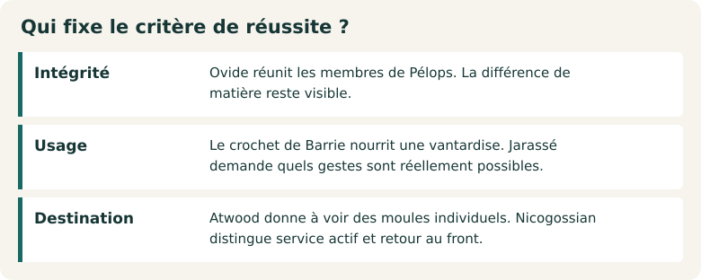

# La prothèse · ENS-PSL 2018 — corrigé guidé

*Corrigé rédigé par IA, non officiel. Signalez toute erreur.*

**Rédaction** · GPT-6.2 Astra Ultra · vitesse non renseignée · 26 novembre 2026

Étude de documents. Préparation de 1 h 30, exposé de 10 minutes, puis discussion de 10 minutes.

## Préparer la lecture

**Partir de la légende.** Décrivez d’abord les formes visibles sur le cliché de Maputo, puis ajoutez les mots « moules », « fabrication » et « centre orthopédique ». Chacun change le moment de la chaîne que nous croyions voir. Gardez cette différence entre apparence et résultat pour l’interprétation de la fin d’Ovide et du récit militaire.

## Formuler la question

Les objets photographiés par Jane Evelyne Atwood à Maputo ressemblent à des jambes. Ce sont, précise la légende, des *moules* de jambes destinés à la fabrication de prothèses. Ce petit délai entre la vue et la lecture importe. À juger du premier regard, nous aurions pris un moment du travail pour son résultat. Un délai semblable est nécessaire devant le soldat dit réparé, le pirate à la main de fer ou l’athlète en compétition. À quel moment peut-on dire que la prothèse a rempli son office, et qui peut en juger ?

## « Entier » selon quel regard ?

**Saisir un paradoxe narratif.** Lisez les premier et dernier gestes d’Ovide dans l’ordre du récit. À la fin, Pélops est entier. Au début, il peut montrer la différence. Cherchez ensuite, dans le cadrage d’Atwood, le détail qui individualise les formes à première vue répétées.

Chez Ovide, la fin de l’épisode se ramasse en un mot. Pélops redevient « entier ». La description anatomique localise exactement ce qui manque entre le cou et le bras, et les dieux réunissent les parties dispersées. Pourtant le premier geste imaginé par le narrateur est déjà celui d’un homme qui écarte son vêtement pour montrer son épaule. L’ivoire garde la mémoire du crime et de la réparation. L’intégrité retrouvée accepte qu’une différence de matière continue à se voir. Plus encore, elle se raconte à partir de cette différence. L’expression qui rapporte le récit à la tradition souligne à quel type de vérité appartient cette merveille.

La photographie en noir et blanc donne à un autre matériau clair une tout autre existence. Au centre orthopédique, les formes se pressent les unes contre les autres. Leurs hauteurs et leurs contours varient, des tiges en dépassent, certaines basculent. La série fait songer à une production en nombre et sa diversité à l’ajustement que requiert chaque personne. Le cadre ne nous donne ni le visage ni le récit des futurs usagers. Il rend sensible un travail préparatoire que le verbe conclusif d’Ovide pouvait condenser en une seule opération des dieux. Il ne nous apprend pas encore si chacun s’appropriera l’objet fabriqué.

## Ce que peut faire une main

**Faire entendre l’ironie.** Attribuez chaque réplique à son énonciateur. Floup ne parle pas en chercheur. Il rappelle au capitaine une parole de ce dernier. En passant de la menace au démêlage des cheveux, il met une prétention à l’épreuve d’un geste précis. Expliquez ensuite ce qui change lorsque Jarassé procède à une comparaison rigoureuse des usages.

Le crochet de Barrie semble d’abord donner un avantage certain au capitaine. Il lui vaut un nom et une autorité sur son équipage. Mais celui qui l’arbore avec fierté veut aussi se venger de la perte subie. La vantardise qui prête à un crochet la valeur d’une vingtaine de mains est rapportée par Floup au moment le plus gênant. Le capitaine vient de jouer sur le sens menaçant de « serrer la main » à son ennemi. Son subordonné le ramène au soin des cheveux. La chute transporte brusquement le pirate dans le rôle d’une mère formulant des vœux pour ses enfants. Le comique naît des usages et des registres que ce discours doit traverser pour prétendre à une supériorité universelle.

Le chercheur en robotique Nathanaël Jarassé démonte par un exemple la confusion que met en scène la fiction. Les lames de course de Pistorius autorisent une performance remarquable dans une activité précise. Un changement de dispositif est nécessaire pour d’autres usages. La différence entre courir vite et passer au cours d’une journée d’une posture à l’autre est une différence de critère. Une mesure de vitesse ne rendra pas compte de cette polyvalence, même si elle est parfaitement exacte. Jarassé indique aussi un effet de la mise en spectacle. La promesse d’un dépassement permanent peut rendre une aide réellement précieuse décevante aux yeux de celui à qui on l’a promise. Il y a donc un enjeu de soin jusque dans le choix des images publiques du progrès.

## Les finalités de la réparation

**Changer de point de vue.** Inscrivez sur trois lignes « le programme militaire », « la personne citée » et « le lecteur des statistiques ». Pour chacun, énoncez ce qui compterait comme une réussite et ce qui reste inconnu. Vous pourrez intégrer cet écart à la discussion médicale du dossier.

L’enquête de Judith Nicogossian situe une partie des recherches américaines dans une institution militaire. L’expression « fonctions motrices et militaires » rapproche une capacité corporelle et une affectation professionnelle. Or le retour en service actif et le retour sur le théâtre des hostilités donnent lieu, dans l’extrait, à deux décomptes distincts. Les confondre reviendrait à attribuer à tous les mêmes fonctions retrouvées, voire le même désir. Le texte laisse aussi entendre l’enthousiasme et l’impatience de Claudia Mitchell pour des usages encore à venir. Ses attentes personnelles et les objectifs du programme peuvent se rencontrer sans devenir interchangeables.

Ici la photographie de Maputo fournit une objection à l’ensemble des portraits héroïques. Elle retire du champ le geste spectaculaire qui permettrait de classer rapidement le résultat. Les moules, avec leurs différences discrètes, nous laissent en amont d’une multiplicité d’usages. Jarassé offre alors un principe de lecture de la scène militaire aussi bien que de celle de Barrie. À chaque promesse, demander quel geste elle désigne, dans quelle situation, au bénéfice de qui. L’usage quotidien apparemment le plus banal peut avoir, pour celui qui veut le retrouver, une importance que le spectacle du record ne mesure jamais.

## Conclure

Ovide nomme entier un homme chez qui reste une trace. Barrie fait rire d’une prétention à la supériorité, et les enquêtes contemporaines donnent à cette distinction des conséquences pratiques. L’efficacité d’une prothèse se juge dans le passage du matériau à une activité, puis dans la place que celle-ci occupe dans une vie. L’image d’Atwood nous laisse précisément le temps d’imaginer cette dernière étape, dont le titulaire le mieux placé pour parler reste la personne appareillée.

## Préparer la discussion

**Si l’on demande si le progrès technique est critiqué**, reprenez la première phrase de Jarassé. Il présente de véritables espoirs, puis examine les conséquences des attentes suscitées par la fiction. On peut donc reconnaître la réussite d’une tâche tout en demandant comment l’objet s’insère dans une journée ordinaire. Revenez pour finir à la série de moules, chacun destiné à une fabrication singulière.

## Sources

Les pages 2 à 6 réunissent Nathanaël Jarassé (2014), la photographie de Jane Evelyne Atwood prise à Maputo (2001), Ovide (*Métamorphoses*, VI), J. M. Barrie (*Peter Pan*, 1911) et Judith Nicogossian (2012).

[Sujet conservé](https://web.archive.org/web/20251009142251id_/https://medecine-humanites.ens.fr/wp-content/uploads/2018/07/MH2018-OralDocuments-2bis-prothe%CC%80se.pdf) · [Rapport du jury](https://web.archive.org/web/20240410061106id_/https://medecine-humanites.ens.fr/wp-content/uploads/2018/07/Rapport-jury-Medecine-Humanites-2018-1.pdf) · [Annales de l’ENS-PSL](https://medecine-humanites.ens.psl.eu/sujets-et-rapports-du-concours-2018/)
