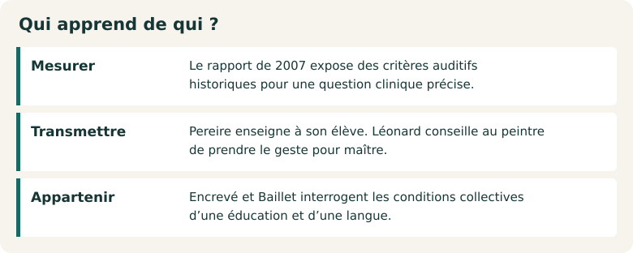

# La surdité · ENS-PSL 2018 — corrigé brut

*Corrigé rédigé par IA, non officiel. Signalez toute erreur.*

**Rédaction** · GPT-6.2 Astra Ultra · vitesse non renseignée · 26 novembre 2026

Étude de documents. Préparation de 1 h 30, exposé de 10 minutes, puis discussion de 10 minutes.

Qui est le maître et qui est l’élève ? Le titre du tableau de Lenepveu paraît trancher. Jacob Rodrigues Pereire enseigne à Mlle Marois. Dans le traité de Léonard, les rôles sont redistribués. Le peintre qui veut rendre une intention intelligible doit apprendre de personnes que les préjugés de son lecteur pourraient lui faire tenir pour privées de moyens d’expression. Entre les deux scènes se dessine la question du dossier. Qui reconnaît une capacité de communiquer, et à quelles conditions celle-ci devient-elle un savoir transmissible ?

## Mesurer un écart, choisir une fin

La page de la Haute Autorité de santé présente les indications d’implantation formulées par un consensus de 1995, dont le rapport de 2007 annonce l’actualisation. Le document précise des conditions, distingue adulte et enfant et tient compte de ce que permet déjà un appareillage. Son intérêt pour notre lecture est dans la construction de ses critères. L’intensité sonore et la reconnaissance de phrases dans des conditions données apportent deux types d’information. La précision de ces mesures répond à une question définie sur l’indication d’une intervention. Rien, dans leur échelle, ne mesure l’appartenance à une communauté linguistique ou la facilité avec laquelle on exprime une idée par les mains.

Chez Caroline Baillet, le choix de Mozart est révélateur. Regretter de ne jamais entendre une symphonie paraît une évidence à celui pour qui cette musique compte. En attribuant d’avance le même regret à quelqu’un d’autre, il transforme une préférence située en manque universel. L’auteure inscrit un S majuscule à « Sourds » pour rendre lisible une revendication d’identité. Ce signe typographique fait apparaître quelque chose que les critères audiométriques laissaient hors de leur champ. Il serait cependant tout aussi imprudent de déduire le désir d’une personne, dans un sens ou dans l’autre, de la majuscule employée par une chercheuse. La prise en compte des usages et des attentes de chacun garde ici une place décisive.

## Regarder comment on apprend

Lenepveu, en 1861, imagine une scène du siècle précédent. L’élève et le maître sont proches, le visage de la jeune fille levé vers celui de l’adulte. Les mains et les visages se rejoignent au centre de la composition. Le tableau concentre ainsi l’attention du spectateur sur une relation silencieuse pour lui aussi. La proximité des mains pourrait faire penser à un enseignement de la langue des signes. Le texte d’Encrevé éclaire le piège. Pereire est associé à une tradition d’enseignement individuel privilégiant l’articulation, la parole et la lecture sur les lèvres. Le corps peut être mobilisé pour apprendre à parler aussi bien que pour converser dans une langue signée. Une pose peinte isolée ne suffit pas à identifier la langue d’un échange.

Léonard s’adresse à un apprenti peintre. Ses impératifs et l’objection moqueuse qu’il prête à son lecteur donnent à son conseil le tour d’une petite controverse. Le regard doit parcourir mains, yeux et sourcils pour saisir une intention rendue visible par toute la personne. Celui qu’on imaginerait devoir être instruit devient une autorité en matière de mouvement. Le peintre peut apprendre de lui un art qu’il ne pratique pas lui-même. Il faut pourtant garder à ce renversement sa portée exacte. Le traité étudie l’intelligibilité d’une figure peinte. Sa célébration du geste ne constitue ni une description linguistique des langues des signes ni la garantie de leur reconnaissance politique.

## Apprendre ensemble et pouvoir participer

Encrevé confronte deux histoires de l’égalité. Dans la première, l’enseignement commun part d’une langue déjà utilisée par les élèves pour leur donner accès aux connaissances générales. Dans la seconde, l’assimilation des manières de parler promet de rendre moins visible une différence qui expose à la stigmatisation. À qui revient alors l’effort de rendre la vie commune possible ? Lorsque l’accès aux autres matières dépend avant tout de la maîtrise d’une forme de parole, la réponse engage l’emploi du temps, les pairs que l’on rencontre et les savoirs que l’on pourra acquérir. Une conception de la différence se traduit en conditions matérielles d’éducation.

L’article de Baillet pousse la question jusqu’aux conditions de transmission d’une culture. La proximité d’expériences partagées et les liens entre membres de communautés sourdes peuvent traverser les frontières nationales. Ces liens expliquent pourquoi, dans l’analyse proposée, regrouper des élèves peut fournir un véritable espace de participation. L’entrée d’un seul élève dans une classe d’entendants peut recevoir le nom d’intégration tout en le privant d’interlocuteurs qui partagent sa langue. Cette critique concerne la possibilité de se rencontrer. Elle ne suppose ni que tous les parcours se ressemblent ni que les langues des signes forment une langue mondiale unique.

La question de départ change de sens. Le maître n’est pas seulement celui qui transmet un savoir, mais aussi celui qui accepte de découvrir chez l’élève un pouvoir d’expression qu’il ignorait. La médecine apporte des moyens situés d’évaluer l’audition, l’histoire interroge le projet éducatif, et l’art rappelle au spectateur que lui aussi a besoin d’apprendre à voir. L’égalité se joue jusque dans cette capacité réciproque d’apprendre.

## Sources

Les pages 2 à 6 associent le dossier de la Haute Autorité de santé par Corinne Collignon et al. (2007), le tableau de Jules Eugène Lenepveu (1861), le *Traité de la peinture* de Léonard de Vinci (vers 1500), l’histoire de l’éducation des jeunes sourds par Florence Encrevé (2008) et le texte de Caroline Baillet sur la culture sourde (2013).

[Sujet conservé](https://web.archive.org/web/20260114114231id_/https://medecine-humanites.ens.fr/wp-content/uploads/2018/07/MH2018-OralDocuments-3-surdite%CC%81.pdf) · [Rapport du jury](https://web.archive.org/web/20240410061106id_/https://medecine-humanites.ens.fr/wp-content/uploads/2018/07/Rapport-jury-Medecine-Humanites-2018-1.pdf) · [Annales de l’ENS-PSL](https://medecine-humanites.ens.psl.eu/sujets-et-rapports-du-concours-2018/)
