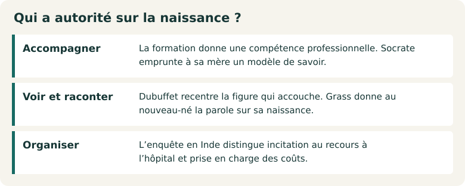

# L’accouchement · ENS-PSL 2018 — corrigé guidé

*Corrigé rédigé par IA, non officiel. Signalez toute erreur.*

**Rédaction** · GPT-6.2 Astra Ultra · vitesse non renseignée · 26 novembre 2026

Étude de documents. Préparation de 1 h 30, exposé de 10 minutes, puis discussion de 10 minutes.

## Préparer la lecture

**Commencer par la grammaire.** Écrivez trois phrases en donnant successivement pour sujet la femme, la sage-femme et l’enfant narrateur du *Tambour*. Gardez cette permutation pour organiser un exposé de dix minutes. Dans chaque mouvement, montrez qui dispose du savoir, de la parole ou du pouvoir d’agir.

## Formuler la question

Le français permet de dire à la fois qu’une femme accouche et qu’une sage-femme l’accouche. Qui agit dans ce verbe ? Chez Grass, la surprise est qu’un troisième acteur, l’enfant, revendique la parole et décrit presque comme un exploit son arrivée au monde. Chez Dubuffet, le regard rencontre d’abord la figure de la mère. Autour de ces deux centres possibles se pressent des témoins, des professionnels et jusqu’à un État qui se donne pour tâche de rendre la naissance plus sûre. Comment l’accompagnement d’un événement corporel redistribue-t-il le savoir et l’autorité de dire ce qui arrive ?

## Le savoir de celle ou celui qui accompagne

**Tester l’analogie.** Dans le *Théétète*, repérez ce que le philosophe conserve du travail attribué aux accoucheuses et ce qu’il déplace. Replacez les critères de la loi française dans leur époque. À quelle condition peut-on comparer les deux modèles de compétence sans en faire un seul récit historique ?

L’histoire retracée par Béatrice Jacques et Sonia Purgues fait apparaître une tension au cœur même de la reconnaissance du métier. Une formation s’organise et un diplôme d’État valide des compétences acquises. Or le texte de loi de 1943 requiert aussi une connaissance de la féminité présentée comme intérieure et personnelle. Le même dispositif atteste un savoir enseignable et lui ajoute une condition tenue pour naturelle. L’association de la sollicitude au féminin devient alors une manière de tracer les frontières d’une profession. Les auteures analysent la formation historique de cette croyance. La citer comme une définition durable des aptitudes des femmes reproduirait la croyance qu’elles étudient.

La scène du *Théétète* fait entendre une argumentation d’une autre nature. Socrate, fils de Phénarète, sollicite l’assentiment de son interlocuteur sur les coutumes des accoucheuses. Selon le récit rapporté, leur expérience passée les qualifie, tandis que leur âge les sépare de celles qu’elles assistent aujourd’hui. Artémis, qui n’a pas enfanté, complique le modèle parce que le privilège divin diffère de la condition humaine évoquée. Socrate emprunte à ce savoir maternel l’image du travail de la pensée. La maïeutique aide quelqu’un d’autre à faire advenir ce qu’il porte. Mais le transfert accorde au philosophe masculin le soin des âmes et situe les femmes du côté du travail des corps. L’analogie honore une compétence et distribue inégalement les places.

## Où se place le témoin ?

**Prendre cinq secondes devant l’image.** Décrivez la position du lit, l’orientation des deux corps et l’habit du personnage de droite. Indiquez le moment précis où une observation deviendrait une supposition. Chez Grass, faites de même pour le partage entre ce qui arrive et ce qu’en dit le narrateur.

Dans le tableau de Dubuffet, un lit est vu de telle façon que le corps de la mère, les bras levés, s’offre frontalement à notre regard. Le petit corps sous elle se présente dans l’autre sens. Deux adultes habillés encadrent cette scène colorée. L’échelle, les contours marqués, la différence entre la figure centrale et les vêtements sombres rendent la mère immédiatement visible. Le personnage au chapeau peut attirer la curiosité. Aucun attribut certain ne lui confère la qualité de médecin. Si nous lui donnons spontanément ce rôle, notre regard révèle une habitude sociale dont l’image ne suffit pas à établir la vérité. Le peintre redistribue donc l’attention avant même que nous ayons nommé tous les protagonistes.

Grass adopte le point de vue matériellement impossible de l’enfant racontant avec précision son propre accouchement. La sage-femme aide deux êtres « à se détacher l’un de l’autre ». Le nouveau-né s’attribue même la réussite de sa présentation. La première lumière qu’il voit vient d’ampoules dont il connaît la puissance. Le rapprochement du récit biblique avec une formule publicitaire sabote le ton solennel attendu pour un commencement absolu. Ce mélange de détail ordinaire, de vocabulaire obstétrical et d’assurance comique fait du nouvel arrivé l’auteur de son origine. Il fait aussi entendre un déséquilibre. Celui qui dispose de la parole présente comme un incident attendu ce que la mère éprouve dans son corps. Mettre un sujet au centre du récit peut en déplacer un autre.

## Changer d’échelle sans perdre l’événement

**Distinguer objectif, instrument et résultat.** La réduction de la mortalité est un objectif. Nommez les deux instruments décrits par Jullien puis cherchez si l’extrait chiffre un effet. Le rapprochement avec la naissance à domicile chez Grass permet de demander ce qu’un classement statistique laisse ouvert.

L’enquête de Clémence Jullien sur l’Inde des années 2000 et 2010 fait passer de la chambre à une politique de santé. Un premier programme prévoit une incitation financière. Un second prend en charge les soins liés à la grossesse, à l’accouchement et à la période qui suit dans les établissements publics. Une récompense attachée à un choix et la suppression d’un coût ne modifient pas de la même manière l’éventail des choix possibles. Leur finalité annoncée est la réduction de la mortalité maternelle et infantile. L’extrait décrit les instruments et l’intention de l’État. Il ne fournit pas à lui seul une mesure des résultats ni le récit de l’accueil fait à ces dispositifs par chaque femme.

Le domicile où naît le narrateur du *Tambour* aide à comprendre cet écart. On voulait partir à la clinique, mais le temps a manqué. Une catégorie administrative comme « naissance à domicile » peut donc réunir des histoires où la volonté, le temps et les possibilités de déplacement ne jouent pas du tout le même rôle. Lire le roman avec l’enquête ne revient pas à transposer une scène allemande en Inde. La fiction révèle ce qu’une catégorie utile pour compter est obligée de laisser de côté. L’histoire des sages-femmes rappelait de même qu’un diplôme peut rendre une compétence visible sans épuiser l’expérience des personnes qui l’exercent.

## Conclure

Le même événement peut faire l’objet d’une aide, d’un récit et d’une politique parce qu’il engage plusieurs personnes dans des rôles différents. Reconnaître la compétence du soignant et l’intérêt d’une politique de santé laisse entière la question de la voix de celle qui accouche. Le tableau est à cet égard une conclusion exigeante. Il nous tient face à cette figure centrale sans nous livrer d’avance l’identité ni l’autorité de ceux qui l’entourent.

## Préparer la discussion

**Pour la discussion**, on peut vous demander si la fiction apporte une connaissance. Répondez par un exemple délimité. Le roman ne calcule aucune fréquence mais fait imaginer une situation où le lieu de naissance résulte d’un contretemps. Dans le tableau, l’habit noir déclenche une hypothèse que le regard doit accepter de réviser.

## Sources

Les pages 2 à 6 réunissent Béatrice Jacques et Sonia Purgues sur la profession de sage-femme (2012), *L’Accouchement* de Jean Dubuffet (1944), le *Théétète* de Platon (149a–150b), *Le Tambour* de Günter Grass (1959) et Clémence Jullien sur les politiques publiques en Inde (2015).

[Sujet conservé](https://web.archive.org/web/20251009143645id_/https://medecine-humanites.ens.fr/wp-content/uploads/2018/07/MH2018-OralDocuments-4-accouchement.pdf) · [Rapport du jury](https://web.archive.org/web/20240410061106id_/https://medecine-humanites.ens.fr/wp-content/uploads/2018/07/Rapport-jury-Medecine-Humanites-2018-1.pdf) · [Annales de l’ENS-PSL](https://medecine-humanites.ens.psl.eu/sujets-et-rapports-du-concours-2018/)
