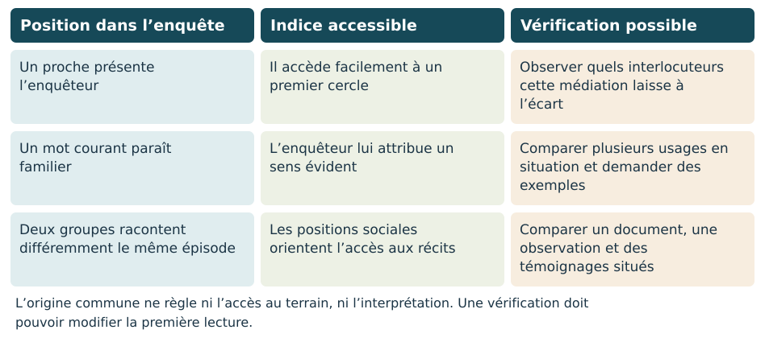

# ENS-PSL · Sélection internationale Lettres — Anthropologie — être anthropologue chez soi 2018 · Corrigé brut

*Corrigé rédigé par IA, non officiel. Signalez toute erreur.*

**Rédaction** · GPT-6.2 Astra Ultra · vitesse non renseignée

**Autocontrôle** · GPT-6.2 Astra Ultra · vitesse non renseignée

## Commentaire de la réflexion d’André Béteille

Deux chercheurs se trouvent devant la même assemblée de village. L’un reconnaît immédiatement le sens d’un titre que plusieurs intervenants se donnent. L’autre demande à chacun de l’expliquer. Le premier peut saisir une allusion inaccessible au second. Il peut aussi manquer le désaccord que révèlent des explications divergentes. Le second peut ouvrir une question féconde ou prendre une explication de circonstance pour une définition universelle. C’est dans cet espace que se situe la proposition de Béteille en 2007. Le rapport à l’objet tient à la position du chercheur et à l’histoire de sa discipline, mais aucun de ces éléments ne commande à lui seul le contenu de l’analyse.

### Deux traditions de constitution des objets

La distinction entre « autres cultures » et « propre société » désigne une division historique du travail savant. Dans une part importante de l’anthropologie européenne, le déplacement lointain, la durée du séjour et l’apprentissage d’une langue ont établi la valeur de l’observation directe. Cette possibilité de se déplacer et de décrire a également dépendu de rapports politiques et coloniaux inégaux. La sociologie s’est souvent donné pour objets des transformations de la société industrielle dont ses auteurs étaient membres, à travers des enquêtes sur le travail, les classes ou les institutions. Demander qui pouvait désigner qui comme un « autre » fait apparaître que la distance est aussi construite par les institutions savantes.

Cette généalogie n’autorise aucune distribution définitive des méthodes. La sociologie urbaine de Chicago a fait de la présence sur le terrain et des récits de vie des moyens de connaître des milieux proches géographiquement et socialement différenciés. Béteille, dans *Caste, Class and Power*, distingue à Sripuram en Inde du Sud rang de caste, position de classe et pouvoir politique. Superposer d’avance ces trois hiérarchies aurait masqué les cas où elles divergent et les changements de leurs rapports. Une enquête au sein de son pays peut exiger apprentissage, comparaison et révision des catégories tout autant qu’une enquête à l’étranger.

### Des asymétries d’accès plutôt qu’un privilège de vérité

Étudier « chez soi » peut faciliter les premiers contacts, la compréhension d’une plaisanterie ou le retour vers des interlocuteurs après le terrain. Cette familiarité a un prix analytique. Le chercheur risque de tenir une norme locale pour une évidence, de supposer un accord qui ne concerne que son milieu ou de taire une observation susceptible d’atteindre une relation durable. L’accès par une famille favorise certains récits et peut fermer d’autres portes. Un chercheur étranger sera parfois dispensé de connaître les conventions et pourra demander des explications. Il dépendra aussi de traducteurs, de médiateurs ou des versions qu’on juge convenables pour un visiteur.

Ces effets varient au sein d’une même enquête. Partager la nationalité d’un interlocuteur ne signifie partager ni sa langue familiale, ni sa classe, ni son métier, ni son autorité. Un habitant peut présenter le chercheur comme un proche devant ses voisins et comme le représentant d’une institution face à un service public. Il s’agit donc de décrire des relations révisables. Les précautions de Béteille, qui refuse un rapport « trop direct » et parle de « chances », s’opposent à la déduction d’une orientation intellectuelle à partir d’une identité.

### Rendre les conditions de connaissance visibles

La réflexivité porte sur la production d’une preuve. Si plusieurs personnes donnent des récits différents d’une réunion, on peut rechercher comment chacune y a pris part, qui a introduit l’enquêteur et ce qui pouvait être dit publiquement. Un procès-verbal révèle certaines décisions officielles, tandis que l’observation de la réunion et des entretiens individuels peuvent restituer les désaccords. Aucun de ces matériaux ne suffit isolément. Leur confrontation permet de réviser l’interprétation qui paraissait évidente à la première visite.

Pour traiter le volet personnel de la consigne, le candidat doit ici décrire une observation ou un entretien réellement réalisé. Le détail décisif est celui où sa position a changé l’accès aux matériaux ou leur interprétation. Il peut s’agir d’un mot initialement jugé transparent et réinterprété après des usages contradictoires, si ses notes attestent cet épisode. Préciser comment les données ont modifié l’hypothèse et quelle incertitude subsiste. L’enquête publiée de Béteille fournit un exemple de comparaison analytique. Elle ne remplace pas le terrain personnel demandé.

Être « chez soi » définit en définitive un ensemble de facilités et d’obligations qui doivent être examinées une à une. La différence entre anthropologie et sociologie subsiste dans l’histoire de leurs questions et de leurs traditions de preuve. Elle cesse de se confondre avec une frontière simple entre proximité et distance dès que l’on considère les conditions concrètes d’une enquête.
