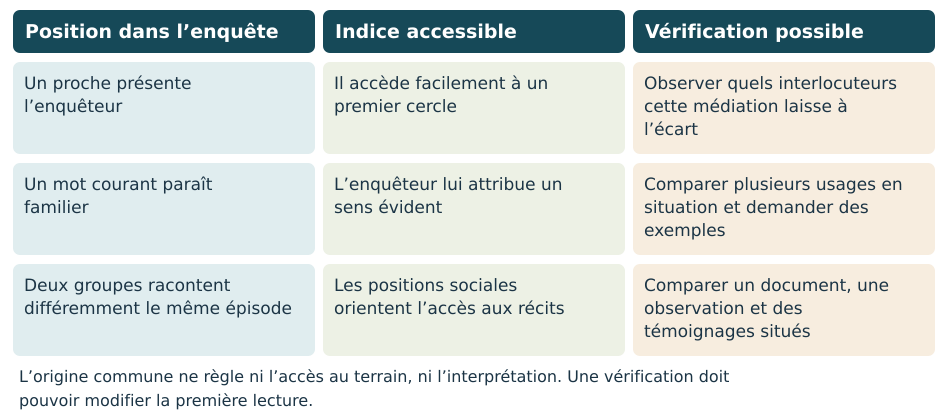

# ENS-PSL · Sélection internationale Lettres — Anthropologie — être anthropologue chez soi 2018 · Corrigé guidé

*Corrigé rédigé par IA, non officiel. Signalez toute erreur.*

**Rédaction** · GPT-6.2 Astra Ultra · vitesse non renseignée

**Autocontrôle** · GPT-6.2 Astra Ultra · vitesse non renseignée

## Construire le problème à partir des précautions de Béteille

Souligner trois expressions. « Tradition » invite à écrire une histoire des disciplines. « Le même objet » maintient constant ce que deux chercheurs étudient, afin de faire varier leur rapport à cet objet. « A des chances » désigne une relation probable. On peut donc formuler la difficulté ainsi. Comment les conditions d’accès orientent-elles les connaissances, et quelles opérations permettent de vérifier puis de corriger cette orientation ?

Une introduction qui distribuerait le lointain à l’anthropologue et le proche au sociologue aurait déjà contredit la possibilité même d’une anthropologie chez soi. Une introduction qui dirait seulement que tous les chercheurs ont des biais manquerait l’histoire disciplinaire évoquée par le passage. Relier l’apprentissage de langues et la résidence prolongée à des traditions ethnographiques, puis l’étude des classes, des institutions ou du travail à des traditions sociologiques. Ajouter un croisement concret, par exemple l’enquête de terrain en sociologie urbaine.

### Faire varier la position à objet constant

Prendre une réunion associative comme expérience de pensée. Une enquêtrice membre de longue date est invitée aux échanges préparatoires. Elle interprète un silence comme un accord selon l’usage de son cercle. Un enquêteur présenté par une mairie n’est convié qu’à la séance publique. Il entend un vote unanime et risque de conclure à la même chose par un autre chemin. Pour chacune de ces interprétations, demander quelles données permettraient de la réviser. Des entretiens séparés peuvent établir que certains ont renoncé à intervenir. Des notes sur la préparation peuvent au contraire montrer qu’un compromis avait déjà été trouvé. Ce cas hypothétique met en évidence une différence de matériaux sans distribuer d’avance la vérité.

### Utiliser une recherche publiée pour préciser les méthodes

Dans son enquête à Sripuram, Béteille distingue la caste, la classe et le pouvoir. On peut rendre la distinction observable en demandant séparément à qui l’on accorde un rang social, qui détient la terre et qui peut mobiliser des soutiens dans une décision collective. Le fait que ces réponses coïncident parfois ne dispense pas de les recueillir séparément. L’intérêt de cet exemple est de montrer comment un chercheur peut décomposer analytiquement une société qui lui est familière à certains égards. Il n’autorise aucune conclusion sur ce qu’un autre enquêteur indien ou étranger aurait nécessairement pensé.

On peut, pour la comparaison, mentionner les enquêtes de terrain des sociologues de Chicago. La proximité de leur université avec les lieux étudiés ne leur donnait pas automatiquement accès aux métiers, aux logements ou aux trajectoires des habitants. Il a fallu construire les contacts, recueillir des récits et situer les groupes dans la ville. L’opposition géographique ne prédit ainsi ni le choix de l’entretien ni l’usage de l’observation.

### Rédiger le paragraphe personnel à partir d’une trace

Choisir dans ses propres matériaux une scène où l’intuition initiale a été bousculée. Indiquer le contexte de la rencontre, le rôle que les personnes présentes attribuaient au chercheur et ce qui a été effectivement vu ou entendu. Isoler ensuite une hypothèse initiale, un détail résistant à cette lecture et la vérification tentée. Si une expression semblait aller de soi, chercher dans les notes deux emplois qui lui donnent des portées différentes. Si l’enquêteur a été introduit par un responsable, préciser qui a pu lui parler à l’écart et quelles voix restent absentes.

Une difficulté d’accès documentée est déjà un matériau pour l’analyse. Un interlocuteur qui refuse de parler en présence d’un supérieur permet de poser la question des effets de cette présence, tout en laissant inconnues les raisons intimes de son silence. Décrire cette limite avec précision. Seule la personne ayant mené l’enquête peut compléter ce passage par une expérience authentique.

Conclure en revenant à la modalisation de Béteille. La position change les occasions de rencontre, les attentes et les indices accessibles. La qualité du travail dépend de la manière dont ces conditions deviennent contrôlables par des comparaisons, des contre-exemples et l’explicitation des matériaux recueillis.
