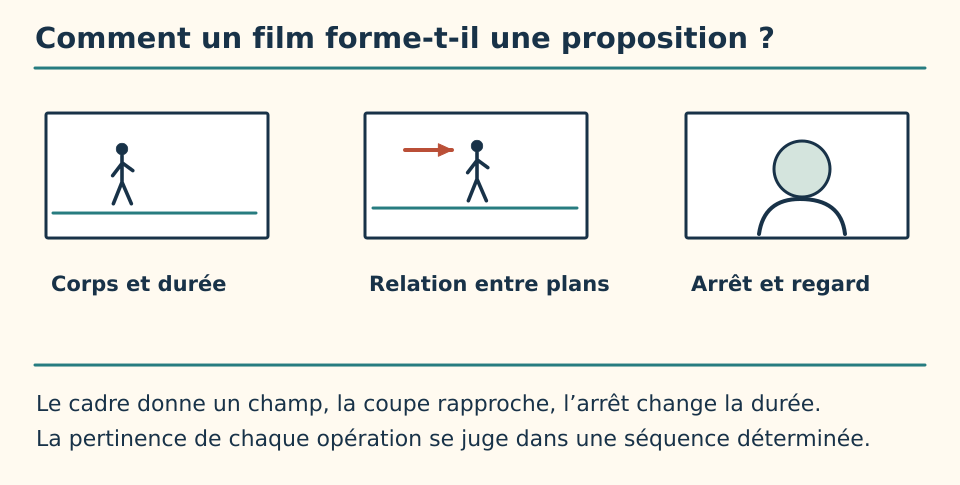

# ENS-PSL · Sélection internationale Lettres · 2018 · Corrigé brut

*Corrigé rédigé par IA, non officiel.*

**Rédaction** · GPT-6.2 Astra Ultra · vitesse non renseignée

**Révision (tour 1)** · GPT-6.2 Astra Ultra · vitesse non renseignée

## Écrire avec le cinéma

Pourquoi comparer une caméra à un stylo alors qu’un tournage engage souvent toute une équipe et que l’image semble enregistrer ce qui lui préexiste ? Le paradoxe est celui d’une pensée qui n’attendrait plus d’être formulée en phrases pour trouver une illustration. Elle prendrait corps à travers les opérations du film. Le présent progressif du texte en fait un programme autant qu’un constat.

### Une promesse écrite au futur

Astruc passe du constat de transformation à l’annonce d’un instrument à venir. Les attractions foraines, le spectacle et l’archive composent pour lui un passé dont il faut s’émanciper. La comparaison avec la peinture et le roman revendique une égale latitude pour le cinéaste. L’expression « aussi abstraite » met cette revendication à l’épreuve : une chaise se photographie, alors qu’une idée sur le temps, une hypothèse ou une objection réclament des relations entre images. Le titre propose d’appeler écriture le travail qui donne à ces relations une forme partageable.

### Monter une pensée

Dans *L’Homme à la caméra* de Dziga Vertov (1929), des images d’activité se figent, la pellicule et la monteuse Elizaveta Svilova apparaissent, puis les gestes retrouvent leur mouvement à la projection. La différence entre vie filmée, photogramme immobile et mouvement reconstruit se laisse éprouver dans le temps de la séance. Il serait possible de la résumer en une phrase. Le film conduit pourtant le spectateur à refaire lui-même le passage d’un état à l’autre. Le travail visible de la monteuse révèle au passage la limite de la métaphore d’un auteur seul devant sa feuille. L’écriture peut résulter d’une coopération qui entre jusque dans l’image.

### Une obsession prend le temps d’un plan

À la fin des *Quatre Cents Coups* de François Truffaut (1959), le déplacement d’Antoine jusqu’à la mer se prolonge au-delà de la durée nécessaire pour transmettre l’information de sa fuite. Lorsqu’il se retourne, le visage s’immobilise. Le temps ouvert de la course aboutit à une image dont la durée semble désormais soustraite au personnage. L’arrêt donne à la question de l’avenir de cet enfant une forme que ne dicte aucune réponse verbale. Réalisé après 1948, l’exemple permet de mettre la promesse d’Astruc à l’épreuve sans le présenter comme l’objet historique de son article.

### Ce que la promesse doit à ses prédécesseurs

L’opposition entre attraction et langage demande enfin à être discutée. Lorsque Méliès loge un projectile dans l’œil de la lune dans *Le Voyage dans la Lune* (1902), l’attraction repose déjà sur un changement d’échelle et sur la métamorphose d’un astre en visage. Le gag visuel construit une représentation irréductible à la conservation d’un événement. La rupture annoncée par Astruc devient alors une revendication de liberté pour tous les genres et toutes les pensées. On peut retenir la force du programme sans dater de 1948 la première apparition d’une écriture cinématographique.

## Sources

Le sujet d’une page reproduit un extrait de l’article d’Alexandre Astruc publié le 30 mars 1948 dans L’Écran français. La citation introduit une hypothèse historique et esthétique.

[Sujet de l’ENS](https://www.ens.psl.eu/sites/default/files/Sujet%20ecrit%20cinema%20SIL.pdf)
