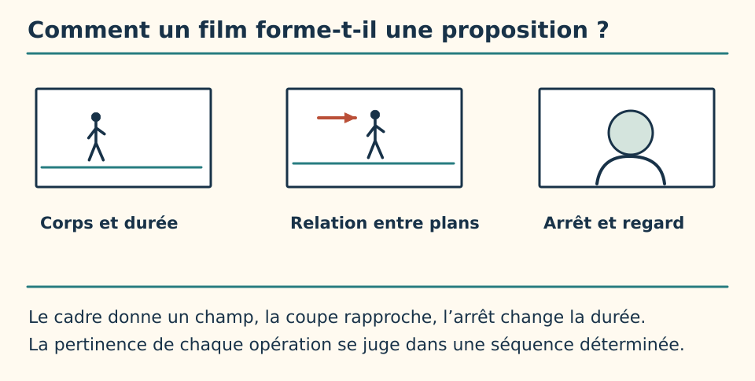

# ENS-PSL · Sélection internationale Lettres · 2018 · Corrigé guidé

*Corrigé rédigé par IA, non officiel.*

**Rédaction** · GPT-6.2 Astra Ultra · vitesse non renseignée

**Révision (tour 1)** · GPT-6.2 Astra Ultra · vitesse non renseignée

## Écrire avec le cinéma

Diviser le passage selon ses temps verbaux. Le sujet demande de commenter cette page précise. Tout exemple doit éclairer une difficulté de son raisonnement.

### Situer la comparaison

Souligner le présent, puis le futur. Demander ce que le critique croit déjà possible et ce dont il souhaite faire une possibilité ordinaire. Expliquer pourquoi l’essai importe à côté du roman : l’un autorise à penser par hypothèses, digressions et rapprochements, là où le récit apparaît d’abord comme enchaînement d’événements.

### Produire un exemple analysable

Choisir deux opérations perceptibles chez Vertov. Quand une image de mouvement devient pellicule manipulée, le changement de support fait partie de ce que le film énonce. Pour le dernier plan de Truffaut, décrire la course puis l’arrêt. Le schéma distingue des opérations possibles ; il ne reproduit aucun photogramme.

### Mettre la métaphore à l’épreuve

Comparer trois propositions : le film enregistre un geste, la succession des plans fait comprendre son mécanisme, l’arrêt final modifie la question que se pose le spectateur. Préciser laquelle resterait vraie si le film se réduisait à une photographie. Demander aussi quelles décisions reviennent au cadreur, au comédien ou au monteur.

### Construire la conclusion

Rapprocher Méliès et Vertov du texte de 1948, puis faire jouer Truffaut comme exemple ultérieur. L’antériorité des deux premiers oblige à distinguer une invention et la formulation d’un programme. La conclusion peut dès lors préciser à quelles conditions on peut penser par images et par sons.

## Sources

Le sujet d’une page reproduit un extrait de l’article d’Alexandre Astruc publié le 30 mars 1948 dans L’Écran français. La citation introduit une hypothèse historique et esthétique.

[Sujet de l’ENS](https://www.ens.psl.eu/sites/default/files/Sujet%20ecrit%20cinema%20SIL.pdf)
