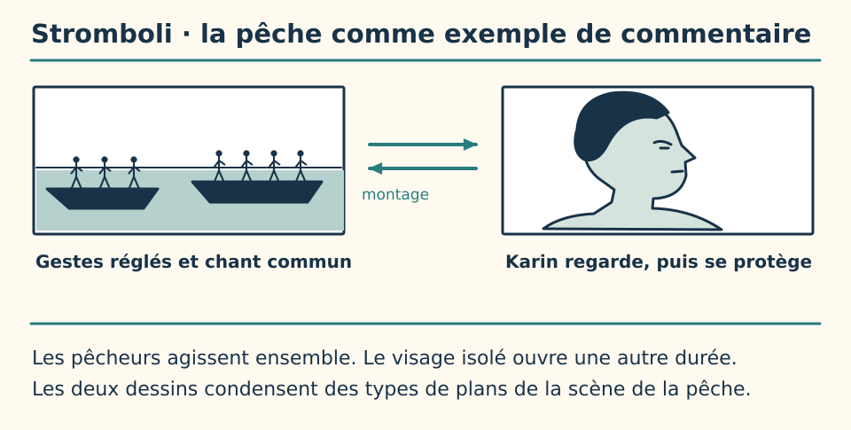

# ENS-PSL · Sélection internationale Lettres · 2018 · Corrigé brut

*Corrigé rédigé par IA, non officiel.*

**Rédaction** · GPT-6.2 Astra Ultra · vitesse non renseignée

**Révision (tour 1)** · GPT-6.2 Astra Ultra · vitesse non renseignée

## Stromboli de Roberto Rossellini · commenter un extrait

**Couverture partielle.** Le feuillet identifie Stromboli, mais les pièces conservées ne donnent ni la vidéo ni les bornes du passage projeté. Le commentaire de la scène de la pêche est un exemple de travail dont le choix pour l’oral de 2018 reste inconnu.

Dans la scène de la pêche au thon de Stromboli (1950), que je prends ici pour exemple, Karin, une étrangère venue vivre sur l’île après son mariage, assiste au travail des hommes depuis une barque. Rossellini fait tenir ensemble deux expériences d’un même événement. Les pêcheurs anticipent le geste du voisin. Karin découvre ce qui se passe à mesure que cela arrive. À qui le film donne-t-il le temps de comprendre ce qu’il montre ?

### Du large à la mesure d’un geste

Les embarcations dessinent d’abord un espace commun. D’un bord à l’autre, un corps penché trouve sa réponse dans un autre. Le chant fait entendre cette coordination quand l’image découvre seulement une partie du groupe. Il permet d’attendre avec les pêcheurs. Les vues plus rapprochées et les changements d’axe rendent ensuite plus difficile de garder en tête la disposition des barques. L’accélération du montage transforme également la perception de gestes que nous avions eu le temps de reconnaître.

### Qu’apporte le contrechamp sur Karin ?

Rossellini coupe de la pêche à un visage. L’événement continue dans l’intervalle pendant lequel nous regardons quelqu’un le voir. L’écume atteint Karin, qui cherche la protection de son bras et de son foulard. Sa place de témoin devient sensible sur son propre corps. Certaines vues peuvent se comprendre comme le prolongement de son regard. Les angles en plongée et les changements de distance donnent aussi accès à des détails que sa seule place dans la barque expliquerait mal.

### Le réel de la pêche dans le temps du récit

Le chant et la répartition des gestes enseignent quelque chose de précis sur un travail insulaire. La scène conserve ce savoir même pour qui ignore l’histoire de Karin. Inversement, l’intrigue conjugale acquiert ici un contenu concret. Partager la vie d’Antonio voudrait dire habiter un monde dont beaucoup de gestes, évidents pour ceux qui les pratiquent, la laissent désemparée. La gêne de Karin ne suffit pas à juger les pêcheurs. Le temps accordé à leur travail permet aussi de prendre leur point de vue au sérieux.

### Conclusion

La pêche continue quand le montage nous ramène à Karin. Cette persistance donne au contrechamp sa force. Nous pouvons éprouver le choc de la spectatrice et continuer d’entendre le rythme d’un métier. Entre ces deux expériences, le film fait percevoir la distance qui sépare la présence physique sur l’île de l’appartenance à une communauté.

## Sources

Le sujet officiel de 2018 nomme le film et fixe les durées. La page pédagogique « Stromboli » et l’étude de la revue Visible documentent la scène de la pêche choisie ici pour l’entraînement. Aucun rapport propre à cet oral ne figure parmi les pièces de la fiche.

[Sujet de l’ENS](https://www.ens.psl.eu/sites/default/files/Sujet%20oral%20cinema%20SIL.pdf)

[Extrait pédagogique et commentaire](https://www.cinemacentansdejeunesse.org/videos/stromboli.html) · [Étude de la séquence de la pêche, revue Visible](https://www.unilim.fr/visible/183)
