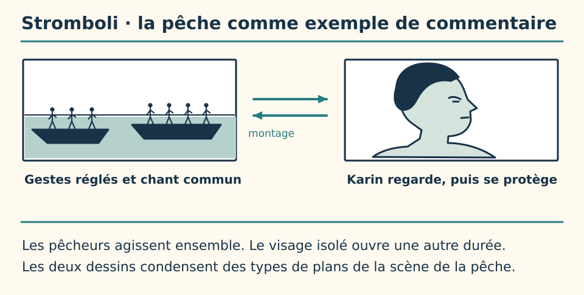

# ENS-PSL · Sélection internationale Lettres · 2018 · Corrigé guidé

*Corrigé rédigé par IA, non officiel.*

**Rédaction** · GPT-6.2 Astra Ultra · vitesse non renseignée

**Révision (tour 1)** · GPT-6.2 Astra Ultra · vitesse non renseignée

## Stromboli de Roberto Rossellini · commenter un extrait

**Couverture partielle.** Le feuillet identifie Stromboli, mais les pièces conservées ne donnent ni la vidéo ni les bornes du passage projeté. Le commentaire de la scène de la pêche est un exemple de travail dont le choix pour l’oral de 2018 reste inconnu.

Le feuillet fixe une heure de préparation et une demi-heure de passage. Si vous travaillez sur la séquence de la pêche diffusée par Cinéma, cent ans de jeunesse, vous pouvez vérifier les observations suivantes pendant le visionnage. Si vous disposez de la copie d’épreuve, commencez par relever son premier et son dernier plan.

### Dessiner ce qui est visible

Sur une feuille, placez les bords des barques, le groupe qui travaille et la place d’où Karin observe. Une ligne suffit pour l’horizon. Dès que change l’échelle du cadre, demandez-vous ce que vous perdez de la situation générale et quel geste vous pouvez désormais suivre. La réponse passe, par exemple, de la disposition collective des embarcations à l’effort d’un corps.

### Expliquer une coupe

Choisissez un retour au visage de Karin. Notez l’élément qui rattache les deux plans, puis ce que le changement de cadre ajoute. Voir l’effort renseigne sur le travail. Voir la réaction de Karin renseigne sur ce que regarder cet effort lui coûte. Distinguez le contrechamp qui montre la spectatrice du plan subjectif qui adopterait son point de vue optique. Justifiez le second terme par l’orientation et la hauteur de la prise de vues.

### Écouter deux fois

Suivez d’abord le chant en laissant de côté l’intrigue. Que donne-t-il à entendre de l’accord entre les pêcheurs ? Suivez ensuite les images de Karin. Le même rythme collectif fait sentir la place singulière d’une femme qui observe sans prendre part au geste. Appuyez votre commentaire sur un croisement précis entre un élément sonore et une image.

### Préparer la reprise par le jury

Si on vous demande où commence la fiction, repartez d’une coupe précise. Le travail fournit la matière de la scène. Les retours sur le visage d’Ingrid Bergman inscrivent ce travail dans l’histoire de Karin. Si le jury a retenu un autre moment du film, reprenez ces trois questions sur les images effectivement montrées : qui agit, qui voit, et quel élément de son ou de cadre déplace notre attention ?

## Sources

Le sujet officiel de 2018 nomme le film et fixe les durées. La page pédagogique « Stromboli » et l’étude de la revue Visible documentent la scène de la pêche choisie ici pour l’entraînement. Aucun rapport propre à cet oral ne figure parmi les pièces de la fiche.

[Sujet de l’ENS](https://www.ens.psl.eu/sites/default/files/Sujet%20oral%20cinema%20SIL.pdf)

[Extrait pédagogique et commentaire](https://www.cinemacentansdejeunesse.org/videos/stromboli.html) · [Étude de la séquence de la pêche, revue Visible](https://www.unilim.fr/visible/183)
