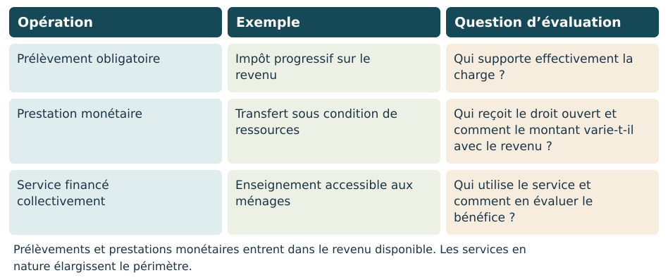

# ENS-PSL · Sélection internationale Lettres — Économie — redistribuer 2018 · Corrigé brut

*Corrigé rédigé par IA, non officiel. Signalez toute erreur.*

**Lecture du rapport du jury** · GPT-6.2 Astra Ultra · vitesse non renseignée

**Rédaction** · GPT-6.2 Astra Ultra · vitesse non renseignée

**Autocontrôle** · GPT-6.2 Astra Ultra · vitesse non renseignée

**Révision (tour 2)** · GPT-6.2 Astra Ultra · vitesse non renseignée · 26 novembre 2026

## Redistribuer

En Amérique du Nord, dans le périmètre États-Unis–Canada du *Rapport sur les inégalités mondiales 2018*, les 10 % d’adultes aux revenus les plus élevés recevaient 34 % du revenu national en 1980 et 47 % en 2016. Cette évolution d’une part de revenu avant impôt renseigne sur la distribution à laquelle s’appliquent les politiques publiques. Elle ne suffit pas à juger de leur action. Redistribuer consiste à modifier la répartition des ressources ou des risques par des règles collectives de prélèvement et d’attribution. Pour savoir si l’opération atteint son but, il faut identifier ses bénéficiaires, ses financeurs et les changements qu’elle induit.

### I. Corriger une inégalité de ressources et assurer contre un risque

Si un euro de plus permet à un ménage pauvre de chauffer son logement et apporte peu à un ménage déjà très aisé, un transfert peut accroître le bien-être agrégé sous l’hypothèse d’une utilité marginale décroissante et de poids sociaux appropriés. On peut aussi défendre une garantie minimale d’existence ou l’égalité des chances sans additionner des utilités. Ces critères diffèrent. Réduire la pauvreté en bas de distribution peut laisser presque intacte la concentration des très hauts revenus. Un impôt sur les transmissions peut viser les écarts au début de la vie adulte sans produire immédiatement la même variation de pauvreté.

L’assurance introduit une seconde dimension. Au cours d’une année, une personne en bonne santé finance des soins auxquels elle ne recourt guère, tandis qu’une personne malade en bénéficie davantage. Avant de connaître leur état de santé, les deux peuvent gagner à mutualiser ce risque. De même, une pension publique peut redistribuer entre périodes de la vie et entre générations. Le solde observé pour un assuré à une date donnée ne mesure donc pas son gain sur toute la vie. Il importe de préciser si la comparaison porte sur une année, une génération ou des personnes à revenu initial identique exposées à des risques différents.

### II. Suivre ensemble les prélèvements, les transferts et les services

Un impôt progressif peut prélever une part croissante du revenu à mesure que celui-ci s’élève. Une prestation ciblée peut relever directement les ressources des ménages les plus pauvres. Un système mêle les deux. Pour suivre son effet immédiat, on passe du revenu initial au revenu disponible en ajoutant les prestations monétaires et en retranchant les prélèvements directs pertinents. On compare ensuite des niveaux de vie par unité de consommation, afin de tenir compte des besoins et des économies d’échelle des ménages. Les dépenses publiques d’école ou de soins en nature changent le champ de comparaison. Les valoriser à leur coût de production est possible, mais le coût ne donne pas mécaniquement la valeur que chaque usager retire du service.

La charge économique d’un impôt peut différer du paiement inscrit dans les comptes. Sur un marché concurrentiel, une taxe sur la vente d’un bien peut relever le prix payé par l’acheteur et réduire le montant reçu par le vendeur. L’ampleur respective dépend des possibilités de substitution de chaque côté du marché. À court terme, celui qui ajuste le moins ses quantités tend à porter davantage de la charge. Pour apprécier le caractère redistributif d’une taxe sur la consommation, il faut donc observer les prix, les paniers effectivement achetés et l’usage du produit fiscal. Un transfert ciblé financé par cette taxe peut inverser le bilan pour un ménage donné.

### III. Évaluer ensemble protection, incitations et efficacité

Supposons qu’une personne gagne 100 euros supplémentaires, paie 20 euros de prélèvements en plus et perde 40 euros de prestation dégressive. Son gain monétaire immédiat est de 40 euros. Le taux marginal effectif de prélèvement sur cette tranche est de 60 %. Le taux moyen sur l’ensemble des revenus répond à une autre question. Lisser le retrait de la prestation réduit l’effet des seuils mais peut prolonger son versement plus haut dans la distribution et en accroître le coût. Un transfert universel évite le retrait à ce stade, mais le prélèvement destiné à le financer peut lui aussi modifier les incitations.

Quand une taxe réduit des transactions mutuellement avantageuses en l’absence d’externalité, elle peut créer une perte sèche. La recette fiscale elle-même est un transfert, utilisable pour financer des prestations ou des biens collectifs. Une assurance qui permet à un travailleur de chercher un emploi mieux adapté ou à un enfant de poursuivre sa scolarité peut augmenter la production future. L’équité et l’efficacité ne s’opposent donc pas uniformément. Il faut aussi examiner le non-recours, les frais administratifs et les adaptations d’activité ou de déclaration.

Un bilan sérieux suivra la pauvreté, la distribution avant et après intervention, la couverture des risques et les réactions des agents. L’écart comptable avant et après prélèvements-transferts mesure un effet immédiat à comportements donnés. Pour prédire les effets d’une réforme, il faut encore étudier les changements de prix, de travail et de recours aux droits. Redistribuer oblige ainsi à choisir un objectif explicite, un horizon et un ensemble cohérent d’instruments.

## Vérification sur le sujet

Les deux éditions confrontent la distribution initiale et le revenu disponible, distinguent incidence juridique et économique et refont le gain de 40 euros pour 100 euros de revenu supplémentaire. Le rapport d’écrit attend expressément prélèvements, transferts, incitations et perte sèche.

Une taxe de 2 euros sur chacune des 90 transactions qui subsistent rapporte 180 euros. Si, dans un exemple linéaire d’offre et de demande, dix autres transactions mutuellement avantageuses disparaissent et que le surplus perdu décroît linéairement de 2 euros à zéro sur ces dix unités, la perte sèche est de 10 euros. La recette de 180 euros peut financer un transfert. Elle se distingue du surplus détruit par les échanges abandonnés. Cette mesure suppose l’absence d’une externalité que corrigerait la taxe.
