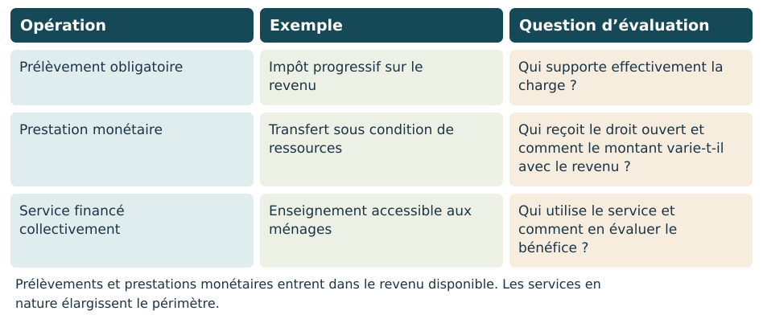

# ENS-PSL · Sélection internationale Lettres — Économie — redistribuer 2018 · Corrigé guidé

*Corrigé rédigé par IA, non officiel. Signalez toute erreur.*

**Lecture du rapport du jury** · GPT-6.2 Astra Ultra · vitesse non renseignée

**Rédaction** · GPT-6.2 Astra Ultra · vitesse non renseignée

**Autocontrôle** · GPT-6.2 Astra Ultra · vitesse non renseignée

**Révision (tour 2)** · GPT-6.2 Astra Ultra · vitesse non renseignée · 26 novembre 2026

## Déterminer qui reçoit quoi et à quelle date

« Redistribuer » est un verbe. Donner un sujet, un objet et un horizon à la première phrase du devoir. Un État prélève chaque année des ressources auprès de ménages pour financer des prestations monétaires. Un système d’assurance répartit entre personnes et entre dates le coût d’un risque. Une école publique donne accès à un service dont les effets se déploient sur une génération. Ces trois formulations ouvrent des comparaisons différentes. Le jury de 2018 demande des faits sur les inégalités, des institutions et une analyse de l’impôt autant que des transferts.

Un fait d’ouverture exploitable figure dans le *Rapport sur les inégalités mondiales 2018*. La part de revenu national avant impôt détenue par le dixième supérieur aux États-Unis et au Canada passe de 34 % en 1980 à 47 % en 2016. Donner le groupe, l’indicateur, le périmètre et les dates. La série éclaire une concentration croissante au sommet. Elle ne mesure ni un taux de pauvreté ni l’effet causal d’un changement de barème.

### Calculer un bilan et changer son périmètre

Prenons deux personnes seules, dont les revenus initiaux sont 1 000 et 3 000 euros par mois. Dans un système simplifié, la seconde verse 300 euros et la première les reçoit. Le rapport entre leurs revenus passe de 3 à environ 2,08, car les revenus disponibles sont 1 300 et 2 700 euros. La somme est conservée dans cet exemple comptable, qui ignore les coûts de gestion et les adaptations. Si l’objet était de mesurer la pauvreté au seuil fixe de 1 400 euros, la première personne resterait sous le seuil, mais son écart à celui-ci serait réduit de 400 à 100 euros. Distinguer fréquence de la pauvreté et intensité du manque.

Déplacer ensuite la question vers l’assurance maladie. Deux personnes disposant du même revenu initial cotisent, une seule subit un problème de santé. La prestation réduit l’écart de ressources qu’aurait créé ce choc. Une photographie des versements annuels montre surtout un transfert au malade. Avant la réalisation du risque, chaque assuré bénéficiait de la garantie. La redistribution verticale entre niveaux de revenu et la mutualisation horizontale du risque peuvent se superposer.

### Suivre l’incidence et la réponse des comportements

Un magasin reverse au fisc une taxe sur chaque unité vendue. Si les acheteurs peuvent facilement changer de produit tandis que les producteurs ont peu d’autres débouchés, une forte hausse du prix de détail risquerait de faire disparaître les ventes. Une part importante de la taxe peut alors prendre la forme d’une baisse du prix net reçu par le producteur. Inverser les possibilités d’ajustement pour comprendre le cas contraire. Même quand la recette finance un transfert bien ciblé, il faut inclure dans le bilan les variations de prix subies par les bénéficiaires.

Prendre à présent une allocation dont le montant baisse de 40 euros lorsque les gains d’activité augmentent de 100 euros. Si l’impôt augmente aussi de 20 euros, le ménage conserve 40 euros. Cette différence de gain net renseigne sur le prix relatif d’une heure de travail supplémentaire. Son effet sur l’activité reste une question empirique. Les contraintes horaires, les frais de garde et la possibilité effective d’obtenir des heures interviennent aussi.

### Proposer une évaluation en deux étapes

Une microsimulation peut appliquer les anciens et nouveaux barèmes aux mêmes ménages et mesurer l’effet mécanique sur pauvreté et inégalité. La comparer aux paiements réels permet de détecter un défaut de recours ou des retards. Pour estimer un effet sur les heures travaillées, rechercher des groupes comparables inégalement exposés à la réforme et vérifier leurs tendances avant son entrée en vigueur. Comparer seulement bénéficiaires et non-bénéficiaires confondrait l’effet de l’aide et les difficultés qui rendent éligible.

La conclusion peut revenir à la perte sèche. Si le prélèvement décourage des échanges profitables et n’en corrige aucun effet externe, il engendre un coût supplémentaire à la recette transférée. S’il finance une assurance utile ou l’accès à l’éducation, des gains distincts apparaissent. On peut alors défendre ou critiquer un dispositif précis en nommant les effets, les bénéficiaires et l’horizon retenu.

## Vérification sur le sujet

Les deux éditions confrontent la distribution initiale et le revenu disponible, distinguent incidence juridique et économique et refont le gain de 40 euros pour 100 euros de revenu supplémentaire. Le rapport d’écrit attend expressément prélèvements, transferts, incitations et perte sèche.

Une taxe de 2 euros sur chacune des 90 transactions qui subsistent rapporte 180 euros. Si, dans un exemple linéaire d’offre et de demande, dix autres transactions mutuellement avantageuses disparaissent et que le surplus perdu décroît linéairement de 2 euros à zéro sur ces dix unités, la perte sèche est de 10 euros. La recette de 180 euros peut financer un transfert. Elle se distingue du surplus détruit par les échanges abandonnés. Cette mesure suppose l’absence d’une externalité que corrigerait la taxe.
