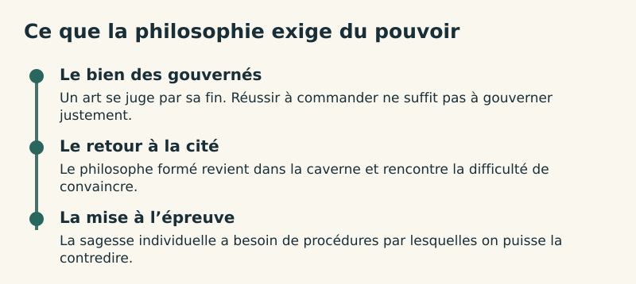

# ENS-PSL — Études classiques — les philosophes rois 2018 · Corrigé brut

*Corrigé rédigé par IA, non officiel. Signalez toute erreur.*

**Rédaction** · GPT-6.2 Astra Ultra · vitesse non renseignée

[Sujet officiel](https://www.ens.psl.eu/sites/default/files/LettresClassiquesEcrit-SIL2018.pdf) · [Rapport du jury](https://www.ens.psl.eu/sites/default/files/rapport-sil18-etudes-classiques.pdf)

Le sujet d’écrit invite à commenter la condition posée par Socrate dans la *République*, V, 473d. Le rapport de 2018 précise la forme argumentative attendue. Sa discussion détaillée des documents sur la technique concerne l’oral de la même session.

## Exposé

Un médecin auquel les passagers d’un navire feraient confiance pour soigner le pilote ne serait pas pour autant chargé de la navigation. À quel titre celui qui s’occupe de connaître pourrait-il donc réclamer le gouvernail de la cité ? Au livre V de la *République*, Socrate envisage aussi bien que les philosophes deviennent rois que de voir les souverains philosopher véritablement. La proposition porte d’abord sur la réunion de deux activités que leur séparation pervertit. Son intérêt est de faire dépendre le pouvoir d’une exigence de vérité. Sa difficulté est de savoir qui pourra demander au gouvernant des comptes sur la vérité qu’il invoque.

### Le savoir nécessaire à une décision juste

Le livre I fournit la raison de cette exigence. Thrasymaque définit le juste comme l’intérêt du plus fort. Si l’on identifie ce qui est juste à ce que prescrit le gouvernant, sa domination lui fournit à elle seule la preuve qu’il a raison. Socrate prend au sérieux la comparaison entre le gouvernement et un art. L’art médical vise le bien du malade, y compris lorsque son praticien en retire un salaire. De même, on peut désirer les bénéfices du commandement sans s’acquitter de sa fonction propre. Il faut donc au magistrat quelque connaissance d’un bien distinct de sa réussite. Il faut aussi qu’il préfère effectivement ce bien à sa réussite. La philosophie a un enjeu pratique, celui de soumettre l’usage d’une puissance à l’examen de sa fin.

La restriction aux souverains qui philosophent « vraiment et sérieusement » prend ici son poids. Aimer les spectacles, les belles formules ou la conversation des savants ne suffit pas à devenir philosophe. La fin du livre V distingue l’amateur de belles choses de celui qui s’interroge sur le beau lui-même. Le premier risque de prendre pour mesure de toutes choses le goût d’une assistance. La distinction garde une actualité politique lorsque la popularité d’une décision sert d’unique preuve de sa justice.

### La conversion du philosophe en gouvernant

La première formulation de l’hypothèse est plus embarrassante que la seconde. Au livre VII, celui qui s’est dégagé de la caverne ne désire guère redescendre dans l’obscurité. L’obligation de revenir vers les prisonniers relève d’une dette d’éducation envers la cité. Platon n’attend donc pas du goût pour les honneurs qu’il désigne le plus compétent. La disposition à se passer du pouvoir peut devenir une garantie pour ceux sur qui il s’exerce. Le dirigeant a d’ailleurs besoin d’une longue formation et d’expérience dans les charges communes. La contemplation ne lui dicte pas à elle seule l’heure où il convient de prendre une décision.

Il subsiste une objection interne. Le prisonnier qui revient de la lumière distingue d’abord moins bien les ombres que ses anciens compagnons. Ces derniers ont de bonnes raisons, depuis leur poste d’observation, de douter de son aptitude. Comment distinguer pour eux un savoir qu’ils ne possèdent pas de l’assurance de quelqu’un qui prétend le posséder ? Le propos de Socrate devient périlleux si un souverain transforme la condition exigeante qu’il pose en un titre qu’il se décerne.

### Rendre le pouvoir capable d’être contredit

Marc Aurèle offre une expérience différente de la figure platonicienne. Ses *Pensées* ramènent le prince à sa mortalité et lui demandent d’examiner ses représentations. Ces exercices témoignent d’un travail sur soi. Ils ne démontrent ni que toutes les décisions de l’empereur furent justes, ni que ses successeurs se soumirent à la même discipline. Une sagesse personnelle ne suffit pas à constituer une règle transmissible de gouvernement. On peut même retenir de Platon une raison d’exiger autre chose que l’appartenance du souverain à une école. Socrate donne des raisons publiquement et accepte les objections. En faire la propriété exclusive d’un détenteur du pouvoir exposerait cette méthode à perdre sa condition d’existence.

Dans le livre III de la *Politique*, Aristote examine ainsi l’idée qu’une multitude, dont chaque membre sait peu, puisse juger collectivement mieux qu’un seul. Il ne fait pas de toute foule un juge infaillible. Il permet de distinguer le savoir de l’exécutant du jugement de ceux qui font usage d’un ouvrage ou subissent une décision. Dans une assemblée, distinguer ces compétences et rendre les raisons discutables est une autre manière de faire agir la philosophie dans la cité. L’opinion y acquiert de la valeur lorsqu’elle s’expose à une correction.

L’union demandée en 473d demeure défendable comme exigence imposée à tout pouvoir de répondre du bien qu’il poursuit. Elle devient indéfendable comme dispense de rendre des comptes accordée à qui posséderait le bon savoir. Le philosophe que la cité gagnerait à avoir pour roi serait justement celui qui y organiserait la possibilité de lui donner tort.

