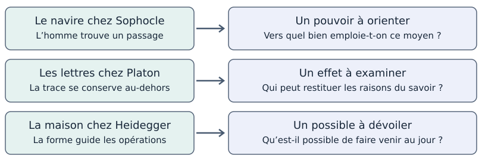

# ENS-PSL · Qu’est-ce que la technique ? · 2018 — corrigé brut

*Corrigé rédigé par IA, non officiel. Signalez toute erreur.*

**Rédaction** · GPT-6.2 Astra Ultra · vitesse non renseignée · 26 novembre 2026

## D’où vient le pouvoir d’une technique ?

Une personne sait lire l’inscription d’un remède. Une autre sait quand l’administrer. Entre elles se loge la question ouverte par le dossier. Un moyen peut fonctionner, une inscription peut transmettre des mots exacts, et pourtant la compétence dont ils donnent l’apparence peut manquer. Je propose d’appeler technique un savoir réglé qui fait advenir une possibilité. Trois questions permettent d’éprouver cette définition. Qu’est-ce qui devient possible ? Que doit savoir celui qui agit ? Qui jugera des effets ?

### Trouver passage et choisir sa route

Dans le premier chant du chœur de l’*Antigone*, l’homme se distingue par un paradoxe sensible. Il reste chétif devant la tempête et traverse pourtant la mer. La charrue qui revient chaque année, le filet qui entrelace des fils et le joug qui associe la force de la bête à une fin humaine renouvellent le même geste. Une disposition des choses change le rapport entre des forces inégales. Le marin n’a nul besoin de faire taire la tempête pour savoir passer. Le laboureur, lui, obtient de la terre un résultat qu’il faudra obtenir encore. L’image de la Terre divine tourmentée introduit une inquiétude dans l’hommage.

Le mot *deinon* de l’ouverture peut faire entendre le merveilleux et le redoutable. L’ode réalise ce double sens en faisant glisser son inventaire des ressources aux décisions humaines. La parole, la pensée et les dispositions qui rendent la cité possible comptent parmi les acquisitions de cet être qui s’est enseigné lui-même. Sous son toit, il s’abrite du gel. Ses remèdes peuvent le soustraire à des maladies, mais un homme guéri reste mortel. La dernière antistrophe ajoute une limite d’une autre espèce. Le même savoir peut accompagner le mal ou le bien. Celui qui se dresse contre la justice risque l’exclusion du foyer. Dans une tragédie où l’édit de Créon et le devoir funéraire d’Antigone se heurtent, invoquer ensemble lois du pays et justice divine ne fournit aucune recette pour les accorder. Même la cité qui héberge les artisans doit débattre de ce qui mérite d’être fait.

### Éprouver le succès annoncé par l’inventeur

Dans le *Phèdre*, Socrate rapporte la rencontre de Theuth et du roi Thamous. Theuth promet mémoire et sagesse aux bénéficiaires de l’écriture. Le roi lui accorde implicitement le succès le plus facile à vérifier. Une trace peut effectivement rappeler quelque chose à son lecteur. Il déplace ensuite la question vers l’activité du lecteur. Si ce dernier confie aux signes étrangers l’effort du rappel, la disponibilité de la trace rend moins nécessaire l’exercice qui entretenait sa mémoire. Plus la bibliothèque paraît savante, plus son lecteur peut se méprendre sur ce qu’il saurait expliquer à un interlocuteur. Le dernier trait du roi vise même le coût social d’un tel malentendu. Le présomptueux lecteur devient difficile à fréquenter.

Les deux interlocuteurs parlent d’un *pharmakon*. L’objet dont le créateur promettait la vertu change de fonction selon l’usage et le critère de réussite. À quelqu’un qui connaît déjà la démonstration, une ligne peut remettre ses articulations en mémoire. À qui sait seulement la lire à haute voix, elle prête une autorité d’emprunt. Ainsi l’inventeur et le juge des usages peuvent être deux personnes différentes. Un livre qui met en scène un dialogue nous invite précisément à refaire cette épreuve par nos propres réponses.

### Comment la chose devient-elle possible ?

Heidegger remonte du résultat à ce qui dirige l’ouvrage. La *technè* embrasse l’art du constructeur et les beaux-arts. Sa parenté avec *epistèmè* tient à une manière de s’y connaître qui ouvre un accès aux choses. L’artisan qui projette un bateau doit déjà comprendre le bois comme une matière propre à former une coque, et la coque à partir du bateau achevé qui pourra prendre la mer. La fin anticipée commande la découpe et l’assemblage. Avant que l’objet soit là, un ensemble de possibilités devient intelligible. Tel est le sens du dévoilement, ou venue au jour, que le texte rattache à la *poièsis*.

Cette lecture éclaire la différence, empruntée à Aristote, entre l’objet d’une science du nécessaire et celui d’une technique de production. Le bateau peut être autrement et son principe de fabrication réside dans un savoir de l’artisan. Celui-ci peut choisir un autre bois ou une autre forme. Il répond de la manière dont ces choix concourent à la navigation. Le bateau de Sophocle paraissait merveilleux par sa victoire sur un obstacle. Le constructeur de Heidegger en révèle une condition en voyant, dans les pièces encore séparées, ce qu’elles peuvent former ensemble.

### Conclusion et discussion

Je distinguerais trois réussites dans l’exemple de l’écriture. Une inscription rend la parole durable. Un lecteur l’intègre en sachant en rendre raison. Une communauté décide de la confiance à lui accorder. La première réussite peut se constater alors que les deux autres restent à construire. La technique révèle ainsi les possibilités d’une situation, modifie les capacités de ceux qui s’en servent et expose leurs fins au jugement commun. C’est ce dernier écart qui rend son histoire réellement ouverte.

**La technique et la morale dépendent-elles alors de deux mondes séparés ?** Le chœur enracine la vie civique parmi les capacités acquises des hommes. Cependant, aucune habileté à se procurer les moyens d’une action ne tranche à elle seule le conflit sur sa justice. L’ode formule une exigence politique à l’intérieur du monde des techniques.

**Pourquoi sauver le rôle de l’écriture ?** Le roi distingue la réactivation d’un souvenir et la formation d’une mémoire capable de se soutenir elle-même. Cette distinction donne un bon usage à l’aide écrite. Elle permet aussi de mesurer le progrès de celui qui se l’approprie en l’interrogeant sur ses raisons.
