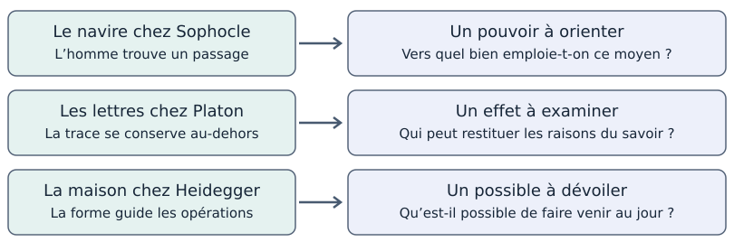

# ENS-PSL · Qu’est-ce que la technique ? · 2018 — corrigé guidé

*Corrigé rédigé par IA, non officiel. Signalez toute erreur.*

**Rédaction** · GPT-6.2 Astra Ultra · vitesse non renseignée · 26 novembre 2026

## Préparer l’exposé de vingt minutes

Le feuillet demande une définition argumentée qui s’appuie sur trois textes et aboutisse à une conclusion personnelle. Les dix minutes suivantes sont réservées aux questions. Au brouillon, partir d’un seul objet, le bateau. Inscrire trois verbes sous son nom. Le constructeur **anticipe** un navire dans du bois encore brut, le marin **traverse** un obstacle, la cité **juge** ce que permet la traversée. L’écriture permettra de vérifier si l’explication vaut aussi pour un objet dont l’action s’exerce sur l’esprit.

### 1. Commenter une ambivalence dans le chant de Sophocle

Lire le premier et le dernier mouvement du chant l’un après l’autre. À l’ouverture, *deinon* permet de réunir étonnement et inquiétude. À la fin, la ressource qui portait l’homme en mer peut le conduire au bien comme au mal. Entre les deux, repérer une opposition précise. Au mouvement répété de la charrue répond la Terre que le travail « tourmente ». Au filet et à la domestication succède un nouvel apprentissage, celui de la parole et des dispositions civiques. L’ingéniosité commence par agir sur un milieu et finit par transformer la manière de vivre ensemble.

**Question à se poser.** La mort et l’injustice désignent-elles la même limite ? La médecine permet des détours devant la maladie, sans supprimer la mortalité. L’injustice désigne un emploi possible des capacités humaines. Les lois de la terre et la justice des dieux font alors l’objet d’un jugement dont le conflit tragique montre la difficulté. Cette distinction fait passer d’un catalogue d’inventions à un problème philosophique.

### 2. Utiliser Platon pour construire une objection

Écrire au brouillon deux phrases dont les sujets diffèrent. « Le signe écrit garde une trace. » « Celui qui le lit peut expliquer ce qu’il sait. » On peut établir la première par l’œil. Pour vérifier la seconde, demander une explication au lecteur en lui retirant la feuille. Cet essai simple fait comprendre les termes du débat de Theuth et Thamous. Le premier annonce un remède à la mémoire et à la sagesse. Le second lui accorde une aide au rappel, mais prévoit l’oubli chez qui délaisse tout exercice du souvenir. Beaucoup de lectures peuvent multiplier les raisons de se croire savant.

Socrate fait entendre ces deux voix dans un récit. Éviter d’attribuer au roi un interdit général. Montrer comment il déplace le critère d’évaluation du produit vers une pratique. Une note réveille une raison que je peux retrouver et expliquer. Recopier une raison incomprise peut aussi me dispenser d’en chercher une. Cette différence autorise une première conclusion personnelle sur la responsabilité de l’usager.

### 3. Éclairer le mot « dévoilement »

L’extrait de Heidegger associe *technè* et *epistèmè* en tant que formes de connaissance et reprend leur distinction aristotélicienne. Poser un problème concret au constructeur. Devant un morceau de bois, comment choisir une découpe ? Il doit saisir d’avance l’apparence de la coque, les qualités de la matière et la fin de navigation qui donnera son unité au bateau achevé. Ainsi quelque chose qui pourrait être autrement, et qui ne vient pas de soi, se montre déjà comme réalisable. C’est ce mouvement que désignent le dévoilement et la *poièsis*. L’artisanat rejoint ici les beaux-arts dans la capacité de faire paraître une forme.

Se méfier d’un glissement. Le mot « dévoilement » pourrait évoquer un bateau déjà caché dans le bois et qu’il suffirait d’extraire. Plusieurs bateaux sont possibles. Le savoir du constructeur consiste précisément à rassembler ces conditions en vue de tel bateau. Revenir alors au passage de Sophocle. Le chœur se tenait du côté de l’usager face à la mer, Heidegger permet de se placer du côté de la production.

### Construire sa propre réponse et soutenir l’entretien

Consacrer deux minutes à l’introduction, cinq à chacun des trois mouvements et trois à la synthèse. Proposer comme réponse finale qu’une technique **rend un possible accessible par un savoir réglé**. Ajouter la mise à l’épreuve qui rend cette formule féconde. L’écriture rend possible une transmission à distance, mais elle change aussi les habitudes de mémoire. On doit juger ensemble ce qu’un moyen fait paraître, ce que son usage nous exerce à faire et les fins auxquelles nous l’employons.

**Si le jury demande si le chœur « croit au progrès ».** Reconnaître l’admiration suscitée par l’apprentissage cumulatif, puis citer deux contre-épreuves précises, la mort inévitable et la possibilité d’une habileté criminelle. Elles interdisent de transformer l’inventaire en une marche nécessaire vers la justice.

**Si l’on rapproche science et technique.** Repartir de la décision du constructeur. Il connaît des propriétés, mais cette connaissance n’impose aucun bateau singulier. Le texte de Heidegger rassemble les deux termes sous le pouvoir de connaître avant de préciser ce que la technique fait connaître et comment elle le fait apparaître.
