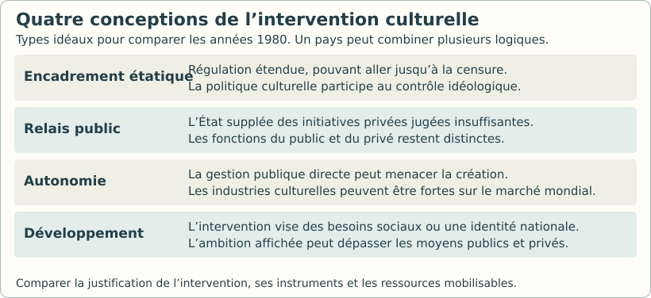

# Études politiques — Bustamante et les politiques culturelles (oral) · SIL 2018 · Corrigé brut

*Corrigé rédigé par IA, non officiel. Signalez toute erreur.*

**Rédaction** · GPT-6.2 Astra Ultra · vitesse non renseignée

## Commentaire de l’extrait de Mauricio Bustamante

Quand un gouvernement décide de soutenir la culture, il reste à préciser ce qu’il pense devoir soutenir et au nom de quoi. Il peut s’agir de surveiller une production artistique, de rendre des œuvres accessibles à de nouveaux publics ou de consolider une identité nationale. Le même geste apparent prend ainsi des significations politiques différentes. Dans cet extrait d’un article publié en 2015, Mauricio Bustamante compare les conceptions de l’action culturelle des années 1980. Il se demande aussi comment des États ont appris à reconnaître la culture comme un domaine appelant une administration particulière. Pourquoi le désaccord sur la place de l’État n’empêche-t-il pas cette idée de gagner du terrain à l’échelle internationale ?

### Comparer les raisons d’intervenir

L’auteur présente sa classification comme une construction. Un type idéal accentue certains traits pour permettre la comparaison. On peut ainsi demander quelles logiques coexistent dans un cas réel et laquelle l’emporte dans un secteur donné. L’extrait indique plusieurs dimensions qui ne se confondent pas : l’idéologie du régime, le degré de centralisation administrative, l’importance politique accordée à la culture et l’organisation déjà acquise du monde culturel. Un gouvernement centralisé peut déléguer certaines décisions aux milieux artistiques. Un pays pauvre en équipements peut soutenir une politique culturelle ambitieuse sur le papier. La comparaison doit rendre ces décalages visibles.

Le premier type associe les régimes socialistes à une forte emprise de l’État sur la production culturelle. La censure constitue une limite possible de la régulation. Le deuxième type fait intervenir les pouvoirs publics lorsque les initiatives privées paraissent laisser des besoins insatisfaits. C’est alors la défaillance d’un autre acteur qui fonde la légitimité de l’action publique. Le troisième renverse le point de vue : les producteurs culturels peuvent craindre que la gestion publique directe ne menace leur autonomie. L’auteur relève que plusieurs pays libéraux où s’affirme cette conception ont aussi des industries culturelles dominantes sur le marché international. Ce rapprochement invite à examiner le pouvoir du marché lui-même. Il n’autorise pas à imputer à tout artiste défendant son indépendance une stratégie commerciale.

La quatrième tendance rassemble des pays que les organismes internationaux ont successivement désignés comme en développement ou émergents. Ces dénominations et l’hétérogénéité que souligne l’auteur interdisent de prendre l’ensemble pour une aire culturelle homogène. Les gouvernements peuvent donner une haute priorité au secteur et manquer de ressources, publiques comme privées, pour réaliser leurs ambitions. Les rapprocher des régimes du premier type parce que les uns et les autres approuvent l’intervention de l’État ferait perdre la distinction essentielle. Le pouvoir peut intervenir pour contrôler les œuvres, mais aussi pour répondre à un besoin social ou construire des institutions communes après la décolonisation. Ces logiques peuvent d’ailleurs coexister dans un même pays. L’idéal-type a précisément permis de nommer ce qui, dans ce cas, se combine.

### Ce que signifie démocratiser la culture

Sur la deuxième page, l’auteur introduit une doctrine qui traverse plusieurs configurations nationales. Au Danemark, en Suède ou en France, les politiques culturelles peuvent être justifiées par l’objectif d’étendre l’accès à des œuvres savantes auxquelles on reconnaît une valeur universelle. La promesse est égalitaire du côté des destinataires. Elle laisse largement intacte, du côté des œuvres, la hiérarchie qui désigne les biens dignes d’être diffusés. Supposons qu’un musée rende l’entrée gratuite. Il peut lever un obstacle de prix sans modifier les collections, les conditions de déplacement ou les connaissances nécessaires pour se sentir à sa place. Cet exemple distingue la justification d’une politique, que l’extrait analyse, de ses effets sur les pratiques des publics, qui requerraient une enquête.

La portée de cette distinction est aussi internationale. Pendant la guerre froide, certains régimes libéraux voient avec suspicion les arguments qui autorisent une intervention publique étendue. À leurs yeux, ces arguments pourraient fournir une caution aux gouvernements qui répriment les artistes. Bustamante restitue un jugement engagé dans une lutte idéologique. Le prendre à son compte conduirait à assimiler arbitrairement l’élargissement de l’accès aux œuvres et la censure. En revanche, le prendre au sérieux permet de comprendre pourquoi deux administrations apportant chacune une aide aux arts peuvent se présenter comme politiquement opposées. Elles combattent aussi pour la définition de ce qu’une politique culturelle légitime doit garantir.

### Comment se constitue un espace international de modèles

La fin remonte des années 1980 aux années 1970 pour expliquer comment la comparaison elle-même a pu devenir possible. L’Unesco contribue à instituer la culture en domaine d’action publique. Dire qu’elle crée un besoin ne signifie pas que les sociétés auparavant dépourvues d’un service spécialisé auraient été dépourvues de pratiques culturelles. Le besoin nouveau porte sur la capacité d’identifier, de nommer et d’administrer un secteur comme tel. Dès lors qu’un gouvernement envisage un organisme spécialisé, il est conduit à chercher des compétences administratives, des exemples de dispositifs et des interlocuteurs susceptibles de les fournir. Cette demande ouvre un marché international de l’expertise. La création d’institutions nationales dans les années 1970 va de pair avec la formation d’un lieu d’échanges où l’on pourra comparer les politiques qu’elles conduisent.

L’extrait s’achève sur une asymétrie. La France et le Royaume-Uni sont placés en position de modèles par rapport à des administrations qui cherchent encore des références. Cette position commune ne signifie ni qu’ils défendent un dispositif unique, ni que leurs propositions ont partout été suivies. L’auteur parle d’une volonté d’inspirer. Pour en établir un effet local, il faudrait suivre par exemple un rapport d’expert, le débat auquel il donne lieu et les moyens accordés à la structure finalement créée. Une référence peut servir à obtenir des crédits, à privilégier une certaine définition de la culture ou à justifier une solution transformée par ses destinataires.

Le mouvement du texte livre ainsi sa réponse. Une norme internationale avance lorsque la culture devient un secteur que les autorités sont invitées à prendre en charge. L’intervention pourra toutefois servir des conceptions distinctes du rôle de l’État, rencontrer des ressources très inégales et être revendiquée au nom de l’autonomie aussi bien que du contrôle. La circulation des modèles organise la confrontation de ces définitions autant qu’elle favorise leurs rapprochements.

[Extrait officiel, deux pages](https://www.ens.psl.eu/sites/default/files/ORAL-Et.politiquesSIL%202018-2.pdf)
