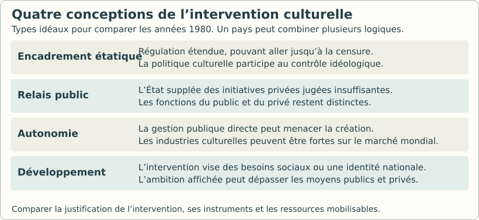

# Études politiques — Bustamante et les politiques culturelles (oral) · SIL 2018 · Corrigé guidé

*Corrigé rédigé par IA, non officiel. Signalez toute erreur.*

**Rédaction** · GPT-6.2 Astra Ultra · vitesse non renseignée

## Préparer le commentaire de Bustamante

Un gouvernement finance des expositions itinérantes. Un autre décide quelles œuvres peuvent être exposées. Tous deux interviennent. Le font-ils pour la même raison ? Cette question ouvre le commentaire. Suivez-la des quatre conceptions nationales de l’action culturelle jusqu’à leur confrontation internationale.

### Dégager les critères avant de nommer les pays

Le verbe *construire* désigne la méthode. Le secteur, le régime, l’administration et l’organisation du monde culturel font varier les situations. Posez trois questions : qui décide, pour résoudre quel problème, avec quels moyens ? Un pays peut illustrer une tendance sans se réduire à elle.

Reconstituez les quatre réponses sans regarder la figure. Dans la première, l’État se réserve une forte capacité de régulation idéologique, pouvant aller jusqu’à censurer. Dans la deuxième, fréquente dans une partie de l’Europe occidentale, il supplée un acteur privé dont l’action est jugée insuffisante. Dans la troisième, les défenseurs de la création se méfient de la direction publique des institutions. L’extrait souligne aussi la puissance de certaines industries culturelles de ces pays sur le marché mondial. Dans la quatrième, les objectifs nationaux de développement culturel s’accompagnent de moyens souvent faibles, même lorsque l’État est favorable à l’intervention. Pour vérifier votre compréhension, comparez d’une part les types deux et trois, d’autre part les types un et quatre. Dans le premier couple, le privé et l’autonomie sont mis en avant de façons différentes. Dans le second, l’accord sur la participation de l’État dissimule une différence de finalité.

### Lire la transition entre les deux pages

À la fin de la première page, un pays récemment décolonisé peut chercher à construire une identité nationale. L’auteur admet aussi qu’une telle ambition puisse se combiner avec l’encadrement des productions. Prenez cette concession au sérieux : elle montre l’intérêt d’une méthode capable de décrire un cas mixte. Au début de la page suivante, le Danemark, la Suède et la France illustrent un objectif d’une autre nature. Élargir l’accès de la population à des biens déjà reconnus comme légitimes constitue un principe de démocratisation culturelle. Précisez le sens du terme : *qui* devrait désormais accéder à *quoi* ? Une bibliothèque qui élargirait ses horaires pourrait faire venir de nouveaux lecteurs tout en conservant le même fonds. Le texte analyse d’abord cet objectif d’accès. Pour savoir si les groupes jusque-là absents en ont effectivement bénéficié, il faudrait étudier les usagers.

Faites ensuite entendre un déplacement de point de vue. Le soupçon exprimé du côté libéral porte sur l’usage possible du langage de l’intervention publique par des gouvernements répressifs. Si vous concluez que financer une bibliothèque revient à censurer, vous transformez une accusation historiquement située en équivalence logique. C’est la guerre froide qui donne à l’opposition son intensité politique et fait de la place de l’État dans la culture un enjeu idéologique international.

### Expliquer la dernière séquence plutôt que la résumer

Pourquoi l’Unesco arrive-t-elle après les controverses ? Comparer des politiques suppose qu’on ait déjà reconnu un ensemble d’activités administrables sous le nom de culture. L’organisation internationale légitime cette manière de poser le problème et fournit un lieu d’échange. Pour un gouvernement souhaitant se doter d’un service culturel, elle rend pensable l’appel à des modèles et à des spécialistes. L’expertise devient par là une activité demandée. Les institutions nationales qui se multiplient dans les années 1970 fournissent à leur tour des interlocuteurs et des expériences à comparer. Distinguez ces années 1970 de la décennie 1980 à laquelle s’applique la typologie.

Pour conclure à l’oral, revenez aux deux derniers pays cités. La France et le Royaume-Uni occupent une position privilégiée pour proposer leur expérience. Le texte s’arrête sur les administrations qu’ils cherchent à inspirer et laisse ouverte la question de l’appropriation effective. Quel document supplémentaire demanderiez-vous ? Un rapport d’expert suivi des procès-verbaux de sa discussion et des décisions budgétaires locales permettrait de voir ce qui a été emprunté, transformé ou écarté. Cette réponse donne un contenu concret à la circulation internationale et rend aux administrations destinataires leur capacité d’agir.

**Une relance possible.** L’Unesco crée-t-elle la culture des pays concernés ? Les pratiques, les artistes et les œuvres peuvent exister sans ministère particulier. Le besoin que décrit le passage est celui de traiter ces activités comme un secteur de politique publique, de disposer d’instruments pour le faire et de reconnaître certaines personnes comme expertes.

**Une autre relance.** Un faible budget indique-t-il nécessairement un refus de l’action publique ? Le quatrième type établit que des ressources réduites peuvent accompagner de vastes ambitions, tandis que le troisième concerne une objection de principe à la gestion directe. C’est précisément pour séparer ces interprétations que l’auteur compare les justifications et les moyens.

[Extrait officiel, deux pages](https://www.ens.psl.eu/sites/default/files/ORAL-Et.politiquesSIL%202018-2.pdf)
