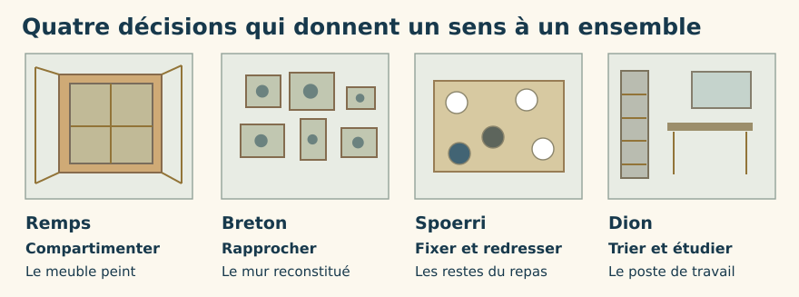

# ENS-PSL · Sélection internationale Lettres — Histoire de l’art — collectionner 2018 · Corrigé guidé

*Corrigé rédigé par IA, non officiel. Signalez toute erreur.*

**Lecture du rapport du jury** · GPT-6.2 Astra Ultra · vitesse non renseignée

**Rédaction** · GPT-6.2 Astra Ultra · vitesse non renseignée

**Autocontrôle** · GPT-6.2 Astra Ultra · vitesse non renseignée

« Collectionner ». Le sujet invite à étayer cette dissertation de quatre heures sur les documents et sur d’autres exemples d’histoire de l’art. La proposition est rédigée en français.

## Choisir une unité de comparaison

Dans les quatre planches, quel est l’élément qui perdrait le plus de sens s’il était isolé ? Essayez avec le battant du cabinet de Remps, un objet du mur de Breton, un verre sur la table de Spoerri, puis une étiquette ou un bocal chez Dion. Chaque réponse donne accès à une opération distincte, composer un monde dans un meuble, maintenir un voisinage poétique, garder une trace située, rendre une catégorie intelligible. Vous disposez ainsi d’une problématique et d’une histoire, sans avoir à supposer une définition universelle du bon collectionneur.

**La photographie de la table de Spoerri est-elle une nature morte peinte ?** La vue frontale peut donner cette impression. Le document reproduit un assemblage de vrais objets fixés sur un support redressé. Décrivez l’orientation d’usage du repas puis l’orientation d’exposition. La surface picturale de Remps offre alors un contrepoint historique précis.

**Comment parler des objets de Breton qui proviennent de cultures différentes ?** Commencez par le statut du document et par la place de l’objet sur le mur. La disposition renseigne sur les rapprochements de Breton et sur leur conservation au musée. L’attribution à une communauté, le premier usage et les conditions de sortie exigent d’autres sources. Une notice de pièce permet de passer du constat d’ensemble à l’histoire d’une provenance individuelle.

**Comment ajouter un exemple hors dossier sans perdre le fil ?** L’ouverture publique du Louvre pose une question qui revient avec la dation du mur. Qui peut regarder et qui décide de l’ordre des œuvres ? Comparez ensuite l’intention d’ordonner une collection nationale et le souci de conserver l’arrangement singulier d’un atelier. Le changement de statut du bien est le fait commun. Ses effets sur l’exposition diffèrent.

## Du meuble ouvert à l’atelier exposé

Quel rapport y a-t-il entre garder une porcelaine rare et conserver une assiette après qu’un convive a fini son repas ? Les deux gestes suspendent l’usage courant de l’objet, mais cette suspension reçoit des sens presque opposés. Rareté, témoignage, beauté et valeur de vente ne vont pas nécessairement ensemble. L’infinitif « collectionner » invite donc à suivre des actes précis, soustraire à la circulation, rapprocher, classer, disposer, transmettre. Le cabinet peint par Remps, le mur de Breton, la table de Spoerri et le poste de travail évoqué par Mark Dion permettent de demander comment ces actes, longtemps associés à la possession et à la connaissance, sont devenus eux-mêmes les moyens de faire œuvre et de discuter une autorité.

## Faire tenir un monde dans quelques compartiments

La pratique de réunir et de conserver précède les cabinets de curiosités de la Renaissance. Un trésor d’église pouvait déjà rapprocher des matières précieuses, des œuvres d’orfèvrerie et des reliques. Celles-ci devaient notamment leur valeur à des relations de croyance, de mémoire et de culte. Elles n’avaient pas été réunies pour former une histoire des styles. Dans les cabinets princiers et savants des XVIe et XVIIe siècles, la proximité d’un objet naturel singulier et d’une virtuosité de l’artisan répond à une autre ambition. Les différences entre nature et artifice deviennent un objet de comparaison. Les réseaux de voyageurs, de marchands et de dons qui approvisionnent les cabinets conditionnent ce que leurs propriétaires peuvent offrir au regard.

Vers 1689, Domenico Remps peint un *Cabinet de curiosités*. Les battants ouverts portent eux-mêmes des images et des objets. Les compartiments intérieurs donnent aux petites peintures, aux spécimens et aux instruments des voisinages que peut explorer un regard mobile. Frontière et contenu s’échangent presque leurs fonctions, puisque l’œil peut s’attarder sur ce qui semblait ne servir qu’à fermer le meuble. C’est toutefois une huile sur toile. Rien ne garantit que chacun de ces objets ait appartenu à un unique propriétaire ni que le tableau puisse tenir lieu d’inventaire. En donnant la même présence persuasive à tant de matières, le trompe-l’œil rend visible un désir de rassemblement et donne au peintre sa propre occasion de rivaliser avec les objets précieux.

## Passer de la possession à l’exposition publique

Une collection change de sens lorsque son public, ses catégories ou son statut juridique changent. En août 1793, le Muséum central des arts ouvre au Louvre. Des œuvres provenant notamment des collections royales deviennent accessibles sous un nouveau régime de propriété et de visite. Mettre un tableau sous le nom d’une école, le rapprocher sur un mur d’une autre composition, fabriquer un catalogue transforment une suite d’acquisitions en récit de l’art. Ce pouvoir a son envers. Ce qu’une institution conserve peut manquer ailleurs. Les histoires d’acquisition, de don, de vente, de saisie ou de spoliation exigent des preuves propres à chaque objet. L’entrée au musée et l’inscription sur un cartel n’épuisent pas cette histoire.

Le mur de l’atelier d’André Breton expose une autre logique de voisinage. Dans le document, les grands cadres en hauteur dominent une accumulation serrée d’objets, de formes dressées et d’images plus petites. On peut suivre des échos de silhouettes, de signes et de matières sans retrouver le rangement par école ou par région qu’adopterait un musée d’histoire de l’art. Pour un poète surréaliste, la rencontre entre objets peut produire elle-même une pensée. Mais le document de la page 3 montre ce mur dans sa reconstitution muséale. La dation de 2003 a permis de conserver une disposition d’ensemble au moment où d’autres biens de la collection se dispersaient. Une institution protège désormais des voisinages qui relevaient d’une vie privée. Elle a aussi la responsabilité de documenter l’histoire des pièces que ces rapprochements pourraient rendre anonymes.

## Quand collectionner devient une pratique artistique et critique

En mars 1963, Daniel Spoerri transforme pour un temps la galerie J à Paris en restaurant. Dans *Le Repas hongrois*, assiettes, verres, serviettes et restes gardent sur un support leur disposition de fin de repas. L’artiste fixe cette disposition puis redresse la table. La rotation de l’horizontale à la verticale est capitale. Un nouvel arrivant aurait normalement débarrassé ou repris une place. Le visiteur de galerie se trouve devant un « tableau-piège » dont les objets gardent leur volume. Il peut chercher dans une répartition irrégulière la trace de gestes dont il ignore les auteurs. Le principe de sélection porte ici sur une situation et sur un instant. Un reste sans prix est conservé pour la relation qu’il entretient avec tout le reste. Entré au musée par achat en 1992, cet ensemble éphémère est à son tour traité comme un objet à transmettre.

La vue de l’exposition de Mark Dion à Boston en 2017 fait apparaître une haute étagère remplie de bocaux, une table de travail avec une chaise, des chariots et une carte au mur. Le spectateur reconnaît un lieu de classement avant même de savoir ce que contient chaque récipient. Présenter cette organisation dans un musée d’art apprend à regarder là où les musées de sciences demandent souvent de passer vite, du côté de l’étiquette, de la boîte, de la table de tri. Le naturaliste, le collectionneur et le conservateur établissent des catégories dont l’objet isolé ne porte pas à lui seul la raison. Dion rend leur travail perceptible et ouvre leurs choix à la discussion. La légende donne le titre de l’exposition. Elle ne permet pas d’attribuer à cette seule installation le titre ou le protocole précis d’un projet particulier.

Collectionner constitue ainsi une opération sur des relations autant que sur des choses. À chaque époque comptent la personne qui choisit, le droit de disposer des objets et le public à qui ils sont montrés. L’art contemporain peut reprendre les gestes du collectionneur pour leur faire dire quelque chose qu’un inventaire de richesses ne dirait pas, par exemple la mémoire d’un repas commun ou les présupposés d’un classement. Le musée rencontre alors une difficulté très concrète. En déplaçant ou en conservant un ensemble, il doit s’interroger aussi sur les liens fragiles en vertu desquels cet ensemble constitue une œuvre.

[Sujet et planches](https://www.ens.psl.eu/sites/default/files/SIL-Histoire%20de%20l_Art%20sujet%20ecrit%202018.pdf) · [Rapport du jury](https://www.ens.psl.eu/sites/default/files/sil_2018_rapport_ha.pdf)

[Musée du Louvre, histoire de la Grande Galerie](https://www.louvre.fr/decouvrir/le-palais/la-peinture-italienne-en-perspective) · [Centre Pompidou, une pièce du mur de Breton](https://www.centrepompidou.fr/fr/ressources/oeuvre/c6rrqKM) · [Centre Pompidou, Le Repas hongrois](https://www.centrepompidou.fr/fr/ressources/oeuvre/coXyynA) · [ICA Boston, exposition de Mark Dion en 2017](https://www.icaboston.org/exhibitions/mark-dion-misadventures-21st-century-naturalist/)
