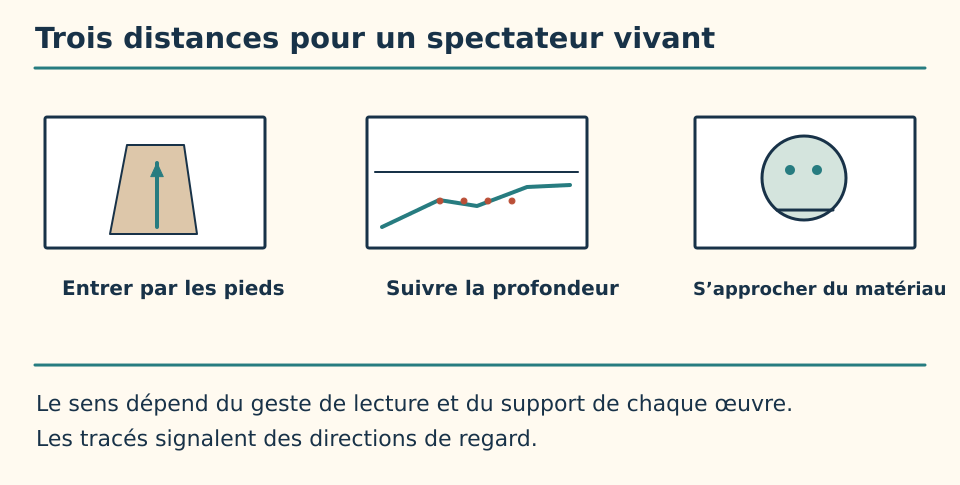

# ENS-PSL · Sélection internationale Lettres · 2018 · Corrigé brut

*Corrigé rédigé par IA, non officiel.*

**Lecture du rapport du jury** · GPT-6.2 Astra Ultra · vitesse non renseignée

**Rédaction** · GPT-6.2 Astra Ultra · vitesse non renseignée

**Révision (tour 1)** · GPT-6.2 Astra Ultra · vitesse non renseignée

## La mort

Aucune de ces œuvres ne donne accès à ce qu’éprouve celui qui meurt. Toutes règlent en revanche la place des vivants devant une absence. Une image peut rapprocher un corps, maintenir socialement un défunt, attester une perte publique ou attirer le regard vers les matériaux dont se fait un souvenir. C’est cette diversité d’adresses qui permet de comparer les cinq reproductions.

### Approcher et retenir

Dans la *Lamentation sur le Christ mort* de Mantegna, vers 1480, le corps est vu depuis les pieds et s’enfonce dans la profondeur du support horizontal. Les visages des proches apparaissent latéralement, resserrés sur le bord gauche. Le regard du spectateur est ainsi placé sur un axe différent du leur, à proximité du drap qui recouvre partiellement le corps. La détrempe et le dessin des plis rendent sensible une présence que la douleur des vivants déclare déjà perdue. Dans le tombeau de Charles de Maigny commandé à Pierre Bontemps en 1557, la figure assise appuie la tête sur la main. Son maintien, son armure et la permanence de la sculpture préservent une identité sociale. Le tombeau ne cherche pas à raconter l’instant du décès. Il installe parmi les vivants l’image durable d’une personne nommée.

### Attester une perte collective

Après la bataille de Gettysburg en 1863, Timothy H. O’Sullivan photographie un terrain sur lequel reposent des soldats morts. Le premier plan et les formes plus petites qui se succèdent jusqu’à l’horizon associent la singularité d’un corps proche à l’ampleur d’une bataille. La distance et la brume empêchent d’identifier chaque personne. Alexander Gardner imprime et publie la photographie sous le titre *A Harvest of Death*. La métaphore de la récolte appartient donc aussi à la circulation de l’image et à sa légende. Distinguer prise de vue, publication et titre aide à comprendre comment un document historique devient une proposition sur le coût humain de la guerre.

### Quand la ville poursuit ses échanges

Dans *Suicide* de George Grosz (1916), le rouge envahit la scène urbaine, les diagonales des architectures font basculer le sol et plusieurs épisodes demeurent simultanément visibles. Le titre désigne un drame singulier, mais la composition empêche de s’arrêter au seul personnage du premier plan. Une zone éclairée en hauteur et les silhouettes voisines font exister une ville qui poursuit d’autres occupations. À l’étagement stable du tombeau répond un espace disloqué qui met en question la manière dont une société peut détourner son attention d’une disparition. La violence chromatique appartient au jugement du peintre. Elle ne permet pas de tirer de conclusion biographique sur le personnage.

### Faire du regard lui-même un problème

Le *Skull with the Keys of Hell* de Jan Fabre (2013) adopte le signe familier du crâne et lui associe des clés qui débordent le volume. Le bleu, le blanc et les irisations visibles retardent la lecture purement emblématique. La légende précise que la surface est faite notamment d’ailes de coléoptères-bijoux. Une matière d’origine vivante donne à l’objet fabriqué l’éclat qui attire le regard. Les clés orientent vers un imaginaire de seuil sans fournir une interprétation unique de l’au-delà. Mantegna rapprochait le spectateur d’un corps pour soutenir la déploration, Fabre le rapproche d’une surface dont il lui faut découvrir la nature. C’est bien le rôle accordé au vivant qui a changé entre les deux œuvres.

## Sources

Le PDF est archivé par l’ENS pour 2018 et porte un en-tête 2014. Le rapport de 2018 confirme le sujet et cite les cinq œuvres, bien qu’il annonce d’abord quatre documents. Les cinq reproductions du fascicule sont examinées.

[Sujet de l’ENS](https://www.ens.psl.eu/sites/default/files/SIL-Histoire%20de%20l_Art%20sujet%20ORAL%202018.pdf) · [Rapport du jury](https://www.ens.psl.eu/sites/default/files/sil_2018_rapport_ha.pdf)
