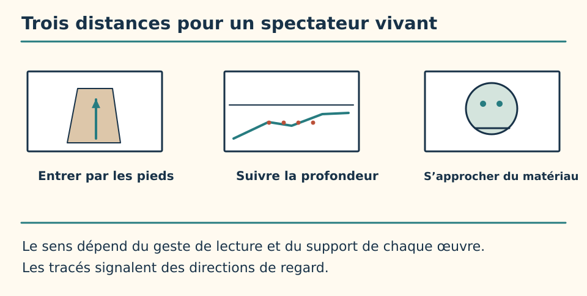

# ENS-PSL · Sélection internationale Lettres · 2018 · Corrigé guidé

*Corrigé rédigé par IA, non officiel.*

**Lecture du rapport du jury** · GPT-6.2 Astra Ultra · vitesse non renseignée

**Rédaction** · GPT-6.2 Astra Ultra · vitesse non renseignée

**Révision (tour 1)** · GPT-6.2 Astra Ultra · vitesse non renseignée

## La mort

À l’oral, partir de détails visibles avant de relier les œuvres. Le jury de 2018 propose plusieurs points d’entrée, dont l’évolution des représentations et le regard que chaque artiste porte sur son temps. L’exposé peut faire jouer les deux sans prétendre établir une évolution unique.

### Se placer devant chaque objet

Noter ce qui approcherait le visiteur d’une dépouille, d’un portrait commémoratif ou d’un objet précieux. Pour Mantegna, suivre le raccourci depuis les pieds. Pour Bontemps, nommer la posture assise, le costume et le contexte de commande. Relever ce que la reproduction plane permet difficilement de juger dans une sculpture.

### Partir du détail et du support

Sur la photographie, poser un doigt sur l’horizon puis sur le premier plan. Décrire les changements d’échelle avant d’interpréter la portée du titre. Séparer l’auteur de la prise de vue et l’éditeur nommé dans la légende. Le schéma ci-dessous donne des directions d’observation conventionnelles, sans reproduire les corps.

### Opposer deux régimes de visibilité

Préparer une comparaison orale entre O’Sullivan et Grosz. L’un inscrit les conséquences d’un événement historique dans la profondeur, l’autre désarticule la ville par ses lignes et sa palette. Dire ce que le rouge fait au rapport entre les personnages constitue un argument plus précis qu’un jugement général de tristesse.

### Relancer avec un autre exemple

Pour la discussion, rapprocher le crâne de Fabre de l’anamorphose des *Ambassadeurs* de Holbein en 1533. Dans un cas, il faut s’approcher pour lire la matière et les clés. Dans l’autre, il faut quitter l’axe frontal pour identifier une forme. La comparaison précise le geste demandé au spectateur au lieu de simplement ajouter une autre vanité.

## Sources

Le PDF est archivé par l’ENS pour 2018 et porte un en-tête 2014. Le rapport de 2018 confirme le sujet et cite les cinq œuvres, bien qu’il annonce d’abord quatre documents. Les cinq reproductions du fascicule sont examinées.

[Sujet de l’ENS](https://www.ens.psl.eu/sites/default/files/SIL-Histoire%20de%20l_Art%20sujet%20ORAL%202018.pdf) · [Rapport du jury](https://www.ens.psl.eu/sites/default/files/sil_2018_rapport_ha.pdf)
