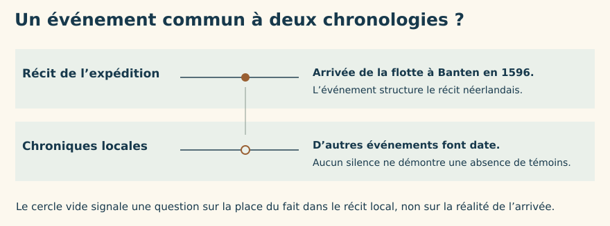

# ENS-PSL · Sélection internationale Lettres — Histoire — le point de vue de l’historien 2018 · Corrigé brut

*Corrigé rédigé par IA, non officiel. Signalez toute erreur.*

**Lecture du rapport du jury** · GPT-6.2 Astra Ultra · vitesse non renseignée

**Rédaction** · GPT-6.2 Astra Ultra · vitesse non renseignée

**Autocontrôle** · GPT-6.2 Astra Ultra · vitesse non renseignée

La feuille cite Patrick Boucheron en 2009. Elle demande ce que signifie assumer son point de vue et quel rôle jouent les circulations entre des lieux géographiques ou disciplinaires. La consigne autorise un appui sur ses lectures et/ou son expérience de recherche.

## Indiquer la projection

Sur une carte du monde, on peut conserver les angles localement ou choisir de conserver les surfaces. On ne conserve pas à la fois toutes les propriétés du globe en les projetant sur un plan. L’utilité scientifique de la carte tient aussi à la possibilité de savoir ce qu’on peut mesurer sur elle. La comparaison de Patrick Boucheron invite l’historien à une exigence analogue. S’il écrit « de quelque part », l’indication de son point de vue devrait permettre au lecteur de reprendre son travail. Mais ce lieu n’est pas simplement l’adresse d’où l’on écrit, et la consigne demande ce que deviennent les perspectives lorsque personnes, objets ou concepts circulent. Comment rendre la situation de l’enquête explicite tout en la laissant se modifier au contact de ce qu’elle étudie ?

## La situation du chercheur se lit dans la construction de son objet

Choisir la Méditerranée à l’époque de Philippe II comme objet d’histoire change déjà ce que le lecteur verra. Fernand Braudel, dans son ouvrage publié en 1949, ne déduit pas les limites de l’espace étudié de celles du royaume d’Espagne. Une navigation, des échanges de céréales, la relation entre une île et des marchés plus éloignés peuvent être significatifs là où les frontières politiques les isoleraient. Le choix de différentes durées organise ensuite les phénomènes observables. Une campagne militaire se date plus aisément qu’une modification durable des routes commerciales, mais cela n’en fait pas nécessairement le meilleur principe d’explication de tout ce qui lui est contemporain. Dans le titre, un souverain donne une époque à une mer. Il n’en devient pas l’unique personnage.

Indiquer ce choix change la possibilité de critiquer le résultat. Le lecteur peut demander ce qui arrive, à cette échelle, aux décisions de personnes dont la vie dure moins longtemps qu’un grand mouvement des prix. Il ne suffirait guère que l’auteur décline sa nationalité pour répondre à une telle objection. Le lieu dont on écrit comprend des langues accessibles, des pratiques savantes, un corpus conservé par certaines institutions et une question qui rend comparables certaines traces. Le travail historique commence par faire de ces conditions des choix descriptibles. Il évite ainsi de prendre les limites d’un fonds d’archives pour celles du monde passé.

L’analogie cartographique atteint toutefois une première limite. Une projection est définie par une transformation mathématique connue. Dans une enquête, un document nouvellement rapproché d’un autre peut faire apparaître au chercheur une présupposition qu’il ne savait pas avoir. Assumer son point de vue implique donc aussi de rendre compte des moments où il a fallu en changer.

## L’objet qui circule déplace le centre du récit

Dans *L’Histoire à parts égales* (2011), Romain Bertrand reprend les premiers contacts entre Hollandais et habitants de Java. Une flottille de la première expédition néerlandaise vers les Indes orientales arrive à Banten en 1596. Une histoire construite à partir des seuls récits européens peut faire de cette date le commencement évident d’un chapitre. C’est déjà choisir la chronologie de ceux pour qui l’expédition ouvrait une voie nouvelle. La confrontation avec les mondes javanais et malais montre une dissymétrie plus profonde qu’un désaccord de témoignages. Les visiteurs n’occupent pas nécessairement un rang mémorable dans les chroniques locales. La place de Banten dans les échanges asiatiques oblige alors à concevoir l’arrivée comme un épisode d’histoires qui n’avaient pas attendu les Hollandais pour commencer.

L’égalité de traitement ne consiste pas ici à remplir un même nombre de pages pour chaque camp. La procédure qui chercherait dans les chroniques une réponse locale à chacune des observations européennes continuerait de prendre les questions des arrivants pour mesure commune. Il faut d’abord demander ce qui peut faire événement dans chaque ordre d’écriture. Le mouvement des navires et des biens relie matériellement des lieux. Il n’entraîne pas que toutes les personnes connectées perçoivent la même scène ni que leurs traces se répondent terme à terme.

Cette difficulté vaut pour les mots du chercheur autant que pour les objets de son enquête. Traduire un nom de charge par un titre familier à un lecteur français peut rendre une scène compréhensible. Cela peut aussi introduire une hiérarchie que l’organisation étudiée ne connaît pas. Une traduction accompagnée d’indices sur les situations où le terme est employé laisse au lecteur un contrôle. Donner à voir le trajet d’un concept, de l’archive à la traduction puis au récit, précise le point de vue de l’historien mieux qu’une profession générale d’impartialité.

## Une autre discipline peut déplacer la question sans décider de la réponse

Dans *Les Rois thaumaturges* (1924), Marc Bloch compare le toucher des écrouelles par les rois de France et d’Angleterre. Le même geste peut intéresser un médecin qui chercherait des signes de guérison, un historien de la cour qui suivrait le rituel ou un enquêteur attentif à la formation d’une croyance collective. Bloch ne s’arrête pas à un verdict sur les pouvoirs physiques du souverain. Il s’interroge sur les conditions dans lesquelles la capacité de guérir a pu être attendue, reconnue et transmise. Le rapprochement de l’histoire politique avec des questions relevant des sciences sociales change l’objet. Il faut examiner ensemble les malades qui viennent, le prestige d’une dynastie et l’institution qui règle la cérémonie.

La circulation entre disciplines conserve une exigence de vérification. Un concept de croyance collective permet d’interroger des témoignages. Il ne prouve pas que tous les malades aient cru la même chose, ni que deux monarchies aient suivi une évolution identique. La comparaison oblige justement à restituer des lieux et des dates au phénomène que l’on a rendu comparable. De même, la perspective javanaise chez Bertrand permet de corriger la chronologie spontanée d’une expansion européenne, sans donner accès à un regard unique de tous les habitants de Java.

Écrire de quelque part signifie ainsi assumer ce qui organise la visibilité historique et ce qu’elle laisse à vérifier autrement. La circulation des objets relie des mondes dont les temporalités ne coïncident pas. Celle des concepts rend possible une question nouvelle, à charge pour les documents d’en éprouver la portée. La meilleure raison d’indiquer sa projection est qu’un autre lecteur pourra la comparer à une autre et expliquer précisément ce que chacune fait voir.

[Feuille de l’écrit](https://www.ens.psl.eu/sites/default/files/Sujet%20ecrit%20specialite%20histoire%202018.pdf) · [Rapport du jury](https://www.ens.psl.eu/sites/default/files/rapport_2018_histoire.pdf) · [Romain Bertrand, notice de la BnF](https://catalogue.bnf.fr/ark:/12148/cb42517322n) · [Marc Bloch, introduction aux Rois thaumaturges](https://classiques.uqam.ca/classiques/bloch_marc/rois_thaumaturges/rois_thaumaturges_intro.html) · [Fernand Braudel, notice de la BnF](https://catalogue.bnf.fr/ark:/12148/cb31866731s)
