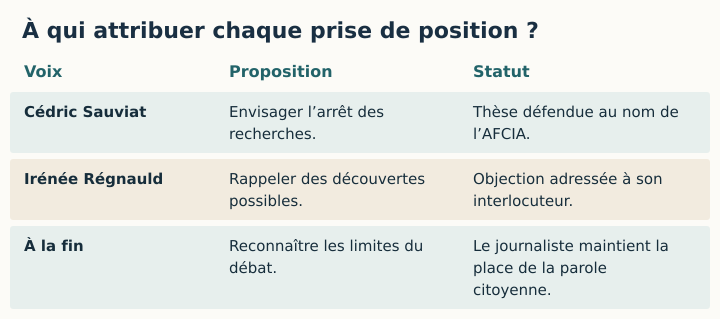

# ENS-PSL · Sélection internationale Lettres · Langue française — intelligence artificielle et transhumanisme 2018 — Corrigé guidé

*Corrigé rédigé par IA, non officiel. Signalez toute erreur.*

**Rédaction** · GPT-6.2 Astra Ultra · vitesse non renseignée

Irénée Régnauld, « On peut être contre l’intelligence artificielle par principe », Usbek & Rica, janvier 2017.

## Compréhension · 4 points

**« Tire la sonnette d’alarme ».** L’association avertit publiquement des dangers qu’elle attribue au développement de l’intelligence artificielle et appelle à réagir.

**Des frontières « poreuses ».** Les deux projets restent définissables séparément. Cependant, certaines personnes souhaitent accroître les capacités humaines pour suivre celles des machines. Une justification ou un objectif peut ainsi passer d’un projet à l’autre.

**La « savonnette ».** Un objet que l’on croit tenir peut soudain échapper à la main. L’image matérialise le risque que la compétition pour développer ces techniques prive leurs concepteurs du pouvoir de les orienter ou de les arrêter.

**« Les problèmes humains sont les garants du lien social ».** Selon Cédric Sauviat, l’épreuve d’une difficulté commune oblige les personnes à s’entraider et à convenir de règles. Une solution entièrement déléguée aux machines pourrait faire disparaître certaines occasions de former ce lien.

## Résumé · 8 points

Irénée Régnauld interroge Cédric Sauviat sur une position qui surprend jusque par son nom : une association française entend combattre le développement de l’intelligence artificielle. Son représentant veut rendre pensable le refus de principe d’une recherche que ses promoteurs présentent volontiers comme nécessaire.

Ses objections sont d’abord sociales. L’automatisation toucherait désormais des activités intellectuelles et pourrait bouleverser le travail. L’histoire de l’industrialisation rappelle d’ailleurs qu’une innovation peut servir le pouvoir et distribuer inégalement ses bénéfices. Les promesses de croissance laissent ouverte une autre question : que devient l’autonomie de personnes qui confient aux machines le soin de résoudre leurs problèmes ? Pour Sauviat, les difficultés suscitent coopération et élaboration de règles. Il envisage aussi le risque, plus spéculatif, de voir apparaître une intelligence consciente qui échapperait à la volonté de ses créateurs.

Le journaliste rappelle les perspectives de découvertes et demande si la collectivité ne pourrait pas orienter autrement ces techniques. Son interlocuteur répond que la concurrence économique et la recherche de puissance tendent à déterminer leurs usages. Une parenté se dessine avec le transhumanisme lorsque l’on juge indispensable d’augmenter les capacités humaines pour suivre les machines. Évoquant les analyses d’Hannah Arendt, Sauviat s’inquiète des projets qui font passer une direction imposée à l’histoire pour une nécessité et y subordonnent les individus. Il reconnaît le caractère provocateur du rapprochement. Régnauld admet pour finir les limites scientifiques de la discussion, tout en maintenant que les inquiétudes des citoyens doivent pouvoir s’exprimer.

*240 mots, comptés par espaces. La consigne fixe 250 mots à 10 % près.*

## Rédaction · 8 points

Faut-il arrêter toute recherche en intelligence artificielle pour préserver la possibilité de choisir notre avenir ? Le mot « toute » fait ici difficulté. Il engage à se prononcer aussi bien sur un logiciel qui aide une personne malvoyante à lire une lettre que sur un dispositif auquel une administration confierait le classement de milliers de demandes d’aide. Dans les deux cas, des calculs traitent de l’information. Les personnes exposées aux conséquences ne disposent pourtant ni des mêmes droits ni des mêmes possibilités de refus.

La proposition de l’AFCIA a au moins un mérite. En envisageant l’arrêt, elle oblige à justifier la poursuite d’un projet. Imaginons qu’une administration souhaite accélérer l’attribution de logements. Mesurer uniquement le temps gagné par dossier rend invisible le cas d’une famille écartée parce que sa situation a été mal comprise. Si aucun agent ne sait expliquer le classement et si les intéressés ne peuvent obtenir sa révision dans un délai utile, suspendre le dispositif est une décision raisonnable. L’existence d’une solution technique ne dispense pas de définir la responsabilité publique.

Le cas d’une personne qui choisit de faire lire un courrier par une application invite toutefois à examiner l’interdiction générale. Cette personne peut vouloir se passer d’un intermédiaire pour découvrir le contenu d’un document privé. Une solution technique lui rend alors une marge de décision. Les conditions comptent : peut-elle choisir les documents concernés, comprendre où ils sont traités et revenir à un autre moyen de lecture ? La réponse dépend des caractéristiques du service et de son environnement social. Un arrêt de toute recherche priverait également de moyens ceux qui travaillent à satisfaire ces exigences.

Je défendrais donc la possibilité effective de dire non à un usage, de financer des solutions concurrentes et de réexaminer une autorisation. Cela suppose que les personnes affectées prennent part aux décisions, y compris lorsqu’elles ne sont pas clientes du dispositif. Cela suppose aussi de déterminer avant une mise en service les critères qui en justifieraient l’interruption. L’alerte de l’association garde sa force si elle rend aux citoyens ce pouvoir de décision. Elle me convainc moins lorsqu’elle voudrait en fixer une fois pour toutes le résultat pour des activités très différentes.

*362 mots, comptés par espaces. Minimum demandé : 300.*

## Construire les réponses

**Suivre les voix.** Le journaliste formule une objection positive à l’arrêt des recherches. C’est Sauviat qui y répond par les motifs financiers et la volonté de puissance. Le rapprochement avec Arendt est aussi son argument et il en reconnaît la fonction provocatrice. Ces marques d’attribution préservent le statut de chaque proposition dans le résumé.

**Passer du principe au cas.** Un dispositif public subi et une aide individuelle librement choisie permettent d’interroger la portée du mot « tout ». Le commentaire doit cependant revenir à la question de la recherche : une suspension d’usage et l’interdiction de poursuivre toutes les recherches ont des conséquences différentes.

[Sujet officiel et texte intégral](https://www.ens.psl.eu/sites/default/files/SIL%202018%20-%20Sujet%20Langue%20francaise.pdf)
