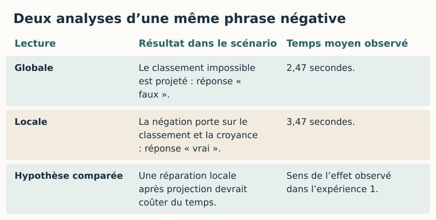

# ENS-PSL · Sélection internationale Lettres · Linguistique 2018 — Corrigé brut

*Corrigé rédigé par IA, non officiel. Signalez toute erreur.*

**Rédaction** · GPT-6.2 Astra Ultra · vitesse non renseignée

## Expérience de Chemla et Bott

### 1. Le problème posé

Chemla et Bott demandent comment un auditeur comprend une présupposition déclenchée dans la portée d'une négation. Deux lectures finales sont possibles. L'enjeu de l'expérience 1 est de déterminer si l'une demande plus de temps que l'autre et d'en tirer une prédiction sur l'ordre de leur construction.

### 2. Deux analyses et leurs prédictions de traitement

Appelons P la proposition enchâssée et B le fait que les spécialistes la croient. Dans la lecture globale de « ils ne se rendent pas compte que P », P reste tenue pour acquise et la négation porte sur B. Dans la lecture locale, la négation porte sur l'ensemble « P et B ». Si P est manifestement fausse, la lecture globale échoue et entraîne dans la tâche une réponse « faux ». La lecture locale est vraie puisqu'une conjonction dont le premier terme est faux est fausse.

Dans la version dynamique testée, la projection globale est le fonctionnement ordinaire. Une accommodation locale, c'est-à-dire la réinterprétation de P à l'intérieur de la négation, peut réparer la difficulté. L'autre approche teste une analyse pragmatique de manière. La conjonction sous la négation fournit d'abord le sens littéral local. L'interprétation globale demanderait un enrichissement fondé sur le choix de la formulation. Ces deux implémentations sérielles prédisent donc des ordres de rapidité opposés.

### 3. L'expérience

Trente-trois étudiants de Cardiff ont jugé des phrases vraies ou fausses. Trois ont été écartés pour des performances insuffisantes sur les contrôles. Une histoire de spécialistes extraterrestres attribuait aux zoologistes ou aux géographes des connaissances distinctes et contrôlées. Le dernier mot déterminait par exemple si le classement d'un animal était correct. Les mots apparaissaient successivement pendant 200 millisecondes, sauf le dernier qui restait affiché jusqu'à la réponse.

Dans l'item critique, des zoologistes « ne se rendent pas compte » que les éléphants sont des reptiles. Dire « faux » correspond au rejet de la prémisse projetée, dire « vrai » à une lecture locale. Quatre conditions témoins faisaient varier la spécialité, la justesse du classement et le verbe factif ou non factif. Les listes étaient contrebalancées. Les participants recevaient un retour pendant l'entraînement, puis jugeaient les items expérimentaux sans retour.

### 4. Résultats et arbitrage

Les contrôles donnent 89 % de réponses correctes en moyenne. Pour les items critiques, environ 38 % des réponses sont locales. Dans la comparaison au sein des participants, les décisions globales prennent 2,47 secondes en moyenne contre 3,47 pour les locales. La différence est également présente lorsque les auteurs comparent les groupes plus ou moins enclins à chaque réponse. Le sens de l'effet correspond à la prédiction « globale d'abord ». Dans cette tâche et pour ces factifs niés, le modèle sériel qui attend une réponse locale plus rapide rencontre donc une difficulté empirique.

### 5. Discussion proposée

Une explication immédiate serait qu'appuyer sur « vrai » en lisant une proposition enchâssée notoirement fausse provoque simplement un conflit de réponse. Les auteurs testent un décalage comparable dans une condition témoin. La réponse locale critique reste plus lente. Une stratégie consistant à ne traiter que le dernier mot devrait également produire des erreurs spécifiques sur certains contrôles, ce que la corrélation mesurée ne confirme pas.

L'avantage temporel étaye un ordre de traitement sans transformer chaque temps final en observation directe de deux étapes mentales. La décision vrai/faux ajoute au temps d'interprétation le temps nécessaire pour choisir une réponse. Je referais l'expérience en préparant explicitement un contexte où P est contestée, puis en mesurant le traitement pendant la phrase et en variant les déclencheurs. Une réduction sélective du coût local dans ce contexte aiderait à distinguer une réparation après échec d'une difficulté générale liée aux réponses minoritaires.

## Mises à jour selon Heim

### 1. Si Jean est incompétent, il le sait

Partons d'un contexte défini C. Notons I l'ensemble des mondes où Jean est incompétent, et B ceux où il se croit incompétent. Après l'antécédent, il reste C ∩ I. Dans cet ensemble, l'incompétence est garantie et « il le sait » satisfait donc sa présupposition locale. La mise à jour négative garde les mondes de C ∩ I dans lesquels cette croyance manque. La conditionnelle retranche précisément ces contre-exemples de C. Son résultat est l'ensemble des mondes de C où Jean est compétent ou se croit incompétent, c'est-à-dire C privé de (C ∩ I) ∖ B. Si C était déjà en échec, le résultat resterait en échec.

Il n'est donc pas nécessaire que l'incompétence de Jean soit acquise dès le départ. L'antécédent la fournit là où le conséquent en a besoin. Cela correspond à la possibilité naturelle de prononcer la phrase tout en ignorant si Jean est effectivement incompétent.

### 2. Les quatre mondes et les deux connecteurs

Avec « exactement deux étudiants **et** les deux sont en bonne santé », la première mise à jour conserve w1 et w3. Dans ces deux mondes, la description plurielle a bien deux référents. Seul w3 conserve ensuite les deux personnes en bonne santé. Résultat, {w3}. La présupposition locale de la deuxième proposition n'exclut aucun monde au départ.

Avec « exactement deux étudiants **ou** l'étudiant est malade », la première branche conserve w1 et w3. Pour calculer la seconde, on se place là où la première est fausse, donc dans {w2, w4}. Ces mondes ont chacun exactement un étudiant. Le singulier défini est ainsi légitime et seul w2 satisfait « malade ». La réunion donne {w1, w2, w3}. C'est bien w4, où il n'y a qu'un étudiant en bonne santé, qui rend l'alternative fausse. Cette prédiction dépend du contexte stipulé. S'il contenait aussi un monde sans étudiant, l'unicité ne serait plus garantie sur toute la seconde branche.

## Phonologie du frioulan

### 1. Le dévoisement final et les racines

À la fin du mot, les obstruantes du jeu sont sourdes. Un suffixe commençant par une voyelle révèle la consonne là où le contraste est conservé. Les racines sous-jacentes sont /warb/ « aveugle », /kwarp/ « corps », /pierd/ « il perd », /dint/ « dent », /sek/ « sec » et /fig/ « figue ». Pour /warb/, le *b* apparaît dans la forme suffixée, mais la forme isolée finit par *p*. Pour /kwarp/, le *p* reste *p* dans les deux formes. Les deux *t* finaux de « il perd » et « dent », puis les deux *k* de « sec » et « figue », illustrent le même raisonnement. Une consonne sourde en surface finale peut donc correspondre à deux séries sous-jacentes.

### 2. L'allongement vocalique

Dans les formes présentées, une voyelle accentuée s'allonge lorsqu'elle précède immédiatement une obstruante sous-jacente sonore en fin de mot. Les formes suffixées ne satisfont pas cette condition finale. Ainsi /lad/ donne une voyelle longue dans la forme masculine isolée, mais une voyelle brève dans la forme féminine où *d* est suivi de *e*. /brut/ donne une voyelle brève, même en finale de mot, parce que le *t* est sourd dès le départ. On observe le même contraste pour /nervoz/ face à /ros/, /lov/ face à /trop/, et encore l'allongement devant le *d* de /vjod/. Dans /fig/, le *g* que révèle le suffixe explique la voyelle longue dans la forme isolée. La racine /warb/ n'appellerait pas le même allongement, puisque *r* s'interpose entre la voyelle et *b*.

### 3. Pourquoi l'ordre des règles est décisif

Partons de /lad/. L'allongement devant le *d* final donne d'abord /laːd/. Le dévoisement final donne ensuite [laːt], la forme observée. Si l'on dévoise d'abord, on obtient /lat/. La règle d'allongement ne voit plus d'obstruante sonore et produit à tort une voyelle brève. Dans /lad+e/, aucune des deux règles finales ne s'applique et on obtient [lade]. L'ordre constaté est un ordre opaque, souvent nommé contre-limitation (*counterbleeding*). La seconde règle efface en surface l'environnement qui a permis à la première de fonctionner.

[Sujet officiel et document scientifique annexé](https://www.ens.psl.eu/sites/default/files/Epreuve_ecrite_linguistique_2018.pdf)
