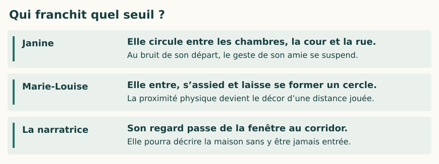

# Littérature — Assia Djebar et L’Amour, la fantasia · Oral PSL 2018 · Corrigé guidé

*Corrigé rédigé par IA, non officiel. Signalez toute erreur.*

**Rédaction** · GPT-6.2 Astra Ultra · vitesse non renseignée

**Révision (tour 1)** · GPT-6.2 Astra Ultra · vitesse non renseignée

Commentaire en vingt minutes environ, linéaire ou organisé par enjeux, puis entretien. L’extrait va de l’attente des filles au bilan de l’enfance.

## Préparer l’explication

Tracez les trajets de Janine et des deux fillettes. Pourquoi ces dernières peuvent-elles courir jusqu’aux arbres, mais pas entrer dans la mercerie ? Situez le café. Indiquez ensuite où seul le regard poursuit la visite.

Derrière la porte, dans le cercle de Marie-Louise, puis à la fenêtre, qui regarde, qui parle ? Lisez la réplique de la benjamine sur son père. Faites entendre son insistance sur ce que savent les enfants. Reprenez à voix plus basse le regard silencieux de la narratrice, occupée à tout autre chose.

## Commentaire du passage de « La Fille du gendarme français »

Dans *L’Amour, la fantasia* (1985), Assia Djebar fait alterner l’histoire de la conquête de l’Algérie et des souvenirs personnels ou transmis par des femmes. Le chapeau place le souvenir dans les années 1940. Une petite Algérienne passe les vacances au hameau auprès de ses trois cousines. Le « nous » de l’ouverture comprend donc aussi une enfant venue en visite. Aux visites des deux filles du gendarme semblent répondre les courses des petites Algériennes dans leur voisinage. Il y a des amitiés, des services rendus, une curiosité très vive de part et d’autre. Le dernier paragraphe tire pourtant de ce souvenir un fait qui pourrait surprendre, pendant toute son enfance, la narratrice n’est jamais entrée chez une camarade française. Comment le récit fait-il voir, au milieu même des échanges, la persistance d’un seuil ?

### Deux portraits dessinés à partir d’une liberté de mouvement

« Nous, les filles » rassemble d’abord les enfants dans une même attente. Pourtant les attitudes se différencient aussitôt à l’intérieur du groupe. L’aînée des trois sœurs s’enferme avec Janine, la plus jeune et la narratrice voudraient voir Marie-Louise. Le lecteur est ainsi invité à observer les relations une à une. Le premier trait de Janine tient à l’oreille. Derrière la porte, des voix mêlées se succèdent au rire et au silence sans que l’auditrice puisse les départager. Janine parle l’arabe sans accent. En la chargeant d’achats précis que le père saurait mal faire, la mère lui donne une fonction réelle dans les activités domestiques. Son intégration dans la maison pourrait se dire par une parenté nouvelle, elle en serait presque la quatrième fille.

Or la tournure hypothétique qui suggère cette parenté introduit aussi une réserve sur le prénom, puis une exclamation change toute la portée du portrait. Janine entre et sort « comme un garçon ». La série des espaces traversés, chambres, cour, rue, donne à sa liberté une mesure concrète. Pour aller d’une maison à l’autre, elle utilise sans même y penser des seuils qui déterminent l’existence de son amie. Le son du heurtoir suspend une seconde le geste de l’aînée. La narratrice s’abstient de traduire cette suspension en sentiment précis, envie, regret ou tristesse. Le geste arrêté fait sentir une différence que le dialogue amical n’aurait pu faire entendre. La parenté souhaitée est réelle dans un certain espace et cesse au moment de le quitter.

Marie-Louise n’entre pas dans le récit par le son, mais par la fascination du regard. Les talons, les peignes, les couleurs du visage attirent une attention aussi minutieuse que les gestes de Janine avaient été simples. « Elle devait être petite » montre l’adulte tirant aujourd’hui une conséquence incertaine du souvenir de ses hauts talons. Quant au travail de la jeune femme, employée des postes ou secrétaire, les fillettes n’en savent rien. Leur admiration invente une vie citadine possible pour un être qu’elles ne voient qu’à intervalles espacés. Assise devant un « cercle » de femmes, la visiteuse se laisse regarder et sait l’effet qu’elle produit. Inverse du portrait de Janine, que l’on pourrait prendre pour une sœur, celui-ci aboutit à une formule théâtrale, jouer à l’étrangère. Au soupir sur l’oubli de la langue arabe, la narratrice entend une concession et la distance qu’elle maintient derrière la politesse. Elle se garde pourtant de décider laquelle des deux Françaises représente l’exception. Ce scrupule soustrait les portraits à une classification commode.

### Des courses de petites filles à l’apprentissage des frontières

Une question portant sur la date des fiançailles de Marie-Louise change le plan du récit. Le souvenir ne revient pas comme une scène photographiée une fois pour toutes. La narratrice le date par approximations, d’après l’âge de son amie et la liberté dont celle-ci disposait encore avant d’être cloîtrée. Le futur de ces fillettes est donc déjà sensible dans la manière dont l’adulte restitue leurs déplacements. Aller faire une commission leur permet de goûter la liberté. Elles dépassent même la destination prévue, courent jusqu’aux arbres et se couchent parmi les feuilles odorantes. Les verbes de mouvement et le battement du cœur donnent à ce trajet une intensité qu’un relevé de la distance parcourue ne ferait pas comprendre.

Le retour plus lent fait entendre le goût « âcre » de cette complicité de fugitives. La course avait momentanément effacé une limite, mais le corps en éprouvait déjà la fragilité. Arrivées chez le gendarme, les fillettes restent debout dans la cour devant la fenêtre ouverte de la cuisine. Cette fenêtre permet pourtant une conversation animée. On parle de lait de chèvre, de la taille exacte d’une paire d’aiguilles et des achats que les pères sont plus ou moins capables de faire. Le dialogue direct redonne à chacune une allure de voix. C’est la Bourguignonne qui a les bras dans la lessive et qui rit des maris. La benjamine lui réplique que son père, à elle, sait choisir les fruits et la viande. Son objection, accueillie sans réprimande, donne au dialogue son allure familière. Le numéro des aiguilles semble un détail de la commission. Il oblige pourtant la benjamine à dire pourquoi elle a besoin de Janine : la mercerie se trouve juste en face du café maure. Les fillettes peuvent courir au-delà de la maison et rester devant la cuisine du gendarme. Dans une autre rue, la simple proximité d’un lieu fréquenté par des hommes leur ferme au contraire un magasin. La même voix qui répond librement à l’adulte sait énoncer la règle au pluriel, au nom des filles. L’itinéraire dessine ainsi deux frontières distinctes, celle des permissions faites aux filles et celle de l’entrée dans la maison française.

### La fenêtre ouverte et le seuil jamais franchi

Pendant ce dialogue assez égal, le regard de la narratrice suit en silence une autre route. Du cadre de la fenêtre il passe au corridor puis aux autres pièces qu’on devine sans les voir entièrement. Les meubles brillants dans la pénombre, les torchons à carreaux, la nourriture suspendue et l’image de la Vierge attirent successivement son attention. Ce sont des objets banals dans cette maison. Leur situation à la fois visible et inaccessible leur donne un éclat singulier, celui que le regard des étrangères attribuait tout à l’heure aux peignes de Marie-Louise. Les torchons qui servent ici au travail domestique deviennent, depuis la cour, un « pur ornement ». La méconnaissance fait partie de l’enchantement lui-même.

Une inversion de premier plan et d’arrière-plan pousse cette expérience jusqu’au paradoxe. La famille dont les filles occupaient presque toute la scène devient ombre passagère et les choses semblent les véritables occupantes. Il serait insuffisant d’en tirer une simple liste d’usages différents de part et d’autre des familles. La scène passe au présent pour affirmer que l’œil « reste fasciné ». L’adulte reconnaît dans sa manière présente de regarder une disposition née à la fenêtre. L’image du « rivage » élargit brusquement les quelques mètres séparant la cour et la cuisine. Elle figure une terre proche dont on peut détailler les contours sans y débarquer.

Les deux passés simples de la fin font le bilan d’une enfance entière après les imparfaits des gestes répétés. À la première négation spatiale, le seuil, la seconde ajoute quelque chose de plus intime, la maison d’une camarade de classe. Les visites de Janine se prolongeaient jusque dans les chambres de ses voisines ; dans le trajet inverse, la fenêtre restait la limite. À cette différence s’ajoutent les permissions inégalement distribuées selon l’âge et selon le sexe. La narratrice les fait apparaître par les trajets mêmes qui en procuraient une connaissance enfantine. Le rappel de la guerre d’indépendance introduit pour finir l’histoire collective dans cette géographie de voisinage. L’écrivaine ne l’ajoute pas après coup à une jolie scène de vacances. C’est en faisant le compte exact de qui était entré chez qui qu’elle nous a appris à la lire.

## Deux relances pour l’entretien

**Pourquoi deux sœurs françaises ?** Janine traduit l’amitié en allées et venues et Marie-Louise entretient sa distance au milieu même des visites. Leurs conduites différentes empêchent de ramener le passage à deux portraits collectifs et fixes des familles françaises et algériennes.

**Comment l’adulte intervient-elle dans le souvenir ?** Elle hésite sur les dates, déduit la taille d’une visiteuse de la hauteur de ses talons et reprend au présent la fascination de l’œil. Elle indique aussi les limites de son savoir, ce qui donne d’autant plus de poids à la négation finale.

[Énoncé](https://www.ens.psl.eu/sites/default/files/oral-SIL2018-litt.4.pdf)
