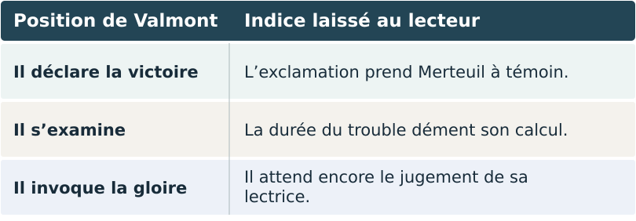

# Laclos et Les Liaisons dangereuses · Oral de littérature ENS-PSL 2018 · Corrigé brut

*Corrigé rédigé par IA, non officiel. Signalez toute erreur.*

**Rédaction** · GPT-6.2 Astra Ultra · vitesse non renseignée

## Commentaire du début de la lettre CXXV

Dans *Les Liaisons dangereuses* (1782), le vicomte de Valmont écrit à la marquise de Merteuil après avoir obtenu ce qu’il poursuivait auprès de la présidente de Tourvel. Le billet de victoire qui aurait pu tenir dans le premier paragraphe devient un long examen de ce que le vainqueur éprouve. Le feuillet s’arrête avant le récit des paroles échangées avec Tourvel, au moment où Valmont en promet une restitution exacte à sa correspondante. Pourquoi celui qui affirme posséder entièrement une femme a-t-il tant besoin de s’expliquer sur l’effet qu’elle produit encore sur lui ?

### Une victoire acquise, une émotion qui dure

L’adverbe « donc » présente d’emblée la conquête comme le résultat attendu d’une entreprise. La tournure présentative et le participe « vaincue » font voir un tableau de triomphe avant même que la femme en question ne soit désignée. L’adjectif « superbe » lui prête un orgueil dont sa résistance serait la marque. En répétant le groupe « à moi », le vicomte proclame son pouvoir devant une alliée qu’il interpelle avec familiarité. Le mot « hier » fixe un terme à l’entreprise. Il offre aussi, pour la suite du raisonnement, la possibilité de comparer deux états du même homme.

Dès le deuxième paragraphe, le présent devient en effet celui de l’étonnement. Valmont se déclare trop rempli par le bonheur pour en être juge. Il cherche néanmoins sur-le-champ une cause au plaisir singulier qu’il a éprouvé. La vertu de Tourvel aurait-elle accru sa valeur à ses yeux ? La question menace de faire reconnaître une qualité propre à l’autre. Le mépris affiché pour les « contes de bonnes femmes » ferme provisoirement cette issue. Sous la forme de la question suivante, une autre difficulté ressurgit. Si toutes les résistances se ressemblent, pourquoi aucune de ses aventures antérieures n’a-t-elle produit le même effet ?

Valmont envisage alors l’amour, aussitôt déprécié comme une faiblesse. Il applique à sa vie intérieure le langage de la conquête et se donne pour victorieux de ses propres émotions. Or la syntaxe de la concession rend cette maîtrise incertaine. Si le trouble n’avait été que celui de la scène de la veille, il aurait dû se dissiper. Le fait observé est sa persistance. La brièveté du retournement qui suit la longue hypothèse rend la difficulté presque palpable. À l’image du conquérant succède celle d’un « écolier » qui aurait trouvé son maître. La décision de combattre le sentiment tout en en poursuivant l’analyse associe deux exigences difficiles à satisfaire ensemble. Un examen libre pourrait menacer les principes que le combat a pour fonction de défendre.

### Construire une explication avantageuse

Le très court paragraphe qui sert de charnière introduit une cause entrevue et surtout le désir qu’elle soit vraie. La préférence précède la démonstration. Valmont compose pour l’appuyer deux portraits de groupe très inégaux. Les femmes jadis séduites sont rassemblées dans une « foule ». Le libertin décrit son activité à leur égard comme un rôle et des fonctions. Si les partenaires étaient également disposées à l’aventure, la conquête devenait une sorte de jeu convenu dont son lexique à lui fixait même le degré de résistance acceptable.

Le déictique « Ici » singularise le cas présent. Prévention alimentée par des avis extérieurs, timidité, pudeur, convictions religieuses et démarches de protection se cumulent en une longue phrase. La durée de deux années que Valmont accorde à la vertu de la présidente prête curieusement à celle-ci le premier triomphe. Les efforts qu’elle a déployés pour éviter ses poursuites sont lisibles dans sa lettre. Mais son raisonnement convertit chacun de ces motifs d’agir en un obstacle dont la difficulté augmentera sa propre gloire. Le lecteur du roman épistolaire peut reconnaître à Tourvel une volonté là où la version du vicomte cherche principalement un faire-valoir.

### Se persuader sous les yeux de Merteuil

La métaphore militaire relie « capitulation », « campagne » et « manœuvres ». Elle permet de classer les aventures, d’évaluer le prix des succès et de donner au vainqueur le mérite exclusif de l’issue. Les adverbes de conséquence et les tours restrictifs veulent faire de la gloire l’unique cause du bonheur persistant. Pourtant Valmont écrit qu’il chérit cette façon de voir. Le verbe affectif, déplacé de la personne de Tourvel vers l’explication qui convient à son orgueil, trahit le soulagement que lui procure sa théorie. Ce soulagement prouve la crainte d’une dépendance. Il ne démontre pas la théorie.

La figure du maître qui dépendrait de son esclave donne à cette crainte sa forme la plus vive. Valmont voudrait contenir en lui seul la source de tout son plaisir. La simple possibilité qu’une femme déterminée, irremplaçable, en détienne une part suffirait à ruiner sa liberté telle qu’il la conçoit. Le passage au futur lui permet de transformer une maîtrise encore à prouver en promesse de rupture. Il en parle déjà alors qu’il n’a pas encore raconté la conquête. C’est une avance prise dans l’ordre du récit sur une liberté qu’il croit pouvoir exercer dans l’avenir.

Merteuil reparaît en personne grammaticale à la fin. Les impératifs de lecture et la promesse de rendre les discours avec exactitude l’installent dans la position d’une juge dont il attend le contentement. Celui qui étudiait attentivement les répliques assure pouvoir les reproduire, mais l’on vient de mesurer avec quel intérêt il interprète les faits. Laclos fait donc entendre deux histoires à travers une seule lettre, l’assurance de la victoire et le travail nécessaire pour la soutenir devant autrui. La question de l’amour reste ouverte, tandis que le désir de maîtriser la lecture de Merteuil est partout sensible.
