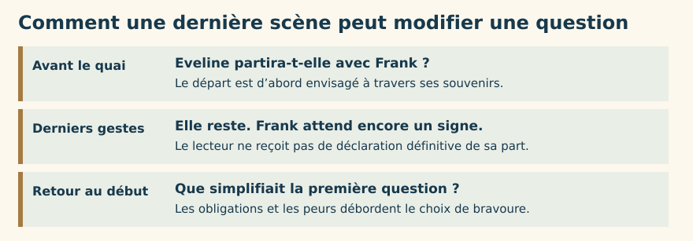

# ENS-PSL · Sélection internationale Lettres — Littérature — Todorov et le pouvoir de la littérature 2018 · Corrigé guidé

*Corrigé rédigé par IA, non officiel. Signalez toute erreur.*

**Lecture du rapport du jury** · GPT-6.2 Astra Ultra · vitesse non renseignée

**Rédaction** · GPT-6.2 Astra Ultra · vitesse non renseignée

**Relecture** · GPT-6.2 Astra Ultra · vitesse non renseignée · 26 novembre 2026

**Autocontrôle** · GPT-6.2 Astra Ultra · vitesse non renseignée

Le rapport officiel de l’écrit reproduit la citation de La Littérature en péril de Tzvetan Todorov (2007) et précise l’exercice de commentaire. La proposition suit cette attestation en mobilisant œuvres, lecture critique et expérience de lecture.

## Décrire comment s’obtient une proposition

Le rapport reproduit la citation et explicite la demande d’exemples littéraires, critiques et personnels. Deux mots permettent de construire le devoir, « figurer » et « mouvement ». Montrez d’abord ce que permet la représentation d’une scène, puis ce qui continue quand elle est terminée.

> [!INDICATION]
> La morale finale annule-t-elle le rôle du lecteur ?

Dans la fable de La Fontaine, le résultat est peu ambigu. Il reste cependant à voir comment le Renard transforme un aveu en flatterie et pourquoi l’Âne n’obtient pas le bénéfice de la même opération. Localisez cette activité précise du lecteur.

> [!INDICATION]
> Que faire du « choc » ?

À la fin d’« Eveline », identifiez la question que vous posiez avant la scène du quai et demandez si elle convient encore. Une réaction compte dans le commentaire lorsque l’on peut montrer quel changement du récit l’a rendue possible.

> [!INDICATION]
> Comment discuter Todorov ?

Une image répétée peut renforcer un stéréotype. La fiction n’assure donc pas automatiquement le gain de liberté qu’elle promet. Étayez votre jugement par la possibilité de reprendre le détail à une seconde lecture.

## Entre une fable que l’on sait et une scène que l’on ne sait plus juger

Une maxime peut dire d’un trait que les puissants échappent à la condamnation qui frappe les faibles. Les derniers vers des *Animaux malades de la peste* de La Fontaine proposent précisément une conclusion de cet ordre. Si elle était tout ce que la fable nous apprend, la lecture des vers précédents serait une longue manière d’en retarder l’énoncé. Pourtant il importe que nous ayons d’abord entendu le Lion présenter son aveu, le Renard le rendre flatteur et l’Âne exposer son scrupule. Dans *La Littérature en péril*, Todorov associe la figuration d’un cas particulier, la liberté du lecteur et une activité d’interprétation capable de durer au-delà du livre. Comment une œuvre peut-elle soutenir une intelligence partageable de l’expérience tout en produisant ce « tremblement de sens » qu’une proposition abstraite tendrait à arrêter ?

## Le cas ne se contente pas d’illustrer ce que l’on savait

Le Lion de La Fontaine réunit un conseil pour déterminer celui dont les fautes seraient responsables du malheur commun. La convocation donne à l’assemblée l’apparence d’une recherche partagée. En prenant le premier la parole, le Lion construit aussi la situation dans laquelle on pourra le juger. L’intervention du Renard rend l’aveu royal pratiquement irréfutable, en le réinterprétant comme un honneur fait à ceux-là mêmes qui en ont subi les effets. Lorsque l’Âne prétend à son tour peser précisément un tort mineur, sa scrupuleuse précision est retenue contre lui. Le lecteur peut donc distinguer le degré de la faute, le rang de celui qui parle et la transformation de son discours par ceux qui l’écoutent. La moralité énonce un résultat. La scène fait observer le mécanisme qui y conduit.

Le particulier joue ici un rôle plus exigeant que celui d’un exemple décoratif. Les prises de parole se contredisent à l’intérieur d’une action unique. Pour comprendre la manière dont l’assemblée se rend injuste, il faut se souvenir de la norme qu’elle proclame et repérer discrètement le moment où elle cesse de l’appliquer également. La fable ne laisse guère ouverte la question de savoir si l’Âne a été jugé équitablement. Elle laisse au lecteur le travail d’identifier ce qui, dans une parole flatteuse ou dans un aveu sans protection, rend ce verdict possible. La présence d’une thèse explicite ne suffit donc pas à en faire une leçon imposée de bout en bout.

Le premier verbe de Todorov appelle une objection. Si le lecteur doit formuler une thèse, qui décide que cette formulation est juste ? Dans la fable, je pourrais conclure que l’Âne a été condamné parce qu’il a mal parlé. Ce serait prendre pour cause première une maladresse que le loup exploite. Il faut revenir aux fautes plus graves déjà absoutes, puis au rang des orateurs. La scène m’oblige à corriger mon explication du verdict. La liberté du lecteur se mesure ici à la possibilité de proposer une raison, le pouvoir du texte à la précision des détails qui peuvent la démentir.

> [!INDICATION]
> Quel détail du conseil oblige à corriger une première interprétation du verdict ?

Comparez la manière dont le Renard défend le Lion et celle dont le Loup interprète l’aveu de l’Âne. Un récit du conseil qui parlerait seulement d’une maladresse de l’Âne manquerait l’inégalité de ces deux médiations. La morale peut être annoncée franchement tout en laissant un mécanisme à découvrir.

## Une figuration peut défaire la question qu’on voulait lui poser

Dans « Eveline », une nouvelle de James Joyce publiée dans *Dubliners* en 1914, une jeune femme envisage de quitter Dublin avec Frank. La perspective d’une vie nouvelle se trouve prise dans les souvenirs de la maison et des obligations envers la famille. Le titre donne un nom plutôt qu’un problème général. Le récit au plus près de la conscience d’Eveline nous fait d’abord chercher si elle aura le courage de partir. Au quai, au lieu d’une déclaration où elle s’expliquerait, apparaissent un corps qui s’agrippe et un visage qui ne transmet plus à Frank le signe attendu.

Le changement de distance m’oblige alors à reprendre ma question. Demander si elle a du courage revient peut-être à adopter le point de vue de celui qui attend d’elle qu’elle parte. Les souvenirs familiaux font de l’immobilité autre chose qu’une simple préférence pour le familier. Mais en faire une héroïne du devoir familial effacerait la menace et la fatigue présentes dans ses souvenirs. L’alternative que je croyais claire se révèle incapable de distribuer proprement les raisons. C’est en ce sens qu’une figuration peut apprendre quelque chose qu’un énoncé moral ne donnerait pas déjà. Elle met en difficulté la forme même du jugement.

Dans Upheavals of Thought (2001), ouvrage mentionné par le jury, Martha Nussbaum étudie ce que les émotions révèlent de nos jugements de valeur. Ce rapprochement permet de préciser l’effet produit par Joyce. Je peux éprouver d’abord l’impatience de voir l’héroïne se décider, puis reconnaître dans cette impatience une exigence que le récit me conduit à interroger. L’émotion n’est pas la récompense que l’on recevrait après avoir compris le sens. Elle fait apparaître ce que je tiens implicitement pour important. Elle n’accorde cependant aucun accès immédiat à la vérité d’autrui. Mon trouble n’autorise pas à écrire à la place d’Eveline la déclaration définitive que le texte a précisément suspendue.

## L’onde de choc continue lorsqu’on peut rééprouver sa lecture

Dans « Devant la loi » de Kafka, l’homme de la campagne attend longtemps devant une entrée gardée. Le lecteur peut envisager la scène comme une dénonciation d’une autorité inaccessible, puis se demander quelle part prend au pouvoir du gardien la décision d’attendre. À la fin, l’annonce que cette entrée était destinée à cet homme seul reprend tous les gestes antérieurs sans décider entre les interprétations. Elle individualise l’obstacle apparemment universel et laisse sans réponse la question de ce qu’aurait permis une autre conduite. Le retentissement de la parabole tient en partie à cette fin capable de transformer l’importance du premier échange dès qu’on y revient.

Mais une œuvre peut aussi prendre le lecteur de vitesse, circonscrire ses sympathies ou flatter un préjugé déjà installé. Figurer une situation ne garantit pas qu’il la mette en question. La répétition de personnages définis par un trait unique peut produire un stéréotype au lieu d’ébranler un jugement. L’expérience d’un choc ne fournit pas à elle seule un critère de valeur littéraire. Il faut demander ce que l’œuvre permet d’examiner lorsque le premier effet est passé et si l’on peut éprouver son interprétation contre d’autres détails, ou contre celle d’un autre lecteur.

La proposition de Todorov fournit donc une théorie d’une puissance que la littérature exerce diversement. Chez La Fontaine, une morale déclarée conserve derrière elle une scène de jugement à interroger. Chez Joyce, la représentation change la question que le lecteur croyait devoir résoudre. Chez Kafka, la dernière parole remet en circulation les possibilités du début. Dans chacun de ces cas, le lecteur demeure actif parce que le sens ne lui arrive pas comme le dernier mot d’une autorité. Il lui arrive comme une relation qu’il devra pouvoir reconnaître, justifier et peut-être modifier lors d’une autre lecture.

[Énoncé reproduit dans le rapport officiel](https://www.ens.psl.eu/sites/default/files/rapport_sil_litterature_ecrit_2018.pdf) · [James Joyce, Dubliners, nouvelle Eveline](https://www.gutenberg.org/files/2814/2814-h/2814-h.htm) · [Martha Nussbaum, Upheavals of Thought, Cambridge University Press](https://assets.cambridge.org/97805215/31825/copyright/9780521531825_copyright_info.pdf)
