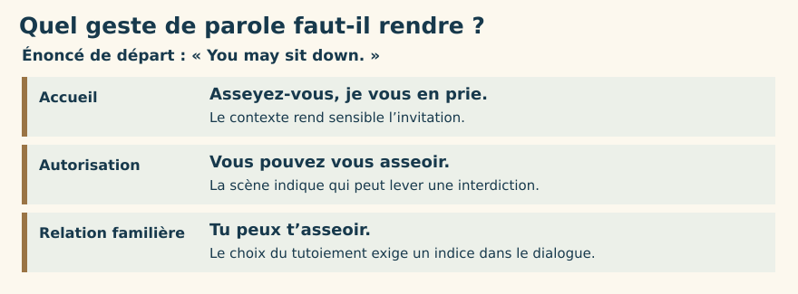

# ENS-PSL · Sélection internationale Lettres — Philosophie — la traduction 2018 · Corrigé guidé

*Corrigé rédigé par IA, non officiel. Signalez toute erreur.*

**Rédaction** · GPT-6.2 Astra Ultra · vitesse non renseignée

**Autocontrôle** · GPT-6.2 Astra Ultra · vitesse non renseignée

**Révision (tour 1)** · GPT-6.2 Astra Ultra · vitesse non renseignée

La consigne demande de développer et commenter la notion « La traduction ».

## Partir d’une décision de traduction

La feuille donne seulement la notion. Pour en faire un problème, choisissez une phrase courte, maintenez le même texte source et changez les circonstances. L’écart entre une permission et une invitation oblige à préciser ce qu’il s’agit de conserver.

**Qu’est-ce qui distingue plusieurs traductions et un contresens ?** Dans l’exemple, la situation et les réponses des personnages rendent certaines interprétations possibles et en excluent d’autres. Une variation de ton mérite un argument précis. Le mot « subjectif » ne dispense pas de lire l’énoncé.

**Comment traiter l’intraduisible ?** Dans le jeu français sur « pas », établissez ce qui peut être transmis et ce qui résiste. Expliquez l’intérêt et la limite d’une note pour un poème imprimé, puis refaites l’essai pour une lecture orale. Un résultat différent peut être justifié par la destination de la traduction.

**Pourquoi évoquer le lecteur ?** C’est lui qui dépend d’un choix qu’il ne peut pas toujours contrôler. L’explicitation d’un terme institutionnel ou d’une ambiguïté engage la possibilité de poursuivre une discussion informée.

## Comment répondre du même avec d’autres mots ?

Une personne pousse la porte d’une consultation et entend en anglais « You may sit down ». Rendre la phrase par « Vous pouvez vous asseoir » conserve une possibilité exprimée grammaticalement. « Asseyez-vous, je vous en prie » peut mieux rendre le geste d’accueil, au prix d’un changement de mode verbal. « Tu peux t’asseoir » introduirait en français une proximité que la forme anglaise ne détermine pas à elle seule. La traductrice ne manque pas simplement d’un dictionnaire plus complet. Plusieurs aspects de la parole doivent être compris ensemble et ne se recouvrent pas exactement d’une langue à l’autre. Pourtant, si traduire n’obligeait à aucune fidélité, rien ne distinguerait une traduction d’un nouveau propos sur le même thème. Quel type de ressemblance entre deux paroles différentes permet d’en répondre comme d’une traduction ?

## Traduire demande d’interpréter ce qu’il faut maintenir

La substitution terme à terme suppose une pensée déjà intégralement découpée en unités auxquelles chaque langue aurait donné des étiquettes différentes. Elle peut réussir pour un élément très délimité. Les heures indiquées sur un billet de train doivent renvoyer au même départ, compte tenu du système de notation et du fuseau pertinents. Leur exactitude a une sanction nette. Mais la phrase qui invite quelqu’un à s’asseoir ne désigne pas seulement un mouvement du corps. Elle règle une relation. Même si tous les verbes ont été correctement identifiés, il reste à savoir si le personnage commande, propose ou lève une interdiction.

Roman Jakobson, dans *On Linguistic Aspects of Translation* en 1959, distingue notamment la reformulation dans une même langue, la traduction entre langues et le passage entre systèmes de signes. Cette distinction empêche de confondre le déplacement des mots avec celui du sens. Il arrive qu’une définition donnée en français rende compréhensible un terme français inconnu. La possibilité de reformuler montre que la compréhension n’est pas prisonnière d’un seul mot. Inversement, si l’on traduit un dialogue en conservant tous ses renseignements mais en effaçant ses différences de ton, la fonction de chaque réplique peut être perdue. Dans un roman, l’écart entre un personnage qui tutoie et un autre qui maintient ses distances peut faire partie de ce qui arrive.

Un premier critère apparaît ainsi. Une traduction construit dans la langue d’arrivée les distinctions dont dépend l’intelligibilité de l’énoncé dans une situation. Pour l’appliquer, il faut avoir interprété cette situation. Mais si l’interprétation commande déjà ce qu’il faut préserver, comment éviter que le traducteur n’entende seulement ce qu’il veut y trouver ?

## La pluralité de bonnes solutions ne supprime pas l’erreur

Imaginons que « You may sit down » soit prononcé au tribunal après l’autorisation donnée à un témoin. En français, « Je vous invite à vous installer confortablement » risque d’ajouter une sollicitude qui change l’exercice de l’autorité. À l’inverse, une injonction sèche dans une scène de réception chaleureuse imposerait au personnage une rudesse nouvelle. Le reste du dialogue, les formes d’adresse, le lieu et les réactions qui suivent permettent de rendre compte du choix. Aucune liste d’équivalents ne peut le faire seule. Mais le traducteur n’est pas sans critère, puisque les mêmes éléments peuvent contredire son interprétation.

Le travail sur un poème rend la situation plus délicate. Supposons un très court poème français où la répétition de « pas » évoque alternativement la négation et des pas entendus dans le couloir. Traduire chaque occurrence par le mot anglais qui convient isolément peut rendre l’action claire tout en effaçant le retour du même son. Maintenir un jeu verbal en anglais peut conduire à déplacer une image ou une pause. Une traduction bilingue destinée à l’étude peut signaler brièvement ce jeu dans une note. Une version faite pour être dite à voix haute devra chercher son effet dans les mots prononcés. La difficulté ne rend pas équivalents un contresens sur l’action et la perte explicitée d’une résonance. Elle oblige à hiérarchiser et à rendre perceptible le coût de la solution qui prévaut.

Essayons le jeu sur deux phrases de notre invention. « Pas un bruit. Un pas. » La version anglaise « Not a sound. A footstep. » maintient le silence, puis l’irruption du bruit qui le rompt. Elle perd le son identique par lequel le français passe de la négation à la présence de quelqu’un. « No sound. Someone steps. » reprend des sifflements, mais introduit plus explicitement une personne et un mouvement. Pour un sous-titre lu dans l’urgence, je choisirais la première. Pour une scène jouée, j’essaierais les deux à voix haute avec le rythme des pas. Même lorsqu’une perte est inévitable, on peut donner une raison de préférer une solution à une autre dans un emploi précis.

Le mot « intraduisible » désigne dans ce cas une résistance à un transfert sans reste. Il peut constituer une raison de traduire à nouveau. Une première version a rendu l’information, une seconde souhaite rendre audible une ambiguïté, une troisième dispose d’un usage nouveau dans la langue d’arrivée. Le texte source continue de mettre les versions à l’épreuve. Une nouvelle traduction peut rendre perceptible ce qu’une autre avait sacrifié. La possibilité de reprendre le travail explique la coexistence de plusieurs versions jugées fidèles, chacune pour des raisons qu’il reste à comparer.

## Une traduction engage aussi une relation entre des lecteurs

La personne qui dépend de la traduction ne peut pas toujours la comparer à l’original. De cette asymétrie découle une responsabilité particulière. Traduire le titre d’une institution étrangère par le nom d’une institution familière peut éviter une longue explication. Si cette équivalence attribue au titulaire des pouvoirs qui ne sont pas les siens, elle fait précisément manquer l’objet qu’elle devait rendre accessible. Conserver un terme accompagné d’une explication lors de sa première apparition permet quelquefois de préserver la distinction sans rendre la suite illisible. Le choix pertinent varie selon la fonction du document et ce que les interlocuteurs doivent pouvoir en faire.

Il existe une difficulté inverse. Accumuler tous les termes originaux et toutes leurs nuances peut laisser le lecteur devant une parole qu’il ne peut ni suivre ni reprendre. Faire une place à ce qui est étranger à la langue d’arrivée suppose d’en faire effectivement entendre quelque chose. Une traduction établit ici une possibilité de discussion. Le lecteur peut comprendre assez bien un argument pour lui répondre, alors même que le traducteur indique à quel endroit une ambiguïté subsiste. La fidélité ne concerne donc pas seulement la relation de deux textes. Elle porte aussi sur ce que la seconde parole permet à un tiers de comprendre, de demander et de contester.

Traduire, en définitive, c’est reconnaître qu’une parole peut être reprise autrement et qu’elle continue d’obliger celui qui la reprend. La traduction est un acte d’interprétation publiquement justifiable par l’original, par la situation du discours et par les possibilités de la langue destinataire. Plusieurs versions peuvent satisfaire cette exigence à des titres différents. Leur pluralité prend un sens dès que l’on est capable de dire ce que chacune a sauvé, ce qu’elle a déplacé, et quelle lecture le déplacement rend possible.

## Vérifier une retraduction

Rendez en français « Not a sound. A footstep. » sans consulter les deux phrases de départ. Vous retrouverez probablement le silence et le bruit de pas. Retrouverez-vous à coup sûr la répétition du même son ? Cet écart montre les limites de la retraduction comme épreuve de fidélité. Elle peut faire apparaître une perte, sans décider à elle seule si le premier traducteur a eu tort.

[Feuille de l’écrit](https://www.ens.psl.eu/sites/default/files/ecrit-philo-SIL2018.pdf) · [Roman Jakobson, On Linguistic Aspects of Translation (1959)](https://www.degruyterbrill.com/document/doi/10.4159/harvard.9780674731615.c18/html)
