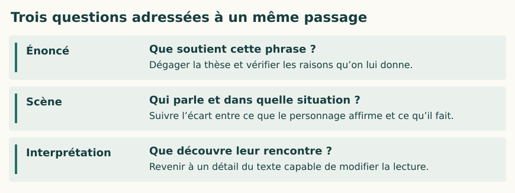

# Philosophie — Littérature et philosophie · Oral PSL 2018 · Corrigé guidé

*Corrigé rédigé par IA, non officiel. Signalez toute erreur.*

**Rédaction** · GPT-6.2 Astra Ultra · vitesse non renseignée

**Révision (tour 1)** · GPT-6.2 Astra Ultra · vitesse non renseignée · 26 novembre 2026

## Préparer l’exposé

Prenez un épisode que vous pourriez raconter en quarante secondes. Écrivez ensuite une phrase qui en abstrait la leçon. Relevez précisément ce que la phrase perd. Chez Tolstoï, une formule sur la finitude laisse échapper le passage du regard des collègues à la conscience du personnage. Montrez comment cette perte oblige à mieux poser le problème.

Pour l’objection inverse, inventez deux personnages qui soutiennent avec la même éloquence des thèses contradictoires. Quel type d’examen permettrait d’arbitrer ? Reprenez alors votre définition de la philosophie et demandez-vous si une œuvre peut organiser cet examen à l’intérieur même de son intrigue.

**Déplacer une réplique.** Imaginez que la proposition de nourrir Socrate au Prytanée soit faite par un ami avant le procès. L’argument sur le service rendu à la cité pourrait rester identique. Que perd-on ? Dans l’*Apologie*, c’est le condamné qui répond à l’invitation de proposer sa peine. Le décalage entre la place qu’on lui assigne et l’honneur qu’il revendique devient sensible au moment où l’on peut encore le punir. Vous disposez alors d’une prémisse à discuter et d’un effet de situation à expliquer.

## Exposé

Dans l’*Apologie de Socrate*, un accusé parle devant ses juges. Le lecteur peut examiner sa thèse sur l’obligation de philosopher. Il peut aussi entendre l’ironie d’un homme qui propose pour récompense d’être nourri aux frais de la cité. Retranchons le procès, son public, le risque que court l’orateur. La proposition sur le devoir d’examen reste intelligible, mais savons-nous encore à quelle épreuve elle engage celui qui l’énonce ? La philosophie semble avoir besoin du récit pour donner chair à une idée. Pourtant un beau discours peut emporter l’adhésion quand le raisonnement est mauvais. Que peuvent donc littérature et philosophie l’une pour l’autre si chacune doit répondre de ce qu’elle avance à sa manière ?

### Deux manières de demander raison d’un texte

Si j’affirme que personne ne commet volontairement l’injustice, il suffit d’un contre-exemple convenablement décrit pour exiger une révision de ma thèse. Je dois dire ce que j’entends par vouloir et pourquoi l’exemple entre dans le champ de ma proposition. Si un roman donne à lire la conviction du même personnage qu’on ne commet jamais volontairement l’injustice, son lecteur demandera notamment qui parle, à quel moment et avec quel intérêt. Le personnage sera-t-il démenti par ce qu’il fait trois pages plus loin ? Confondre les deux demandes conduit à imputer à un auteur toutes les paroles de ses personnages. On perd aussi la puissance d’un argument si l’on répond à sa conclusion par une appréciation de style.

La distinction concerne donc des opérations de lecture. Elle sépare mal les livres. Le poème de Parménide introduit par un voyage et la rencontre d’une déesse un examen exigeant des voies de la pensée. Le poème donne au lecteur la place de celui qui doit apprendre à juger, mais cette scène ne le dispense d’aucune inférence. Inversement, si l’on réduit une fable de La Fontaine à la maxime qu’elle porte, que faire de l’écart entre la règle proclamée et le plaisir qu’on prend parfois aux raisons du plus adroit ? La distinction permet de lire ces tensions à condition de ne pas classer une fois pour toutes les ouvrages.

### Ce qu’un récit fait découvrir à une idée

En racontant la mort d’Ivan Ilitch, Tolstoï donne une portée nouvelle à un syllogisme que son personnage a appris autrefois. Si tous les hommes sont mortels, le personnage d’un exercice de logique est mortel. Ivan n’avait aucune difficulté à l’admettre. Mais dans ce personnage quelconque, comment reconnaître celui qui se souvient de son enfance et qui souffre maintenant ? La conclusion du syllogisme demeure valide. Le récit découvre un écart entre savoir une proposition qui vaut pour tous et se l’appliquer en première personne. L’irréductibilité du « je » à l’exemple de manuel devient un problème parce que deux descriptions vraies d’une même mort nous affectent diversement.

Il y a ici plus qu’une illustration. Pour illustrer une proposition, on la possède déjà et l’on choisit un cas approprié. Chez Tolstoï, le lecteur accompagne d’abord le regard convenu des collègues du défunt, puis remonte le cours d’une vie. L’ordre du récit fait éprouver la facilité avec laquelle on passe de sa propre place à un jugement impersonnel sur autrui. C’est à partir de cette difficulté qu’on peut poser une question dont le récit ne donne pas la solution générale. D’autres histoires produiraient d’autres questions. On ne déduit donc de cette lecture aucune loi psychologique sur tous les mourants.

### La philosophie peut-elle rendre justice à la singularité ?

Aristote soutient dans la *Poétique* que la poésie a une portée philosophique parce qu’elle agence ce qui pourrait arriver selon la vraisemblance ou la nécessité. L’enchaînement des actions d’Œdipe intéresse un spectateur au-delà des circonstances particulières de Thèbes. Ses efforts pour savoir qui a causé le malheur de la cité transforment le sens de ses propres actes. On saisit une possibilité générale de la conduite par la seule précision de l’intrigue. Cette lecture rend raison d’un effet du théâtre sans décréter qu’une tragédie se résume à une leçon.

Le renversement du procès de Socrate donne une seconde épreuve de cette idée. Déclaré coupable, il lui revient de proposer une peine. En suggérant d’être nourri au Prytanée, comme un bienfaiteur, il force les juges à entendre une réponse qui respecte la forme de leur question tout en contestant leur appréciation de ce qu’il fait (*Apologie*, 36d–e). La réplique prête à rire et peut irriter. Elle contient pourtant un argument que les juges peuvent examiner. Si la cité honore celui qui lui fait du bien et si l’examen des vies lui est bénéfique, elle a une raison d’honorer le philosophe. La seconde prémisse reste à défendre. Isoler cet argument permet de le discuter, tandis que retrouver la scène permet de comprendre pourquoi le dire à cet instant expose Socrate à la colère de ceux dont dépend sa peine.

La philosophie se tromperait pourtant de tâche si elle prétendait livrer le concept enfin exact dont la littérature n’aurait su proposer qu’une esquisse. Un personnage comique peut porter une objection parfaitement sérieuse à la thèse qui semble dominer une scène. Une interprétation gagne en rigueur lorsqu’elle reconnaît un détail qui lui résiste et accepte de se réviser. La lecture littéraire travaille ici au profit de l’examen philosophique. Réciproquement, cet examen permet de comparer des lectures rivales, de distinguer une hypothèse compatible avec les mots du texte d’une impression que contredit son déroulement.

Le lien entre les deux pratiques tient ainsi à un échange de questions. Devant un récit, la philosophie peut demander quelles possibilités de l’action ou de la pensée il découvre. Devant un argument, la littérature nous invite à demander qui peut en prendre la parole, dans quelle situation et à quel prix. Revenons à Socrate. La scène du procès ne prouve pas à elle seule qu’il faut examiner sa vie. Elle montre ce que coûte au personnage, à cet instant du procès, le choix de vivre conformément aux raisons qu’il donne. Le lecteur peut juger ces raisons et mesurer le prix de les soutenir, sans confondre les deux épreuves.

## Pour l’entretien

**Un roman peut-il réfuter une proposition universelle ?** Un cas imaginable suffit parfois contre une thèse de nécessité logique. Pour réfuter une loi portant sur des faits, une fiction suggère une enquête ou révèle une ambiguïté. Sa cohérence narrative ne suffit pas à attester que l’événement décrit a eu lieu.

**Toute philosophie est-elle littérature parce qu’elle est écrite ?** L’écriture impose des choix d’adresse et de disposition, y compris à un raisonnement formel. Mais on peut souvent reformuler le raisonnement et examiner la validité qui demeure. Transporter une voix romanesque ou une rime dans d’autres mots modifie une partie de ce que l’œuvre donne à saisir.

[Énoncé](https://www.ens.psl.eu/sites/default/files/Philo-oral-4.pdf)
