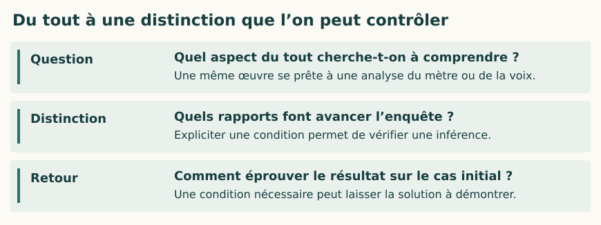

# Philosophie — Qu’est-ce qu’une analyse ? · Oral PSL 2018 · Corrigé brut

*Corrigé rédigé par IA, non officiel. Signalez toute erreur.*

**Rédaction** · GPT-6.2 Astra Ultra · vitesse non renseignée

**Révision (tour 1)** · GPT-6.2 Astra Ultra · vitesse non renseignée · 26 novembre 2026

## Exposé

Une montre s’arrête chaque nuit à la même heure. On la démonte et l’on dispose toutes les pièces sur la table. L’inventaire est impeccable. A-t-on analysé la panne ? Un horloger aurait pu se contenter d’observer quel mouvement cesse le premier. Le soupçon porte sur ce que l’inventaire a effacé en séparant les pièces, leur relation à un certain moment du cycle. Analyser paraît signifier décomposer un tout pour mieux le connaître. Or certaines décompositions font disparaître l’objet même de la recherche. Qu’est-ce qui distingue une analyse d’un simple découpage et à quelle épreuve reconnaît-on qu’elle a réussi ?

### Décomposer d’après une question

Couper un poème en trois morceaux d’égale longueur donne trois fragments authentiques du texte. Cela apprend peu sur le moment où celui qui parle change de destinataire. Pour l’étudier, il faudrait repérer une apostrophe, un changement de pronom, peut-être le déplacement d’une image. L’élément d’analyse varie donc avec la question. Pour le mètre du vers on retiendra des syllabes ; pour le mouvement de la parole on distinguera des adresses. On ne prétend pas que le poème soit matériellement recollé à partir de ces unités. L’analyse suppose déjà une idée de la propriété à expliquer et le choix d’une échelle pertinente.

Descartes recommande dans le *Discours de la méthode* de diviser chacune des difficultés en autant de parcelles qu’il se pourrait et qu’il serait requis pour les mieux résoudre. La seconde condition compte autant que la première. La divisibilité d’une figure ou d’un nombre n’indique pas par elle-même où il convient de s’arrêter. Si je cherche pourquoi les diagonales d’un rectangle ont la même longueur, construire certains triangles me donne des relations déterminées à comparer. Décomposer la figure en un million de carrés ne fournit aucun avantage du même ordre. La fécondité du choix se mesure à la difficulté qu’il permet de traiter.

### Découvrir des conditions et des relations

Quand on analyse un raisonnement, on trouve rarement des prémisses toutes faites que la phrase aurait empilées. « Ce témoin se contredit, donc l’accusé est innocent » saute d’une faiblesse du témoignage à une conclusion sur les faits. Supposons que ce témoignage soit la seule pièce à charge et que sa contradiction lui ôte toute valeur. On peut conclure que le dossier n’établit pas la culpabilité. Pour conclure que l’accusé n’a pas accompli l’acte, il faudrait une autre raison, par exemple un alibi établi. Même en explicitant les prémisses les plus favorables à la critique du témoin, on repère donc un saut entre ce que le dossier permet de prouver et ce qui s’est effectivement passé. L’analyse fait apparaître une articulation dont dépend la force de la conclusion.

Dans certaines démonstrations géométriques, on suppose le problème résolu et l’on remonte de la figure cherchée à une condition que l’on peut construire. L’analyse commence donc par prêter provisoirement à son objet une existence encore à établir. Si je cherche un point équidistant de deux points donnés, je peux supposer qu’il existe et en tirer son appartenance à la médiatrice. Pour résoudre un problème qui lui impose une autre contrainte, il reste à construire le croisement convenable et à vérifier que le point obtenu satisfait toutes les demandes. Une condition nécessaire ne devient pas suffisante par le seul mouvement de remontée. Ce retour donne un sens précis à la complémentarité de l’analyse et de la synthèse.

On peut achever la construction. Soient A et B deux points distincts. On cherche un point P à trois centimètres de A et de B. Une solution éventuelle se trouve à la fois sur la médiatrice de AB et sur le cercle de centre A et de rayon trois centimètres. Réciproquement, tout point d’intersection satisfait les deux conditions, par définition du cercle et par la propriété de la médiatrice. Si AB mesure quatre centimètres, la distance du centre à la médiatrice est de deux centimètres et il y a deux intersections. Pour AB égal à six centimètres, il n’y en a qu’une. Au-delà de six, il n’y en a aucune. L’analyse peut donc déterminer où chercher sans garantir qu’il existe quelque chose à trouver. La synthèse permet d’établir à la fois l’existence et le nombre de solutions dans chacun des cas.

### Éprouver ce que l’analyse autorise à conclure

Reste une objection. Puisque la question décide des distinctions, comment éviter que l’analyse ne découvre que ses propres présupposés ? Revenons à la montre. Un défaut supposé d’engrenage permet de prévoir le moment où le mouvement cessera et de comparer ce qui arrive quand on remplace la pièce suspecte. Une hypothèse sera affaiblie si l’arrêt persiste après son remplacement dans les mêmes conditions. On soumet ainsi la distinction choisie à un contrôle dont l’issue peut décevoir l’enquêteur. Pour un poème, l’épreuve ne sera évidemment pas de remplacer un vers pour voir si l’original marche à nouveau. Il faudra rendre compte des mots, de leur ordre et des passages qui semblent résister à la lecture proposée.

Bergson objecte à certaines analyses de la durée qu’elles juxtaposent des états comme des objets dans l’espace. Isoler chaque note d’une mélodie donne bien une série exacte de hauteurs et de durées. Pourtant la même note prend une tout autre fonction à la suite d’une attente harmonique que si elle ouvre la phrase. L’objection désigne une faute déterminée et indique comment la corriger. Il faut étudier aussi les dépendances temporelles et reconnaître que décrire leurs conditions n’épuise pas l’expérience de l’écoute. La limite rencontrée devient elle-même une connaissance de l’objet.

Une analyse est donc une opération réglée qui, partant d’une question sur un tout, y distingue des conditions, des éléments ou des rapports et éprouve ce qu’ils rendent intelligible. Sa fin n’est pas toujours une reconstruction matérielle. Elle exige toutefois qu’on puisse revenir à la difficulté de départ et montrer ce que les distinctions ont fait comprendre, ce qu’elles laissent encore ouvert, et pourquoi il en va ainsi.

## Pour l’entretien

**La psychanalyse entre-t-elle dans cette définition ?** L’analyse d’un rêve rapporté peut chercher les associations attachées à tel mot ou tel souvenir de la veille. Elle reconstruit des relations au lieu de dresser un catalogue d’images. L’accord sur les critères qui permettraient de départager plusieurs interprétations constitue précisément une difficulté de cette extension du terme.

**Une analyse chimique doit-elle toujours reconstituer l’échantillon ?** On peut, en le transformant, établir qu’il contenait une espèce donnée sans avoir les moyens de le recréer. Le protocole et des essais de contrôle doivent cependant justifier le passage de la réaction observée à l’identification annoncée.

[Énoncé](https://www.ens.psl.eu/sites/default/files/Philo-oral-5.pdf)
