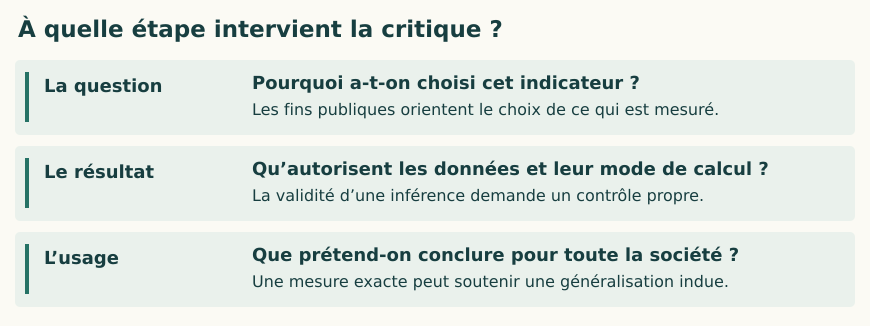

# Philosophie — Science et idéologie · Oral PSL 2018 · Corrigé brut

*Corrigé rédigé par IA, non officiel. Signalez toute erreur.*

**Rédaction** · GPT-6.2 Astra Ultra · vitesse non renseignée

**Révision (tour 1)** · GPT-6.2 Astra Ultra · vitesse non renseignée · 26 novembre 2026

## Exposé

Une administration publie un chiffre unique pour mesurer la réussite des écoles. Ce chiffre peut avoir été établi avec exactitude et donner pourtant une représentation contestable de ce que les écoles accomplissent. Suffit-il de dénoncer un intérêt politique pour en conclure que le calcul est faux ? Inversement, une opération arithmétique exacte rend-elle scientifique le jugement que l’on en tire ? Science et idéologie peuvent s’opposer comme la connaissance contrôlée et la représentation intéressée du monde. Elles peuvent aussi se rencontrer dans un même discours sans s’y identifier. Leur rapport exige qu’on distingue l’origine sociale d’un problème, la validité d’un résultat et les usages qui transforment ce résultat en évidence indiscutable.

### Une idée fausse n’est pas encore une idéologie

Une hypothèse de physique finalement abandonnée a pu appartenir à la recherche scientifique si elle avait une portée définie et s’exposait à des contrôles. À l’inverse, un énoncé statistique exact peut entrer dans un discours idéologique. Supposons que le nombre de diplômes augmente. Si l’on démontre à partir de ce seul fait que toute personne a désormais les mêmes chances de réussite, on a fait porter à un indicateur une conclusion qu’il ne pouvait établir. Pour appeler idéologique ce glissement, il reste encore à expliquer sa stabilité et sa fonction. À quels intérêts, à quelles pratiques administratives ou à quelle image de la société l’assimilation rend-elle service ?

Marx et Engels, dans *L’Idéologie allemande*, examinent la manière dont les idées dominantes se rapportent aux rapports sociaux dominants. Un intérêt particulier peut se présenter comme la raison universelle de l’ordre existant. La question n’est donc pas seulement celle d’une erreur dans la tête d’un individu ou d’un mensonge délibéré. Des acteurs sincères peuvent partager une représentation qui fait apparaître une situation historiquement produite comme allant de soi. Une analyse scientifique peut alors avoir une portée critique en décomposant les mécanismes qui entretiennent cette apparence. Reconstituer les conditions inégales d’accès aux diplômes ôte une part de son évidence au récit qui attribuait toutes les différences au seul mérite.

### Les sciences ont elles-mêmes une histoire et des conditions sociales

Cette critique serait bien confortable si le chercheur pouvait se croire entièrement extérieur au monde qu’il décrit. Les questions qui reçoivent des financements, le choix des personnes interrogées et la définition des catégories ont une histoire. Pour mener une enquête sur « la réussite », il a bien fallu décider quels faits compteraient comme signes de réussite. Ce choix peut rendre visibles des inégalités et laisser dans l’ombre des apprentissages difficiles à chiffrer. Les appareils de mesure et les termes savants n’immunisent pas un travail contre les présupposés dont il hérite.

Cependant, expliquer pour quelles raisons une enquête a commencé ne suffit pas à décider de la valeur de sa conclusion. Une vaccination peut faire l’objet d’une politique publique et son efficacité d’une comparaison entre situations définies. L’origine politique de la question ne dit pas quel résultat cette comparaison produira. Inversement, établir un résultat dans des conditions précises ne suffit pas à décider de toutes les priorités d’un système de santé. Il faut chaque fois distinguer ce qui relève du contrôle des faits et ce qui relève des fins poursuivies. Faute de quoi la dénonciation de l’idéologie deviendrait une explication générale qui dispenserait de lire les données.

Bachelard, dans *La Formation de l’esprit scientifique*, fait de la connaissance scientifique un effort répété pour dégager et rectifier des obstacles qui agissent à l’intérieur même de l’acte de connaître. Sans identifier tout obstacle épistémologique à une idéologie, on en tirera une conséquence. La différence de la science ne tient pas à ce que les savants seraient par nature exempts de préjugés. Elle se cherche dans le travail par lequel des présupposés identifiables peuvent être mis à l’épreuve, des concepts redéfinis et des résultats rectifiés, y compris contre les préférences de ceux qui avaient lancé l’enquête.

### L’objectivité comme exigence publiquement vérifiable

Comment apprécier de l’intérieur une prétention à la connaissance ? Revenons aux résultats scolaires. Si le chiffre mesure l’obtention d’un diplôme dans un groupe d’élèves arrivés en dernière année, nous pouvons demander ce qu’il advient de ceux qui ont quitté l’établissement auparavant. Modifier le dénominateur, comparer les recrutements et expliciter les limites d’une enquête sont des opérations concrètes. Elles produisent des raisons que peut reprendre un lecteur en désaccord avec les finalités politiques du rapport. Un autre indicateur n’est pas automatiquement plus vrai parce qu’il produit un classement différent. Il doit à son tour rendre compte du phénomène qu’il prétend mieux saisir.

Prenons des effectifs fictifs. Dans un lycée, 100 élèves entrent dans une même cohorte. Au terme de la période, 80 se présentent à un examen et 76 de ces élèves le réussissent. Le taux de réussite parmi les présents est de 95 %. La proportion des entrants qui ont obtenu le diplôme observé est de 76 %. Les deux calculs sont exacts et répondent à deux questions différentes. Assimiler la première proportion aux chances de réussite de tout entrant efface les vingt absents. Les qualifier tous d’élèves en échec commettrait une autre erreur, car certains pourraient avoir changé de filière. Pour passer d’une erreur de lecture à un diagnostic d’idéologie, il faudrait encore expliquer pourquoi une institution a intérêt à faire circuler une seule interprétation et comment celle-ci se maintient face aux objections.

L’idéologie peut se reconnaître à sa capacité de transformer les objections en simples signes de l’hostilité de l’objecteur. Si toute observation contraire au classement se trouve rejetée d’avance comme un manque de confiance dans l’école, aucun travail sur le classement n’est plus possible. Mais la démarche scientifique demande davantage qu’une déclaration abstraite d’ouverture. Il faut que les échantillons et les opérations soient décrits, que plusieurs interprétations puissent être discutées et que les institutions laissent effectivement place à la correction. L’objectivité s’appuie donc sur des conditions sociales de critique, sans que le vrai se ramène au résultat d’un vote.

La perspective conduit enfin à examiner les formes de scientisme. Une méthode efficace pour comparer deux performances ne confère pas à son utilisateur le pouvoir de décider ce qu’est une vie réussie. Étendre sans justification l’autorité de la science hors de son domaine peut constituer un usage idéologique de la science elle-même. Le rapport entre les deux termes n’est donc ni une frontière entre deux catégories de personnes ni une confusion générale de tous les discours. Il devient précis quand on demande ce qu’un résultat autorise à conclure, quelles objections pourraient le modifier et quelles décisions collectives appellent encore d’autres raisons.

## Pour l’entretien

**Une idéologie contient-elle forcément des propositions fausses ?** Elle peut sélectionner des faits exacts et les organiser de façon à naturaliser une situation historique ou à dissimuler d’autres faits pertinents. La critique doit porter sur les inférences et sur la fonction de la représentation.

**Pourquoi la critique par les pairs importe-t-elle ?** Elle organise la possibilité qu’une autre personne reprenne la question avec des présupposés différents. Sa valeur dépend des conditions réelles de la discussion et de la qualité des objections, non du prestige des signataires.

[Énoncé](https://www.ens.psl.eu/sites/default/files/Philo-oral-2.pdf)
