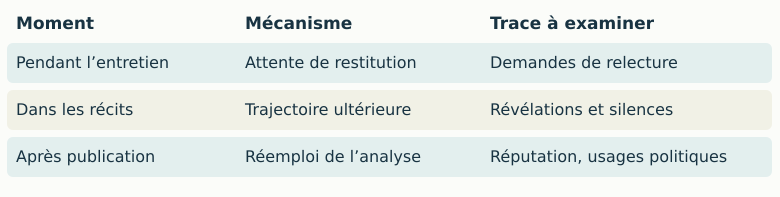

# ENS-PSL · Sélection internationale Lettres · Sociologie — Matonti et les intellectuels communistes (oral) 2018 — Corrigé brut

*Corrigé rédigé par IA, non officiel. Signalez toute erreur.*

**Rédaction** · GPT-6.2 Astra Ultra · vitesse non renseignée

Le sujet d’oral 2018 demande un commentaire du passage reproduit sur deux pages. Il contient une coupe signalée dans la première page. L’analyse porte sur les paragraphes effectivement proposés.

## Quand les enquêtés peuvent lire et utiliser l’enquête

Frédérique Matonti étudie les intellectuels qui ont participé à *La Nouvelle Critique*, une revue du Parti communiste français engagée dans un travail de rénovation. Ils appartiennent à deux univers dont ils connaissent les règles, le monde politique et le monde intellectuel. Ils ont aussi les moyens de lire la sociologue et d’agir sur la réception de ce qu’elle écrit. À quelles conditions cette proximité peut-elle devenir une source de connaissance alors qu’elle expose l’enquête à la censure, à l’autocensure et aux usages stratégiques ?

## La restitution anticipée change ce qui se passe dans l’entretien

La demande de relire une recherche n’est pas propre à ce milieu. Ici, toutefois, elle est particulièrement efficace. Les enquêtés connaissent le calendrier universitaire et savent qu’une thèse complète existe. L’auteure peut difficilement esquiver la demande. De plus, leur expérience du parti les a familiarisés avec des formes de contrôle du travail intellectuel. La demande de retour peut donc changer de sens, depuis le désir de connaître le résultat jusqu’à une tentative d’infléchir l’interprétation qui sera rendue publique.

Cette action commence avant toute lecture. Sachant que son texte leur reviendra, la sociologue risque d’atténuer une analyse. La référence à Thersite, qui rabaisse les grands, désigne une crainte inverse en apparence : prendre pour de la lucidité savante une simple façon de dénigrer les intellectuels communistes. Or l’autocensure et le jugement méprisant compromettent tous deux le travail d’objectivation. Accepter de discuter avec les participants peut aussi ouvrir l’accès à des informations imprévues. Leurs attentes montrent notamment ce qui, dans ce milieu, constitue une description honorable ou une mise en cause.

## Un même passé, plusieurs positions présentes

Les récits rétrospectifs varient avec les trajectoires. Les anciens membres engagés dans la dissidence peuvent mettre en avant les rénovations auxquelles ils ont participé et révéler des secrets du parti. Ceux qui y sont restés peuvent minimiser leur travail de contrôle et protéger ces mêmes secrets. Ce sont des tendances que l’enquête relie à des positions, sans en faire une clé de décodage automatique de chaque témoignage. Rendre cohérente sa propre trajectoire, rester fidèle à une conviction et tirer parti d’un récit public peuvent aller ensemble. La différence entre deux récits ne se réduit donc pas à la fiabilité personnelle de leurs auteurs.

La publication agit également dans le champ intellectuel. Remettre en circulation des articles théoriques autrefois dévalués parce qu’ils paraissaient dans une revue politique peut améliorer la réputation de leurs auteurs. L’intérêt à parler comprend alors une dimension professionnelle. L’enquête contribue elle-même à transformer ce qu’elle étudie.

## Que faire de ces effets ?

Une difficulté d’accès ou une tentative de contrôle peut être notée, située et comparée à d’autres interactions. On peut confronter un entretien à la collection de la revue, distinguer la position d’un témoin à l’époque racontée de celle qu’il occupe lors de l’enquête et chercher les silences de plusieurs récits. Ces précautions méthodologiques prolongent l’extrait. Elles n’assimilent pas toute parole à une dissimulation. Une rectification factuelle doit pouvoir être entendue et une interprétation discutée, sans accorder au participant un droit de décider seul du sens de l’enquête. Matonti montre ainsi que la relation d’enquête est à la fois une condition de production des matériaux et une partie de ce qu’il faut expliquer.

Le rapport de jury propre à ce sujet n’a pas été retrouvé. [Archives ENS-PSL de 2018](https://www.ens.psl.eu/sujets-et-rapports-du-concours-2018-lettres)

[Feuillet officiel](https://www.ens.psl.eu/sites/default/files/SujetOralSociologie2018-2.pdf#page=1)
