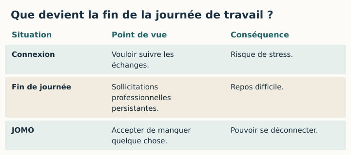

# ENS Rennes · D1 · Allemand 2018 — Corrigé guidé

*Corrigé rédigé par IA, non officiel. Signalez toute erreur.*

**Rédaction** · GPT-6.2 Astra Ultra · vitesse non renseignée

**Couverture partielle.** Les pages 1 et 2 du rapport identifient les problèmes de traduction, citent plusieurs segments et donnent la question de composition à la page 2. On peut recouper ces segments avec une autre adaptation de « Schluss mit der ständigen Erreichbarkeit », dans un examen madrilène. Les bornes du sujet rennais et le libellé de toutes ses phrases restent inconnus.

## Version française des passages attestés

**Rester joignable.** « Si nous sommes connectés, c’est pour ne rien manquer. Or cela peut être une source de stress. » Ces deux phrases, citées dans le rapport, distinguent un objectif de son effet possible. Le texte applique cette observation à la vie professionnelle. Une fois leur journée de travail terminée, des salariés ont encore le sentiment de devoir continuer à travailler. Les caisses d’assurance maladie et les entreprises se préoccupent des conséquences de cette sollicitation permanente.

**Le propos de Jens Baas.** « Cela suppose aussi qu’on en finisse avec l’obligation d’être joignable en permanence. » Le jeu sur la fin de la journée et la nécessité de mettre fin à une pratique contribue au ton de la formule. Le rapport mentionne notamment les troubles psychiques, la dépression et les troubles anxieux dans le vocabulaire de l’extrait.

**Le renversement final.** Au lieu de redouter de manquer quelque chose, on peut prendre plaisir à ne pas être de la partie à chaque fois. C’est l’idée que résume *JOMO*, les initiales anglaises de *joy of missing out*. Cette dernière formule allemande apparaît sous deux formes proches dans les commentaires du jury, avec et sans l’infinitif exprimant l’obligation.

## Composition en allemand

*Sind Sie für oder gegen das Prinzip der „ständigen Erreichbarkeit“? Begründen Sie Ihren Standpunkt.* Réponse courte.

Ich bin gegen die Vorstellung, ständig erreichbar sein zu müssen. Wenn mein Arbeitgeber mir am Abend eine Nachricht schickt, kann schon das Warten auf die nächste Frage verhindern, dass ich mich wirklich erhole. Wer seine Arbeitszeit beendet hat, sollte deshalb grundsätzlich am nächsten Tag antworten dürfen. Für einen ärztlichen Bereitschaftsdienst gilt natürlich etwas anderes. Dort weiß eine bestimmte Person im Voraus, wann sie erreichbar sein muss, und nach ihrer Schicht übernimmt jemand anderes. Gerade dieser Unterschied ist wichtig: Eine vereinbarte Ausnahme schützt die Versorgung, während eine unausgesprochene Erwartung den Feierabend aller Beschäftigten verkürzt. Klare Regeln helfen beiden Seiten.

*98 mots, comptés par espaces.*

## Comment construire la réponse

**Comprendre la liaison.** Dans la phrase citée par le rapport, *um … zu* exprime le but de la connexion. Après le point, le pronom *das* reprend ce comportement. Il devient le sujet de *kann … verursachen*. La possibilité d’un effet indésirable n’est donc pas un second but poursuivi par l’utilisateur.

**Choisir entre deux emplois de Feierabend.** Après la préposition *nach*, le nom désigne le moment où finit la journée de travail. Dans le propos de Baas, *Feierabend ist mit …* exprime l’idée qu’une pratique doit prendre fin. Le rapport de Rennes est ici le témoin de la citation de Baas. Le texte d’examen publié à Madrid sous le même titre présente une autre adaptation. Ses statistiques et ses découpages n’établissent pas ceux de Rennes.

**Justifier une position.** L’opinion porte sur un principe général. Comparer une personne qui attend un message sans savoir si elle est de garde et une personne qui a accepté une astreinte avec relais. L’exception précise le critère du jugement : connaître à l’avance les responsabilités et l’heure à laquelle elles prennent fin.

[Rapport du jury, partie écrite](https://www.ens-rennes.fr/medias/fichier/rapport-de-jury-d1-allemand-e-crit-et-oral-2018_1563806798604-pdf) · [Autre adaptation, universités publiques de Madrid, option B](https://www.upm.es/sfs/Rectorado/Vicerrectorado%20de%20Alumnos/Acceso/BachilleratoLOMCE/Examenes/17%20Alem%C3%A1n.pdf#page=3) · [Deutsche Welle, exercices sur le document](https://static.dw.com/downloads/36101088/nachrichten-mit-vokabeln-20161021-schluss-mit-der-stndigen-erreichbarkeitaufgaben.pdf)
