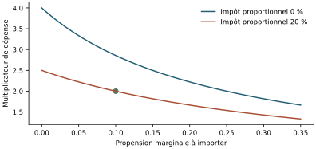
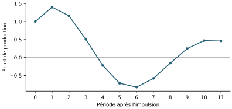

# ENS Rennes D1 — Composition d’ordre économique 2018 · Corrigé brut

*Corrigé rédigé par IA, non officiel.*

**Rédaction** · GPT-6.2 Astra Ultra · vitesse non renseignée

## Le rôle de la consommation et de l’investissement dans les fluctuations de l’activité économique

### Introduction

Quand les ventes ralentissent, une entreprise qui possède déjà ses machines peut différer tout son prochain achat d’équipement. Un ménage peut lui aussi reporter une voiture, mais continue de se nourrir et de se loger. Le même choc ne provoque donc pas le même mouvement de toutes les dépenses. Les fluctuations désignent les accélérations et ralentissements de l’activité autour de son évolution de long terme, parfois jusqu’à une contraction du produit. Consommer satisfait des besoins présents. Investir ajoute au capital productif ou le remplace. La formation brute de capital fixe est un flux différent du stock de capital et d’un placement financier.

Dans une économie ouverte, le produit se décompose en consommation finale, formation brute de capital et exportations nettes. Cette identité garantit qu’une dépense réalisée a une contrepartie dans les comptes. Elle ne dit pas quelle décision déclenche un cycle. Comment les dépenses privées, qui répondent au revenu, peuvent-elles à leur tour déterminer son ampleur et la durée du ralentissement ? Nous analyserons la transmission d’une impulsion, puis les raisons qui rendent l’amplification et sa correction variables.

### I. Les décisions de dépense transforment un choc initial en fluctuation du produit

#### A. Le multiplicateur fait dépendre le revenu de la dépense de chacun

Dans une économie fermée à prix fixes et capacités disponibles, écrivons $C=C_0+c(Y-T)$ et $Y=C+I+G$, en regroupant dans $I$ l’investissement prévu et en supposant les stocks revenus à leur niveau désiré. Une baisse autonome de l’investissement de dix réduit les commandes d’équipement de dix. Les salariés et fournisseurs concernés dépensent ensuite une fraction du revenu perdu. Si $c=0{,}75$ et si les impôts sont forfaitaires, la baisse du produit d’équilibre vaut $10/(1-0{,}75)=40$. Dix relèvent de l’impulsion initiale, trente de la baisse induite de consommation. Ce calcul compare deux niveaux de produit sous hypothèses explicites. Il ne fixe pas la durée réelle d’une récession.

Le même raisonnement part d’une consommation autonome moindre, par exemple lorsque l’incertitude pousse les ménages à épargner simultanément. L’épargne désirée de chacun peut augmenter tandis que le produit se contracte, de sorte que l’épargne globale effectivement réalisée n’augmente guère. Dans une économie ouverte, l’impôt proportionnel et les achats importés freinent la propagation domestique. Pour une propension à consommer de 0,75, un taux d’imposition marginal de 20 % et une propension marginale à importer de 0,10, le multiplicateur devient $1/[1-0{,}75(1-0{,}20)+0{,}10]=2$. Avec les mêmes dix perdus, le produit baisse de vingt.

#### B. L’investissement réagit au changement du rythme des ventes

Pour servir durablement cent unités de ventes supplémentaires, une entreprise peut souhaiter un équipement supplémentaire. Si $K^*=vY$ et si la capacité est pleinement utilisée, l’investissement net désiré est proportionnel à la variation de production, $I_n=v\Delta Y$. Les dépenses brutes ajoutent le remplacement du capital usé. Une production qui augmente encore, mais de moins en moins vite, peut donc entraîner une baisse des commandes nettes d’équipements. Une capacité déjà inutilisée rend ce mécanisme plus faible. L’anticipation de la demande future importe davantage qu’une extrapolation mécanique des dernières ventes.

Le multiplicateur et l’accélérateur peuvent se répondre avec retard. Prenons les écarts à une trajectoire de référence, une consommation induite $c_t=0{,}6y_{t-1}$ et un investissement induit $i_t=0{,}8(y_{t-1}-y_{t-2})$. Une commande autonome d’une unité à la date 0, suivie d’aucune autre, donne $y_0=1$, $y_1=1{,}4$ et $y_2=1{,}16$. En effet la hausse initiale a poussé à consommer et à investir, mais l’investissement réagit ensuite au ralentissement de la hausse. La récurrence $y_t=1{,}4y_{t-1}-0{,}8y_{t-2}$ produit ici des oscillations amorties. D’autres paramètres, d’autres délais ou des chocs renouvelés ne donnent pas ce même cycle. L’exemple explique une propagation, il n’établit pas la périodicité de l’économie française.

### II. Les anticipations, le financement et les politiques conditionnent l’ampleur du cycle

#### A. Des agents hétérogènes ne réagissent pas au même signal

Dans une logique de cycle de vie ou de revenu permanent, un ménage peut emprunter ou puiser dans son épargne face à une baisse provisoire de revenu. Sa consommation varie alors moins que son revenu courant. Une famille sans épargne ni accès au crédit ajuste au contraire immédiatement certaines dépenses, même si elle pense la difficulté passagère. Une perte d’emploi attendue peut aussi accroître l’épargne de précaution. Un même transfert temporaire aura donc des effets différents selon les destinataires et leur confiance. La répétition des achats de biens durables ajoute à la volatilité de cette composante.

L’investissement dépend des recettes futures actualisées, du coût d’usage du capital et de la possibilité de différer une dépense irréversible. Une baisse de taux soutient certains projets, mais une hausse du risque ou des exigences de garantie peut la neutraliser. La crise financière de 2008 illustre l’interaction entre difficultés de crédit, recul des commandes et anticipations de débouchés. L’observation simultanée d’une chute de l’investissement et de la production ne permet pas de séparer ces canaux. Un choc de productivité ou de coût énergétique peut aussi réduire la production possible et modifier à la fois le revenu réel et les projets rentables. Toute fluctuation ne naît donc pas d’une insuffisance de demande.

#### B. Stabiliser les dépenses exige de diagnostiquer l’origine de la fluctuation

Les stabilisateurs automatiques soutiennent le revenu disponible en récession. Une prestation versée à un ménage contraint est plus rapidement consommée. La dépense publique ou l’investissement public peuvent soutenir la demande présente et, pour un équipement utile, les capacités futures. Le schéma IS-LM à prix fixes suggère cependant qu’une relance qui relève le taux d’intérêt peut évincer une partie de l’investissement privé. Une politique monétaire accommodante limite ce canal. En situation de crédit rationné ou d’anticipations très dégradées, un taux bas reste insuffisant pour susciter des emprunts.

L’anticipation d’impôts futurs peut conduire certains ménages à épargner une partie d’un transfert financé par dette. La neutralité ricardienne complète suppose notamment des marchés financiers et des horizons qui rendent possible le lissage intertemporel. Elle ne s’impose pas à un ménage sans liquidités. À pleine capacité ou face à une pénurie d’offre, un surcroît de demande peut surtout accroître prix ou importations. Les délais d’une commande publique et la nature du choc déterminent alors son efficacité stabilisatrice. Une politique peut par exemple préserver les projets viables pendant un resserrement temporaire du crédit, tout en laissant se réorienter les investissements rendus durablement inutiles par un changement de demande.

### Conclusion

L’investissement est souvent la composante la plus mobile car il anticipe la variation des débouchés, tandis que la consommation propage largement le revenu créé ou perdu. Des délais suffisent à faire alterner amplification et freinage. L’effet final dépend de la distribution des ressources, de la dynamique du crédit et des capacités inutilisées. Une politique de stabilisation doit distinguer l’impulsion qui déclenche la fluctuation des canaux susceptibles de la prolonger.

[Sujet distribué](https://www.ens-rennes.fr/medias/fichier/sujet-e-conomie-e-crit-d1-2018_1563804896083-pdf) · [Rapport du jury](https://www.ens-rennes.fr/medias/fichier/rapport-de-jury-eco-e-crit-d1-2018_1563806647735-pdf)
