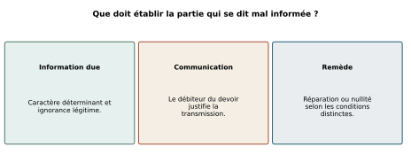
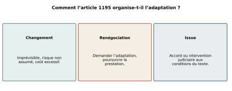

# ENS Rennes D1 — Droit civil 2018 · Corrigé brut

*Corrigé rédigé par IA, non officiel.*

**Rédaction** · GPT-6.2 Astra Ultra · vitesse non renseignée

## Les remèdes à la vulnérabilité du cocontractant et la réforme du droit des contrats

### Introduction

Un artisan juridiquement capable peut dépendre d’un seul donneur d’ordre au moment de renouveler son marché. Une acheteuse indépendante peut ignorer une caractéristique du bien connue du vendeur. Un cocontractant initialement bien informé peut devenir vulnérable en cours d’exécution si un événement imprévisible bouleverse le coût de sa prestation. Ces personnes n’ont ni le même statut ni le même besoin de protection. Par vulnérabilité on entend ici une exposition concrète à un engagement subi ou particulièrement dommageable, liée à la personne, à une asymétrie d’information ou à la relation entre les parties. Un remède désigne aussi bien ce qui prévient la difficulté que ce qui corrige ses effets.

L’ordonnance du 10 février 2016, entrée en vigueur le 1er octobre 2016, renforce et ordonne des mécanismes de droit commun, à côté des protections spéciales des consommateurs et des personnes juridiquement incapables. Il faut dater le contrat avant de choisir sa version du Code. Les contrats antérieurs demeurent en principe soumis au droit antérieur, sous les exceptions transitoires prévues. La loi de ratification du 20 avril 2018 comporte ses propres dates et dispositions interprétatives. L’enjeu n’est pas de classer tous les débiteurs en deux catégories permanentes, mais de savoir à quelles conditions une difficulté individuelle ou économique devient juridiquement pertinente. La réforme protège d’abord le pouvoir de choisir, puis limite certains risques que la seule déclaration de volonté n’épuise pas.

### I. Permettre un engagement éclairé et libre sans supprimer la capacité de choisir

#### A. La loyauté et l’information répondent aux asymétries avant la conclusion

La liberté contractuelle suppose de pouvoir négocier ou renoncer. Les articles 1104 et 1112 imposent la bonne foi dans les négociations, tout en maintenant la liberté d’en prendre l’initiative, de les conduire ou de les rompre. Une rupture déloyale peut causer un dommage réparable, mais la partie déçue n’obtient pas le bénéfice attendu d’un contrat jamais conclu. Le devoir de loyauté règle un comportement. Il ne confère pas à celui qui a moins de ressources un droit à la conclusion.

L’article 1112-1 oblige celui qui connaît une information déterminante pour le consentement de l’autre à la révéler lorsque l’autre l’ignore légitimement ou fait confiance à son cocontractant. Il faut un lien direct et nécessaire avec le contenu du contrat ou la qualité des parties. L’évaluation personnelle de la valeur en est exclue. Le demandeur doit établir qu’une information lui était due, puis son contradicteur doit prouver l’avoir fournie. Le devoir ne peut être écarté par convention. Un vendeur qui connaît une limitation décisive à l’usage promis ne peut donc se retrancher derrière une formule vague si l’acheteur ne pouvait normalement découvrir cet obstacle. Selon les conditions réunies, il peut devoir des dommages-intérêts et le contrat peut être annulé pour vice du consentement.

Les délais légaux ou conventionnels de réflexion et de rétractation de l’article 1122 donnent une prise sur le temps de la décision lorsqu’ils existent. Le premier interdit d’accepter avant son terme, le second permet de revenir sur un consentement déjà exprimé. Aucun délai général de repentir ne naît du seul sentiment d’avoir mal négocié.

#### B. L’examen du consentement individualise le remède

L’article 1128 distingue consentement, capacité et contenu licite et certain. Une personne frappée d’une incapacité relève d’un régime légal adapté aux actes qu’elle peut accomplir seule ou avec assistance ou représentation. Une personne capable peut, au moment d’un acte, manquer de discernement (art. 1129 et 414-1), ou avoir voulu sous l’effet d’une erreur, d’un dol ou d’une violence. Les conditions et la preuve diffèrent. Faible revenu et âge avancé ne suffisent pas à établir l’incapacité ni le vice du consentement.

L’article 1130 exige que, sans le vice, la personne n’aurait pas contracté ou l’aurait fait à des conditions substantiellement différentes. Ce caractère déterminant s’apprécie selon la personne et les circonstances. Une dissimulation intentionnelle d’information déterminante peut caractériser un dol et rendre excusable une erreur qui ne l’aurait pas été autrement. L’annulation relative protège alors la personne lésée. La nullité entraîne en principe restitutions et peut se cumuler avec la réparation d’un dommage distinct. Si la personne correctement informée aurait conclu au même prix, il manque un maillon essentiel à la demande de nullité. La sanction n’est pas le simple reflet d’une infériorité sociale.

### II. Corriger certaines dépendances économiques tout en préservant la force de l’engagement

#### A. La dépendance et l’adhésion révèlent deux déséquilibres distincts

L’article 1143 qualifie de violence le fait d’abuser de l’état de dépendance du cocontractant pour obtenir un engagement qu’il n’aurait pas souscrit sans cette contrainte et en tirer un avantage manifestement excessif. La ratification de 2018 précise la dépendance de la victime à l’égard de son cocontractant, précision à caractère interprétatif. L’artisan lié à un donneur d’ordre devra établir la réalité des solutions de remplacement, l’usage de cette dépendance pour imposer une stipulation, l’effet sur sa décision et l’excès manifeste de l’avantage. Une négociation difficile et un prix bas ne suffisent pas. La nullité relative est envisageable si toutes les conditions sont démontrées.

Un contrat d’adhésion peut quant à lui soumettre un adhérent à des clauses prédéterminées. Dans le régime de l’ordonnance applicable depuis 2016, l’article 1171 permet de réputer non écrite une clause créant un déséquilibre significatif dans un tel contrat. La rédaction issue de la loi de ratification vise, pour les actes conclus à compter du 1er octobre 2018, la clause non négociable déterminée à l’avance par l’une des parties. L’objet principal et l’adéquation du prix à la prestation échappent à ce contrôle. La protection porte donc sur la structure de l’engagement plutôt que sur le seul état psychologique de l’adhérent. Une clause privant de sa substance l’obligation essentielle peut également être écartée par l’article 1170, même hors contrat d’adhésion. La clause disparaît, sans anéantissement automatique du contrat entier.

#### B. L’imprévision protège contre un bouleversement qualifié de l’exécution

La vulnérabilité peut apparaître après un accord libre et équilibré. L’article 1195 vise un changement de circonstances imprévisible à la conclusion rendant l’exécution excessivement onéreuse pour une partie qui n’avait pas accepté ce risque. Une hausse conjoncturelle ordinaire, un marché simplement moins rémunérateur ou un risque assumé par clause ne suffisent pas. La prestation reste possible. L’impossibilité sous les conditions de l’article 1218 relèverait de la force majeure.

La partie concernée peut demander une renégociation et doit continuer à exécuter pendant celle-ci. En cas d’échec ou de refus, les parties peuvent choisir la résolution ou convenir d’une saisine du juge pour adapter le contrat. À défaut d’accord dans un délai raisonnable, l’une peut demander au juge sa révision ou sa fin. Ce cheminement reconnaît le risque de dépendance dans une relation de longue durée sans conférer au débiteur un droit immédiat de modifier son prix. Le régime étant en principe aménageable, la rédaction des clauses et l’allocation initiale des risques demeurent déterminantes. La bonne foi accompagne leur mise en œuvre sans autoriser une réécriture discrétionnaire.

### Conclusion

La réforme n’érige pas la vulnérabilité en cause unique de nullité. Elle rattache l’information, le consentement, la structure de l’adhésion et le bouleversement futur à des conditions et des remèdes distincts. L’intensité de la protection dépend de l’atteinte prouvée. Informer peut suffire avant la signature, neutraliser une clause peut sauver l’accord, et réviser l’exécution ne se justifie que lorsque les conditions légales ou conventionnelles le permettent.

[Sujet distribué](https://www.ens-rennes.fr/medias/fichier/sujet-droit-civil-d1-2018_1563804920053-pdf) · [Rapport du jury](https://www.ens-rennes.fr/medias/fichier/rapport-du-jury-droit-civil-2018_1563806659582-pdf)

[Code civil au 1er avril de la session](https://www.legifrance.gouv.fr/codes/texte_lc/LEGITEXT000006070721/2018-04-01/) · [Loi de ratification du 20 avril 2018](https://www.legifrance.gouv.fr/jorf/id/JORFTEXT000036825602)
