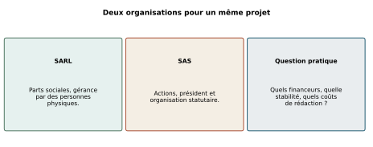
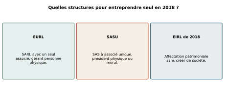

# ENS Rennes D1 — Droit commercial 2018 · Corrigé brut

*Corrigé rédigé par IA, non officiel.*

**Rédaction** · GPT-6.2 Astra Ultra · vitesse non renseignée

## La société à responsabilité limitée est-elle une forme sociale obsolète ?

### Introduction

Le rapport de 2018 relève un recul de la SARL dans les créations de sociétés. Une forme juridique cesse-t-elle pour autant de répondre à un besoin ? Une baisse de sa part parmi les nouvelles immatriculations mesure un choix récent, sans faire disparaître les sociétés existantes ni identifier le motif du choix. La SARL est une société commerciale par la forme dans laquelle les associés ne supportent les pertes qu’à concurrence de leurs apports (art. L. 223-1 du Code de commerce). Elle peut être constituée par une seule personne, auquel cas on parle d’EURL. Il faut la comparer aux formes effectivement ouvertes aux entrepreneurs pendant la session de 2018.

La question d’obsolescence suppose un critère. Une société qui convient peu à l’entrée rapide de multiples investisseurs peut convenir à des parents désireux de réserver le capital à un cercle déterminé. Les formes concurrentes ont réduit l’originalité des avantages de la SARL, mais cette concurrence révèle aussi des usages pour lesquels son encadrement conserve sa valeur.

### I. La SARL a perdu plusieurs avantages comparatifs dans le choix de la forme sociale

#### A. La SAS cumule limitation des pertes et liberté d’organisation

La SAS introduite en 1994 a été élargie en 1999, notamment aux personnes physiques et à l’associé unique. Il faut dater ces deux étapes avant d’expliquer sa diffusion. Son président représente la société, tandis que les statuts définissent une grande partie de l’organisation interne (art. L. 227-5 et L. 227-6). Des fondateurs peuvent organiser l’entrée d’investisseurs, certaines prérogatives ou des règles de décision adaptées aux engagements financiers. Les actions peuvent être soumises à des clauses d’agrément ou d’inaliénabilité dans les conditions prévues. La SAS peut donc elle aussi demeurer fermée. Sa souplesse est particulièrement attractive lorsque les besoins de gouvernance risquent d’évoluer.

Dans la SARL, un ou plusieurs gérants doivent être des personnes physiques (art. L. 223-18). Le nombre d’associés est plafonné à cent. Les parts sociales et leurs transmissions obéissent à des règles davantage prédéfinies, notamment l’agrément pour une cession à un tiers. Ces choix protègent le groupe en place, mais rendent moins aisées certaines entrées successives de financeurs. La souplesse des émissions et des catégories de titres d’une société par actions sert donc un projet particulier. Elle ne signifie pas qu’une SAS peut faire sans restriction une offre au public ou s’affranchir des règles impératives.

#### B. Les très petites activités disposent de plusieurs protections patrimoniales

Depuis 2003, les statuts fixent le capital de la SARL sans minimum légal général (art. L. 223-2). La SAS a connu un assouplissement comparable. La participation aux pertes limitée aux apports ne signifie pas que le prêteur sera intégralement payé. Le patrimoine de la société garantit sa dette, et une banque peut demander une caution personnelle au dirigeant. Ce dernier peut aussi engager une responsabilité propre dans les hypothèses prévues par la loi. Une société faiblement capitalisée a donc intérêt à expliquer ses fonds et sa capacité de remboursement, quelle que soit l’étiquette retenue.

Pour l’entrepreneur seul, la SASU et l’EURL procurent chacune une personne morale distincte. En 2018, l’entreprise individuelle à responsabilité limitée permet également d’affecter un patrimoine à l’activité avec les formalités exigées, sans créer de société (régime historique de l’EIRL). Les règles d’opposabilité aux créanciers et la comptabilité propre au patrimoine affecté importent. Le régime du micro-entrepreneur est un régime fiscal et social sous conditions, distinct d’une forme de société. Il serait anachronique d’appliquer à l’épreuve de 2018 la séparation de patrimoines de l’entrepreneur individuel généralisée en 2022. La pluralité de choix en 2018 explique une partie de l’érosion de la SARL unipersonnelle sans suffire à condamner cette dernière.

### II. L’utilité de la SARL dépend des besoins de stabilité, de transmission et de gestion

#### A. Des règles prédéfinies peuvent servir une entreprise fermée

Le régime de la SARL définit les pouvoirs du gérant, l’information des associés, les décisions collectives et une procédure de cession à un tiers. L’agrément suppose en principe le consentement de la majorité des associés représentant au moins la moitié des parts, sauf majorité plus forte prévue par les statuts (art. L. 223-14). En cas de refus, la loi organise sous conditions une solution de rachat. Dans un commerce fondé par trois membres d’une famille, ce mécanisme aide à éviter l’entrée imprévue d’un tiers tout en ne condamnant pas indéfiniment l’associé à rester prisonnier de ses parts.

La SAS peut reproduire plusieurs de ces protections contractuellement. Mais rédiger, anticiper et coordonner des clauses a un coût. Des règles légales connues offrent un point de départ utile lorsque les associés n’ont ni temps ni expertise pour reconstruire un régime complet. La contrepartie apparaît dès qu’une règle imposée ne correspond plus à leurs besoins. La protection des minoritaires, la lisibilité de la représentation externe et le coût de la négociation des statuts sont donc des critères de choix aussi pertinents que la flexibilité abstraite. La société reste commerciale même lorsque les associés ne sont pas personnellement commerçants du seul fait de leur participation.

#### B. Le choix d’une petite structure engage le dirigeant autant que le capital

Un artisan qui travaille seul peut conserver l’EURL et admettre ultérieurement de nouveaux associés dans la même structure. La présidence d’une SASU peut être confiée à une personne morale tandis que l’EURL exige une gérance par personne physique, ce qui compte notamment dans un groupe. Dans la SARL, le régime social varie selon le caractère majoritaire de la gérance. Le gérant majoritaire relève du régime des indépendants. Le gérant minoritaire ou égalitaire rémunéré relève en principe du régime général pour son mandat. Le président rémunéré de SAS est assimilé salarié à ce titre. Cette assimilation ne donne pas, à elle seule, droit à l’assurance chômage d’un salarié lié par contrat de travail. Le coût et la protection doivent être comparés sur une rémunération et une situation concrètes.

La fiscalité conduit également à préciser la qualité de l’associé. Une EURL dont l’associé unique est une personne physique relève en principe de l’impôt sur le revenu avec option possible pour l’impôt sur les sociétés. Une EURL dont l’associé unique est une personne morale est en principe soumise à l’IS. Une SASU relève en principe de l’IS avec une option temporaire pour le régime des sociétés de personnes sous des conditions précises. Certaines SARL de famille peuvent opter pour ce dernier régime si les conditions d’activité et de parenté sont réunies. Ces différences n’ont de valeur qu’en fonction du revenu, du mode de financement et du projet de transmission. Le régime du commissariat aux comptes et ses seuils doivent eux aussi s’apprécier aux dates pertinentes, avant les réformes ultérieures.

### Conclusion

Une forme devient inadaptée lorsqu’elle impose durablement plus de contraintes qu’elle n’apporte de protections pour un projet déterminé. La SAS et les formes unipersonnelles disponibles en 2018 ont déplacé cet arbitrage, particulièrement pour les entreprises recherchant une gouvernance sur mesure. La SARL garde toutefois des usages précis pour l’entreprise fermée, familiale ou graduellement ouverte à des associés. Son recul dans les créations témoigne d’une concurrence réelle et non d’une disparition de sa fonction juridique.

[Sujet distribué](https://www.ens-rennes.fr/medias/fichier/sujets-e-preuve-a-option-d1-2018_1563804946515-pdf) · [Rapport du jury](https://www.ens-rennes.fr/medias/fichier/rapport-de-jury-droit-commercial-d1-2018_1563806677752-pdf)

[Code de commerce à la date de la session](https://www.legifrance.gouv.fr/codes/texte_lc/LEGITEXT000005634379/2018-04-01/) · [Code civil à la date de la session](https://www.legifrance.gouv.fr/codes/texte_lc/LEGITEXT000006070721/2018-04-01/)
