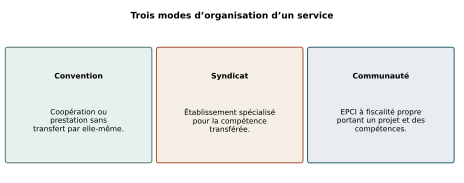
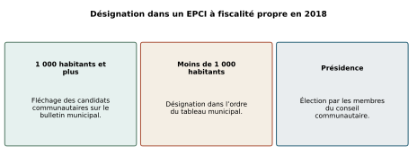

# ENS Rennes D1 — Droit public 2018 · Corrigé guidé

*Corrigé rédigé par IA, non officiel.*

**Rédaction** · GPT-6.2 Astra Ultra · vitesse non renseignée

## La coopération intercommunale

### Introduction

> [!INDICATION]
> Partir d’un service dont le périmètre technique dépasse celui d’une commune.

Un réseau de distribution d’eau ne s’arrête pas à la limite d’une commune. Les équipements d’un bassin d’emploi sont utilisés par des habitants qui votent dans plusieurs conseils municipaux distincts. La coopération intercommunale répond à ce décalage d’échelle. Elle permet à des communes d’exercer ensemble des compétences ou de conduire un projet, tout en conservant en principe leur existence. La fusion dans une commune nouvelle, qui modifie la carte des collectivités, relève d’une logique différente.

L’histoire part des syndicats de communes autorisés en 1890 et aboutit à des intercommunalités à fiscalité propre assumant des politiques structurantes. La montée en puissance de ces structures résout des problèmes de coordination et crée simultanément une nouvelle question de responsabilité politique. Dans quelle mesure leur intégration transforme-t-elle l’exercice de l’autonomie communale ? Le dépassement de la simple gestion d’un service se comprend d’abord par les compétences et les ressources. Il faut ensuite apprécier les limites de cette intégration au regard des communes membres et des citoyens.

### I. La coopération a progressivement constitué une échelle de projet et de solidarité financière

#### A. La mutualisation d’un service n’exige pas partout le même degré d’intégration

> [!INDICATION]
> Identifier la personne morale, le titulaire de la compétence et les moyens de financement.

Des communes peuvent d’abord coordonner ponctuellement leurs décisions ou utiliser des conventions de mutualisation dans les conditions légales. Le syndicat de communes offre une personne publique spécialisée à laquelle les communes transfèrent une ou plusieurs compétences. Un syndicat à vocation unique peut par exemple exploiter un réseau d’eau. Les syndicats à vocation multiple et les syndicats mixtes répondent à d’autres configurations. Un syndicat mixte permet notamment d’associer des établissements et, selon son type, des collectivités de catégories différentes. Tout syndicat mixte n’est donc pas un EPCI.

Le gain économique tient aux coûts fixes répartis entre usagers, à la continuité d’un réseau et à la capacité de recruter des agents spécialisés. Le transfert a un effet juridique. En principe la compétence transférée est exercée par l’établissement dans son périmètre, plutôt que concurremment par chaque commune. Il faut lire les statuts, la loi et, lorsqu’il intervient, l’intérêt communautaire qui trace la frontière entre action communautaire et communale. Les conventions de prestation et mises à disposition de services ne se confondent pas avec un tel transfert. Le syndicat financé par les contributions de ses membres n’a pas les mêmes marges qu’un établissement disposant de la fiscalité propre.

#### B. Les communautés et métropoles donnent une assise durable aux politiques communes

> [!INDICATION]
> Rattacher chaque étape de réforme à un changement de périmètre, de compétence ou de ressource.

Les communautés urbaines instituées en 1966, puis les communautés de communes créées en 1992 et les communautés d’agglomération issues de la loi du 12 juillet 1999 structurent l’intercommunalité à fiscalité propre. La loi Chevènement simplifie les catégories et accompagne financièrement l’intégration. Les réformes de 2010, MAPTAM de 2014 et NOTRe de 2015 poursuivent la rationalisation des périmètres et le renforcement de compétences structurantes. L’objectif n’est plus uniquement de construire un ouvrage commun mais de traduire un projet d’aménagement, de développement économique ou de services à l’échelle d’un territoire.

Les ressources propres rendent crédible une action pluriannuelle. Une fiscalité professionnelle unifiée peut réduire la concurrence pour attirer une base fiscale au sein du même bassin et financer des équipements utilisés au-delà de la commune d’implantation. Le partage financier suscité par l’intégration suppose toutefois une évaluation des charges transférées et des relations financières avec les communes. Un établissement plus vaste ne réalise pas automatiquement une économie nette. Il faut comparer les doublons supprimés, les dépenses nouvelles et la qualité du service offert aux différents territoires. Le seuil démographique de droit commun renforcé par la loi NOTRe comporte des adaptations, notamment liées aux caractéristiques locales. L’agrandissement des périmètres répond ainsi à un choix d’organisation autant qu’à une nécessité technique.

### II. L’intégration pose un problème d’articulation juridique et de responsabilité démocratique

#### A. L’établissement agit par attribution dans une carte territoriale différenciée

> [!INDICATION]
> Distinguer la catégorie de métropole et le cas particulier de Lyon.

Une communauté est un établissement public soumis aux principes de spécialité fonctionnelle et territoriale. Il ne dispose pas, du seul fait de l’étendue de son périmètre, d’un pouvoir général de régler toutes les affaires locales. Les communes conservent leurs attributions non transférées et leur conseil municipal. Elles n’exercent pas pour autant un droit individuel d’ignorer les décisions communautaires régulièrement prises. Les procédures de création ou d’évolution du périmètre combinent actes préfectoraux, critères légaux et majorités consultées ou requises selon l’opération. Une commune peut être affectée par une décision majoritaire qu’elle n’approuve pas.

Le terme métropole oblige à qualifier l’institution exacte. Nombre de métropoles sont des EPCI à fiscalité propre. La métropole de Lyon, en activité depuis 2015, est une collectivité à statut particulier au sens de l’article 72 de la Constitution. Sur son périmètre elle exerce des compétences autrefois dévolues notamment à la communauté urbaine et au département. En tirer que toute métropole est une collectivité territoriale serait erroné. L’exemple révèle néanmoins qu’une forte intégration peut conduire le législateur à choisir une autre catégorie institutionnelle. Entre deux territoires, le même besoin concret peut donc être satisfait par des structures juridiques différentes.

#### B. L’identité du décideur doit rester lisible pour les habitants et les communes

> [!INDICATION]
> Comparer les modes de désignation selon la taille de la commune et le type de structure.

Le conseil communautaire délibère et le président exécute ses décisions. Depuis les élections municipales de 2014, le fléchage permet dans les communes d’au moins 1 000 habitants d’identifier sur le bulletin municipal les candidats au conseil communautaire. Dans les communes de moins de 1 000 habitants, les conseillers communautaires sont désignés dans l’ordre du tableau municipal. Il faut donc nuancer l’affirmation d’une élection directe uniforme de tous les responsables. Le président de l’EPCI est élu par le conseil, et le vote municipal combine encore des enjeux locaux et intercommunaux. La désignation des délégués d’un syndicat répond à un régime distinct.

La représentation des communes, et notamment des moins peuplées, doit être conciliée avec une répartition des sièges reposant sur des bases essentiellement démographiques. Le Conseil constitutionnel l’a rappelé à propos des accords locaux de répartition (décision Commune de Salbris du 20 juin 2014). Une commune ne peut prétendre représenter une population comparable à celle d’une ville beaucoup plus grande, mais la disparition de toute voix des petites communes compromettrait la coopération. Pour le citoyen, savoir qui délibère sur les transports ou les déchets et à qui réclamer les comptes est aussi important que l’élection du représentant. Rapport d’activité, débats budgétaires et information des conseillers municipaux rapprochent la décision intercommunale des habitants lorsqu’ils montrent les engagements et leurs résultats concrets.

### Conclusion

> [!INDICATION]
> Rattacher chaque gain de coordination à une responsabilité compréhensible pour les habitants.

La coopération intercommunale organise un changement d’échelle de l’action publique locale. Elle peut améliorer la continuité des services et répartir les ressources d’un même bassin, mais le degré d’intégration doit être apprécié compétence par compétence. Les règles de transfert, la nature de l’établissement et le mode de représentation permettent de déterminer qui dispose du pouvoir et devant qui il en répond. La préservation des communes et l’existence d’une politique commune crédible se jouent dans cette articulation.

[Sujet distribué](https://www.ens-rennes.fr/medias/fichier/sujets-e-preuve-a-option-d1-2018_1563804946515-pdf) · [Rapport du jury](https://www.ens-rennes.fr/medias/fichier/rapport-de-jury-droit-public-d1-2018_1563806698100-pdf)

[Constitution du 4 octobre 1958 à la session](https://www.legifrance.gouv.fr/loda/id/JORFTEXT000000571356/2018-04-01/) · [Code général des collectivités territoriales à la session](https://www.legifrance.gouv.fr/codes/texte_lc/LEGITEXT000006070633/2018-04-01/)
