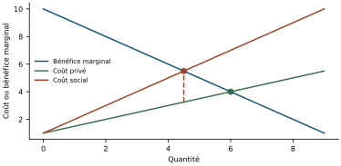
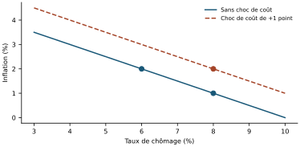
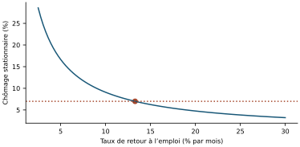

# ENS Rennes D1 — Économie (oral) 2018 · Corrigé guidé

*Corrigé rédigé par IA, non officiel.*

**Rédaction** · GPT-6.2 Astra Ultra · vitesse non renseignée

La feuille officielle contient 26 intitulés repris ci-dessous dans l’ordre du concours. Après trente minutes de préparation, le jury a observé 10 à 11 minutes d’exposé, puis 10 à 12 minutes de questions. Les intitulés reproduisent la graphie de la feuille. Aux sujets 11 et 26, le rapport donne respectivement « Phillips » et « est-elle allée » dans ses exemples.

# Questions générales

## Sujet 1 — La théorie économique est-elle utile pour mieux comprendre le monde d’aujourd’hui ?

> [!INDICATION]
> Prendre une politique concrète et distinguer, en quatre phrases, constat, mécanisme, prédiction et méthode de vérification.

**I. Une théorie rend explicite ce qu’il faudrait observer.** Une corrélation entre ventes de glaces et noyades n’autorise aucune conclusion sur les effets des glaces si la température affecte les deux. Un modèle économique ajoute des agents, des contraintes et des hypothèses réfutables. Par exemple, à demande inchangée, une taxe unitaire sur un produit élève généralement le prix payé par l’acheteur et baisse celui reçu par le vendeur. Le partage dépend des élasticités. Une identité comptable vérifiée ne constitue pas à elle seule une explication de comportement.

**II. Les faits aident à choisir entre plusieurs mécanismes.** Une comparaison avant-après de deux marchés peut isoler l’effet d’une taxe si leur trajectoire aurait été comparable en son absence et si le second marché n’a pas subi de retombées. Un résultat local ne se généralise pas automatiquement à une autre institution. La théorie sert alors à préciser l’hypothèse, interpréter l’écart et vérifier si un mécanisme concurrent produit une autre prédiction. Elle peut également éclairer un arbitrage normatif sans déterminer les poids que la collectivité attribue aux gagnants et aux perdants.

**Relance.** Un modèle faux dans le détail est-il inutile ?

Le modèle de prix concurrentiel peut prévoir qui supporte une taxe sur un marché de petites entreprises même si l’information est imparfaite. Il échouera si une firme dominante choisit ses marges autrement. C’est la question et la précision de la prédiction qui décident de l’usage.

## Sujet 2 — A quoi sert le prix Nobel d’économie ?

> [!INDICATION]
> Utiliser un travail distingué avant les oraux de juin 2018. Expliquer le raisonnement économique qu’il apporte plutôt que d’énumérer les lauréats.

**I. Une distinction scientifique rend visibles des méthodes et des désaccords féconds.** Le prix de la Banque de Suède en sciences économiques en mémoire d’Alfred Nobel est attribué pour la première fois en 1969. En 2009, les travaux d’Elinor Ostrom sur la gouvernance des ressources communes et ceux d’Oliver Williamson sur les frontières de l’entreprise donnent à voir deux questions de coordination. En 2017, les travaux de Richard Thaler mettent en avant la comptabilité mentale ou les difficultés de maîtrise de soi. Chaque exemple fournit une prédiction qui peut être étudiée, comme l’effet d’une option par défaut avec possibilité de retrait.

**II. Son effet institutionnel dépasse la validation d’une proposition.** Les médias, les universités et les décideurs accordent davantage d’attention à des méthodes distinguées. Cette visibilité peut financer de nouvelles vérifications ou orienter les thèmes étudiés. Un prix est attribué après une sélection et souvent après une longue accumulation de travaux ; il ne remplace ni la réplication, ni l’examen des hypothèses, ni le débat sur les objectifs. On peut expliquer l’influence d’une récompense par les incitations de réputation sans considérer l’autorité du lauréat comme une preuve empirique.

**Relance.** Une inscription automatique à un plan d’épargne améliore-t-elle nécessairement le bien-être de chaque salarié ?

Elle peut accroître la participation en modifiant le choix par défaut. Pour conclure sur le bien-être, il faut aussi connaître taux de contribution, coûts de retrait, endettement et préférences hétérogènes. L’effet sur un comportement et son jugement normatif diffèrent.

## Sujet 3 — Un bon économiste est-il classique ou keynésien ?

> [!INDICATION]
> Présenter le même fait sous deux hypothèses, puis désigner l’observation qui permettrait de les départager.

**I. Deux diagnostics stylisés aident à poser une question vérifiable.** La tradition classique attire l’attention sur les conditions de production, la répartition et les incitations ; dans une fermeture macroéconomique à prix flexibles, les ressources et techniques disponibles limitent durablement le produit. La tradition keynésienne insiste sur l’incertitude, les débouchés et la possibilité d’un chômage involontaire lorsque l’ajustement des dépenses se fait par les quantités. Une usine limitée par un manque de machines et une usine équipée qui manque de commandes n’appellent pas le même diagnostic.

**II. Le choix d’un modèle dépend du problème et de l’horizon.** Une relance en sous-emploi et une amélioration durable de productivité n’agissent pas par le même canal. Les modèles néo-keynésiens combinent fréquemment choix intertemporels et rigidités de prix. Pour juger un résultat, on peut confronter l’utilisation des capacités, les délais d’ajustement des salaires, les réponses de prix et de production et les conditions de financement. Un économiste gagne donc à énoncer une prédiction qui pourrait échouer et à comparer plusieurs explications, y compris à l’intérieur de chaque tradition.

**Relance.** Une usine dont les ventes s’effondrent doit-elle automatiquement investir davantage ?

Si les capacités sont déjà inutilisées, un investissement additionnel peut rester sans débouchés. Si la baisse des ventes reflète au contraire une technique obsolète, moderniser peut améliorer la compétitivité. Les commandes et le coût des techniques disponibles aident à trancher.

# Microéconomie

## Sujet 4 — La rémunération des facteurs de production

> [!INDICATION]
> Énoncer les hypothèses du théorème d’épuisement du produit avant de commenter le partage observé.

Une heure de travail, l’usage d’un équipement et l’apport d’un terrain procurent des services productifs différents. **I. Le repère de la productivité marginale.** Une entreprise concurrentielle embauche jusqu’à ce que la valeur du produit marginal du travail égale le coût du dernier travailleur. Une relation analogue fixe le coût d’usage du capital. Lorsque la fonction de production est différentiable et homogène de degré un, la rémunération de chaque facteur à son produit marginal épuise le produit par le théorème d’Euler. Les résultats dépendent du prix de vente, de la technologie et des quantités complémentaires.

**II. Les institutions et les rentes modifient le partage.** Un employeur qui exerce un pouvoir de monopsone peut payer moins que la valeur marginale ajoutée. Les négociations collectives, le salaire minimum, les droits sur la propriété intellectuelle et la concurrence sur le marché du produit influencent la répartition. La rémunération du capital inclut dépréciation, risque et éventuellement rente de rareté. Une décision normative doit préciser équité, incitation à investir, assurance et emploi. Une productivité marginale théorique ne détermine pas à elle seule la justice distributive. Une heure de travail supplémentaire qui rapporte 30 euros de ventes en concurrence et coûte 24 euros accroît le profit de 6 euros, avant interactions avec les autres facteurs. Cette vérification explique la condition marginale.

**Relance.** Comment un salaire minimum peut-il accroître l’emploi dans un modèle de monopsone ?

Dans la plage adéquate, il peut réduire le coût marginal d’une embauche supplémentaire que l’employeur supportait en relevant l’ensemble des salaires. L’effet dépend du niveau choisi.

## Sujet 5 — Externalités et choix économiques

> [!INDICATION]
> Dans le premier modèle, comparer les quantités et calculer la taxe à 4,5. Dans le second, conserver la même quantité pour tous les usagers.

**I. Le calcul privé omet certains effets sur autrui.** Une externalité apparaît lorsque produire ou consommer modifie le bien-être d’un tiers sans paiement correspondant. Si le bénéfice marginal est $10-q$, le coût marginal privé $1+0,5q$ et le social $1+q$, le marché choisit 6 alors que l’optimum est 4,5. Une taxe par unité de 2,25 égale au dommage marginal au niveau optimal décentralise ce résultat dans cet exemple. Une subvention peut encourager un effet positif si sa mesure est suffisamment fiable.

**II. La non-rivalité appelle une autre condition d’efficacité.** Une alerte météo disponible pour tous peut être approximativement non rivale et difficile à soustraire aux non-payeurs. Chacun a intérêt à laisser les autres contribuer. Pour un bien public pur, on additionne verticalement les dispositions marginales à payer pour une même quantité avant d’égaler leur somme au coût marginal. Production publique, commande à un fournisseur ou financement mutualisé peuvent répondre à ce problème. Une ressource commune, telle une pêcherie ouverte, est au contraire rivale et pose un problème de surexploitation. Une norme exprimée par usine et une taxe par tonne donnent des efforts d’abattement différents lorsque les coûts marginaux diffèrent entre usines. Une évaluation doit suivre les émissions effectivement évitées.

**Relance.** Le fait qu’une bibliothèque soit publique rend-il chaque livre non rival ?

Une même copie physique ne peut être empruntée à deux personnes au même moment. Le statut du propriétaire, les règles d’accès et les propriétés économiques du service doivent être distingués.

## Sujet 6 — La compétitivité des firmes

> [!INDICATION]
> Calculer un coût par unité avant de discuter la part de marché. Intégrer au moins un mécanisme de compétitivité hors prix.

**I. Une entreprise est compétitive sur un marché et pour un produit donné.** Sa compétitivité-prix dépend du prix proposé relativement aux concurrents. La productivité, le coût des intrants, le taux de change et le taux de marge relient coûts et prix. Si le salaire horaire passe de 20 à 22 euros et la productivité de 10 à 12 unités par heure, le coût salarial unitaire baisse de 2 à environ 1,83 euro malgré la hausse du salaire. Un avantage de coût peut servir à baisser le prix ou à accroître la marge pour investir.

**II. La qualité et l’accès au marché peuvent l’emporter sur un écart de prix.** Fiabilité, caractéristiques, délai, réputation et distribution déterminent la disposition à payer. Une entreprise plus productive peut aussi s’auto-sélectionner dans l’exportation en couvrant ses coûts fixes d’accès. Une hausse de part de marché peut résulter de l’effacement d’un concurrent ou d’un changement géographique de demande. La mesurer avec prix relatifs, volumes, marges, survie à l’export et qualité corrige l’interprétation d’un seul taux de croissance.

**Relance.** Une monnaie dépréciée améliore-t-elle autant les marges de tous les exportateurs ?

Le prix des intrants importés peut monter en monnaie locale. L’effet dépend aussi de la devise de facturation, du degré de transmission au client étranger et de la réaction des concurrents.

## Sujet 7 — Les monopoles publics

> [!INDICATION]
> Écrire la fonction de coût d’un réseau puis comparer deux réseaux produisant chacun la moitié. Séparer le statut de l’opérateur de son financement.

**I. Expliquer pourquoi un réseau peut n’admettre qu’un producteur efficient.** Si construire une infrastructure coûte 100 et chaque trajet une unité, le coût $C(q)=100+q$ est sous-additif pour deux réseaux redondants desservant ensemble la même demande. Le coût marginal est 1, tandis que le coût moyen dépasse 1 pour toute quantité finie. Un prix égal au coût marginal maximise l’usage sous des hypothèses simples, mais laisse 100 à financer. La propriété publique est un choix institutionnel distinct de la propriété technique de monopole naturel.

**II. Arbitrer entre accès, équilibre financier et discipline de gestion.** Une tarification au coût moyen évite un déficit mais décourage des usages dont la valeur excède le coût marginal. Un abonnement plus un prix d’usage peut couvrir les coûts fixes mais exclure des ménages peu consommateurs. Subvention, obligations de desserte ou régulation indépendante ont des effets différents sur la redistribution et l’incitation à maîtriser les coûts. Là où elles sont séparables, concurrence sur les services et régulation de l’accès au réseau peuvent coexister.

**Relance.** Un monopole public est-il nécessairement un monopole naturel ?

Une exclusivité peut être instituée par la loi pour un objectif de service public, même si plusieurs opérateurs pourraient produire au même coût. Inversement, une infrastructure naturellement monopolistique peut être exploitée par un concessionnaire privé régulé.

# Macroéconomie

## Sujet 8 — A quoi sert l’équilibre épargne investissement ?

> [!INDICATION]
> Commencer par un stock invendu puis comparer les ajustements de quantité et de taux.

En économie fermée, en négligeant les variations de stocks dans la distinction entre investissement prévu et réalisé ou en les incluant dans I, l’identité Y = C + I + G et l’épargne nationale S = Y − C − G donnent S = I. C’est une égalité *ex post* entre grandeurs mesurées de façon cohérente, pas l’assertion que les intentions des ménages et des entreprises coïncident à tout revenu. Un stock invendu compte dans l’investissement réalisé, même si le producteur ne souhaitait pas le constituer.

Si les ménages réduisent simultanément leurs achats pour épargner davantage, les stocks gonflent d’abord. Puis les entreprises peuvent réduire la production et le revenu. Dans une lecture keynésienne, la variation du revenu adapte l’épargne aux projets d’investissement. Dans une lecture où capacité et prix sont flexibles, le taux réel peut contribuer à coordonner les projets. En économie ouverte, l’écart entre épargne nationale et investissement correspond au solde courant sous les conventions cohérentes. Un pays où S = 19 et I = 23 mobilise quatre unités d’épargne nette du reste du monde. Par exemple, si l’entreprise avait prévu de vendre 100 et en vend 96, quatre unités de stocks involontaires réconcilient les comptes sans réaliser son projet commercial initial.

**Relance.** Une hausse de l’épargne désirée garantit-elle quatre points d’investissement de plus ?

Non. Les entreprises peuvent ne pas modifier leurs projets et le revenu peut baisser. L’identité comptable impose l’égalité finale appropriée, elle ne décrit pas seule la causalité.

## Sujet 9 — Les déterminants du solde du compte courant de la balance des paiements

> [!INDICATION]
> Construire le même solde par une hausse de l’investissement et par une chute de l’épargne.

Le compte courant rassemble biens et services, revenus primaires et transferts courants internationaux. Il se distingue donc du seul solde des marchandises. Dans une présentation cohérente des comptes, son solde correspond à l’écart entre épargne nationale et investissement intérieur. Si les résidents épargnent 22 et investissent 25, le besoin de financement courant vaut trois unités hors distinctions additionnelles du compte de capital. L’égalité comptable ne dit pas pourquoi la dépense excède l’épargne.

Une forte demande intérieure peut stimuler les importations, une hausse du prix de l’énergie détériorer les termes de l’échange d’un importateur, ou un effort rentable d’équipement créer temporairement un déficit. La spécialisation, la qualité et le prix influencent les exportations. Revenus d’actifs extérieurs et transferts peuvent compenser ou accentuer le solde commercial. La position extérieure nette, la devise des dettes et leur échéance éclairent la soutenabilité. On comparerait un déficit finançant un équipement exportateur et un déficit finançant une bulle non échangeable. Une dépréciation ne corrige pas aussitôt le solde si les quantités réagissent lentement ou si des importations essentielles sont peu substituables. Il est donc instructif de séparer une demande temporaire d’actifs sûrs d’une baisse durable de compétitivité des exportateurs : un même signe comptable appelle deux enquêtes différentes.

**Relance.** Un excédent est-il automatiquement un signe de bonne santé ?

Il peut refléter de fortes exportations, mais aussi un investissement ou une demande intérieure faibles. La composition et les causes décident du diagnostic.

## Sujet 10 — En quoi la prise en compte des anticipations en économie a-t-elle modifié le comportement des autorités de politique économique ?

> [!INDICATION]
> Faire varier la croyance sur la durée de la mesure tout en gardant son montant initial fixe.

Annoncer une baisse d’impôt demain modifie parfois la consommation aujourd’hui. **I. Les anticipations transmettent et peuvent neutraliser une décision.** Les achats durables dépendent du revenu futur attendu, l’investissement des ventes et des taux futurs, les négociations salariales de l’inflation prévue. Une baisse de taux courts jugée transitoire peut peu déplacer les taux longs. La critique de Lucas souligne qu’une relation statistique observée sous une règle peut changer sous une autre si les agents adaptent leurs prévisions.

**II. Crédibilité, apprentissage et hétérogénéité bornent la maîtrise publique.** Une banque centrale qui promet toujours une surprise expansionniste finit par perdre l’ancrage des anticipations. Une règle, l’indépendance ou une explication publique des exceptions peuvent améliorer sa crédibilité. Mais certains ménages ne suivent pas ses annonces, manquent de liquidités ou jugent incertaine l’action des pouvoirs publics. Une annonce de soutien peut même signaler une conjoncture plus grave qu’on ne le pensait. Le décideur doit donc considérer les anticipations sans supposer des croyances homogènes ni des réactions entièrement prévisibles. Les banques centrales ont notamment développé la publication de prévisions et la communication sur la trajectoire susceptible d’être donnée aux taux. L’effet d’une annonce dépend de sa crédibilité et des nouvelles qu’elle révèle sur la conjoncture.

**Relance.** Une prévision rationnelle est-elle toujours exacte ?

Elle peut être contredite par un choc imprévisible. L’hypothèse concerne l’usage de l’information disponible lorsque la prévision a été formée.

## Sujet 11 — Quelle actualité pour la relation de Philips ?

> [!INDICATION]
> Passer du cas $z=0$ à $z=1$ sur deux droites distinctes. Annoncer ce qui reste supposé constant entre les deux.

**I. Relier le marché du travail aux salaires, puis aux prix.** La relation de Phillips d’origine porte sur le chômage et la variation des salaires nominaux. Une relation portant sur les prix doit ajouter productivité et transmission des coûts. Dans l’expression $\pi=\pi^e-0,5(u-u^*)+z$, pour $\pi^e=2$, $u^*=6$, $z=0$ et $u=8$, l’inflation vaut 1 %, les taux étant en points. Si le chômage revient à 6 %, elle vaut 2 %. Ce déplacement se fait ici à paramètres constants.

**II. L’arbitrage est conditionnel à l’horizon et aux chocs.** La prise en compte des anticipations explique pourquoi une expansion répétée ne garantit pas un chômage durablement plus bas. Un renchérissement de l’énergie ou une hausse des anticipations déplace l’ordonnée à chômage donné. Les modèles néo-keynésiens relient notamment les décisions de prix à des coûts marginaux et des anticipations futures lorsqu’une partie des prix n’est pas ajustée immédiatement. Une pente faible dans des données agrégées peut aussi refléter une politique stabilisatrice ou une mauvaise mesure des tensions. Pour le diagnostic en 2018, une pente observée faible peut provenir d’anticipations mieux ancrées ou d’une mesure imparfaite des capacités inemployées. Elle ne suffit pas à conclure que tensions salariales et demande n’ont plus aucun effet sur les prix.

**Relance.** Dans l’exemple initial, une inflation de 2 % permet-elle de retrouver le chômage sans autre information ?

Avec $z=0$ et les autres paramètres fixés, oui, il vaut 6 %. Avec un choc $z=1$, une inflation de 2 % est également compatible avec 8 % de chômage. Il faut identifier le choc pour inverser la relation.

## Sujet 12 — La nouvelle macroéconomie classique : origine et développements

> [!INDICATION]
> Distinguer trois étapes historiques : critique des règles, surprises nominales et cycles réels. Nommer une prédiction et une limite à chaque fois.

**I. La nouvelle macroéconomie classique réexamine les effets anticipés des politiques.** Dans les années 1970, Lucas et d’autres auteurs étudient des agents qui exploitent l’information disponible et choisissent sur plusieurs périodes. Une relation statistique estimée sous une règle de politique peut changer lorsque la règle est modifiée et comprise. C’est la critique de Lucas. Des modèles d’information imparfaite permettent à une surprise nominale d’influencer la production, mais limitent l’effet réel d’une action systématique et anticipée sous leurs hypothèses.

**II. Les modèles de cycles réels et leurs prolongements changent les mécanismes discutés.** Kydland et Prescott étudient dans les années 1980 comment des chocs réels et l’accumulation intertemporelle peuvent engendrer des fluctuations. Les anticipations rationnelles ne suffisent pas à conclure que tout choc est technologique ou toute politique inefficace. En ajoutant rigidités nominales, concurrence imparfaite ou contraintes financières, on obtient d’autres implications, dont celles de modèles néo-keynésiens. La confrontation aux données doit vérifier ensemble le choc supposé, la réponse des heures travaillées, des prix et de la productivité.

**Relance.** Que signifie exactement « anticipations rationnelles » sous cette hypothèse ?

La prévision utilise l’information et la loi du modèle disponibles à la date de décision ; elle peut comporter une erreur imprévisible. Un changement de règle peut donc modifier les prévisions et les relations observées sans rendre les agents omniscients.

## Sujet 13 — Quelle actualité pour la théorie keynésienne après la crise de 2007 ?

> [!INDICATION]
> Relier la chute du prix d’un actif au crédit, à la dépense et au revenu. Introduire ensuite le levier de stabilisation dont l’effet doit être évalué.

**I. La crise de 2007 rappelle comment une baisse de dépense peut se transmettre.** Une perte de patrimoine et des perspectives plus incertaines encouragent la réduction simultanée des dépenses. Ce qui protège un ménage isolé diminue les revenus des autres lorsqu’ils font tous de même. Investissement, consommation et emploi reculent. Le levier bancaire, les garanties et les ventes forcées aggravent la contraction, dimensions qu’une simple croix keynésienne de court terme représente mal.

**II. L’efficacité de la stabilisation dépend des conditions concrètes.** Quand des capacités restent inutilisées et des taux nominaux butent sur une borne basse, une demande publique supplémentaire peut entraîner des achats privés induits. En économie ouverte, une partie fuit vers les importations. Primes de financement, structure des budgets, réaction de la banque centrale et nature des mesures changent l’effet attendu. En juin 2018, le débat après la crise porte ainsi sur les situations où les multiplicateurs sont élevés et sur les canaux bancaires ou européens à ajouter au diagnostic.

**Relance.** Une hausse du déficit pendant la crise prouve-t-elle qu’une relance délibérée a eu lieu ?

Une récession réduit spontanément les recettes et augmente certaines prestations. Isoler l’effet d’une mesure discrétionnaire exige une référence à politique inchangée et un traitement du cycle.

## Sujet 14 — Le chômage peut-il être volontaire ?

> [!INDICATION]
> Décrire une entreprise sans débouché et une entreprise qui ne parvient pas à recruter.

Une recherche peut prolonger volontairement le temps avant acceptation, mais le manque de débouchés ou l’absence d’offre compatible avec les qualifications conduit aussi à un chômage subi. Un chômeur involontaire souhaite travailler aux conditions de rémunération en vigueur sans trouver de poste. La définition fait porter l’analyse sur le rationnement des emplois et la coordination des décisions. Une entreprise qui prévoit peu de ventes n’embauchera pas uniquement parce que le coût du travail baisse. Si toutes diminuent les salaires, la demande des ménages peut aussi diminuer. Une baisse de salaire réel utile dans un marché partiel peut donc avoir un effet différent dans l’économie entière.

La rigidité nominale est un mécanisme possible, mais elle n’épuise pas le diagnostic. Un salaire d’efficience peut être choisi par l’entreprise pour retenir ou motiver ses salariés, même si d’autres personnes accepteraient moins. Les frictions d’appariement permettent la coexistence d’emplois vacants et de chômage. L’action pertinente dépend alors des faits. Peu d’offres dans la plupart des secteurs suggèrent une insuffisance de demande, beaucoup d’offres non pourvues dans certaines qualifications justifient d’étudier l’information, la formation et les conditions de travail. Le salaire de réservation est le seuil auquel une personne accepte une offre compte tenu du salaire net, des trajets, des horaires et de ses perspectives de recherche. Refuser une offre isolée n’établit pas que toute période sans emploi était souhaitée.

**Relance.** L’existence d’emplois vacants prouve-t-elle que tout chômage est volontaire ?

Non. Une offre peut exiger une qualification ou une mobilité inaccessible au demandeur. Les agrégats ne disent pas si chaque emploi peut être pourvu par chaque personne sans coût.

## Sujet 15 — En quoi la crise financière a-t-elle modifié la conduite de la politique économique ?

> [!INDICATION]
> Distinguer un outil d’urgence, une règle de prévention et une mesure de soutien de la demande. Décrire pour chacun son horizon d’action.

**I. Une crise de bilan exige des outils de liquidité et de solvabilité.** Une banque peut détenir des actifs rentables mais manquer de liquidités lorsque ses prêteurs refusent de renouveler leur financement. Un prêteur en dernier ressort peut prévenir des ventes forcées. En revanche, si la valeur des actifs est durablement inférieure aux engagements, un prêt supplémentaire ne restaure pas les fonds propres. Recapitalisation, résolution et répartition des pertes répondent à ce problème distinct.

**II. La politique économique s’est élargie à la transmission et à la stabilité du système.** Après 2007, des banques centrales ont recouru aux achats de titres, aux prêts de maturité plus longue et aux indications sur les taux futurs. La surveillance macroprudentielle s’intéresse au risque commun de bilans exposés aux mêmes actifs. Dans la zone euro, la supervision bancaire commune est devenue opérationnelle en 2014. Les stabilisateurs budgétaires et les mesures discrétionnaires ont également porté sur les pertes de demande, avec des marges variables selon la dette et les institutions.

**Relance.** Pourquoi renforcer les coussins de fonds propres pendant une expansion ?

Ces fonds peuvent absorber des pertes futures et limiter les ventes forcées ou la contraction du crédit lorsque les risques se réalisent. Les constituer en pleine récession pourrait, au contraire, amplifier l’ajustement.

## Sujet 16 — Qu’est-ce que le plein emploi ?

> [!INDICATION]
> Construire deux exemples menant au même taux de chômage, avec des taux d’emploi différents.

Le plein emploi peut se définir comme l’emploi compatible avec les frictions d’appariement et une activité soutenable. **I. Les indicateurs éclairent plusieurs dimensions.** Le chômage au sens du BIT suppose disponibilité et recherche active. Il exclut certains découragés et masque le temps partiel subi. Examiner taux d’emploi par âge, heures souhaitées, postes vacants, durée des recherches et transitions complète la photographie. Une coexistence de chômeurs et de postes vacants peut provenir d’un appariement coûteux plutôt que d’une demande globale suffisante.

**II. Le repère structurel n’est pas directement observable.** Le chômage compatible avec une inflation stable dépend de la mesure de l’inflation, des anticipations et des chocs d’offre. Les méthodes économétriques fournissent un intervalle et révisent leurs estimations. Formation, qualité des appariements ou perte de compétences après une récession peuvent déplacer la référence elle-même. Un taux de chômage bas associé à peu de participation peut conduire à un diagnostic trompeur. Il faut donc confronter prix, quantités, trajectoires et hétérogénéité régionale. Dans une illustration à population active fixe et deux états, le chômage stationnaire vaut s/(s+f). Le graphique fait varier le retour en emploi f à un taux de perte d’emploi s de 1 % ; il ne représente pas une norme universelle de plein emploi.

**Relance.** Une baisse du chômage due au retrait de demandeurs découragés rapproche-t-elle nécessairement du plein emploi ?

Le taux mesuré peut baisser sans nouvel emploi ni meilleure chance de trouver du travail. Les transitions vers l’emploi et les enquêtes sur le halo permettent de préciser le diagnostic.

## Sujet 17 — Les déterminants de la croissance économique

> [!INDICATION]
> Passer du flux d’investissement au stock de capital, puis du stock à la production.

À court terme, produire plus peut consister à utiliser une capacité existante. Une progression durable du produit potentiel mobilise quantité de travail, capital productif et productivité. Dans le modèle de Solow, une accumulation supérieure accroît le capital par travailleur, mais les rendements décroissants font converger vers un niveau plus élevé plutôt que vers une hausse éternelle du taux de croissance par tête. Le progrès technique est déterminant sur le sentier de long terme du modèle.

L’investissement dans l’éducation, les infrastructures et la recherche peut modifier l’efficacité des facteurs. La connaissance est en partie non rivale et ses gains dépassent parfois ceux de l’investisseur. Il faut pourtant que les entreprises puissent adopter les procédés, que les salariés disposent des compétences et que les institutions permettent de financer des projets incertains. Une décomposition comptable du PIB ne suffit pas à prouver une cause. Un résidu de productivité peut refléter mesure imparfaite, réorganisation, meilleure allocation ou innovation. Comparer investissement brut et net, croissance totale et par tête, et effets environnementaux complète le diagnostic. Avec une production par travailleur égale à la racine du capital par travailleur, passer de 4 à 9 unités de capital porte la production de 2 à 3. Le niveau progresse, sans créer à lui seul un taux de croissance permanent.

**Relance.** Une hausse de 10 % de l’investissement implique-t-elle une croissance supérieure de 10 % ?

Non. L’investissement est un flux qui accroît le stock après dépréciation. L’effet sur la production dépend du capital initial, des autres facteurs et du rendement du projet.

## Sujet 18 — La politique monétaire : mesures conventionnelles et mesures non conventionnelles

> [!INDICATION]
> Dérouler une seule chaîne depuis le bilan de la banque centrale jusqu’à la dépense envisagée. Nommer la fuite ou le délai possible à chaque étape.

**I. Les taux directeurs orientent les conditions financières.** Par ses facilités et ses opérations de refinancement, une banque centrale influence le coût de la liquidité de court terme. Les anticipations des futurs taux courts contribuent ensuite aux taux longs, avec des primes de risque et de maturité. Des prêts moins chers ou un taux de change plus faible peuvent soutenir consommation, investissement et prix. La transmission dépend du bilan des banques, de la demande de prêts et des risques perçus.

**II. Les mesures non conventionnelles traitent d’autres marges.** Dans la zone euro de 2018, achats de titres, indications sur les taux futurs et refinancements ciblés portent respectivement sur les portefeuilles et primes de terme, les anticipations et l’offre de crédit. Un achat de titre modifie la composition des actifs détenus par le secteur privé ; les réserves ne sont pas distribuées mécaniquement aux ménages. Les rendements peuvent baisser sans que l’investissement reprenne immédiatement si les débouchés demeurent incertains. La BCE utilise en juin 2018 les taux directeurs et plusieurs instruments de bilan. Pour distinguer leurs canaux, on peut tenir le taux court courant constant et modifier seulement le portefeuille de titres à long terme de la banque centrale.

**Relance.** Pourquoi une obligation existante à coupon fixe monte-t-elle lorsque le rendement exigé baisse ?

Ses paiements futurs sont actualisés à un taux plus faible. Pour un titre versant 105 dans un an, la valeur passe de 100 au taux de 5 % à environ 102,94 au taux de 2 %. Le risque de crédit est tenu constant dans l’exemple.

## Sujet 19 — A quoi servent les marchés financiers ?

> [!INDICATION]
> Dessiner deux circuits : émission initiale entre investisseur et emprunteur, revente entre investisseurs. Indiquer le bénéficiaire du paiement dans chacun.

**I. Les marchés de titres répartissent le financement et les risques.** Lors d’une émission primaire, l’entreprise ou l’État reçoit des fonds contre une créance ou des droits sur des revenus futurs. Une vente secondaire change le détenteur du titre et rend la liquidation plus facile, ce qui peut aider l’émetteur lors d’une future émission. Des investisseurs diversifient les risques spécifiques, et les prix agrègent une partie des informations sur les revenus attendus, les taux et les risques.

**II. La liquidité peut disparaître au moment où elle est collectivement recherchée.** Un actif négociable par un détenteur isolé ne peut être vendu simultanément par tous au prix antérieur. Information asymétrique, effets de levier ou imitation peuvent amplifier variations et ventes forcées. Transparence des comptes, compensation, règles prudentielles et gestion des défaillances visent des mécanismes différents. Il faut juger un marché selon ce qu’il finance, la qualité du signal de prix et la distribution des risques, sans confondre volume des échanges et financement neuf.

**Relance.** L’achat d’une action déjà cotée verse-t-il directement de l’argent à la société ?

Le prix va ici au vendeur du titre. La liquidité du marché secondaire et le cours observé peuvent cependant influencer le coût d’une future émission par la société.

## Sujet 20 — L’ouverture de l’économie contraint-elle l’action des autorités de politique économique ?

> [!INDICATION]
> Comparer deux pays au même déficit extérieur, dont un seul emprunte en sa propre monnaie.

La contrainte externe désigne les limites que la balance des paiements, les conditions de financement et le régime de change imposent à une politique. Une relance budgétaire accroît la demande, dont une partie porte sur les importations. Dans une économie qui emprunte en monnaie étrangère, une dépréciation renchérit en outre la valeur domestique des dettes. Il faut distinguer ce risque de bilan d’un déficit courant qui finance des équipements capables d’accroître les recettes futures.

Avec change fixe et forte mobilité des capitaux, un taux domestique durablement inférieur au taux étranger compatible avec le risque exerce une pression sur les réserves. Défendre la parité réduit la liberté de la politique monétaire. En change flexible, l’ajustement du cours amortit certains chocs et peut renchérir les importations. Dans l’union monétaire, il n’existe pas de parité nationale à dévaluer et le taux commun peut convenir inégalement aux membres. La réponse dépend des échéances, de la devise de dette, des capacités productives et de la coordination entre partenaires. Les autorités conservent aussi des instruments : la coopération permet d’internaliser les effets des dépenses d’un pays sur les ventes de ses voisins. Un régime de change encadre les choix mais ne fait pas disparaître toute politique économique.

**Relance.** Le solde commercial doit-il être nul chaque année ?

Un déficit soutenable peut financer une activité rentable. La question porte sur l’usage des ressources, la capacité future de financement et le risque d’une interruption brutale des entrées de capitaux.

## Sujet 21 — La poursuite de la construction économique de l’Europe nécessite-t-elle une union fiscale ?

> [!INDICATION]
> Donner deux significations précises à « union fiscale » et dire pour quel type de choc chacune serait pertinente.

**I. Comprendre ce que pourrait mutualiser un budget commun.** Une politique monétaire unique réagit à la moyenne de la zone. Si un seul pays subit un choc temporaire, un mécanisme commun d’assurance ou des transferts automatiques peuvent soutenir son revenu sans attendre une dévaluation nationale. Des dépenses d’infrastructure transfrontalière peuvent corriger un sous-financement par chaque gouvernement isolé. L’amplitude du choc, la taille du budget et la rapidité des versements conditionnent ces gains.

**II. La nécessité dépend des solutions de remplacement et des règles politiques.** Mobilité du travail, portefeuilles diversifiés, budgets nationaux disposant de marges et crédit transfrontalier peuvent aussi partager le risque, imparfaitement en crise. Une union fiscale peut recouvrir un impôt commun, un budget de stabilisation, de la dette commune ou une harmonisation : ces instruments ne produisent pas les mêmes transferts. Les règles d’éligibilité, la décision démocratique et la responsabilité budgétaire influencent leur acceptation. En 2018, l’UE dispose déjà d’un budget, qui ne constitue pas pour autant un puissant stabilisateur fédéral comparable à un grand budget national.

**Relance.** Une assurance contre le chômage régionale implique-t-elle des transferts permanents ?

Elle peut organiser des transferts temporaires qui changent de sens si les chocs sont transitoires. Des divergences persistantes de chômage, ou une règle mal conçue, peuvent créer des flux durables. Les critères de déclenchement permettent d’étudier cette différence.

## Sujet 22 — L’union économique et monétaire est-elle une zone monétaire optimale ?

> [!INDICATION]
> Choisir un choc commun puis un choc touchant un seul exportateur. Montrer quel ajustement national a disparu et quel mécanisme peut prendre le relais.

**I. La monnaie commune offre des gains mais retire un ajustement.** Moindres coûts de conversion et risque de change interne réduit facilitent échanges et intégration. En contrepartie, le taux de change national et le taux directeur national disparaissent. Les critères de zone monétaire optimale examinent notamment la symétrie des chocs et des structures, la mobilité du travail, la flexibilité des prix et salaires, l’intégration financière et l’existence de transferts. L’optimalité est une comparaison de coûts et bénéfices, pas un statut juridique obtenu une fois pour toutes.

**II. Les mécanismes européens compensent inégalement les chocs asymétriques.** Un choc frappant uniformément la zone se prête davantage à une réponse monétaire commune. Un choc spécifique à une région exportatrice nécessite mobilité, transferts internes ou crédit soutenable. Des marchés de capitaux intégrés peuvent partager les pertes ou, s’ils sont fragiles, propager une crise. L’intégration commerciale peut rapprocher les cycles ou accroître la spécialisation industrielle. L’analyse de la zone euro en 2018 doit donc préciser le choc, l’horizon et l’évolution des institutions observées depuis sa création.

**Relance.** Un fort commerce entre deux pays suffit-il à justifier une monnaie commune ?

Il augmente les gains d’une suppression du risque de change, mais ne garantit ni la similitude des chocs ni un mécanisme de compensation lorsqu’ils divergent. Il faut notamment examiner spécialisation et mobilité.

## Sujet 23 — Inflation, désinflation, déflation

> [!INDICATION]
> Écrire successivement 100, 104 et 105,04. Comparer la variation de l’indice à la variation du taux d’inflation.

**I. Distinguer niveaux et taux.** Avec un indice de départ de 100, une inflation de 4 % le porte à 104. Une inflation de 1 % l’année suivante donne 105,04 : les prix continuent d’augmenter, mais le rythme ralentit, c’est la désinflation. Une baisse durable du niveau général est une déflation. Une baisse isolée ou sectorielle ne suffit pas à ce dernier diagnostic. L’indice retenu, la période de comparaison et la diffusion du mouvement entre biens comptent.

**II. Les effets passent par les revenus réels, les contrats et les anticipations.** Une désinflation réduit l’érosion future d’une créance nominale ; si elle était anticipée, le taux nominal peut déjà en tenir compte. Une déflation anticipée élève le taux réel pour un taux nominal donné et alourdit les dettes existantes en pouvoir d’achat. En revanche une baisse de prix due à la productivité dans un secteur peut accompagner l’expansion des volumes. La banque centrale s’intéresse à la persistance, aux anticipations et à l’origine du choc.

**Relance.** La désinflation ramène-t-elle nécessairement le pouvoir d’achat d’un salaire à son niveau antérieur ?

Si le salaire nominal reste inchangé et les prix augmentent encore de 1 %, le pouvoir d’achat continue de baisser, à un rythme moindre. Il faut comparer l’évolution du salaire à celle du panier.

## Sujet 24 — Rigidités nominales et efficacité de la politique économique

> [!INDICATION]
> Nommer le contrat et sa durée. Expliquer quelle variable s’ajuste pendant que le tarif ou le salaire reste fixé.

**I. Les contrats nominaux introduisent un délai entre impulsion et ajustement.** Si une entreprise garde temporairement son prix affiché, une hausse de demande peut augmenter ses ventes et ses heures de travail avant sa marge nominale. Si toutes les entreprises ajustaient immédiatement leurs prix et si les autres frictions étaient absentes, l’effet réel d’un choc purement nominal pourrait être faible. Coûts de révision, contrats salariaux et fixation échelonnée des prix rendent ce délai possible sans immobiliser tous les prix.

**II. Une politique efficace dépend du choc et de sa transmission.** Face à un déficit de demande, une baisse du taux réel ou une dépense publique peut soutenir les quantités à court terme. Face à une hausse du coût des intrants, soutenir intégralement l’activité peut amplifier l’inflation. Les anticipations et la crédibilité de la politique influencent les prix que choisissent les firmes pouvant réviser leurs tarifs. Une flexibilité plus grande n’élimine pas les frictions financières, les effets redistributifs des dettes nominales ou les limites de la borne des taux.

**Relance.** Une rigidité du salaire nominal signifie-t-elle que le salaire réel est fixé ?

Si le salaire nominal reste à 100 et l’indice des prix monte de 100 à 105, le salaire réel diminue d’environ 4,76 %. Fixité de la paie en euros et fixité du pouvoir d’achat sont distinctes.

## Sujet 25 — La politique économique selon les classiques

> [!INDICATION]
> Comparer une perte durable de capacité et une baisse temporaire des achats à capacité inchangée.

Dans une représentation classique stylisée, les prix et salaires flexibles coordonnent les marchés et la production réelle dépend des facteurs et des techniques, tandis que la monnaie agit principalement sur les grandeurs nominales à long terme. Cette conception donne un repère pour étudier rareté, incitations et allocation intertemporelle. Une réduction durable de la capacité énergétique peut, par exemple, limiter la production malgré une demande forte. Une expansion nominale ne recrée pas immédiatement cette ressource.

Le modèle est moins adapté pour expliquer l’ajustement immédiat lorsque salaires et prix sont fixés pour plusieurs périodes, que la finance est contrainte ou que tous les projets dépendent de ventes déprimées. Une baisse de la demande peut produire du chômage involontaire sans baisse rapide des prix. La question empirique est donc celle de l’horizon et des mécanismes dominants, pas celle d’une succession d’écoles définitivement périmées. Les modèles contemporains combinent souvent choix intertemporels et rigidités nominales. Ils retrouvent certains résultats classiques à prix flexibles tout en laissant une place à la stabilisation à court terme. Dans une perspective de long terme, garantir les droits de propriété, fournir des infrastructures et réduire certaines barrières à l’entrée peut soutenir les capacités réelles. La défense classique des marchés n’implique pas l’absence de fonctions publiques, comme l’illustrent déjà certains travaux d’Adam Smith.

**Relance.** Que signifie la neutralité monétaire dans ce cadre ?

Une variation proportionnelle de la quantité nominale de monnaie et des prix peut laisser les grandeurs réelles inchangées à l’équilibre de long terme. Elle n’implique pas l’absence de tout effet transitoire.

## Sujet 26 — La globalisation est-allée trop loin ?

> [!INDICATION]
> Choisir un flux commercial et un flux financier. Définir deux critères de jugement et suivre séparément leurs gagnants, leurs perdants et leurs risques.

**I. Évaluer les gains et leur distribution.** L’ouverture commerciale permet une spécialisation selon les coûts d’opportunité, une plus grande variété et l’accès à des intrants efficaces. Les flux financiers peuvent diversifier les risques et financer des projets au-delà de l’épargne nationale. Un gain agrégé coexiste toutefois avec des pertes concentrées par région, qualification ou secteur. Du fait des coûts de mobilité, la compensation des perdants n’est ni spontanée ni toujours réalisable à faible coût.

**II. Le qualificatif « trop » exige un objectif et un instrument.** Une chaîne internationale peut transmettre des chocs ou externaliser des nuisances qui ne figurent pas dans le prix. Une dette en devises à court terme crée un risque de retournement différent d’un investissement direct durable. Selon le problème, assurance sociale, politique de reconversion, tarification environnementale, coopération fiscale ou règle prudentielle sont des interventions différentes. La bonne comparaison porte sur les effets d’une mesure précise et de ses alternatives, y compris leurs coûts pour les pays partenaires et les consommateurs.

**Relance.** Une hausse uniforme de tous les droits de douane corrige-t-elle la fragilité d’un crédit en devises ?

Elle cible le commerce de biens et peut réduire les échanges mutuellement avantageux. Les expositions en devises, les maturités de la dette et les risques de refinancement appellent d’abord un diagnostic financier et des instruments adaptés.

[Feuille officielle des tirages](https://www.ens-rennes.fr/medias/fichier/sujets-oraux-e-conomie-d1-2018_1563804978786-pdf) · [Rapport officiel du jury](https://www.ens-rennes.fr/medias/fichier/rapport-de-jury-d1-eco-oral-2018_1563807652814-pdf)
