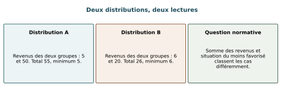
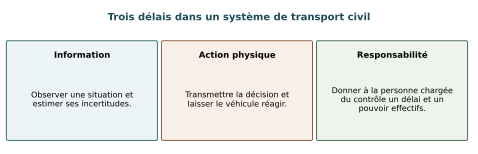

# ENS Rennes D1 — Entretien (oral) 2018 · Corrigé guidé

*Corrigé rédigé par IA, non officiel.*

**Rédaction** · GPT-6.2 Astra Ultra · vitesse non renseignée

Les 28 supports sont repris dans leur ordre de lecture. Chaque repère thématique a été attribué à partir du passage reproduit. Le lien ouvre sa page dans le fascicule institutionnel.

## Texte 1 — La condition animale et la place des humains

[Fascicule 1, page 2](https://www.ens-rennes.fr/medias/fichier/textes-e-preuve-entretien-d1-2018_1563804999901-pdf#page=2)

> [!INDICATION]
> Relever les mots « sentience », « altérité » et « justice ». Pour chacun, donner un exemple de décision qu’il permet de discuter.

L’entretien fait de la sentience, capacité d’éprouver douleur, plaisir ou peur, un motif pour inclure les intérêts des animaux dans les décisions collectives. L’auteur relie modes de production, invisibilité des conditions d’élevage et responsabilité envers des êtres susceptibles de souffrir. Il distingue le respect du vivant, qui peut s’étendre aux plantes, et une justice fondée sur l’expérience propre des êtres sentients.

Une égale prise en considération ne commande pas le même traitement pour des besoins différents. Une décision doit identifier les intérêts en conflit, les effets pour les travailleurs et les possibilités de transition. Il faut aussi distinguer un animal capable d’exprimer des préférences, un droit formulé par les humains et la représentation de cet intérêt devant une institution. Cette distinction explique comment un humanisme peut élargir le champ de ses obligations.

**Relance.** Protéger une espèce et protéger chaque animal de cette espèce sont-ils le même objectif ?

La protection d’une population vise sa continuité et son milieu. Le bien-être individuel porte sur l’expérience de chaque animal. Les deux objectifs peuvent se rejoindre sans être identiques.

## Texte 2 — Céline, son œuvre et l’antisémitisme

[Fascicule 1, page 3](https://www.ens-rennes.fr/medias/fichier/textes-e-preuve-entretien-d1-2018_1563804999901-pdf#page=3)

> [!INDICATION]
> Tracer une ligne du temps avec trois publications ou événements. Distinguer ce que la chronologie démontre de l’interprétation du milieu littéraire.

L’article situe les pamphlets antisémites de Céline dans un milieu littéraire et politique plus ancien, au lieu de les expliquer par une singularité individuelle. La chronologie a ici une valeur argumentative : *La France juive* de Drumont paraît en 1886 avant l’affaire Dreyfus, tandis que *Voyage au bout de la nuit* paraît en 1932 et *Bagatelles pour un massacre* en 1937. La persistance des accusations après la réhabilitation de Dreyfus montre l’indifférence du préjugé aux preuves.

Replacer une œuvre dans son contexte n’efface pas la responsabilité de son auteur ni la diversité de ses lecteurs. Le projet de réédition suspendu en 2018 soulève une question distincte : sous quelles conditions documenter une propagande antisémite sans lui conférer un nouvel aval ? Un appareil critique peut identifier les mensonges, retracer leur réception et donner leur place aux personnes visées. Une édition d’étude et une célébration publique poursuivent ainsi des fins différentes.

**Relance.** Pourquoi la chronologie de Drumont et de l’affaire Dreyfus importe-t-elle ?

Elle contredit l’idée que l’idéologie serait simplement née en réaction à une affaire particulière. Des représentations préexistantes ont au contraire contribué à rendre plausibles des accusations injustifiées.

## Texte 3 — Brancusi et la définition juridique de l’œuvre d’art

[Fascicule 1, page 4](https://www.ens-rennes.fr/medias/fichier/textes-e-preuve-entretien-d1-2018_1563804999901-pdf#page=4)

> [!INDICATION]
> Disposer trois étiquettes sur la table : classification douanière, originalité juridique et loyauté de la vente. Rattacher chaque exemple à son registre.

*Oiseau dans l’espace* de Brancusi sert à rappeler qu’une qualification douanière peut dépendre de la conception de l’art adoptée par une institution. Le contentieux américain aboutit à la reconnaissance de la sculpture en 1928. L’exposition *Artistes et robots* déplace la question vers le rôle de l’auteur : conception, réglages et résultat inattendu ne sont pas nécessairement le fait du même intervenant.

La page avance la personnalité juridique du robot comme solution possible. Il faut la présenter comme la proposition de son auteur. Propriété de l’objet matériel, droit d’auteur sur une création originale et information de l’acheteur sont des questions distinctes. Une qualification douanière ne tranche pas à elle seule un litige de droit d’auteur. Examiner les choix humains vérifiables et les caractéristiques promises lors de la vente permet d’éviter de faire d’un jugement esthétique une règle unique.

**Relance.** Un collectionneur qui achète une sculpture acquiert-il automatiquement tous les droits de reproduction ?

La propriété du support matériel ne suffit pas par elle-même. Il faut examiner les droits en cause, leur titulaire, la loi applicable et les éventuelles cessions consenties.

## Texte 4 — La recherche universitaire face aux procès en diffamation

[Fascicule 1, page 5](https://www.ens-rennes.fr/medias/fichier/textes-e-preuve-entretien-d1-2018_1563804999901-pdf#page=5)

> [!INDICATION]
> Suivre une affaire du propos initial au jugement. Attribuer correctement une accusation, une demande et le résultat de la procédure.

La page décrit des chercheurs poursuivis à la suite de prises de position et évoque notamment l’étude de Bruno Deffains sur Free. Une action rejetée peut néanmoins imposer à la personne poursuivie des coûts, du temps et une inquiétude durables. La crainte de cette charge peut donc exercer un effet sur d’autres publications, indépendamment de l’issue finale.

La liberté académique ne dispense pas de justifier ses données ni ne prive les personnes mises en cause de tout recours. Critiquer une méthode, imputer un fait précis à une personne et dénigrer un service ne relèvent pas d’emblée de la même qualification. Il faut isoler les propos exacts, les pièces disponibles et le stade de la procédure. La notion d’agnotologie évoquée dans la page vise la production organisée de doute ; elle ne permet pas de supposer que toute contestation scientifique est intéressée.

**Relance.** Qui est le mieux placé pour dire si un protocole expérimental est solide ?

L’évaluation par les pairs et la réplication examinent la méthode. Un tribunal peut trancher un litige de droit sur des propos ou une conduite, avec le recours à une expertise si nécessaire. Les deux questions doivent demeurer identifiables.

## Texte 5 — Google et l’aide à la déconnexion

[Fascicule 1, page 6](https://www.ens-rennes.fr/medias/fichier/textes-e-preuve-entretien-d1-2018_1563804999901-pdf#page=6)

> [!INDICATION]
> Comparer une notification choisie, une notification imposée et un message professionnel hors horaire. Chercher qui a la main sur chacun.

Google propose dans Android P des compteurs d’usage, de déverrouillages et de notifications. La page souligne un paradoxe : l’entreprise qui a intérêt à capter l’attention propose aussi d’en régler la dépense. Les mesures peuvent redonner une visibilité à l’utilisateur, mais définir le bien-être en minutes ou en clics impose déjà une certaine conception de l’usage souhaitable.

Le texte oppose utilement outil individuel de « déconnexion » et conditions collectives du travail. Fixer une limite d’écran ne change pas nécessairement l’attente d’une réponse professionnelle tardive. Pour évaluer l’outil, il faudrait comparer objectifs déclarés, réglages par défaut, usage réellement choisi et effets sur le sommeil ou le travail, tout en protégeant les données recueillies. L’intérêt économique du fournisseur motive un examen de la conception sans démontrer à lui seul qu’aucun utilisateur n’en tire profit.

**Relance.** Deux heures d’écran correspondent-elles au même usage pour tous ?

Elles peuvent couvrir une conversation entre proches, un devoir ou des sollicitations subies. La durée seule informe sur une quantité ; la finalité, le contrôle exercé et les effets comptent pour le jugement.

## Texte 6 — Les sources littéraires de Shakespeare et la notion de plagiat

[Fascicule 1, page 7](https://www.ens-rennes.fr/medias/fichier/textes-e-preuve-entretien-d1-2018_1563804999901-pdf#page=7)

> [!INDICATION]
> Prendre une ressemblance et proposer deux explications concurrentes, puis préciser la pièce qui permettrait de les départager.

Les rapprochements proposés entre George North et plusieurs pièces de Shakespeare ont été détectés avec une aide informatique puis interprétés par des chercheurs. Le texte précise que McCarthy et Schlueter parlent de source possible et n’accusent pas Shakespeare de plagiat. Il rappelle le rôle de textes antérieurs, de conventions théâtrales, des contraintes d’une troupe et du travail de transformation des intrigues.

Une ressemblance textuelle peut provenir d’une expression commune, d’une source partagée ou d’un emprunt direct. Pour départager ces hypothèses, il faut comparer la rareté des motifs, leur ordre, les dates et les possibilités de circulation. Appliquer rétrospectivement une conception contemporaine du droit d’auteur efface des différences historiques. Lire côte à côte les scènes fait apparaître les changements de personnage, de portée et de composition qui constituent un apport singulier.

**Relance.** Pourquoi un logiciel de similitude ne tranche-t-il pas à lui seul la question du plagiat ?

Il signale des ressemblances selon des règles déterminées. Établir filiation, intention ou qualification juridique exige d’autres informations et une interprétation du contexte.

## Texte 7 — Statistiques, données numériques et connaissance publique

[Fascicule 1, page 8](https://www.ens-rennes.fr/medias/fichier/textes-e-preuve-entretien-d1-2018_1563804999901-pdf#page=8)

> [!INDICATION]
> Pour chaque source, demander qui est observé, quelles catégories sont utilisées, qui contrôle les données et qui peut vérifier le résultat.

William Davies oppose la statistique publique, dont les catégories servent de références communes, à des données numériques souvent détenues et exploitées par des acteurs privés. Le taux de chômage britannique, qui peut laisser dans l’ombre sous-emploi ou travail indépendant, illustre la sélection opérée par un indicateur national. La critique porte à la fois sur l’unité de mesure, l’échelle géographique et l’accès à la méthode.

Les traces numériques peuvent éclairer des activités nouvelles, mais leurs utilisateurs ne représentent pas automatiquement toute la population. Rendre des données ouvertes ne signifie pas rendre publiques des informations individuelles identifiables. Méthode publiée, comparabilité temporelle, accès protégé aux chercheurs et contrôle de la réutilisation peuvent concilier examen public et confidentialité. L’autorité d’un chiffre repose sur sa capacité à être compris, discuté et reproduit dans son périmètre.

**Relance.** Un très grand nombre d’observations élimine-t-il un biais de sélection ?

Non. Des millions de traces d’utilisateurs d’un seul service peuvent reproduire le même biais d’accès ou d’usage. Il faut connaître le mécanisme de sélection et la population que l’on veut décrire.

## Texte 8 — Véganisme, éthique et industrie alimentaire

[Fascicule 1, page 9](https://www.ens-rennes.fr/medias/fichier/textes-e-preuve-entretien-d1-2018_1563804999901-pdf#page=9)

> [!INDICATION]
> Repérer « pourrait », les attributions à l’ONG et les interrogations du chroniqueur. Dater et localiser précisément la discussion.

La chronique discute de la portée en Ontario d’une protection des convictions non religieuses. Elle précise que la commission ne désigne pas expressément le véganisme, puis rapporte les exemples d’une association et développe ses propres objections. Séparer ces trois voix évite de présenter un exemple militant ou un scénario hypothétique comme un jugement déjà applicable à toute activité.

Une conviction éthique durable, une préférence occasionnelle et une contrainte de santé peuvent appeler des justifications et des aménagements différents. Évaluer un aménagement exige de savoir quelle activité est essentielle et quelles solutions sont réalisables. Proposer une option lors d’un repas collectif ne décide pas de l’avenir de toutes les filières agricoles citées en fin de texte. La projection industrielle et la discussion juridique doivent donc être examinées chacune avec ses propres éléments.

**Relance.** Prévoir une alternative dans un repas de séminaire oblige-t-il tous les participants à modifier leurs convictions ?

Une option supplémentaire peut permettre à chacun de participer sans imposer le même menu à tous. L’analyse doit porter sur les besoins, les coûts et les alternatives concrètes.

## Texte 9 — Le bicentenaire de Karl Marx à Trèves

[Fascicule 1, page 10](https://www.ens-rennes.fr/medias/fichier/textes-e-preuve-entretien-d1-2018_1563804999901-pdf#page=10)

> [!INDICATION]
> Distinguer Marx comme auteur, le marxisme comme doctrine et les usages contemporains de son image.

L’inauguration à Trèves d’une statue de Marx offerte par la Chine fait coexister plusieurs acteurs : municipalité, gouvernement donateur, opposants politiques, associations de victimes et invités européens. La même œuvre peut devenir enjeu de diplomatie, d’économie touristique, de mémoire des régimes politiques ou de reconnaissance d’un auteur né dans la ville.

La chronique ajoute que des économistes libéraux lisent Marx sur la concentration du capital ou la précarité. Accepter un diagnostic particulier ne signifie pas approuver l’ensemble d’une doctrine ou l’action des gouvernements s’en réclamant. Inversement, l’étude historique de violences commises au nom d’une doctrine ne dispense pas d’analyser ce qui relie effectivement textes, institutions et décisions. Les controverses sur la statue éclairent les usages présents de cette mémoire.

**Relance.** La même statue peut-elle exprimer une amitié municipale et un objectif diplomatique du donateur ?

Ces deux intentions appartiennent à des acteurs différents et peuvent coexister. Leur portée publique dépend aussi du discours inaugural, du lieu, des contre-discours et de la réception par les habitants.

## Texte 10 — La commémoration de Marx à la télévision chinoise

[Fascicule 1, page 11](https://www.ens-rennes.fr/medias/fichier/textes-e-preuve-entretien-d1-2018_1563804999901-pdf#page=11)

> [!INDICATION]
> Relever un choix visuel et un choix de vocabulaire, puis expliquer ce qu’ils suggèrent sans leur attribuer automatiquement un effet sur tous les téléspectateurs.

Le talk-show chinois « Marx avait raison » adopte des codes de divertissement, avec plateau coloré, témoignages d’étudiants et interventions rapides. La chronique insiste sur un contraste entre la forme de débat et une conclusion annoncée dès le titre. L’expression de « nouvelle ère » relie l’enseignement du passé au récit politique de Xi Jinping.

Décrire une mise en scène permet d’identifier le message proposé, sans mesurer directement son effet. Un étudiant peut reprendre un vocabulaire officiel, s’y intéresser ou l’interpréter avec distance. Les cinq émissions et les discours du Parti ne constituent pas un sondage du public. Comparer la sélection des questions, le montage et les réactions indépendantes permettrait de séparer production, diffusion et appropriation.

**Relance.** Une émission utilisant les codes du divertissement devient-elle politiquement neutre ?

Le format modifie les conditions de réception mais ne détermine pas la diversité des points de vue. Il faut regarder qui choisit les invités, les questions et les réponses admises.

## Texte 11 — L’adaptation des bandes dessinées de superhéros au cinéma

[Fascicule 1, page 12](https://www.ens-rennes.fr/medias/fichier/textes-e-preuve-entretien-d1-2018_1563804999901-pdf#page=12)

> [!INDICATION]
> Choisir une scène où le héros respecte une règle et une autre où il la conteste. Préciser ce qui doit être connu pour comprendre la seconde.

Le critique compare deux stratégies d’adaptation. Zack Snyder puise dans des comics des années 1980 qui mettaient déjà à distance le genre superhéroïque. Selon la page, Marvel introduit d’abord ses personnages et leurs règles avant de les réunir, tandis que certains films de DC déconstruiraient un univers insuffisamment établi pour de nouveaux spectateurs.

Cette opposition est une hypothèse esthétique sur l’horizon d’attente du public. Une œuvre peut aussi fonder un univers en en contestant les règles dès le début, particulièrement pour un public qui connaît déjà ses personnages. Le succès relatif de *Wonder Woman* est compatible avec l’argument sans le démontrer à lui seul : distribution, promotion, scénario ou mise en scène peuvent aussi jouer. Une comparaison de scènes préciserait ce que le spectateur doit savoir avant de saisir une inversion.

**Relance.** La fidélité d’une adaptation consiste-t-elle à reproduire visuellement chaque case ?

Le film peut modifier cadrage, durée ou intrigue tout en conservant un conflit ou un ton central. Inversement une image très fidèle peut changer de sens selon le montage et les attentes du public.

## Texte 12 — Vérification de l’information et confiance dans la science

[Fascicule 1, page 13](https://www.ens-rennes.fr/medias/fichier/textes-e-preuve-entretien-d1-2018_1563804999901-pdf#page=13)

> [!INDICATION]
> Nommer les rôles respectifs du chercheur, du groupe d’évaluation, du journaliste et du négociateur public.

Le passage prend le climat et le GIEC pour exemples d’un savoir qui rend publiques sa méthode, ses sources et une appréciation des incertitudes. Il plaide pour l’enseignement de l’esprit critique et la participation des chercheurs au débat public. L’autorité scientifique y repose sur la confrontation organisée des résultats, alors qu’une publication isolée peut circuler sans vérification comparable.

Il importe de distinguer consensus scientifique et accord diplomatique. Le GIEC évalue les connaissances ; ce sont les États qui ont négocié l’accord de Paris de 2015. Une incertitude sur l’ampleur locale d’un effet ne remet pas à elle seule en cause tout le mécanisme établi. Pour un citoyen, remonter à la source, comparer les méthodes et vérifier comment les objections ont été traitées constituent des gestes plus robustes qu’une confiance ou une suspicion indifférenciée.

**Relance.** Une étude isolée contredisant une estimation antérieure suffit-elle à renverser un consensus ?

Il faut examiner les données, le domaine de validité, la reproduction indépendante et l’ensemble des résultats. La science peut réviser un consensus, mais une contradiction apparente ne fournit pas à elle seule cette démonstration.

## Texte 13 — La modération des plateformes et le débat démocratique

[Fascicule 1, page 14](https://www.ens-rennes.fr/medias/fichier/textes-e-preuve-entretien-d1-2018_1563804999901-pdf#page=14)

> [!INDICATION]
> Construire deux cases d’erreur, suppression injustifiée et maintien injustifié. Relier chacune à un coût et à un mécanisme de correction.

Le texte souligne deux difficultés de modération : la circulation rapide d’un contenu et l’interprétation de son sens en contexte. L’exemple d’un échange familier montre qu’une même formule peut être interprétée très différemment selon la relation et la situation. Le risque d’erreur existe aussi bien par maintien d’une publication nuisible que par suppression indue d’une expression légitime.

Pour défendre le débat public, on peut distinguer règle de la plateforme, règle juridique et décision contestable dans un cas particulier. Un recours, une motivation compréhensible et des statistiques d’erreurs ou de rétablissement donnent un contenu concret à cette exigence. Le soutien à la presse évoqué dans l’extrait pose une question différente, celle de la vérification et de l’indépendance éditoriale. Ni la rapidité ni la simple quantité de suppressions ne constituent à elles seules un objectif complet.

**Relance.** Pourquoi publier un seul taux de contenus supprimés ne mesure-t-il pas la qualité de la modération ?

Ce taux mélange suppressions justifiées et erreurs, et ignore les publications nuisibles restées en ligne. Il doit être complété par des évaluations contextualisées et les résultats des recours.

## Texte 14 — Personnalisation de l’information et ouverture à d’autres opinions

[Fascicule 1, page 15](https://www.ens-rennes.fr/medias/fichier/textes-e-preuve-entretien-d1-2018_1563804999901-pdf#page=15)

> [!INDICATION]
> Distinguer liberté de sélectionner et liberté d’élargir sa palette de choix. Donner un exemple de découverte qui ne pouvait pas être présélectionnée.

Le « Daily Me » décrit un environnement dont l’utilisateur présélectionne les sujets. Il élargit une liberté immédiate en donnant accès à des centres d’intérêt précis. La page lui oppose les rencontres imprévues d’une promenade ou d’un journal généraliste : découvrir un problème qu’on ignorait peut élargir la capacité de choisir et rendre possible une discussion à partir de références partagées.

Il ne s’ensuit pas qu’une information identique imposée à tous serait préférable. Une personne peut composer volontairement une sélection diversifiée, tandis qu’un même journal peut négliger certaines expériences. La question porte sur la véritable maîtrise des critères, sur l’exposition fortuite et sur la possibilité de découvrir d’autres voix sans abandonner ses propres préférences. Des comparaisons entre contenus servis, réellement lus et compris évitent d’assimiler tout affichage à une ouverture effective.

**Relance.** Un outil de recommandation qui inclut un point de vue différent a-t-il nécessairement élargi la connaissance de l’utilisateur ?

Le contenu peut être ignoré ou seulement survolé. On peut observer l’exposition et la lecture, puis interroger ce que la personne a compris, sans supposer qu’elle doive changer d’avis.

## Texte 15 — Les sources écrites sur les débuts de l’islam

[Fascicule 1, page 16](https://www.ens-rennes.fr/medias/fichier/textes-e-preuve-entretien-d1-2018_1563804999901-pdf#page=16)

> [!INDICATION]
> Faire une petite chronologie des événements, de la composition des sources et des copies conservées. Ne pas attribuer à une pièce davantage que ce qu’elle permet.

L’auteur interroge l’écart entre les débuts de l’islam et la rédaction ou la conservation de certains récits biographiques. Il rapproche un témoignage chrétien présenté comme proche des événements et la tradition biographique révisée par Ibn Hichâm. Plus un récit est tardif, plus il importe d’en étudier les intermédiaires, le genre et le contexte ; un récit très proche peut lui aussi comprendre erreurs et préjugés.

Les formules de « silence » ou de « rideau » dramatisent la rareté de certaines voix personnelles. Elles ne prouvent pas une absence de documentation sur toute la période. Inscriptions, monnaies, papyrus et manuscrits anciens offrent d’autres observations, qui renseignent différemment croyances individuelles, administrations et diffusion d’un vocabulaire. Il faut aussi distinguer la question historique de l’existence d’une personne, l’état des biographies conservées et la question religieuse de la foi.

**Relance.** Deux traditions indépendantes évoquant un événement prouvent-elles que chaque détail des deux récits est exact ?

Leur accord peut renforcer un noyau d’information, sous réserve de vérifier leur indépendance et leurs dates. Le désaccord ou l’absence de détails invite à préciser les limites de la conclusion.

## Texte 16 — Ports, câbles et géographie de la puissance maritime

[Fascicule 1, page 17](https://www.ens-rennes.fr/medias/fichier/textes-e-preuve-entretien-d1-2018_1563804999901-pdf#page=17)

> [!INDICATION]
> Distinguer quatre acteurs : port, transporteur, propriétaire de câble et État. Donner à chacun un indicateur approprié.

L’extrait distingue puissance maritime selon plusieurs indicateurs : trafic des ports, place des compagnies de transport et infrastructures de données. L’exemple d’un câble transatlantique d’environ 6 600 km montre que des entreprises privées peuvent peser sur la géographie des échanges. Il faut séparer les longueurs mesurées en kilomètres, la capacité théorique en térabits par seconde et le trafic effectivement utilisé.

Un classement de ports ne mesure pas la même chose que la propriété d’équipements ou l’accès à un réseau. Inversement, le siège d’une entreprise ne suffit pas à attribuer toutes ses décisions ou ses capacités à un État. Le passage comporte plusieurs annonces au futur : un projet de liaison ne doit pas être compté comme un résultat déjà opérationnel à la date du texte. Comparer les unités et les institutions permet de parler de puissance sans la réduire à une carte unique.

**Relance.** Une capacité annoncée de 160 térabits par seconde indique-t-elle le volume de données effectivement échangé en une journée ?

C’est un débit théorique annoncé. Il faudrait connaître la mise en service, la charge réelle et la durée de fonctionnement pour estimer un volume.

## Texte 17 — Inégalités et divisions raciales aux États-Unis

[Fascicule 1, page 18](https://www.ens-rennes.fr/medias/fichier/textes-e-preuve-entretien-d1-2018_1563804999901-pdf#page=18)

> [!INDICATION]
> Choisir deux chiffres de nature différente et préciser la source qu’il faudrait consulter pour chacun avant toute comparaison.

La page conteste l’idée d’une Amérique devenue « post-raciale » sous Barack Obama. Elle mêle données sur les inégalités, perceptions de l’avenir, événements de violence et jugements très critiques sur certains responsables. La différence entre une projection de risque, une fréquence enregistrée et une réponse d’enquête sur une crainte est essentielle pour commenter les chiffres sans reconduire une généralisation.

Les affirmations statistiques fortes exigent un dénominateur, une date, une source et une définition des catégories. Une expérience de discrimination peut avoir des conséquences réelles sans que toute estimation produite dans un texte polémique soit exacte. Pour étudier ces écarts, on peut comparer conditions de logement, d’emploi, d’accès à la justice et pratiques institutionnelles, en tenant compte des facteurs de sélection. Les questions rhétoriques finales indiquent le jugement de l’auteur ; elles ne démontrent pas l’uniformité de toutes les opinions d’un parti.

**Relance.** Une personne disant craindre de ne pas atteindre un âge donné fournit-elle une statistique d’espérance de vie ?

Elle exprime une perception, qui mérite d’être étudiée. Une estimation démographique demande des données de mortalité sur une population et une période définies.

## Texte 18 — Les lectures françaises de l’élection de Donald Trump

[Fascicule 1, page 19](https://www.ens-rennes.fr/medias/fichier/textes-e-preuve-entretien-d1-2018_1563804999901-pdf#page=19)

> [!INDICATION]
> Isoler dans la page le discours du candidat, les reformulations du chroniqueur et les questions laissées ouvertes.

La chronique s’attaque à une lecture française de Donald Trump comme simple équivalent américain de Marine Le Pen. Elle insiste sur le statut d’entrepreneur, l’appel à la fierté et la promise relation directe avec les électeurs. La répétition du nom, puis l’incise « du moins veut-il le faire croire », signalent une hésitation entre description d’une stratégie et adhésion à l’image vendue.

Affirmer une disparition des intermédiaires n’est pas un constat littéral : médias, réunions politiques, réseaux de campagne et institutions électorales structurent toujours la communication. La victoire présidentielle de 2016 s’est jouée dans le collège électoral ; elle ne constitue donc pas une mesure univoque du jugement de tous les Américains sur chaque aspect des mandats Obama. Le texte se termine d’ailleurs sur des questions ouvertes concernant le programme et les relations avec le Parti républicain.

**Relance.** Une analogie internationale est-elle toujours trompeuse ?

Elle peut isoler un mécanisme commun, comme l’usage d’une posture antisystème, à condition de définir aussi les différences d’institutions, de coalitions et de programmes. Elle ne remplace pas l’étude du cas.

## Texte 19 — L’accès à l’information et la construction des connaissances

[Fascicule 1, page 20](https://www.ens-rennes.fr/medias/fichier/textes-e-preuve-entretien-d1-2018_1563804999901-pdf#page=20)

> [!INDICATION]
> Comparer ce dont le narrateur se souvient avec les affirmations générales qu’il en tire. Distinguer source, information et interprétation.

L’extrait rattaché à la figure de Petite Poucette compare les rumeurs et les communications brouillées en temps de guerre avec l’accès presque instantané à une citation. Deux obstacles se succèdent : obtenir une information et la transformer en connaissance. Une bibliothèque numérisée réduit le coût de la recherche, mais elle ne dit pas à elle seule si la citation est authentique, complète et pertinente.

L’affirmation que le savoir serait distribué presque partout se nuance par les coûts de connexion, les langues, l’accès aux fonds et les compétences de vérification. Le témoignage de quelqu’un qui ne connaît aucun auditeur direct de l’appel du 18 juin porte sur son entourage et sur une mémoire vécue. Une enquête historique sur son audience demanderait d’autres sources. L’accès facilité peut accroître les capacités de connaissance si temps d’apprentissage et méthodes de contrôle sont disponibles.

**Relance.** Retrouver en une seconde une phrase attribuée à un auteur suffit-il à connaître son argument ?

Il reste à vérifier l’édition, lire le passage environnant, identifier la question traitée et considérer d’autres interprétations. La vitesse de recherche facilite cette tâche sans l’accomplir.

## Texte 20 — La mémoire des guerres européennes

[Fascicule 1, page 21](https://www.ens-rennes.fr/medias/fichier/textes-e-preuve-entretien-d1-2018_1563804999901-pdf#page=21)

> [!INDICATION]
> Repérer le changement de focale entre la famille, la France, l’Europe occidentale et le monde avant de commenter la formule sur la paix.

Le récit familial relie guerre de 1870, Première Guerre mondiale et expérience des conflits coloniaux. La répétition de « guerre » et l’énumération des proches font sentir une transmission corporelle et affective. En contraste, la paix est décrite comme moins visible dans les mémoires, tandis que la présence des monuments rappelle les noms des morts dans les villages.

La durée de paix avancée est expressément limitée dans la page à l’Europe occidentale et à un certain sens de l’absence de guerre sur le territoire. Les guerres coloniales, les fronts extérieurs et les trajectoires d’autres sociétés obligent à préciser le périmètre. Un témoignage familial ne résume pas toutes les expériences, mais il peut éclairer la manière dont certaines violences passent entre générations. L’histoire compare ensuite chronologies, archives militaires et civiles, témoignages et mémoriaux.

**Relance.** Un monument aux morts suffit-il à établir comment tous les habitants se souviennent d’un conflit ?

Il rend visible un choix public de noms, de lieu et de cérémonie. Des témoignages et archives peuvent révéler d’autres souvenirs, des absences ou des usages successifs du monument.

## Texte 21 — Égalité en droits, pauvreté et justice

[Fascicule 1, page 22](https://www.ens-rennes.fr/medias/fichier/textes-e-preuve-entretien-d1-2018_1563804999901-pdf#page=22)

> [!INDICATION]
> Écrire deux distributions simples ; comparer le total, l’écart et le niveau du groupe le moins favorisé.

Le texte distingue égalité en dignité, égalité devant la règle électorale et distribution des revenus ou des patrimoines. Il mobilise Rawls pour juger certaines inégalités d’après les conditions d’accès aux fonctions et leur effet sur les plus défavorisés. Une précision importe : le principe de différence n’est pas la maximisation du gain moyen. Dans le cadre rawlsien, des institutions doivent notamment bénéficier le plus aux moins avantagés, sous les exigences prioritaires de libertés de base et de juste égalité des chances.

La projection d’un impôt marginal de 100 % censé rendre toute la population pauvre reste une expérience de pensée polémique. Un taux marginal frappe une fraction d’assiette et n’est pas un taux moyen. L’arbitrage concret exige de connaître l’assiette, les réactions et l’usage des recettes. Lutter contre la pauvreté et examiner les écarts peuvent aussi se rejoindre si la concentration du pouvoir réduit l’accès effectif aux possibilités communes.

**Relance.** Deux distributions (5, 50) et (6, 20) pour deux groupes peuvent-elles être classées différemment selon le critère ?

Le revenu total est plus élevé dans la première, le revenu du groupe le moins avantagé dans la seconde. Cet exemple isole la différence entre somme et situation minimale, sans résumer toute la théorie de Rawls.

## Texte 22 — Perception des réformes du début du quinquennat Macron

[Fascicule 1, page 23](https://www.ens-rennes.fr/medias/fichier/textes-e-preuve-entretien-d1-2018_1563804999901-pdf#page=23)

> [!INDICATION]
> Classifier les observations de la chronique comme opinion, décision institutionnelle, effet mesurable ou hypothèse sur les motivations.

La chronique admet une nécessité de modernisation mais juge qu’une partie de l’opinion ne voit pas en quoi les réformes changent concrètement la vie collective. Elle avance deux absences, l’efficacité de la dépense et un projet social explicite, puis oppose le « pacte girondin » à une pratique qualifiée de verticale. Ces formulations distinguent difficilement parfois le diagnostic sur une politique et le jugement sur sa communication.

Pour évaluer une réforme, on doit séparer ses objectifs annoncés, les moyens effectivement engagés et les effets sur différents groupes. Un sondage de soutien au gouvernement ne renseigne pas automatiquement sur l’efficacité d’un service. Une réforme territoriale, par exemple, pourrait être examinée à partir de la marge de décision locale, des financements et des délais pour les usagers. Un progrès mesuré pour certains peut demeurer peu visible ou contesté par d’autres.

**Relance.** Des résultats limités la première année prouvent-ils l’échec d’une réforme ?

Certains effets sont différés, d’autres devraient apparaître rapidement. Il faut fixer un horizon attendu et des indicateurs intermédiaires avant de comparer avec un scénario sans réforme.

## Texte 23 — Le style présidentiel d’Emmanuel Macron

[Fascicule 1, page 24](https://www.ens-rennes.fr/medias/fichier/textes-e-preuve-entretien-d1-2018_1563804999901-pdf#page=24)

> [!INDICATION]
> Séparer les indices visuels de la mise en scène et les conclusions tirées sur l’opinion ou l’influence internationale.

Le portrait du premier anniversaire de la présidence met en scène le Louvre et le Palais de Chaillot pour distinguer exercice du pouvoir et incarnation du pays. L’auteur voit une ressource dans la solennité retrouvée et dans la faiblesse relative de plusieurs dirigeants étrangers. La formule « il fait ce qu’il dit » lui sert à décrire une perception de constance, en dissociant l’existence des réformes de leur contenu.

Une politique de communication est observable par ses lieux et ses discours ; ses effets sur l’attractivité exigent d’autres mesures et une comparaison temporelle. Investissements, perception internationale et influence diplomatique répondent à plusieurs causes. L’absence d’une mobilisation unifiée ne démontre pas l’approbation de l’ensemble des mesures. Le lecteur peut ainsi interroger la personnalité attribuée au dirigeant sans réduire la capacité publique au style d’un individu.

**Relance.** Peut-on être favorable au respect d’un engagement et opposé au contenu de cet engagement ?

Oui. Cohérence entre annonce et décision, jugement sur la mesure et évaluation de ses effets sont trois objets indépendants que les enquêtes peuvent distinguer.

## Texte 24 — Génétique et limites éthiques de la recherche

[Fascicule 1, page 25](https://www.ens-rennes.fr/medias/fichier/textes-e-preuve-entretien-d1-2018_1563804999901-pdf#page=25)

> [!INDICATION]
> Séparer connaître, décider et intervenir. Pour chaque étape, identifier la personne concernée et la portée de son consentement.

La page passe de l’interprétation d’une information génétique aux dilemmes soulevés par des modifications dont les effets pourraient se transmettre aux descendants. Détecter un variant ne prédit pas toujours avec certitude une maladie. La pertinence clinique et le droit de consentir ou de ne pas savoir comptent au moins autant que le volume d’informations disponible.

Les arguments éthiques concernent notamment la confidentialité, le risque de discrimination, les inégalités d’accès et l’impossibilité pour les générations futures de consentir. L’article 13 de la convention d’Oviedo encadre les interventions sur le génome pour des raisons préventives, diagnostiques ou thérapeutiques et exclut celles ayant pour but d’introduire une modification dans le génome de la descendance. Présenter cette règle et les questions posées en 2018 n’oblige pas à confondre collecte d’information et intervention sur une personne.

**Relance.** La possibilité technique d’obtenir une information signifie-t-elle qu’elle est utile à chaque personne ?

L’utilité dépend de sa fiabilité, de sa portée médicale, de la possibilité d’agir et des souhaits de la personne. Des garanties d’information préalable et de confidentialité sont essentielles.

## Texte 25 — La réforme de la SNCF et les intérêts en présence

[Fascicule 1, page 26](https://www.ens-rennes.fr/medias/fichier/textes-e-preuve-entretien-d1-2018_1563804999901-pdf#page=26)

> [!INDICATION]
> Repérer qui décide de l’offre et qui en supporte le coût. Distinguer statut des personnes et fonctionnement de l’organisation.

Le chroniqueur invoque une dérive bureaucratique pour soutenir que les intérêts de certains agents de la SNCF et ceux des usagers seraient antagonistes. Son explication présuppose que des moyens ou avantages deviennent des fins propres aux organisations. Cette hypothèse peut être examinée sans accepter l’extension immédiate à tous les agents ni l’assimilation générale des cheminots à des fonctionnaires.

Usagers, contribuables, salariés et autorité organisatrice peuvent aussi avoir des intérêts communs, notamment dans la sécurité, la fiabilité et l’entretien du réseau. Retards et déficits peuvent tenir à l’état des infrastructures, au financement ou à la répartition des compétences. Comparer coût par service, qualité et conditions d’exploitation avant et après un changement, à lignes comparables, permettrait de tester le mécanisme allégué au lieu de l’affirmer.

**Relance.** Un service public déficitaire est-il nécessairement inefficace ?

Une tarification volontairement inférieure au coût ou une desserte d’intérêt collectif peut créer un besoin de financement. L’évaluation doit comparer objectifs de service, ressources utilisées et solutions alternatives.

## Texte 26 — Les effectifs de la Ville de Paris et le débat sur la réforme

[Fascicule 1, page 27](https://www.ens-rennes.fr/medias/fichier/textes-e-preuve-entretien-d1-2018_1563804999901-pdf#page=27)

> [!INDICATION]
> Pour chaque chiffre, demander si l’unité est une personne, une journée, une mission ou un euro. Reconstituer les périmètres avant la comparaison.

La page compare les effectifs de Paris et de Tokyo et associe absences ou congés à la qualité de certains services. L’argument paraît chiffré mais les unités institutionnelles, les missions, le recours à la sous-traitance et les populations desservies peuvent différer. Le rapport des effectifs bruts ne mesure pas la productivité d’une collectivité sur un même service.

Il faut aussi distinguer congés légaux, repos de cycle, absences pour maladie, postes budgétaires et équivalents temps plein. Pour examiner une fréquence de métro en soirée, il faudrait des horaires, la demande, les contraintes d’infrastructure, les budgets et les contrats, au lieu d’inférer un lien direct de deux constats juxtaposés. Une comparaison rigoureuse isolerait par exemple les ressources et résultats de la propreté urbaine sur des territoires et des périodes comparables.

**Relance.** Externaliser un service améliore-t-il mécaniquement l’indicateur d’agents municipaux par habitant ?

Le ratio baisse si des emplois quittent le périmètre municipal, même si le coût total et le résultat restent identiques. Inclure les achats de prestations permet de suivre l’activité réellement financée.

## Texte 27 — Le noviciat comme métaphore du gouvernement

[Fascicule 1, page 28](https://www.ens-rennes.fr/medias/fichier/textes-e-preuve-entretien-d1-2018_1563804999901-pdf#page=28)

> [!INDICATION]
> Repérer un cas de premier mandat et un cas de second mandat. Chercher si la même explication peut réellement valoir pour les deux.

La chronique transforme le noviciat monastique en métaphore de l’apprentissage présidentiel. Les difficultés des premières années de plusieurs mandats sont présentées comme des épisodes nécessaires avant stabilisation. Le rapprochement attire l’attention sur l’écart entre ambition de gouverner et expérience concrète de la décision, de la coordination et de la responsabilité.

Une métaphore n’est pas une régularité démontrée. Les exemples sélectionnés mêlent parlementarisme, composition des majorités, conjoncture et relations personnelles. Les seconds mandats qualifiés eux aussi de « noviciats » posent même un problème à une explication uniquement fondée sur l’inexpérience du titulaire. Définir à l’avance les signes d’apprentissage et comparer des épisodes de stabilité ou d’aggravation éviterait de retenir après coup seulement les exemples favorables à la thèse.

**Relance.** Quel fait affaiblirait l’idée d’un apprentissage systématique de deux ans ?

Des présidences expérimentées subissant les mêmes hésitations à cause d’un choc extérieur, ou des présidences débutantes stables dès le départ, obligeraient à isoler autre chose que le temps écoulé.

## Texte 28 — Rapidité des machines et responsabilité dans les décisions

[Fascicule 1, page 29](https://www.ens-rennes.fr/medias/fichier/textes-e-preuve-entretien-d1-2018_1563804999901-pdf#page=29)

> [!INDICATION]
> Classer les comparaisons du passage en vitesse de calcul, vitesse matérielle et temps du jugement. Chercher où l’on change d’unité.

L’auteur oppose le traitement rapide d’informations au mouvement d’un corps dans le monde. La référence à *Her*, puis le rapprochement entre la course d’Usain Bolt, une voiture et une sonde spatiale font varier les tâches et les milieux. Un débit de calcul, une vitesse de déplacement et le temps nécessaire pour corriger une décision ont des unités et des contraintes différentes. Une comparaison valable doit d’abord dire quelle performance est mesurée.

L’enjeu final concerne la responsabilité lorsque la vitesse d’une procédure excède le temps disponible pour exercer un jugement. Dans un transport automatique civil, calcul rapide, freinage physique et possibilité de suspendre le service en cas d’anomalie sont trois exigences distinctes. Une personne désignée responsable sans information ni délai utile n’assure qu’un contrôle de façade. Cette lecture donne une portée institutionnelle à la fragilité humaine évoquée par le texte, indépendamment de toute prédiction générale sur l’intelligence des machines.

**Relance.** Un calculateur mille fois plus rapide fait-il nécessairement arrêter un véhicule mille fois plus tôt ?

Le calcul n’est qu’une composante du délai. Perception de la situation, transmission de la commande, adhérence et mouvement physique interviennent également. La responsabilité exige de connaître les limites de l’ensemble.
